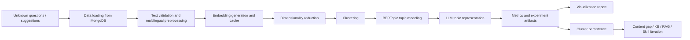

# AI Agent 未知问题聚类与主题发现平台

归档日期：2026-07-07  
项目路径：`/Users/george/workspace/AI/clustering-suggestions`

## 项目定位

面向 AI Agent 客服场景的未知问题聚类与主题发现平台。系统将用户未解决、未命中或低置信度问题，通过 embedding、降维、聚类、BERTopic、LLM 主题命名、质量评估和可视化报告，沉淀为可运营的 content gap 数据，用于知识库补全、RAG 优化、Skill 迭代和客服自动解决率提升。

该项目适合作为 YC 经历下的重点项目之一，定位为企业级 Agent 平台的数据反馈与知识自进化模块，突出从未知问题到 Agent 能力迭代的业务闭环。

## 规模与效果口径

项目在 2025 年进入平台支持阶段。当时平台规模按当前规模的约 50% 折算，对应约 1,000+ 租户、115,000+ 用户、峰值请求约 30,000 次/日。

按 2025 年峰值请求规模折算，平台周请求量约 210,000 次。unknown questions 占比从早期约 30%，逐步下降到约 10%，稳定后约 5%；对应每周处理的 unknown questions 约从 63,000 条下降到 21,000 条，再下降到约 10,500 条。

聚类结果中，约 50% 可进入知识库、RAG 配置或 Skill 迭代；高频主题的运营处理覆盖约 70%。结合 content gap 补全、知识库治理和 Agent 配置迭代，推动客服 Agent 自动解决率提升约 30%。

## 业务背景

在企业客服 Agent 场景中，未解决问题通常以离散会话、失败问法或低置信度检索结果存在。人工逐条查看效率低，难以判断哪些问题具有高频价值、哪些属于同一知识缺口、哪些应进入知识库、流程配置或 Skill 迭代。

该平台将分散的未知问题转化为可分析、可排序、可回放的主题簇，帮助产品、运营和研发团队识别高价值 content gap，并推动知识库、RAG、工具调用和 Agent 流程持续优化。

## 系统架构

核心链路包含：

- FastAPI 任务入口：接收聚类请求，返回 task id，后台执行任务。
- 异步任务管理：任务排队、限流执行、状态流转、失败回调、日志隔离。
- 数据处理：从 MongoDB 获取未知问题，完成清洗、语言检测、关键词抽取和无效问题过滤。
- 表征建模：支持 SentenceTransformer 与 OpenAI-compatible embedding API，兼容阿里云 embedding API。
- 聚类分析：支持 UMAP/PCA/t-SNE 降维，以及 HDBSCAN、KMeans、Agglomerative 聚类。
- 主题生成：基于 BERTopic 与 LLM representation model 生成主题、关键词和摘要。
- 质量评估：输出 Silhouette、Davies-Bouldin、Calinski-Harabasz、DBCV、noise ratio 和 cluster 分布。
- 实验管理：保存配置、日志、CSV、报告、指标和可视化结果。
- 结果回写：聚类结果关联 sourceIds、chatbotId、tenantId，支持运营与平台流程消费。

## 技术亮点

### 1. 生产级未知问题分析流水线

建设从数据拉取、文本清洗、语义向量、降维聚类、主题命名、质量评估到结果回写的完整流水线。系统不仅对问题进行相似性聚合，还将聚类结果转化为可运营的主题、关键词和样例问题，便于知识库与 Agent 配置团队直接使用。

### 2. 多模型 embedding 与缓存机制

抽象 embedding provider，支持本地 SentenceTransformer 与 OpenAI-compatible embedding API。针对阿里云 embedding API 的 batch size、dimensions 和接口限制做适配，并通过内容哈希缓存复用 embedding 结果，降低重复实验与批量任务成本。

### 3. BERTopic 与 LLM 主题表达结合

基于 BERTopic 对聚类结果进行主题建模，并结合 LLM representation model 生成更易读的 cluster topic、keywords 和摘要。相比仅输出 cluster id，该方案更适合业务团队理解和采纳。

### 4. 异步任务队列与资源治理

通过 `AsyncTaskManager` 管理聚类任务状态和执行并发。API 接收请求后立即返回 task id，计算任务在后台执行，并通过串行或限流策略避免多个 embedding、HDBSCAN、BERTopic 任务同时加载模型造成内存压力。

### 5. 多语言文本预处理

构建通用文本清洗能力，覆盖语言检测、Unicode fallback、通用 tokenizer、多语言停用词、关键词抽取、无效问题过滤和人名过滤。该能力适配跨行业、跨语言客服数据，减少噪声输入对聚类质量的影响。

### 6. 聚类质量评估体系

输出 Silhouette、Davies-Bouldin、Calinski-Harabasz、DBCV、noise ratio、cluster 数量、噪声占比和样例问题。系统可对不同 embedding、降维参数、聚类算法和 topic representation 策略进行实验对比。

### 7. 实验管理与可视化

每次任务生成独立 experiment 目录，保存配置、日志、聚类结果、指标、报告和可视化文件。系统提供实验浏览、文件预览、下载、指标卡片、cluster 明细和未知问题统计页面，降低分析结果的使用门槛。

### 8. LLM 使用量与成本统计

封装 OpenAI usage tracking，记录 request count、prompt tokens、completion tokens、total tokens、模型名称和成本估算。该能力支持评估不同 topic representation 策略的质量与成本差异。

### 9. Agent 平台数据反馈闭环

聚类结果可直接服务 content gap 发现、知识库补全、RAG 召回优化、Skill 增补、多租户质量分析和客服自动化率复盘。该项目补齐了 Agent 平台从线上问题案例到知识/流程/Skill 迭代的数据入口。

## 可用于履历的项目表述

### 简历短版

负责 AI Agent 客服未知问题聚类与主题发现平台建设，在约 1,000+ 租户、115,000+ 用户、峰值 30,000 请求/日的阶段规模下，基于 embedding、降维聚类、BERTopic 与 LLM 主题生成，将每周约 10,000+ 至 60,000+ 条 unknown questions 沉淀为可运营的 content gap，服务知识库补全、RAG 优化与 Skill 迭代。

### 简历 bullets

1. 建设 AI Agent 客服未知问题聚类与主题发现平台，支撑约 1,000+ 租户、115,000+ 用户、峰值 30,000 请求/日阶段规模，将每周约 10,000+ 至 60,000+ 条 unknown questions 归并为可分析、可排序、可运营的主题簇。
2. 设计异步聚类任务架构，支持 task id 即时返回、后台限流执行、独立实验目录、webhook 回调、失败重试和日志追踪，解决大模型与聚类任务并发执行的资源治理问题。
3. 构建多语言文本预处理与聚类评估体系，覆盖语言检测、关键词抽取、无效问题过滤、人名过滤、Silhouette、DBCV 和 noise ratio 等指标，提升聚类结果的可解释性与运营可用性。
4. 打通 MongoDB 数据源、聚类结果持久化、可视化报告、实验浏览和 token/cost tracking，推动约 50% 聚类结果进入知识库/RAG/Skill 迭代，高频主题运营处理覆盖约 70%，客服 Agent 自动解决率提升约 30%。

### 项目经历详细版

建设面向多租户 AI Agent 客服场景的未知问题聚类与主题发现平台，在约 1,000+ 租户、115,000+ 用户、峰值 30,000 请求/日的阶段规模下，按 unknown questions 占比从 30% 到 10% 再到 5% 的变化，处理每周约 10,000+ 至 60,000+ 条未知问题。系统从 MongoDB 获取未解决问题，经过多语言清洗、关键词抽取、embedding 表征、降维聚类、BERTopic 主题建模和 LLM topic representation，自动生成主题簇、关键词、样例问题、质量指标和可视化报告。工程上接入 FastAPI、异步任务队列、任务状态管理、实验目录、成本统计、webhook 回调和结果持久化，推动约 50% 聚类结果进入知识库/RAG/Skill 迭代，高频主题运营处理覆盖约 70%，客服 Agent 自动解决率提升约 30%。

## 沟通展开口径

在客服 Agent 场景中，单纯查看线上问题列表很难判断哪些问题值得优先补知识、补流程或补 Skill。因此建设未知问题聚类与主题发现平台，将分散的未解决问题转化为可分析的主题簇。2025 年该模块支撑约 1,000+ 租户、115,000+ 用户、峰值 30,000 请求/日的阶段规模，按 unknown questions 比例变化，每周处理约 10,000+ 至 60,000+ 条未知问题。技术上采用 embedding 表征语义相似度，通过 UMAP/HDBSCAN 完成聚类，再用 BERTopic 和 LLM representation 生成主题名称和关键词。工程上接入 FastAPI、MongoDB、异步任务队列、实验管理、成本统计和可视化报告，支持平台化运行。该模块服务于 Agent 平台的数据反馈闭环，帮助团队发现高频 content gap，并推动知识库、RAG 和 Skill 持续迭代。

## 对高阶岗位的价值

该项目体现了企业级 Agent 平台建设中的三类关键能力：

- 数据反馈闭环：从线上未知问题到 content gap、知识补全和 Agent 能力迭代。
- LLMOps 工程化：任务队列、模型调用、成本统计、实验管理、质量评估和可视化报告。
- 平台集成能力：对接 MongoDB、FastAPI、Webhook、多租户元数据和 Agent 业务流程。

它适合支撑“企业级 Agent 平台架构负责人 / 大模型应用架构专家 / AI FDE 技术负责人”方向，可作为 Agent 平台数据反馈与知识治理能力的一部分呈现。

## 已填充量化口径

- 2025 年平台阶段规模：约 1,000+ 租户、115,000+ 用户、峰值请求约 30,000 次/日。
- 2025 年周请求规模：按峰值折算约 210,000 次/周。
- unknown questions 占比变化：约 30% -> 10% -> 5%。
- 每周 unknown questions 处理量：约 63,000 条 -> 21,000 条 -> 10,500 条。
- 聚类结果进入知识库、RAG 配置或 Skill 迭代比例：约 50%。
- 高频主题运营处理覆盖：约 70%。
- 客服 Agent 自动解决率提升：约 30%。

## 继续完善方向

完善履历时，可继续补充以下数据口径：

1. 覆盖的 chatbot、行业或语种范围。
2. 人工分析时间节省，例如从逐条 review 到批量主题分析的效率提升。
3. embedding cache、batching、任务限流带来的成本、耗时或稳定性收益。
4. 线上任务频率、运营使用方式和报告消费角色。
5. 最佳实验配置，例如 embedding model、降维参数、聚类参数和主要指标。
6. 典型主题簇案例，展示从未知问题发现到知识/Skill 迭代的闭环。

## 可使用项目标题

- AI Agent 未知问题聚类与主题发现平台
- Agent Content Gap Discovery Platform
- AI Agent 客服 content gap 洞察平台
- 面向企业级 Agent 的未知问题分析与知识自进化系统

## 代码阅读参考

- `src/main.py`：FastAPI 应用入口、任务 API、生命周期初始化。
- `src/utils/async_task.py`：异步任务管理、并发控制、webhook 回调和任务清理。
- `src/utils/clustering_task.py`：聚类任务编排、数据加载、预处理、结果保存。
- `src/utils/exec_clustering.py`：embedding、降维、聚类、BERTopic 和结果映射主链路。
- `src/models/embeddings.py`：多 embedding provider、API 调用和缓存。
- `src/models/clustering_manager.py`：聚类算法抽象、HDBSCAN/KMeans/Agglomerative 支持。
- `src/models/topic_modeling.py`：BERTopic 与 LLM representation 集成。
- `src/models/tokes_stats.py`：OpenAI usage 与成本统计。
- `src/evaluation/metrics.py`：聚类质量指标计算。
- `src/api/visualization.py`：可视化报告与未知问题统计页面。
