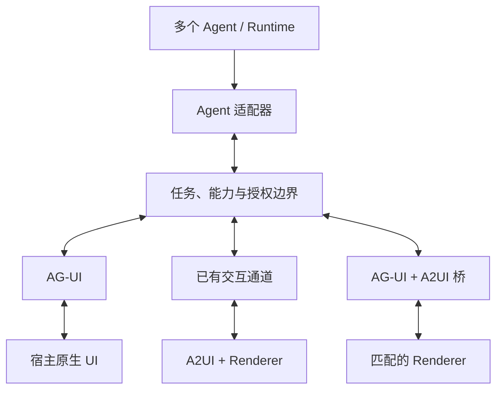
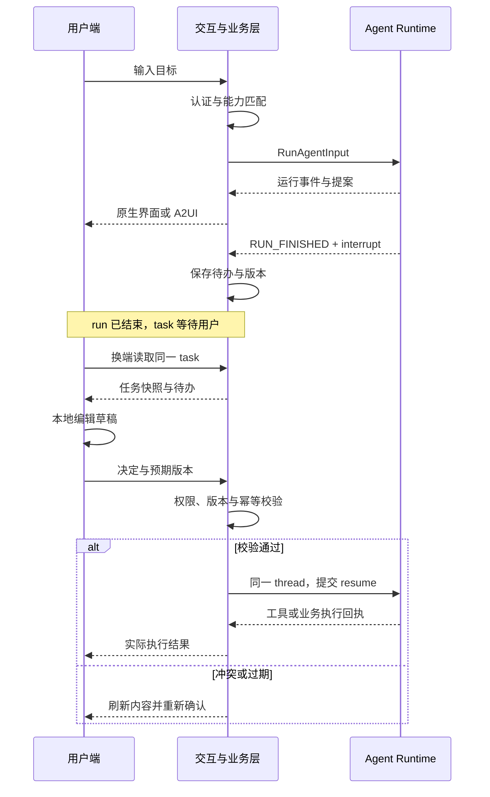

> 通用性不是消除差异，而是把必须共同遵守的约束放在稳定的边界上。AG-UI 标准化交互过程，A2UI 标准化界面表达；真正的互操作性还需要应用补齐能力、状态与授权契约。

## 摘要：先统一交互，再按需统一界面

**针对“一个 UI 接不同 Agent、一个 Agent 接不同 UI/平台”的目标，AG-UI 更适合作为交互接入主干；A2UI 更适合作为可插拔的声明式界面层。它们不是同一层的替代方案。** AG-UI 官方明确区分交互协议与生成式 UI 规范，A2UI 官方也提供了与 AG-UI 组合的接入路径。[S01][s01] [S17][s17]

推荐的最小组合是：**AG-UI + 薄适配层 + 宿主可控组件**。当确实需要 Agent 动态组合表单、结果卡片、选择器与操作面板，并在多个 renderer 上复用时，再增加 A2UI。已经具备成熟交互运行时的系统，也可以直接使用 A2UI，而不必为了渲染 UI 再引入一套 AG-UI 链路。

必须同时避免两个误区：**事件格式统一，不代表所有 Agent 能力等价；界面 JSON 可移植，不代表所有平台都有相同的组件、操作权限和交互方式。** 本文将规范事实、官方实现与架构建议分开讨论，不把候选规范、示例代码或集成名单视作端到端验收结果。

## 1. 比较对象与版本基线

### 1.1 用户提供的两份页面并不处在同一层

AG-UI Introduction 介绍的是 Agent—应用之间的交互协议。A2UI 的 Composer Integration 页面介绍的则是**设计工具如何接入 renderer 预览应用**，不是完整的 Agent 运行时协议说明。[S01][s01] [S03][s03]

Composer 通过 iframe 承载 Renderer Application，并通过 `postMessage` 和桥接库传递内容。这回答的是“设计器如何预览不同 renderer”，不是“生产产品必须使用 iframe”。A2UI 正常的渲染路径，是由宿主选择的 renderer 将声明转换为本地组件。[S03][s03] [S05][s05]

**因此，不能把 Composer 的 iframe 桥接能力，直接拿来与 AG-UI 的运行时互操作能力比较。**

### 1.2 本文采用的证据基线

| 对象 | 官方资料呈现的状态 | 本文如何使用 |
|---|---|---|
| AG-UI | 官方已提供 1.0 迁移说明与 schema-first 规范线；并核对当前概念文档及 A2UI middleware 源码 | 分清规范、兼容层与具体 adapter 行为，不宣称所有 SDK 或集成同时具备全部能力 |
| A2UI v0.9.1 | 官方标注为 Current Production | 解释生产基线；示例明确使用 `v0.9.1` |
| A2UI v1.0 | 官方标注为 Candidate | 单独讨论演进方向，不把候选能力算作现有 renderer 的必备能力 |
| A2UI renderer | 官方矩阵列出 React、Lit、Angular、Flutter 对 v0.9.1 的支持；v1.0 仍列为 Planned | 作为选型线索，不代替具体版本与目标设备的实测 |

以上状态以本次检索的官方页面为准。[S04][s04] [S05][s05] [S20][s20] [S24][s24] AG-UI 的通用概念页、集成指南和实现代码可能处于不同演进阶段；落地时应锁定 SDK、adapter、middleware、renderer、catalog 的**整组版本**，而不只锁定协议名称。

## 2. 两套方案究竟各自统一了什么

### 2.1 AG-UI：统一“交互正在怎样发生”

AG-UI 的核心对象是一次 Agent 运行及其事件流。应用提交 `RunAgentInput`，Agent 返回运行状态、消息、工具调用、共享状态等事件。默认 HTTP 客户端可通过 POST 提交输入，并消费 SSE 或二进制事件流。[S06][s06] [S07][s07] [S23][s23]

它使 UI 不必直接理解每种后端框架的内部事件。例如，前端可以统一展示运行进度、累积文本、工具调用、状态变更和待处理的人类决策，而框架差异收敛在 adapter 内。

但 AG-UI **不是一个完整的可持久化 Agent Runtime，也不是 UI 组件库**。事件能够表达某种能力，不代表后端已经实现相应能力。尤其要区分：

| 协议观察 | 不应据此推断 |
|---|---|
| 收到文本流 | 后端必定支持工具、暂停、恢复或状态同步 |
| 收到 `TOOL_CALL_END` | 外部操作已经成功完成；此时首先意味着工具调用参数序列结束 |
| 收到 `RUN_FINISHED` | 整个业务任务已经完成；它也可能包含 interrupt outcome |
| 连接被客户端中断 | 后台任务、工具执行和外部副作用已全部取消 |

工具结果与 interrupt 的语义需要结合相应生命周期理解；连接中断后的执行处置则要落实到 runtime。[S08][s08] [S09][s09]

### 2.2 A2UI：统一“界面由什么组成，怎样更新”

A2UI 把 UI 结构与数据分开描述。v0.9.1 的核心下行操作为 `createSurface`、`updateComponents`、`updateDataModel`、`deleteSurface`。组件通常以带 ID 的扁平列表描述，通过引用组成结构；renderer 负责还原和更新界面。[S04][s04]

这里的关键价值不是“让模型写一段 JSON”，而是：**Agent 可以表达一个受约束的界面，宿主仍然掌握实际组件实现、主题、交互品质与执行边界。**

同一份组件声明，可以由不同 renderer 映射到不同技术栈；前提是双方理解同一个协议版本和 catalog。`catalogId` 是标识符，不应被当成“允许客户端下载并执行任意远程组件”的授权。[S13][s13]

A2UI 也并非只有单向展示。它定义用户 action、数据绑定和本地函数等机制；但消息如何送达、会话怎样持久化、任务怎样恢复，仍要由承载链路与运行时实现。[S14][s14] [S15][s15] [S16][s16]

### 2.3 最有用的分层认识

| 层 | 回答的问题 | 常见承担者 |
|---|---|---|
| 业务语义 | 用户正在完成什么，哪些动作允许发生？ | 业务模型、工作流、权限系统 |
| 交互过程 | Agent 正在执行、等待、失败还是需要人介入？ | AG-UI + Agent runtime |
| 界面表达 | 应展示哪些组件、数据与可选操作？ | A2UI 或宿主原生 UI |
| 渲染执行 | 用哪些本地控件呈现，怎样处理触摸、键盘与无障碍？ | React / Flutter / 其他宿主 renderer |
| 通道传递 | 数据通过什么网络连接或平台事件传递？ | HTTP、SSE、WebSocket、平台回调 |

这是一种架构分析模型，不是要求增加五个独立服务。对于小系统，这些职责完全可以放在同一应用中，以模块边界隔离。

MCP、A2A 不应与这两者混为一谈：MCP 主要处理 Agent 对工具与数据的接入，A2A 处理 Agent 间协作。它们可以处在后端；AG-UI 面向人机交互，A2UI 面向 UI 声明。采用 AG-UI 并不要求同时引入 A2A，也不要求用 A2UI 替换所有业务页面。[S01][s01] [S02][s02]

## 3. 哪一种通用性更强，哪一种更灵活

“通用”和“灵活”至少要拆成四个维度，否则结论会互相矛盾。

| 维度 | AG-UI | A2UI | 选型判断 |
|---|---|---|---|
| 接不同 Agent 后端 | 统一输入与事件，适配层可屏蔽框架差异 | 只要有生成与承载能力就能输出，但不统一完整执行过程 | **后端交互通用性优先 AG-UI** |
| 同一个 Agent 接不同终端 | 终端可消费同一套交互语义，自行选择呈现方式 | 可复用组件声明，但需要匹配 renderer 与 catalog | **两者互补** |
| 动态组合界面 | 不限定界面 DSL，宿主可以自由定义 | 直接提供声明式组件、绑定、surface 更新机制 | **声明式 UI 复用优先 A2UI** |
| 实现复杂原生体验 | 可调用宿主能力，适合既有编辑器、画布、地图等 | 取决于 catalog 是否包含相应组件及其实现 | **体验上限通常由宿主决定** |
| 扩展自由度 | 开放扩展容易，但私有事件可能损害互操作 | 自定义 catalog 灵活，但需要在目标 renderer 实现 | **自由度增加不自动增加可移植性** |
| 生产可靠性 | 提供交互语义，不替代持久化、授权和故障恢复 | 提供 UI 语义，不替代数据完整性和副作用控制 | **都需要运行时补齐** |

表中结论是基于各自职责的架构判断，而非性能测试评分。[S06][s06] [S12][s12] [S13][s13] [S22][s22]

更准确的结论是：**AG-UI 在“连接谁、怎样交互”上更通用；A2UI 在“同一套声明如何跨 renderer 呈现”上更有针对性。** 如果只选一个来承担多 Agent、多平台接入主干，选 AG-UI；如果现有 runtime 已经解决交互，只缺跨端生成式 UI，则 A2UI 可以单独引入。

## 4. 官方组合路径：已经存在，但仍有实现边界

组合不是纸面构想。A2UI 官方的跨框架指南采用 AG-UI 连接 Agent 与应用；AG-UI 仓库提供 `@ag-ui/a2ui-middleware` 和相应 toolkit。[S17][s17] [S18][s18]

官方实现资料展示了两种生成路径：

| 路径 | 工作方式 | 适合的问题 |
|---|---|---|
| 固定结构 | 后端工具返回 `a2ui_operations`，布局已知，主要更新数据 | 结果列表、审核表单、固定业务面板 |
| 动态结构 | `generate_a2ui` 委托 UI 生成子 Agent，流式产生 `render_a2ui` 参数，经过验证与修复 | 不预先确定布局的组合式界面 |

当前 middleware 会把界面更新包装为 `ACTIVITY_SNAPSHOT`，使用 `activityType: "a2ui-surface"`，并通过合成的 `log_a2ui_event` 工具消息转发用户动作。源码还实现了 building、retrying、failed 等展示状态，使同一界面位置可以呈现生成过程与失败结果。[S18][s18] [S19][s19]

**这些名称属于当前官方 middleware 的集成约定，不是任何 AG-UI 客户端都天然理解的全部 UI 语义。** 不应自行发明 `CUSTOM(name="a2ui")`，然后宣称已获得全生态兼容；也不应假设所有 AG-UI renderer 会识别该 activity payload。

接入时还要防止重复应用 A2UI middleware。框架 adapter、宿主 runtime 和 per-agent middleware 的职责应查清，避免重复工具注入、重复组件输出与重复动作转发。[S18][s18]

版本还存在一处容易踩坑的边界：所读 AG-UI 集成说明仍以 v0.9 形态解释 inline catalog 与 operations，而 A2UI 当前生产文档为 v0.9.1。两者是否被某个 middleware / renderer 版本共同接受，必须核对实际 schema 与实现；本文的 v0.9.1 示例不是对任意已安装 AG-UI 集成版本的即插即用承诺。[S18][s18] [S04][s04]

## 5. 推荐架构：两端适配，中间保持稳定



*三条路径解决不同的已有条件，不是成熟度等级；此图表示建议的逻辑边界，不要求分别部署服务。*

### 5.1 第一条边界：Agent Adapter

UI 面向 AG-UI 交互边界，不直接依赖 LangGraph 节点名、某个 SDK 的 callback 类型或某个 Agent 的私有 checkpoint 格式。

Adapter 应负责输入映射、事件归一化、工具结果关联、中断与恢复映射，以及对能力缺失的明确报告。**只有真实 runtime 可以暂停和恢复时，adapter 才能对外声明相应能力。** 仅把最终文本包装成事件流，不能制造出后端原本没有的语义。

对无法改造的黑盒 Agent，可先接入“文本与最终结果”能力，再逐步增加可验证的交互。对非流式后端可以展示等待状态，但不要伪造运行步骤或尚未发生的工具执行。

### 5.2 第二条边界：Host SDK / Channel Adapter

Web、移动 App、IM 和语音入口不应各自连接所有 Agent。每个平台只实现面向统一交互层的 Host SDK 或 Channel Adapter。

Host 的职责包括：收集语义化用户上下文、展示进度和结果、管理本地表单与编辑草稿、渲染 A2UI、实现允许的宿主工具，以及把用户动作转换为可校验的输入。

IM 平台适配尤其不能等同于“把 A2UI JSON 直接发到群里”。受平台组件和回调约束的通道，可能要转换成平台卡片、消息、选择按钮或可信网页入口。**可以共享业务任务，但未必共享完整组件树。** 这是本文的跨通道设计建议，而不是宣称 A2UI 原生支持所有聊天平台。

多 Agent 同时生成 surface 时，还要维护服务端的 surface 所有者映射。动作返回原始所有者，数据模型只发送给有权读取它的 Agent；不能把所有 surface 的表单值无差别注入每一个子 Agent。A2UI actions 指南已有 surface ownership 与 metadata stripping 的说明，可作为实现依据。[S15][s15]

### 5.3 第三条边界：Interaction Gateway

这里的 Gateway 是逻辑模块，可先实现为 BFF 或服务内模块，不必立即独立部署。

它负责身份与租户绑定、Agent 选择、会话和任务关联、能力解析、授权、动作去重、事件持久化及通道投影。AG-UI 负责其交互表达，但不应被当成这些生产职责的完整实现。

Gateway 还应负责一个特别重要的转换：**把“本次 run 的结束”转换为业务任务的正确状态，而不是把 `RUN_FINISHED` 直接显示为“任务成功”。** 待人审核、已拒绝、已过期、执行失败和已完成应在任务层区分。

### 5.4 第四条边界：可选的 Presentation Adapter

不必要求每一个业务 Agent 都直接理解 A2UI。

更稳妥的方式，是先让 Agent 输出结果对象、输入请求或审批请求，再由呈现适配器决定使用宿主原生组件、A2UI、平台卡片还是语音提问。对常见任务采用确定性模板；只有确需动态组合时才调用专门的 UI 生成模型。

例如业务 Agent 表达的是：

```text
需要审阅一份营销活动草案：
- 展示草案与修改差异
- 允许编辑标题与活动范围
- 确认后执行 campaign.publish
- 执行前必须检查版本与权限
```

而不是：

```text
打开某个 React Modal，再调用某个页面上的组件方法。
```

这样，交互语义不会被绑在某个 UI 技术栈中。同时，原生支持 A2UI 的远程 Agent 仍然可以直接提供界面声明，前提是通过宿主的版本、catalog 和安全校验。

## 6. 真正实现双向解耦，需要补齐四份契约

本节全部是应用层设计建议。优先复用现有 AG-UI / A2UI 语义；只有规范没有覆盖的产品约束才单独定义，避免再造一套庞大的“第三协议”。

### 6.1 能力契约：发现不等于协商，更不等于授权

AG-UI 的 `getCapabilities()` 是可选的能力发现接口；官方明确说明它不承担协商，缺省字段代表未声明。普通 `HttpAgent` 也不会自动拥有一个可查询的统一 discovery endpoint。[S11][s11]

A2UI 并非完全没有能力协商：目录文档定义了客户端广告 `supportedCatalogIds`、可选 inline catalogs，以及 Agent 的目录选择流程。这解决的是“可使用哪些组件与函数”，不自动解决工具授权、任务恢复与跨平台风险策略。应复用已有目录协商，再补充应用层缺失的约束，而不是重造它。[S13][s13]

因此，系统仍然需要应用级能力解析。推荐按以下约束确定本次会话可用的交互：

```text
有效交互能力 =
    Agent 实际实现
  ∩ adapter 已验证支持
  ∩ Host / renderer 能力
  ∩ 当前通道限制
  ∩ 当前用户授权
```

这不是对所有标志位做机械布尔运算。目录版本、schema、输入模态等还需要匹配；缺失声明应视作 unknown，并采用保守回退或拒绝必要操作。

可以定义少量**应用能力包**：基础文本、结构化输入与审批、共享工作区、A2UI surface、实时音视频。它们不是官方命名的标准等级，也不必严格线性继承。某个入口支持语音，不代表它一定支持可编辑表格。

### 6.2 交互契约：跨平台传递意图，而不是页面坐标

一个小而稳定的应用契约，可以围绕 `show_result`、`collect_input`、`request_approval`、`show_diff` 等意图建立。优先把输入请求与审批映射到 AG-UI interrupt，把宿主动作映射到已注册工具。

下面是用于解释设计的 TypeScript 类型，不是 AG-UI 或 A2UI 的标准字段：

```ts
type InteractionRequest = {
  requestId: string;
  taskId: string;
  kind: "collect_input" | "request_approval" | "show_diff";
  title: string;
  schemaRef: string;
  entityRefs: string[];
  expectedRevision: number;
  expiresAt?: string;
  presentationHint?: "form" | "diff" | "selection";
};

type UserDecision = {
  requestId: string;
  actionId: string;
  expectedRevision: number;
  approved: boolean;
  values: Record<string, unknown>;
};
```

这里没有 `actorId` 或权限由客户端自证的设计。操作者身份、租户和授权范围必须从服务端认证上下文取得；请求 ID、版本与动作 ID 也要与服务端记录匹配。

同一个请求，Web 可以是差异面板，App 可以是逐步表单，IM 可以是概要加确认入口。跨端一致的是**用户需要理解和确认的内容**，不一定是像素和控件排列。

### 6.3 状态契约：任务状态独立于某个 Agent 与某个 UI

必须把业务 Task 与 AG-UI 的 thread、run 分开建模。一个任务可能跨多个会话、多个 run，甚至多个 Agent；同一个 thread 也可能承载一个更长期的对话。

推荐记录稳定的业务任务 ID，再维护它与 Agent 线程、运行、通道消息和 surface 的映射。恢复执行所需的领域数据与成果引用不能只放在某个 UI 的内存或某个框架的私有 checkpoint 中。

**“同一 UI 可以切换 Agent”与“执行到一半可无损换 Agent”不是同一个承诺。** 后者涉及消息历史、领域状态、未完成操作、成果、记忆与框架私有执行上下文。应优先保证业务状态和成果可移交；对不可移植的内部执行状态，采用可解释的重新规划或新 run，而不是声称可以任意迁移。

### 6.4 安全契约：显示、建议、审批、执行相互独立

远程 Agent 可以建议界面和操作，但不能通过生成一个按钮就授予自己执行权限。A2UI 的函数与组件实现仍是宿主的受信代码；本地校验只改善体验，不能替代后端数据与权限校验。[S15][s15] [S22][s22]

对于外部副作用，推荐服务端将审批绑定到具体操作、完整参数、资源版本、操作者、有效期和必要的内容摘要。用户确认的内容与最终执行参数不一致时，应重新确认或拒绝执行。

高风险确认最好呈现在宿主控制的可信区域，而不只是任由模型生成的 UI。业务权限、资源可见性与工具授权不应由模型文案或前端传入的 catalog 决定。

## 7. AI-native interaction：不只是聊天框里出现按钮

本文把 AI 原生交互定义为：**用户的自然语言、结构化操作和 Agent 的执行，共同作用于一个可理解、可修正、可恢复的任务。**

### 7.1 意图输入与界面操作使用同一个语义空间

用户可以说“把第二个方案改成更保守的版本”，也可以直接修改方案字段。宿主应提供当前选中对象、可见内容、草稿版本和允许修改的字段，而不只是一个没有上下文的文本串。

“第二个”应由当前视图的语义对象映射解析，不能简单长期绑定列表索引。排序、分页或模型重新生成列表后，旧索引可能对应另一实体。

### 7.2 Agent 先提出可编辑方案，再请求执行

以营销活动发布为例：Agent 生成候选方案，UI 展示内容和差异，用户直接修改标题，或用自然语言补充要求。系统针对修改后的确定版本请求确认，再执行发布。

A2UI 可以承载临时编辑表单；AG-UI 可以承载运行状态和中断恢复。二者的组合价值是连接“看见—修改—决定—继续执行”，而不是把最终文字包装成更漂亮的卡片。[S09][s09] [S14][s14]

### 7.3 本地交互不应该每次都调用模型

A2UI 的输入绑定先写入本地数据模型，用户 action 触发时再携带相关上下文；本地函数也可以不经过 Agent 往返。[S14][s14] [S15][s15]

建议将光标、聚焦、展开折叠、输入校验与拖拽等高频确定性交互留在宿主。需要解释意图、重新规划、补充内容或跨工具执行时再进入 Agent。这样既降低延迟，也避免让模型的非确定性进入每一次 UI 操作。

### 7.4 可打断、可纠正，必须有真实执行语义

默认 HTTP 请求加事件流，不等同于一条永久双工控制连接。[S23][s23] 运行中调整目标、取消后台工作、恢复断线后的任务，需要 runtime 的实际支持。

可按 runtime 能力选择：在安全边界检查新指令、显式 interrupt 后恢复，或者由受控控制通道传递取消与转向请求。客户端的停止按钮必须区分“停止接收”“已请求取消”“执行已停止”，尤其是已经开始产生外部副作用的工具。

### 7.5 实时语音与视频需要额外的媒体链路

AG-UI 当前能力模型能声明不同方向的多模态输入输出，但这种声明不等于低延迟音视频会话、回声消除、打断播放和同步机制的完整实现。[S11][s11]

建议把实时媒体连接作为独立能力，与交互状态和任务标识关联。语音可以输入意图、读取当前任务和确认决策，但不能因为协议支持音频类型，就承诺所有 Agent、通道都能无缝实时对话。

## 8. 状态同步：最容易被低估的工程难点

| 状态 | 内容 | 建议的权威来源 |
|---|---|---|
| Agent 私有执行状态 | 框架 checkpoint、内部控制流、不可公开信息 | Agent runtime |
| 领域权威状态 | 已保存草案、实际资源版本、操作结果 | 业务服务 / 数据库 |
| 共享任务投影 | 进度、待审批项、可公开中间结果 | 服务端事件与任务状态 |
| UI 本地草稿 | 未提交表单、选中项、焦点、暂存编辑 | 当前 Host / renderer |

AG-UI 使用 snapshot 和 JSON Patch 表达共享状态更新，但冲突策略仍需要应用实现。[S10][s10] A2UI 的数据模型则与具体 surface 和数据绑定相关。[S14][s14] **它们不应该天然成为同一个无边界的大对象，也不应把两者的更新消息交给同一个无差别 patch handler。**

典型冲突是：用户正在改标题，Agent 同时更新整份数据，用户输入被覆盖。推荐为领域对象附加 revision，在提交时校验基线；对用户正在编辑的字段保留 dirty 状态，服务端变更先作为可比较的更新，而非无条件覆盖。真正需要多人并发编辑时，再引入适合该领域的合并算法。

另一个问题是“全量 UI 状态回传”。A2UI 的 `sendDataModel` 可要求随消息回传 surface 数据。[S04][s04] 因此，surface 里不应混放密码、令牌、其他租户数据或不应进入 Agent 上下文的信息。应按用途拆分数据与 surface，避免为了同步便利而扩大数据暴露。

## 9. 完整交互时序：从生成表单到恢复任务

以下是建议的端到端流程，不是单个协议自动提供的全部能力：



*换端恢复的是任务与待办，不是旧设备的组件实例；上图的交互层与业务层合并为一个逻辑参与者。*

AG-UI 当前 interrupt 文档使用 `RUN_FINISHED.outcome.type = "interrupt"`，下一次请求通过 `resume[]` 回应对应 interrupt；文档还要求覆盖上一轮全部待处理 interrupt。[S09][s09] 因此，多审批人的异步独立审批不能只靠 UI 各自提交一个不完整 resume：应用需要先聚合结果，或合理拆分业务任务与交互线程。

### 一个版本明确的 A2UI 表单片段

以下是面向 Basic catalog 的说明性示例。为阅读方便，将三条独立消息排版为 JSON 数组；真正使用 JSONL 传输时，每个数组元素单独序列化为一行。这里只检查了 JSON 语法、组件 ID 与引用关系，没有执行完整协议 schema 校验或端到端运行。[S04][s04] [S14][s14]

<details>
<summary>展开：三条 A2UI 消息与表单组件定义</summary>

```json
[
  {
    "version": "v0.9.1",
    "createSurface": {
      "surfaceId": "review-17",
      "catalogId": "https://a2ui.org/specification/v0_9_1/catalogs/basic/catalog.json"
    }
  },
  {
    "version": "v0.9.1",
    "updateDataModel": {
      "surfaceId": "review-17",
      "path": "/",
      "value": {
        "draft": {
          "id": "draft-17",
          "headline": "秋季活动方案",
          "revision": 7
        }
      }
    }
  },
  {
    "version": "v0.9.1",
    "updateComponents": {
      "surfaceId": "review-17",
      "components": [
        {
          "id": "root",
          "component": "Column",
          "children": [
            "heading",
            "headline",
            "submit"
          ]
        },
        {
          "id": "heading",
          "component": "Text",
          "text": "审阅活动草案"
        },
        {
          "id": "headline",
          "component": "TextField",
          "label": "活动标题",
          "value": {
            "path": "/draft/headline"
          }
        },
        {
          "id": "submit-label",
          "component": "Text",
          "text": "提交审核意见"
        },
        {
          "id": "submit",
          "component": "Button",
          "child": "submit-label",
          "action": {
            "event": {
              "name": "review.submit",
              "context": {
                "draftId": {
                  "path": "/draft/id"
                },
                "headline": {
                  "path": "/draft/headline"
                },
                "expectedRevision": {
                  "path": "/draft/revision"
                }
              }
            }
          }
        }
      ]
    }
  }
]
```

</details>

在系统实现里，`review.submit` 不直接等于 `campaign.publish`。Gateway 应把它绑定到服务端创建的审核请求，确认用户所提交的版本，并经授权与状态机决定是否执行后续操作。动态生成的 action 名称不是调用任意后端函数的入口。

## 10. 跨平台不应退化为“所有端只剩文本”

建议采用“核心任务语义一致，增强体验按能力提供”的方式，而不是把所有客户端限制到最低公共界面。

| 用户目标 | 富 Web / App | 受限消息通道 | 纯语音入口 |
|---|---|---|---|
| 看结果 | 原生图表、列表、可选 A2UI | 摘要、平台卡片、受控详情入口 | 先讲核心结论，按需展开 |
| 补充信息 | 表单、选择器、内联编辑 | 支持时使用原生表单，否则分步提问 | 分步询问并复述关键字段 |
| 审阅差异 | Diff 面板与编辑区 | 精简变化概要，复杂内容转可信页面 | 只处理能被充分表达的变更 |
| 确认执行 | 可信审批面板 | 已认证的平台交互或可信审批入口 | 满足身份及风险策略才接受，否则换端 |
| 看进度 | 流式 activity、任务列表 | 聚合通知，避免逐 token 刷屏 | 简短状态播报 |

上表是产品与系统设计建议，不是各平台的现成能力清单。**安全语义不可静默降级。** 一个不能完整展示重要差异或不能可靠绑定身份的入口，可以展示任务，但不应因为“要通用”而接受不充分的审批。

## 11. 安全、恢复与重放：决定系统能否进入生产

### 11.1 声明式 UI 降低攻击面，但不是自动安全

需要同时校验消息结构、catalog 与组件、数据绑定、动作白名单、资源权限和外部 URL。可信 renderer 也可能实现打开链接、加载图片或调用宿主能力；这些功能要经过独立的来源与权限策略。[S13][s13] [S15][s15] [S22][s22]

建议对资源加载采用允许列表或受控代理，并限制数据 URI、危险 URL scheme 和资源体积。处理 renderer 的原型属性、递归结构、过深嵌套和过量组件时，也要有安全边界。具体策略应由宿主实施，而不是只写在模型 prompt 里。

### 11.2 恢复显示与重放副作用必须分开

AG-UI 提供面向历史恢复的事件序列化与压缩机制；这仍不同于持久化业务命令或迁移框架执行栈。[S25][s25]

重放事件可用于恢复界面，但不应再次执行发邮件、发布活动或修改资源等工具。显示逻辑消费投影；命令逻辑经过授权与去重后才执行。

建议为动作建立服务端持久化记录，结合事务、outbox 或外部服务提供的幂等键控制重复副作用。**不要把客户端生成一个 UUID，等同于获得分布式 exactly-once。** 对无法幂等的外部操作，需要结果核查与补偿策略。

### 11.3 断线恢复至少要知道恢复什么

应区分文本流恢复、surface 恢复、待审批请求恢复和业务任务恢复。它们需要的信息并不相同。

推荐持久化稳定任务状态、必要事件位置、surface 版本及未完成交互；重新进入时先取得一致快照，再接续增量。传输协议可表达更新，但日志、保留策略、快照和重连 API 仍需要选定实现并验证。

## 12. 表达能力、性能与成本的取舍

### 12.1 不要让模型负责本来确定的 UI

对于固定审批页，直接维护模板、schema 和数据绑定通常更可控。对于临时组合问题，再使用 A2UI 动态生成。官方 AG-UI 集成也区分固定与动态 schema 两条路径。[S18][s18]

可用一个设计成本模型比较：

```text
总成本 = 任务推理成本 + UI 生成与修复成本
       + 传输与渲染成本 + adapter 维护成本
       + 多 renderer / catalog 兼容与验收成本
```

这不是测量结果，而是提醒：协议统一减少重复接线，却可能增加版本管理和一致性测试成本。

### 12.2 Catalog 的粒度决定生成负担和迁移负担

只有 `Row`、`Column`、`Text` 等低层组件时，模型需要描述更长结构；如果全部是高度定制业务组件，则新平台需要实现更多专用控件。

建议保留一组基础组件，加少量高价值领域组件，例如 `DiffReview`、`EntitySelector`、`ApprovalSummary`。先定义可访问性、输入输出和动作语义，再在不同 renderer 实现视觉细节。不要把 catalog 做成服务端驱动的任意应用操作系统。

### 12.3 “N×M 变 N+M”只在接线层近似成立

有 N 个 Agent、M 个 UI 时，统一边界可以让适配模块数量接近 N+M；但这以公共语义确实成立为前提。

跨 Agent、跨平台、跨版本的行为验证仍覆盖组合；自定义组件还会引入 catalog × renderer 的实现工作。**减少的是重复协议接线，不是取消了互操作验证。**

### 12.4 流式体验要保护稳定性

建议优先保证完整消息边界、稳定组件 ID、焦点不丢失、输入不被重置、加载失败可理解以及无障碍播报不过量。部分 JSON 到达时可以显示安全的 pending 状态，但不能把未经验证的未完成操作开放为真实执行入口。

可观测指标应包括首个有意义内容、首个可操作界面、动作往返耗时、生成失败率、修复次数、恢复成功率和重复副作用数。本次没有进行跨 renderer 性能基准测试，因此不给出未经测量的性能排名。

## 13. A2UI v1.0 会改变什么，不会改变什么

候选版的重要变化包括：同一 surface 混合 catalog、更加明确的组件/函数来源解析、双向函数调用相关消息，以及函数调用者与用户激活条件等约束。演进指南还涉及 MIME type 和数据删除语义的变化，不能只替换消息里的版本字符串。[S20][s20] [S21][s21]

这表明 A2UI 在从“渲染声明”向更丰富的交互表达扩展。因此，不能永远把它描述成“只能展示卡片”。

但这些变化仍不会自动提供业务任务持久化、跨 Agent checkpoint 迁移、统一身份授权或任意平台的等价体验。随着 A2UI 的动作能力增强，更需要避免 AG-UI 工具层与 A2UI 函数层对同一副作用拥有两个执行入口。

**建议为一个业务动作保留唯一的授权与执行路径，其他协议入口只做映射。** 例如 UI action、语音确认和宿主工具调用都归一到同一个业务命令处理器。

## 14. 可执行的落地顺序与验收标准

### 14.1 第一阶段：证明 Agent 可替换

先做同一个 UI 接两个执行机制不同的 Agent，覆盖文本、进度、工具结果、错误和一个人类输入请求。UI 不得包含框架私有判断；能力不支持时明确降级或拒绝。

不要把“换了模型名称”当成完成多 Agent 适配。模型 API 更换与 Agent runtime 更换，是两个不同层次的问题。

### 14.2 第二阶段：证明终端可替换

为同一任务增加第二个终端。重点不是复制视觉效果，而是验证在新终端能读取当前任务、看到未完成请求、提交编辑或决策，并保持资源版本和权限正确。

建议至少选择一个富界面与一个受限通道，尽早暴露平台差异，而不是只比较两个相似的 Web 页面。

### 14.3 第三阶段：加入有限的生成式界面

先接固定结构的 A2UI surface，再开放受控 catalog 内的动态组合。保持原生关键工作区不变；用 A2UI 补充临时结果、表单和选择界面。

同时锁定 adapter、middleware、renderer、协议、catalog 版本，完成 action 回传与失败恢复，再逐步扩大 catalog。官方示例是起点，不是最终验收。[S17][s17] [S18][s18]

### 14.4 最小互操作验收矩阵

| 场景 | 必须观察到的结果 |
|---|---|
| 同一 UI 换 Agent | 前端无需增加框架私有分支；能力差异被准确声明 |
| 同一任务换端 | 可恢复业务状态与未完成请求；不是新开一个无关任务 |
| 未知组件或 catalog | 明确报错或安全回退，不出现无说明白屏 |
| 用户编辑期间后台更新 | 输入不被静默覆盖，版本冲突可处理 |
| 生成失败与修复耗尽 | 有明确失败状态及可继续路径 |
| 重复点击 / 重复投递 | 不重复产生业务副作用 |
| 审批过期 / 参数变化 | 旧审批不能继续执行新内容 |
| 断线重连与事件重放 | 恢复显示，不重新执行已完成命令 |
| 多 Agent / 多 surface | 标识与动作路由不串线 |
| 取消运行 | 能区分停止接收、取消请求与真实执行停止 |
| 无障碍 / 移动输入 | 焦点、读屏、键盘与触摸行为可用 |
| 不支持必要安全能力的通道 | 拒绝该操作或转可信入口，不静默弱化审批 |

这些是建议的验收项。本次完成了官方资料与选定 middleware 源码分析，**没有运行上述跨 Agent、跨终端的系统级测试**。

## 15. 最终选型建议

| 现状与目标 | 推荐方案 |
|---|---|
| 已有成熟业务 UI，希望接不同 Agent | AG-UI + adapter + 宿主原生组件，先不引入 A2UI |
| 同一 Agent 要进入 Web、App、消息平台 | AG-UI 主干 + Channel Adapter + 业务任务与授权层 |
| 希望 Agent 动态生成跨 renderer 表单和面板 | 在上述基础上增加 A2UI、版本化 catalog 与验证链 |
| 已有可靠交互 runtime，只缺声明式 UI | 可单独接 A2UI，复用既有传输与任务机制 |
| 编辑器、地图、画布或其他复杂工作区 | 保留宿主原生能力，Agent 通过语义工具操作；A2UI 作为补充 |
| 需要完整、任意的远程交互应用 | 单独评估受控应用嵌入与沙箱边界，不将其等同于 A2UI 组件声明 |

**核心结论：用 AG-UI 解耦交互，用 A2UI 解耦界面表达，用业务任务、能力和授权契约保证二者可以安全组合。**

最应优先验证的不是“模型能生成多漂亮的 UI”，而是：**换一个 Agent、换一个平台、断一次连接、改一次参数之后，同一项工作是否仍然被准确理解、安全推进，并交付可核验的结果。**

## 参考资料

检索核对日期：2026-09-24。以下均为官方文档或维护者仓库；S18、S19 固定到本次阅读的提交 `e62b348680c41f52a5ea0ed4eb714a6600066fa1`，其余文档链接可能随版本演进。引用表示对职责和实现的依据，不代表已完成其生产性能与安全认证。

| 编号 | 官方资料 | 本文使用范围 |
|---|---|---|
| S01 | [AG-UI Introduction][s01] | 协议定位与生态边界 |
| S02 | [A2UI：How Does A2UI Compare?][s02] | UI 协议的层次定位 |
| S03 | [A2UI Composer Integration][s03] | iframe / postMessage 预览桥接 |
| S04 | [A2UI v0.9.1 Protocol][s04] | 当前版本、消息与数据模型边界 |
| S05 | [A2UI Renderers][s05] | 维护 renderer 与版本支持矩阵 |
| S06 | [AG-UI Core Architecture][s06] | 运行输入、事件与传输 |
| S07 | [AG-UI Core Types][s07] | RunAgentInput 等类型 |
| S08 | [AG-UI Tools][s08] | 客户端工具与工具结果生命周期 |
| S09 | [AG-UI Interrupts][s09] | interrupt、resume 与集成差异 |
| S10 | [AG-UI State Management][s10] | snapshot、JSON Patch 与冲突处理 |
| S11 | [AG-UI Capabilities][s11] | 可选发现、无自动协商与能力类别 |
| S12 | [AG-UI Generative UI][s12] | 交互协议与 UI 规范的区别 |
| S13 | [A2UI Catalogs][s13] | 目录、扩展与匹配 |
| S14 | [A2UI Data Binding][s14] | 结构与数据分离、本地绑定 |
| S15 | [A2UI Actions][s15] | action、本地函数与校验边界 |
| S16 | [A2UI Transports][s16] | 传输独立性 |
| S17 | [A2UI with Any Agent Framework][s17] | 官方跨框架组合路径 |
| S18 | [AG-UI A2UI Runtime and Renderer Wiring][s18] | middleware、固定与动态结构 |
| S19 | [A2UIMiddleware 源码][s19] | activity 包装、生成状态与处理入口 |
| S20 | [A2UI v1.0 Candidate][s20] | 候选规范范围 |
| S21 | [A2UI v1.0 Evolution Guide][s21] | 混合目录、函数与迁移差异 |
| S22 | [A2UI Renderer Development][s22] | renderer 职责与实现边界 |
| S23 | [AG-UI HttpAgent][s23] | HTTP 客户端与传输形态 |
| S24 | [AG-UI Migrating to 1.0][s24] | schema-first 规范线与兼容边界 |
| S25 | [AG-UI Serialization][s25] | 事件序列化、历史恢复与压缩 |

[s01]: https://docs.ag-ui.com/introduction
[s02]: https://a2ui.org/introduction/agent-ui-ecosystem/
[s03]: https://a2ui.org/composer/composer_renderer_integration/
[s04]: https://a2ui.org/specification/v0.9.1-a2ui/
[s05]: https://a2ui.org/reference/renderers/
[s06]: https://docs.ag-ui.com/concepts/architecture
[s07]: https://docs.ag-ui.com/sdk/js/core/types
[s08]: https://docs.ag-ui.com/concepts/tools
[s09]: https://docs.ag-ui.com/concepts/interrupts
[s10]: https://docs.ag-ui.com/concepts/state
[s11]: https://docs.ag-ui.com/concepts/capabilities
[s12]: https://docs.ag-ui.com/concepts/generative-ui-specs
[s13]: https://a2ui.org/concepts/catalogs/
[s14]: https://a2ui.org/concepts/data-binding/
[s15]: https://a2ui.org/concepts/actions/
[s16]: https://a2ui.org/concepts/transports/
[s17]: https://a2ui.org/guides/a2ui-with-any-agent-framework/
[s18]: https://github.com/ag-ui-protocol/ag-ui/blob/e62b348680c41f52a5ea0ed4eb714a6600066fa1/skills/ag-ui-a2ui-integration/references/a2ui-runtime-and-renderer.md
[s19]: https://github.com/ag-ui-protocol/ag-ui/blob/e62b348680c41f52a5ea0ed4eb714a6600066fa1/middlewares/a2ui-middleware/src/index.ts
[s20]: https://a2ui.org/specification/v1.0-a2ui/
[s21]: https://a2ui.org/specification/v1.0-evolution-guide/
[s22]: https://a2ui.org/guides/renderer-development/
[s23]: https://docs.ag-ui.com/sdk/js/client/http-agent

[s24]: https://docs.ag-ui.com/migrating-to-1-0
[s25]: https://docs.ag-ui.com/concepts/serialization
