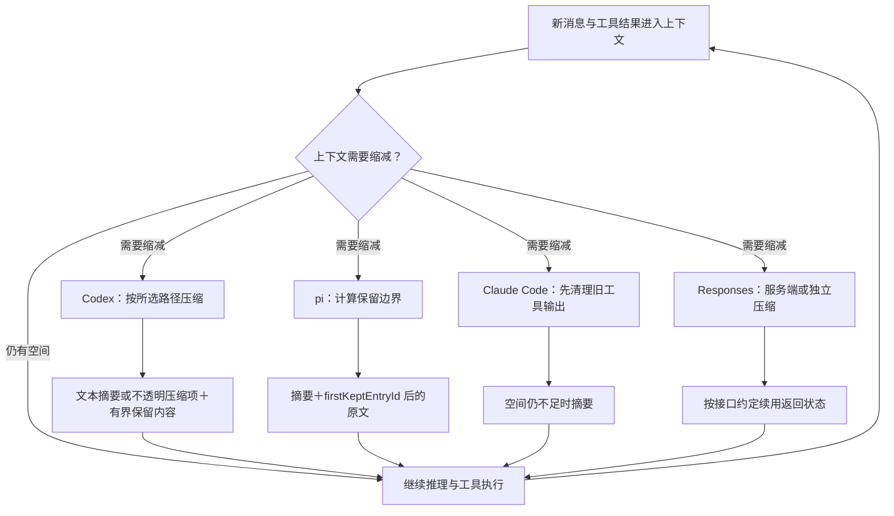
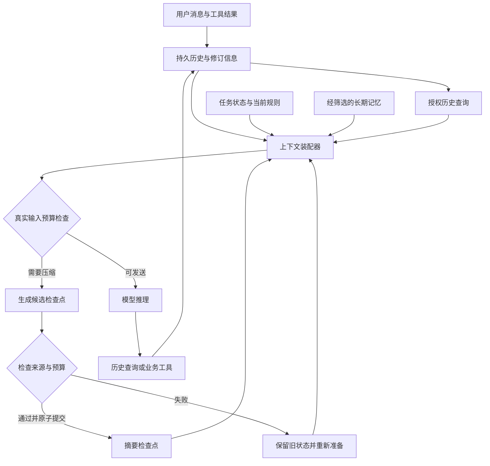

**让 Agent 连续工作，关键是保存可恢复的历史，并为每次推理构建合适的上下文。** 摘要负责概括旧进展，近期原文保留正在处理的细节，历史查询负责找回证据，长期记忆负责跨任务复用。四者各有职责。

本文比较 Codex、OpenAI Responses、pi、Claude Code、ChatGPT 和 Meta Muse，随后给出一套可落地的参考架构。资料核对日期为 **2026-10-10**；源码分析固定到文中列出的提交。产品功能与不同版本可能继续变化。

## 先区分：压缩、裁剪、检索和记忆

“聊天记录还在”和“模型这次看到了全部聊天记录”是两件事。理解上下文管理，可以先把系统拆成四层：

| 层次 | 保存或处理什么 | 使用方式 |
| --- | --- | --- |
| 原始历史 | 用户消息、Agent 回复、工具调用与结果、附件引用、修订信息 | 在授权和保留期内提供原文回查与恢复 |
| 工作上下文 | 当前规则、任务状态、摘要、近期原文、检索片段 | 本次实际送入模型，有明确 token 预算 |
| 长期记忆 | 经筛选的偏好、稳定事实、经验和项目知识 | 按作用域、时效和当前任务选择载入 |
| 执行状态 | 已提交的操作、任务进度、回调状态、幂等键 | 由程序维护，保障任务恢复与正确执行 |

下面是已公开压缩机制的简化对照。图中各路径是不同实现，不能直接组合成某一产品的真实内部流程；ChatGPT 和 Muse 没有足够公开信息支持绘制其压缩算法。



这几个概念会产生不同效果：

- **裁剪**直接把某些内容移出工作上下文，例如仅保留最近 N 轮。若没有摘要或回查，旧信息就无法参与当前推理。
- **摘要压缩**把旧内容转成更短的状态描述。它可以保留任务进展，但属于有损表达。
- **检索**从历史或外部资料中按需补入片段。它保留取回精确证据的机会，也增加查询延迟和选择难度。
- **长期记忆**提炼可以跨任务复用的信息，需要纠错、更新和删除机制。
- **Prompt cache**复用相同前缀的计算。它影响成本和延迟；缓存命中内容仍占本次上下文空间。

最后一项容易混淆。OpenAI 对 Codex 的工程说明强调保持工具与前缀的稳定顺序以提高缓存命中，同时另行通过压缩管理上下文窗口。这是两种资源管理。[Codex agent loop](https://openai.com/index/unrolling-the-codex-agent-loop/)

## 六种实践：机制、状态和设计取舍

### Codex：阈值触发，但压缩路径有区别

Codex 配置提供 `model_auto_compact_token_limit`，未显式设置时使用模型默认值。当前参考文档还区分整个输入与携带前缀之后的增长量作为阈值统计范围。因此，不能把某个固定 token 数或窗口比例视为所有 Codex 会话的通用默认值。[配置参考](https://learn.chatgpt.com/docs/config-file/config-reference)

分析固定到 [openai/codex 提交 806d973](https://github.com/openai/codex/commit/806d9732c974bc8a51b8317c1bd8985544fe627c)。其中至少有三种不同语义：

| 代码路径 | 如何缩减 | 阅读代码时应注意 |
| --- | --- | --- |
| 本地 `compact.rs` | 生成文本摘要，并重建有界历史 | 保留的用户原文不等于完整的最近若干轮 |
| 远端 `compact_remote_v2.rs` | 获取压缩项，再按客户端规则保留部分消息、重建上下文 | 保留形态受预算与功能开关影响 |
| `compact_token_budget.rs` | 按 token 预算开启新上下文窗口 | 此路径跳过模型摘要，不能仅凭“compaction”名称推断行为 |

本地实现为保留的用户消息文本设置 **20,000 token** 上限，从较新的消息向前选择；必要时截断选中范围中较旧的文本。摘要成功后才替换活动历史，并记录来源信息、重算用量、重新加入当前上下文。压缩请求自身超限时，也存在移除候选历史最旧项后重试的处理。这说明它有明确的容量约束，不能据此宣称任意长历史都被无损覆盖。[本地压缩源码](https://github.com/openai/codex/blob/806d9732c974bc8a51b8317c1bd8985544fe627c/codex-rs/core/src/compact.rs)

远端 v2 路径在该提交中使用 **64,000 token 的保留消息预算**，过滤消息后追加新的压缩项，并重新构建当前运行上下文。这个数是特定实现的保留预算，不是模型窗口大小，也不是所有客户端的统一阈值。[远端 v2 源码](https://github.com/openai/codex/blob/806d9732c974bc8a51b8317c1bd8985544fe627c/codex-rs/core/src/compact_remote_v2.rs)

另一个预算策略直接启动新窗口，仍执行压缩生命周期钩子，却跳过模型和服务端摘要。部署时需要确认实际选择的策略。[预算策略源码](https://github.com/openai/codex/blob/806d9732c974bc8a51b8317c1bd8985544fe627c/codex-rs/core/src/compact_token_budget.rs)

**工程启发：**将“何时触发”“怎样缩减”“保留什么”“如何提交新状态”分开设计。模型支持原生压缩时，可以使用其能力；应用仍应掌握自己的历史、任务状态与恢复边界。

### OpenAI Responses：压缩状态成为 API 协议的一部分

Responses 官方公开了两种使用方式。共同点是返回不透明、加密的压缩项；应用不能把它当成可编辑的 Markdown 摘要，也不能从字段外观推断内部编码。

| 方式 | 触发与输入 | 续聊规则 |
| --- | --- | --- |
| 服务端压缩 | `context_management` 中配置 `compact_threshold`，按渲染后的 token 量触发 | 无状态模式保留返回项；可清理最新压缩项之前的历史 |
| 使用 `previous_response_id` 的服务端模式 | 服务管理上下文状态 | 传新输入，按文档约定由服务管理历史 |
| 独立 `/responses/compact` | 显式提交当前窗口；输入仍必须放得进模型窗口 | 将返回的完整新窗口原样作为后续输入基础，再追加新内容 |

独立接口返回值可能还包含保留消息，因此“只拿压缩项、丢掉其他返回项”并不是通用的正确接法。也不能一直等到历史已经超过可接受输入上限才首次压缩。[Responses compaction 文档](https://developers.openai.com/api/docs/guides/compaction)

**工程启发：**Provider 的返回窗口应由独立适配层处理。跨模型迁移时保留可读历史和应用任务状态，不把某个 Provider 的不透明状态当作唯一恢复来源。

OpenAI Agents SDK Cookbook 还给出了轮次裁剪与“摘要＋最近 N 轮”的参考示例。这些示例展示应用侧策略，并非 ChatGPT 的生产实现。固定轮数适合解释边界，实际容量仍应按渲染后的 token 量判断。[Session memory 示例](https://developers.openai.com/cookbook/examples/agents_sdk/session_memory)

### pi：摘要与原文保留边界一起持久化

pi 的实现提供了清晰的状态模型。分析固定到 [earendil-works/pi 提交 42a3497](https://github.com/earendil-works/pi/commit/42a3497d03ad17e308a2299fa824727894f2c0ec)。

其默认自动压缩条件为：

```text
contextTokens > contextWindow - reserveTokens
reserveTokens = 16,384
keepRecentTokens = 20,000
```

这些值是该版本默认设置，可以调整；`keepRecentTokens` 以 token 为单位。它从近期内容向前寻找保留边界，通常按用户轮次切分；单轮过大时可以在合适的 assistant 边界拆分，同时避免拆散工具调用与对应结果。[pi 压缩文档](https://github.com/earendil-works/pi/blob/42a3497d03ad17e308a2299fa824727894f2c0ec/packages/coding-agent/docs/compaction.md)

关键状态是 `CompactionEntry`：包括摘要、`firstKeptEntryId`、压缩前 token 量和相关元数据。Session 采用追加式 JSONL 与父子 entry 关系；上下文投影读取压缩状态，将摘要与保留边界之后的消息组合起来。原始记录与实际模型输入由此分开。[Session manager 源码](https://github.com/earendil-works/pi/blob/42a3497d03ad17e308a2299fa824727894f2c0ec/packages/coding-agent/src/core/session-manager.ts)

后续压缩会使用已有摘要与此前未覆盖的前缀。源码也根据上下文编辑后的投影校正估计，避免继续沿用已过时的 usage。与此同时，启发式 token 估算、摘要前工具结果截短等处理仍可能损失精度；保存边界并不保证摘要记住所有语义。[Compaction 源码](https://github.com/earendil-works/pi/blob/42a3497d03ad17e308a2299fa824727894f2c0ec/packages/coding-agent/src/core/compaction/compaction.ts)

**工程启发：**摘要正文和覆盖位置必须组成同一个检查点。重启后才能确定哪些历史已经被表示、哪些原文仍需载入。分支切换的摘要则需要额外记录分支关系，不能当作普通线性会话压缩。

### Claude Code：先降低噪声，再压缩，持久规则独立加载

官方说明中，Claude Code 接近上下文限制时先清理较旧的工具输出，必要时再摘要。可用 `/compact` 指定重点；早期仅存在于聊天中的细节可能在摘要中丢失。单次巨大输入导致反复压缩仍无空间时，系统会停止这种循环并报告问题。[Claude Code 工作机制](https://code.claude.com/docs/en/how-claude-code-works)

持久信息另有入口：项目根目录 `CLAUDE.md` 在压缩后重新读取并注入；auto memory 通过简短 `MEMORY.md` 索引和按需读取的主题文件组织。当前文档规定启动时读取索引前 **200 行或 25KB，以先达到者为准**。这些文件提供上下文，严格的执行限制仍需代码或钩子实施。[Claude Code memory](https://code.claude.com/docs/en/memory)

Anthropic 的工程文章将压缩、结构化笔记和按需检索视为互补方法，建议先检查摘要对关键信息的召回，再优化简洁程度。[Effective context engineering](https://www.anthropic.com/engineering/effective-context-engineering-for-ai-agents)

**工程启发：**重复文件、完整日志和失效工具输出不必持续占据工作上下文。长期规则、任务状态与历史摘要也需要独立来源，避免所有信息都依赖一次摘要生成。

### ChatGPT：公开记忆能力，压缩算法仍缺少证据

ChatGPT 官方说明记忆可利用保存的信息和过往聊天，但不会保留每一个细节；用户可以查看、纠正和删除记忆。删除聊天与删除已保存记忆也需要分别处理。

这些资料没有足够细节确认同一聊天内的压缩阈值、保留窗口和摘要淘汰算法。不能由 ChatGPT Memory 推断它采用 pi 的边界策略，或直接套用 Responses 的内部状态格式。[Memory in ChatGPT](https://help.openai.com/en/articles/8590148-memory-in-chatgpt)

**工程启发：**面向用户的“记住”需要可解释、可纠正和可删除。界面显示完整聊天记录，也不意味着每次模型推理读取全部原文。

### Meta Muse：持久文件与长期工作空间，压缩细节未公开

Meta Muse 的公开设计强调主对话、侧对话，以及可以跨聊天使用、由用户查看和编辑的记忆文件。它公开了连续交互的产品方向，但没有给出可核实的 token 阈值、摘要结构或原文保留算法。[How We Designed Muse](https://introducing.muse.ai/)

Meta 的安全架构说明进一步披露专属隔离 Linux 环境，并将该虚拟机视为记录系统；用户可以检查、编辑或下载记忆与其他文件。这能支持对持久状态和运行隔离的分析，不能作为压缩准确率的证据。[Meta Muse 安全架构](https://research.meta.ai/blog/security-and-safety-for-ai-agents-our-approach-with-muse)

**工程启发：**长期 Agent 的可靠性越来越依赖可检查的外部工作空间。对话是入口，文件、任务状态和记忆共同承载连续工作。

## 已知效果：有收益证据，缺少统一排名依据

上述资料能说明实现与设计取舍，但没有提供这六种实践在同一模型、任务集和预算下的可比较成绩。不能据此判断哪款产品“最不丢上下文”。

Anthropic 在 **2025-09-29** 发布的 Claude Developer Platform 评估称：

| 官方实验 | 报告结果 | 解读范围 |
| --- | --- | --- |
| 内部 agentic search 评估：记忆工具＋context editing | 相对基线性能提升 39% | 两种能力组合的结果 |
| 同类评估：仅 context editing | 提升 29% | 清理旧工具上下文也可能有收益 |
| 100 轮网页搜索评估 | token 消耗降低 84%，完成原本因窗口耗尽而失败的流程 | 特定长工具链实验 |

这里的 39% 不是增加 39 个百分点，也不是 Claude Code 摘要的准确率。Context editing 主要清理旧工具调用与结果，不等于本文提出的完整摘要策略；公开文章没有给出足以复现全面比较的样本、方差与实验细节。[官方评估说明](https://claude.com/resources/articles/context-management)

可以据此提出一个待验证的工程判断：**有价值的上下文管理同时减少无用输入，并保留继续完成任务所需的信息。** 只比较压缩率，会奖励丢信息；只比较信息召回，又可能忽视延迟、成本和工具协议完整性。

## 有了摘要，还需要近期原文吗？

建议保留，但将其视为**按预算选择的原文尾部**，而不是每轮强制淘汰的固定 N 轮。

摘要与近期原文承担不同任务：

| 内容 | 为什么摘要仍可能不够 |
| --- | --- |
| 用户刚补充的限定条件 | 否定、条件顺序和指代容易被概括得过宽 |
| 订单号、路径、代码、金额、日期 | 一处字符差异就可能改变操作对象 |
| 当前工具调用与结果 | 需要精确关联，摘要不能替代协议消息 |
| 失败尝试与修正 | 只保留“尝试过”会丢失失败原因与下一步依据 |

“摘要＋近期原文”仍然有风险：摘要可能失真，原文尾部可能单轮超大，检索也可能找不到所需内容。因此，它需要持久历史、结构化关键事实与回查能力共同支撑。

### 批量压缩可以不漏区间，前提是提交顺序正确

用编号表示已完成的轮次，当前输入为：

```text
活动检查点：摘要覆盖 1–40
原文尾部：41–81

候选压缩输入：旧摘要 + 原文 41–65
候选保留尾部：66–81
```

**生成候选摘要期间，41–65 仍然属于活动原文尾部。** 它们不能因为已经排进摘要任务就被移出输入预算。候选结果通过检查且提交成功后，才切换为：

```text
活动检查点：摘要覆盖 1–65
原文尾部：66–81
```

这样可以通过程序保证覆盖区间没有断档。它保证的是“这些记录参与了摘要或继续保留原文”，不保证“摘要完整保存了每个事实”。原文回查解决后者的部分风险。

若压缩期间又追加了 82–83，成功提交时保留尾部应为 66–83。若 41–65 中的历史被修订、删除或改变可见权限，候选摘要必须重新验证或废弃。

异步预压缩可以减少前台等待，但只能提前生成候选结果。空间不足时，前台仍需要等待有效检查点；失败后应重新准备上下文、调整输入或明确报错，不能默默丢掉待摘要原文继续回答。

### 摘要是否应立即更新？

无需每一轮都调用模型更新摘要。更合理的触发依据是实际预算：

1. 将新消息和完整工具交互加入历史。
2. 构建真实待发送上下文，评估剩余空间。
3. 空间充足时沿用旧摘要，并继续保留全部未覆盖尾部。
4. 达到触发条件时，压缩合适的历史前缀。
5. 成功提交新检查点后，才移出被覆盖的原文。

近期原文预算决定一次压缩后保留多少细节；触发阈值决定何时值得支付压缩成本。二者分开后，批量压缩和连续性可以兼顾。

## 参考架构：持久历史、可恢复检查点、按需证据

以下是综合公开实践提出的应用侧设计，不是对某个闭源产品内部实现的描述。



### 1. 用稳定会话标识归属历史，运行 Session 标识单次执行

原始记录应有稳定的会话归属和确定顺序。运行 Session、模型调用、连接和执行实例可以多次变化；恢复上下文时按稳定会话读取历史。

建议记录 `conversation_id`、`event_id`、顺序、角色、工具调用关联、内容或附件引用、修订与可见性信息。会话隔离规则仍要包含租户、访问主体与分支作用域；标识相同本身不能替代授权检查。

这一步首先解决“历史属于谁”。摘要解决“本次怎样表示这些历史”。两者分开后，运行实例重启或切换才不会造成上下文归属混乱。

### 2. 检查点记录摘要，也记录可验证的覆盖边界

一个可恢复检查点至少应包含：

| 字段 | 用途 |
| --- | --- |
| 会话与分支标识 | 确定适用范围 |
| `covered_through_event_id` 或 `first_kept_event_id` | 区分已覆盖历史与原文尾部 |
| `source_revision`、必要的范围哈希 | 检测历史修订与候选结果过期 |
| `generation`、父检查点 | 防止旧候选覆盖较新的状态 |
| `summary` 或 Provider 状态 | 保存新的上下文表示 |
| 摘要格式与生成模型版本 | 解释结果，支持升级与重新构建 |
| 关键事实的来源引用 | 支持精确回查与用户纠错 |

线性会话可以从简单的覆盖位置开始。只有出现分支、消息排除或历史编辑，才增加相应范围表达；不要一开始构建通用事件图。

摘要和边界在一次原子提交中更新。后台生成时读取固定快照；提交时检查被摘要前缀仍有效、活动检查点代际未被替换、当前权限允许继续使用。追加新消息不必天然使候选失效，前缀修订则需要重新处理。多实例可用单任务租约配合版本比较，最终以数据库提交条件防止过期写入。压缩和恢复重试应有次数与时间上限；超过上限时明确报告准备失败，避免在压缩循环中持续消耗资源。

### 3. 预算使用真实投影，并给下一步留空间

容量约束可以表达为：

```text
规则 + 工具定义 + 任务状态 + 记忆
+ 摘要 + 未覆盖原文 + 本次检索内容
+ 输出预留 + 输入增长安全余量
<= 模型上下文容量
```

这是预算模型，不是统一默认值。初始阈值应依据实际模型、工具结果大小和延迟目标选择，再用观测调整。

计数需遵循 Provider 的语义：缓存输入通常仍占上下文容量，已包含在 input 或 total 中的缓存量不能再次累加。压缩、工具结果替换或历史过滤后，应对新的投影重新估算，避免用上次请求的 usage 判断已经改变的输入。

中文、图片、音频、附件和工具协议都有额外成本。优先使用 Provider 可用的计数能力；估计器应说明适用范围，并根据实际 usage 校准。工具输出也需限制首轮进入上下文的体量，避免一个超大结果刚返回就再次填满窗口。

压缩完成后的目标容量应低于触发容量，留下足够空间继续工作。对于无法按轮次完整保留的巨大输入，可保存原件、生成内容索引并按需取片段；完整未完成工具调用仍需满足接口协议。

### 4. 摘要保存任务状态，关键事实保存结构与来源

建议摘要包含当前目标、有效约束、已完成动作与结果、失败尝试、关键决策及原因、未解决问题、下一步，以及需要回查的来源。

金额、标识符、时间、地址、授权状态等影响具体操作的信息，优先进入带来源的结构化记录。用户修正应显式标记替代关系；不确定信息标记为未确认。

摘要文字不能改变权限，也不能证明某个外部动作已经提交。付款、发信、创建资源等操作状态应从业务记录和幂等机制读取；恢复时不会因为摘要里写着“下一步执行”而重复产生副作用。

滚动更新“旧摘要＋新前缀”效率较高，却会累积语义漂移。应保留原文和来源，允许按需重建摘要；是否定期重建以及重建频率，交由误差和成本数据决定。

### 5. 历史查询补精确证据，摘要帮助定位

查询可以先从确定性过滤开始：按会话、事件、时间区间、关键词、工具类型或实体标识检索。返回有边界的结果页，包含来源、时间、是否还有下一页及明确的截断信息。

“找回一条旧订单号”和“理解整段长期任务进展”需要不同输入。让摘要提供进展导航，再按问题取回原文，通常比每轮扫描全部历史更可控。

只有确定性查询的召回不足时，再引入语义检索或分层主题摘要。检索出的用户文本和工具结果应维持原始来源与信任等级，不能因为进入记忆就获得更高指令权限。

### 6. 长期记忆有自己的更新与失效规则

从会话中提炼长期记忆时，应记录作用域、来源、更新时间、可信程度，以及需要时的失效条件。稳定偏好可以跨任务复用；临时进度应留在任务状态中；过期业务事实需重新核验。

用户删除历史、撤销权限或纠正事实后，相关摘要、检索索引和长期记忆都需要失效或重建。备份和审计记录也应遵循适用的保留与访问政策。“原文已删除，旧摘要仍泄露内容”属于数据生命周期错误。

原始历史在保留期内应可恢复，但保存全部历史也不是无限期保留的理由。连续性设计与删除能力应一起建设。

## 怎样判断方案真的有效

评价对象应是完整上下文方案，而不是一段摘要文字。建议用同一批长会话、同一模型与工具行为重放比较：

- 能装入窗口的完整历史，作为短会话参考基线。
- 仅保留最近 N 轮，观察直接裁剪的损失。
- 仅保留摘要，观察精确细节和最新交互损失。
- 摘要＋近期原文。
- 摘要＋近期原文＋授权历史查询。

长到无法装入窗口的会话不能继续使用“全量输入”作为可执行基线，可用独立事实答案、分段证据和任务成功标准评价。每种策略都统计全部模型调用与查询成本，不能只统计最终回答。

| 指标 | 建议观察内容 |
| --- | --- |
| 任务完成率 | 是否完成真实目标，是否重复无效尝试或已完成动作 |
| 关键事实与修正召回 | 旧标识符、否定条件、后续更正、来源一致性 |
| 覆盖连续性 | 检查点边界前后是否遗漏或重复纳入记录 |
| 协议完整性 | 工具调用与结果是否正确配对 |
| 成本与延迟 | 回答、摘要、检索总成本，准备时间和首响应 p50/p95 |
| 长期漂移 | 多次压缩后任务约束与事实是否逐步改变 |
| 恢复能力 | 重启、并发追加、压缩失败、模型切换后的状态 |
| 数据生命周期 | 删除、权限变更后，派生状态是否失效 |

测试应包含长历史早期的关键事实、相互矛盾的新旧信息、单次巨大工具结果、压缩期间追加或修订消息、多次连续压缩，以及重启恢复。对有随机性的回答重复试验，报告样本数量与波动范围。

“区间无遗漏”可以通过确定性检查证明；“关键事实不丢”需要事实测试；“任务效果变好”需要任务评估。三种结论不能互相代替。

## 对未来 Agent 工程的意义与实施建议

### 上下文将成为受预算约束的历史视图

一个稳定会话可以拥有完整可查询历史，同时使用多个推理窗口。模型调用只是读取工作视图，持久历史和检查点承载连续性。工程上可以把上下文管理看作有版本、可重建的历史视图，而不是不断增长的 messages 数组。

这种设计也让连续性不必绑定某个进程、连接、超时时间或 Provider。即使某次运行结束，下一次仍可恢复目标和证据。运行生命周期与历史生命周期因此可以分别优化。

### 更大的窗口仍需要信息选择与来源治理

扩大窗口能推迟容量压力，不能自动清除过期信息、冲突事实、重复日志和低价值工具输出。应持续优化工具返回格式、按需加载规则与证据选择，再评估是否需要更多摘要层级。

Provider 原生压缩有使用便利性，应用可读摘要有可检查与迁移优势。应通过适配层支持两者，并对模型切换后的恢复效果单独验证。

### 先完成可靠闭环，再增加复杂记忆能力

建议按四个阶段实施：

| 阶段 | 建设内容 | 进入下一阶段的依据 |
| --- | --- | --- |
| 1. 明确历史与预算 | 稳定会话归属、原文回查、Provider 用量归一化、可重放用例 | 能解释输入来源与上下文增长 |
| 2. 完成压缩闭环 | 摘要＋原文尾部、持久边界、原子提交、失败和重启恢复 | 覆盖检查通过，任务效果与成本达标 |
| 3. 补充精确回查 | 来源引用、分页历史查询、必要的结构化事实 | 关键事实与修正召回达到任务要求 |
| 4. 建设跨任务记忆 | 记忆作用域、编辑与删除、按需载入；必要时语义检索与预压缩 | 跨任务收益超过维护成本 |

最先值得投入的是**历史身份、覆盖边界、真实预算、恢复流程和效果评估**。每轮摘要、向量数据库、多级摘要树或异步预压缩都可以后续按证据增加。

持续工作的 Agent 需要同时满足两类要求：用户能够延续原来的目标；系统能够解释它依据了哪些历史，并在失败、纠错和权限变化后恢复正确状态。上下文压缩只是其中一个部件，完整工程方案应围绕这两类要求建设。
