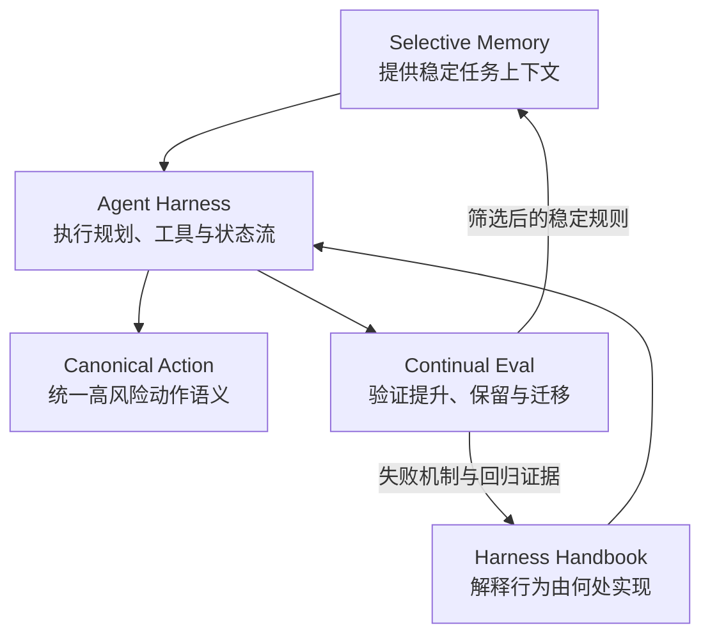
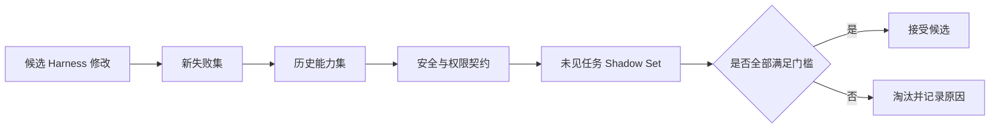
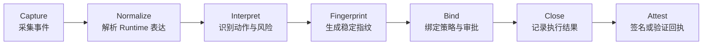
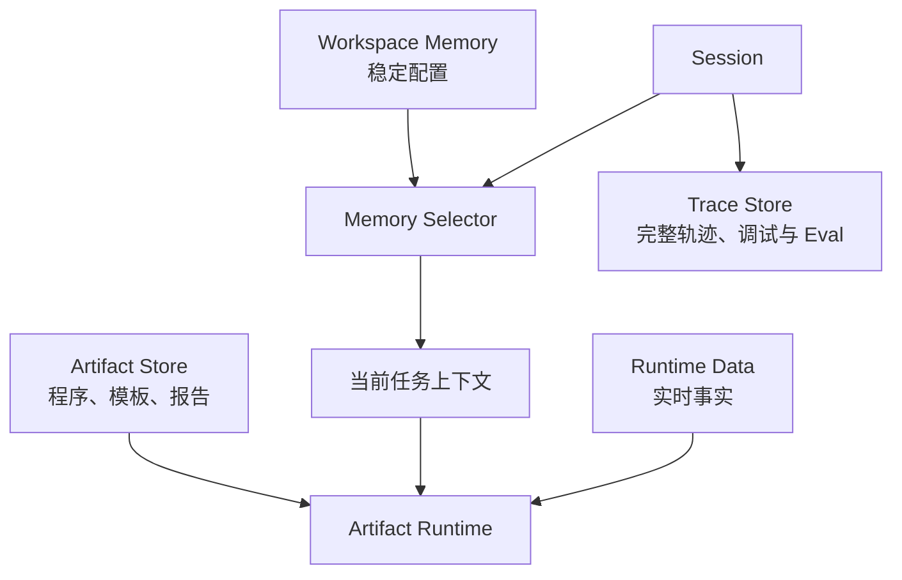
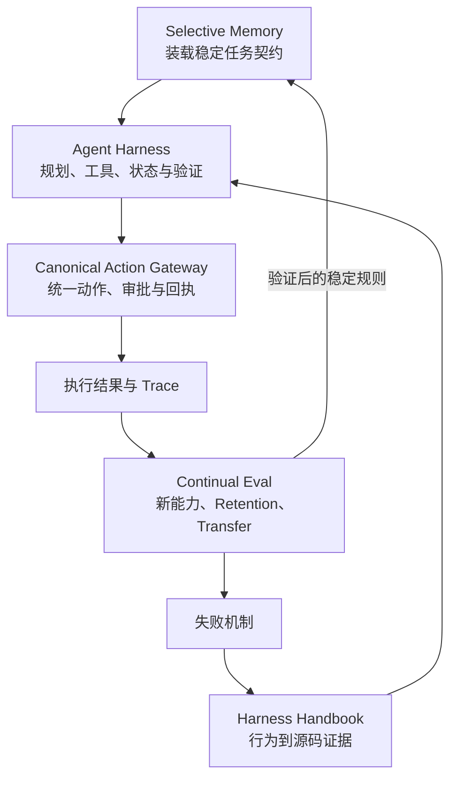

围绕四篇 Agent 系统研究，梳理持续评测、行为到代码定位、Canonical Action 治理与选择性持久记忆之间的关系，并记录关键证据、工程理解和适用边界。

> 研究日期：2026-07-17  
> 阅读对象：
> 1. *Do Agent Optimizers Compound? A Continual-Learning Evaluation on Terminal-Bench 2.0*
> 2. *Harness Handbook: Making Evolving Agent Harnesses Readable, Navigable, and Editable*
> 3. *CAVA: Canonical Action Verification and Attestation for Runtime Governance of Agentic AI Systems*
> 4. *Shared Selective Persistent Memory for Agentic LLM Systems*

## 一、阅读框架

四篇材料分别观察 Agent 系统的不同层面：

| 研究问题 | 核心对象 | 关键判断 |
|---|---|---|
| Harness 修改能否持续积累能力 | Eval 与优化搜索 | 新能力、旧能力保留和未见任务迁移必须同时测量 |
| 复杂 Harness 如何支持准确修改 | 行为知识与源码定位 | 应建立行为到执行阶段、状态和源码证据的映射 |
| 不同 Runtime 的动作如何统一治理 | Canonical Action | 审批必须绑定稳定动作语义，而非工具名或命令字符串 |
| 跨会话应该保存什么 | Selective Memory | 保存稳定结构化配置，轨迹与实时事实进入独立存储 |



组合来看，生产级 Agent 的能力并不只取决于模型。Harness 的可理解性、修改过程的回归控制、动作的治理语义，以及持久上下文的选择方式共同决定系统能否长期演进。

## 二、持续优化：为什么静态提升不等于长期提升

### 2.1 论文关注的问题

常见 Agent 优化流程在固定任务集上收集失败，修改 Prompt、工具或控制逻辑，再在相同任务上验证。它能证明当前分数变化，却无法回答三个长期问题：

```text
Static Gain   当前失败是否被修复
Retention     已获得的旧能力是否保留
Transfer      修改能否迁移到未见任务
```

论文在 Terminal-Bench 2.0 的 22 个困难任务上设计两阶段持续学习实验，对比 GEPA、Meta Harness 与 RELAI-VCL。三种方法在第一阶段都能改善静态得分，但第二阶段加入新任务后出现明显分化。

论文报告的 lifelong average pass rate 为：

| 方法 | Lifelong Average |
|---|---:|
| Baseline | 58.7% |
| GEPA | 66.0% |
| Meta Harness | 64.6% |
| RELAI-VCL | 76.4% |

最有价值的结果不是单个方法排名，而是：静态 Benchmark 的提升无法单独证明系统能力在累积。

### 2.2 回归控制为何要进入搜索过程

如果候选修改只根据新失败集排序，搜索过程会自然偏向当前样本的局部最优。即使发布前发现回归，搜索预算已经消耗在不合格候选上。

更合理的候选筛选关系是：

```text
Candidate accepted iff:

new_failure_gain >= threshold
AND old_capability_regression <= tolerance
AND safety_contracts == 100% pass
```



这意味着 Regression Control 不是末尾的一次补测，而是搜索目标的一部分。

### 2.3 机制性修复与样本性修复

论文观察到，过拟合修改常表现为 Prompt 不断增长，并写入任务特定经验。迁移性更好的修改通常作用于通用机制，例如：

- 完成状态判断；
- Malformed Tool Call 处理；
- 长输出压缩；
- Verifier Discovery；
- Runtime Contract 校验。

可以把修改分成四类：

| 修改类型 | 典型内容 | 主要风险 |
|---|---|---|
| 样本规则 | 为单个失败添加特例 | 过拟合、Prompt 膨胀 |
| 任务族规则 | 为一类任务增加步骤 | 需要跨样本验证 |
| 通用机制 | 重试、完成检测、压缩、验证 | 影响范围更广，需要完整回归 |
| 安全契约 | 审批、权限、数据边界 | 应保持零容忍回归 |

学习结论是：失败分析的目标不是记住一条轨迹，而是识别导致该轨迹的系统机制。

### 2.4 适用边界

这项实验只有两轮优化，任务规模较小，并依赖可重复运行且带 verifier 的 Benchmark。真实生产环境还包含不可复现事故、共享数据依赖、工具版本变化和长期分布漂移。

因此，当前证据足以支持“三类能力必须共同评估”，但不足以证明某个优化器能普遍解决长期演进问题。

## 三、Harness Handbook：用行为结构理解代码

### 3.1 行为需求与仓库结构之间的鸿沟

Agent Harness 的一次行为可能横跨：

```text
Prompt Builder
→ Context Loader
→ Planner
→ Tool Registry
→ Executor
→ State Store
→ Retry Handler
→ Completion Gate
→ Output Validator
```

需求通常使用行为语言，例如“敏感写操作需要审批”或“工具失败后最多重试两次”；仓库却按文件、模块和函数组织。关键词搜索容易找到入口，却可能漏掉状态清理、异常路径和低频分支。

Harness Handbook 试图建立中间层：

```text
行为
→ 执行阶段
→ 依赖状态
→ 相关函数与文件
→ 当前源码证据
```

### 3.2 L1–L3 渐进式结构

论文使用三层信息组织复杂 Harness：

| 层级 | 内容 | 回答的问题 |
|---|---|---|
| L1 | 系统架构、执行模型、全局数据流 | 系统整体如何工作 |
| L2 | 阶段职责、输入输出、依赖和状态 | 某个行为经过哪些阶段 |
| L3 | 文件、函数、代码区间和 source locator | 当前修改应验证哪些源码 |

跨阶段的共享状态通过 State Register 补充：

```yaml
state: approval_state
readers:
  - policy_gate
  - executor
writers:
  - approval_service
lifecycle: request_scoped
invariants:
  - approval 必须绑定当前动作指纹
  - approval 不可重复使用
```

### 3.3 行为引导的定位过程


Handbook 负责导航，当前仓库仍然是事实权威。如果 locator 与当前版本无法对齐，应将映射标记为失效，而不是猜测新的代码位置。

### 3.4 自动同步的核心

代码合并后，系统通过 Diff、AST、调用图、函数指纹或文件哈希识别受影响条目，只更新变化区域。确定性工具适合维护位置、版本和依赖关系，模型适合总结行为语义与阶段职责。

这种组合体现了一个清晰边界：

| 确定性基础设施 | 模型语义能力 |
|---|---|
| AST、Call Graph、Diff | 行为归类 |
| Source Locator、Hash | 阶段总结 |
| Version Alignment | 失败机制抽象 |
| Test、Eval、Schema | 修改意图说明 |

### 3.5 证据与限制

论文实验覆盖两个开源 Harness 和 60 个修改请求。Handbook 辅助改善了定位质量，并降低 Planner Token，尤其适合跨文件、低频路径和关键词难搜索的行为。

主要限制包括：Handbook 本身存在维护成本；动态注册、反射和运行时生成代码难以静态定位；错误的行为映射可能放大修改偏差。它更适合作为可验证导航层，而不是替代源码阅读。

## 四、CAVA：把工具调用转换为可治理动作

### 4.1 为什么工具名不足以表达风险

同一个发布动作可以来自多种 Runtime：

```text
Shell      git push origin main
MCP        github.push(branch="main")
SDK        githubClient.push(...)
Browser    点击 Publish Release
CI         POST /deployments
Workflow   release_pipeline.transition("publish")
```

如果策略只匹配字符串或 Tool Name，wrapper、alias 和间接调用都可能改变观察结果；审批内容也可能与最终执行参数发生漂移。

CAVA 的基本主张是：先把不同 Runtime 事件转换成统一的 Canonical Action，再进行策略、审批和审计。

### 4.2 Canonical Action 的最小结构

```json
{
  "schema_version": "cava.v1",
  "runtime": "mcp",
  "adapter": "github-mcp-adapter",
  "executable": "github",
  "operation": "push",
  "category": "deployment",
  "systems_touched": ["github"],
  "target": {
    "repository": "org/service",
    "branch": "main"
  },
  "reversible": false,
  "externality": "external-write",
  "adapter_confidence": 0.98,
  "enforcement_depth": "inline-blocking"
}
```

稳定治理字段经过确定性序列化后生成指纹：

```text
action_fingerprint = SHA256(canonical_json(governance_fields))
```

策略决策、用户审批和执行回执都绑定同一指纹。仓库、分支、操作或数据范围发生变化时，执行指纹将不再匹配已批准指纹。

### 4.3 七阶段流水线



这一模型解决三类核心问题：

1. Shell、MCP、Browser 和 API 可以共享同一语义策略。
2. 用户批准的目标与实际执行参数可以进行一致性校验。
3. 审计记录能表达动作、影响系统、控制深度和执行结果，而不只是“调用过某个工具”。

### 4.4 需要重点验证的风险

Canonicalizer 自身成为高权限可信组件，因此至少要验证：

| 测试方向 | 验证内容 |
|---|---|
| Semantic Equivalence | wrapper、alias、MCP 调用是否映射到相同动作 |
| Semantic Separation | `git status` 与 `git push` 是否保持不同语义 |
| Approval Drift | 批准 repo A 后能否阻止执行 repo B |
| Receipt Replay | 单次批准能否阻止重复执行 |
| Benign Contamination | 文档中的危险命令是否不会被当作实际动作 |
| Unknown Parser | 无法理解的私有脚本是否进入保守策略 |

### 4.5 适用边界

CAVA 是单作者 working paper，并带有 OSuite/open-core 产品语境。作者构建的 384 个变体 Benchmark 能说明规范化思路，但不能代表真实世界完整覆盖。

困难主要集中在私有脚本、复杂 Shell、Browser Click 到业务语义的映射、动态数据范围、多动作事务和部分失败。当前最值得吸收的是统一数据模型与审批绑定原则，而不是假设 Canonicalizer 已经完全理解所有 Runtime。

## 五、Selective Memory：持久化稳定配置，而不是完整轨迹

### 5.1 两个极端

无记忆会让每个新会话重复说明任务规则、数据结构、工具用法和输出格式；保存完整历史则会把旧推理、失败恢复和过时工具模式重新注入上下文。

完整历史可能引入：

```text
Trace Anchoring
Stale Assumptions
Old Tool Patterns
Lost-in-the-Middle
Context Pollution
```

论文提出只持久化四类稳定上下文：

| Memory 类型 | 保存内容 | 典型失效信号 |
|---|---|---|
| Task Specifications | 长期业务规则与质量要求 | 规则版本或 scope 变化 |
| Data Schemas | 字段、类型、关系和兼容性 | schema digest 变化 |
| Tool Configurations | 工具契约、版本、权限范围 | server、schema 或 auth 变化 |
| Output Constraints | Artifact 与 Runtime 契约 | 模板、运行时或业务约束变化 |

明确排除多轮推理轨迹、旧 Tool Invocation Logs、中间文件状态和一次性错误恢复路径。

### 5.2 Memory 与 Trace 的区别



| 存储 | 主要用途 | 是否默认进入 Prompt |
|---|---|---|
| Workspace Memory | 跨会话复用稳定配置 | 按任务选择 |
| Trace Store | 调试、评测和事故分析 | 否 |
| Artifact Store | 保存可执行结果 | 由任务引用 |
| Data Store | 提供实时业务事实 | 运行时读取 |

### 5.3 Zero-Token Refresh

论文中最值得关注的工程思想是将模型生成的程序或模板与运行时数据解耦：

```text
首次生成：Schema + Requirements → Artifact Program
数据刷新：New Data → Runtime Injection → Existing Artifact Program
```

当新数据与既有 Schema 兼容时，运行时可以刷新结果而无需重新调用模型。这更接近 Agent-assisted program synthesis，而不是每次重新生成最终内容。

论文在 24 个企业场景任务中报告：

| 条件 | 完成率 | 用户轮次 | 时间 |
|---|---:|---:|---:|
| 无记忆 | 79% | 4.3 | 285 秒 |
| 完整历史 | 71% | 3.1 | 310 秒 |
| 选择性记忆 | 96% | 1.4 | 68 秒 |

公开数据复现实验中，Schema Compatible 的刷新任务实现 12/12 零 Token 刷新。

### 5.4 写入、读取和失效

Memory 不应由模型自由追加。一个可靠条目至少需要：

```text
category + scope + source + version + validity + status + validation rule
```

读取阶段依次完成 Scope Filter、Freshness Check、Version Compatibility、Conflict Resolution 和 Token Budget 控制。

失效机制比写入更重要：

- Data Schema 变化时阻止零 Token 刷新，并重新生成 Artifact。
- Tool Schema 或 Auth Scope 变化时停用旧 Tool Config。
- Task Spec 冲突时按 scope、priority 和 version 解析。
- Output Constraint 变化时触发 Artifact Regression。

### 5.5 与其他上下文机制的关系

| 机制 | 主要保存对象 | 适合的问题 |
|---|---|---|
| 长上下文 | 完整历史 | 单次连续对话 |
| 会话总结 | 压缩后的自然语言历史 | 会话衔接 |
| RAG | 外部文档片段 | 知识检索 |
| Trace | 完整执行轨迹 | 调试与 Eval |
| Selective Memory | 稳定结构化配置 | 跨会话复用与约束 |

这些机制不是互斥选项。稳定配置进入 Selective Memory，外部知识通过 RAG 获取，完整轨迹进入 Trace，实时事实从数据源读取。

### 5.6 适用边界

论文任务主要围绕结构化数据驱动 Artifact。选择性记忆条件中的收益可能同时来自已有 Artifact，而不完全来自 Memory 本身。对开放式软件工程、长期研究或高度动态业务，四类 Memory 未必覆盖全部有效上下文。

因此，零 Token 刷新只适用于 Schema Compatible 数据；涉及语义变化、契约变化或任务目标变化时，应重新进入模型生成与验证过程。

## 六、四篇研究如何组成一个系统

四篇材料不是四个独立功能，它们分别回答一次 Agent 变更循环中的上下文、定位、执行与验证问题。



| 系统层 | 解决的问题 | 事实依据 |
|---|---|---|
| Selective Memory | 当前任务需要加载哪些稳定上下文 | 版本化配置与来源 |
| Harness Handbook | 某个行为由哪些阶段和源码实现 | 当前仓库与 source locator |
| Agent Runtime | 如何规划、调用工具和管理状态 | Runtime code 与工具契约 |
| Canonical Action | 实际动作如何审批、绑定和审计 | 规范化语义与动作指纹 |
| Continual Eval | 修改是否真正积累能力 | 新失败、历史能力和 Shadow Set |

它们之间形成两个重要闭环：

1. **知识闭环**：稳定规则进入 Memory，动态轨迹进入 Trace，避免旧推理污染新任务。
2. **演进闭环**：失败通过 Handbook 定位到 Harness，修改通过持续评测验证，再以版本化方式发布。

## 七、学习结论

1. **Agent 是完整软件系统。** 模型之外还包括 Context Construction、State、Tools、Control Flow、Validation、Memory、Policy 和 Observability。
2. **Harness 优化属于持续学习问题。** 当前得分提升必须与能力保留、未见任务迁移一起判断。
3. **行为知识不能脱离源码。** Handbook 提供导航，仓库和可验证 locator 决定事实。
4. **审批对象应该是动作语义。** Tool Name 和命令字符串不足以支撑跨 Runtime 治理。
5. **Memory 不是 Trace 的压缩副本。** 只有稳定、可复用、可失效的配置适合长期持久化。
6. **确定性系统与模型各有边界。** Hash、版本、权限、Schema 和 Eval 由程序保证；语义抽象与非结构化理解由模型完成。
7. **可演进性来自闭环。** 上下文选择、行为定位、动作治理和回归验证需要连接成同一套版本化工程过程。

## 参考资料

1. Wang, W., Kattakinda, P., & Feizi, S. **Do Agent Optimizers Compound? A Continual-Learning Evaluation on Terminal-Bench 2.0.** arXiv:2607.14004, 2026.  
   [arXiv:2607.14004](https://arxiv.org/abs/2607.14004)

2. Wang, R. et al. **Harness Handbook: Making Evolving Agent Harnesses Readable, Navigable, and Editable.** arXiv:2607.13285, 2026.  
   [arXiv:2607.13285](https://arxiv.org/abs/2607.13285)

3. Wang, Z. **CAVA: Canonical Action Verification and Attestation for Runtime Governance of Agentic AI Systems.** arXiv:2607.13716, 2026.  
   [arXiv:2607.13716](https://arxiv.org/abs/2607.13716)

4. Pedada, S., Dhavala, A., & Patil, N. **Shared Selective Persistent Memory for Agentic LLM Systems.** arXiv:2607.09493, 2026.  
   [arXiv:2607.09493](https://arxiv.org/abs/2607.09493)

### 研究可信度

- 四篇材料在研究日期均属于预印本，不能等同于经过长期同行评议和生产验证的行业定论。
- 文中的实验数据按论文报告记录；跨论文的统一架构属于工程推导。
- CAVA 的数据模型与治理原则具有参考价值，其 Benchmark 仍需要独立复现。
- Selective Memory 的结论主要来自结构化 Artifact 场景，推广到开放任务时需要重新评测。
