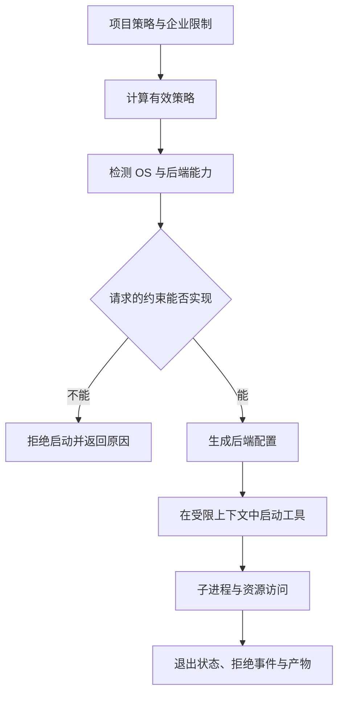
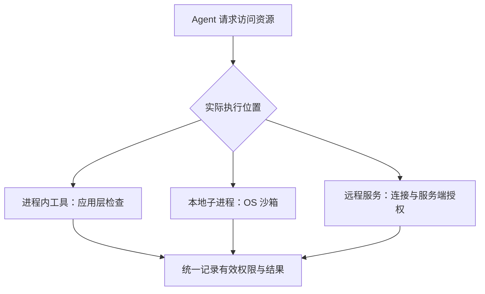

**本地沙箱的价值，是让 Agent 使用已经存在的本机工程环境，却不自动继承用户对整台电脑的全部权限。** 它不是离线模型，不是 Git 工作树，也不必然是一台虚拟机。执行位置、隔离强度、网络权限和模型数据流是四个独立问题。

本文以 GitHub Copilot App 于 2026 年 9 月 23 日发布的本地沙箱为切入点，结合官方配置文档和 Microsoft MXC 开源资料，分析本地执行的意义、控制机制、局限与可复用设计。[1]

## 1. 为什么还需要在本地执行

假设一个前端项目依赖未提交的组件改动、本地数据库、企业 VPN 和专用构建工具。让云端 Agent 工作，首先要解决的往往不是推理，而是把这个环境搬过去：同步工作树、安装依赖、提供测试数据、处理内部服务连接，再把结果同步回来。

本地执行绕过了其中一部分环境重建成本，但也带来另一种风险：没有隔离时，Agent 启动的命令通常继承开发者账号的文件、网络和凭据能力。GitHub 官方文档正是将这组默认继承的权限作为本地沙箱要收缩的对象。[2][3]

因此，真正的选择并非“本地不安全，云端安全”，而是：

| 方案 | 环境复用 | 主要代价或风险 |
|---|---|---|
| 宿主机直接执行 | 最直接 | 无意命令可触达用户拥有的其他资源 |
| 本地 OS 沙箱 | 保留多数本地工作流 | 隔离依赖平台能力；允许区内仍可能受损 |
| 本地容器或 VM | 可以封装运行环境 | 挂载、网络、依赖与桌面集成需要维护 |
| 云端执行环境 | 适合持续任务与并行计算 | 需要同步数据、构建环境及管理远端权限 |

后两列是架构分析，不是 GitHub 对各类实现的性能排名。云端进程若拥有过大的生产令牌，也可能造成严重副作用；本地进程若只有窄范围读权限，风险可以较低。

### 三种容易混淆的“本地”

**工具本地执行**表示命令在电脑上运行；**模型本地推理**表示模型计算也在电脑上；**数据不出设备**还需要约束上下文上传、工具返回和遥测。启用第一项，不能自动得到后两项。

本地沙箱可以减少将完整工程环境搬到云端的需要，但被读取的代码、命令输出或错误信息仍可能成为远程模型输入。这是数据流问题，不由“沙箱在本机”四个字解决。

## 2. GitHub 这次提供了什么，不提供什么

Copilot App 的控制对象是本地仓库与 working tree 会话。用户可以按项目配置额外只读、读写和拒绝目录，以及公网、局域网、Git 与 GitHub CLI 凭据。项目策略是请求值，企业策略可以进一步收紧。[1][2]

几个会改变理解的细节如下：

| 事项 | 官方行为 | 工程含义 |
|---|---|---|
| 是否自动启用 | 默认关闭 | 有功能不等于正在保护当前任务 |
| 启用后的默认网络与凭据 | 保留常见开发所需访问 | 默认策略偏兼容，不等于零出站或无凭据 |
| 配置变更 | 多数配置对新建或重启会话生效 | 管理页已保存，不代表活动进程已切换 |
| 不支持请求的隔离策略 | App 的沙箱 Shell 失败，不静默无沙箱执行 | 区分“保存配置”与“实际可强制执行” |
| 云端或远程主机会话 | 不属于这组本地设置的适用范围 | 必须检查对应执行环境的策略 |

这些行为来自 App 文档，不能原样套用到 Copilot CLI。[1][2]

尤其要区分两种路径：**隔离后端不支持请求策略时失败**，与**用户在有效策略允许时，主动批准某个工具在沙箱外运行**。后者仍可能存在，企业管理员可以限制它。因此，“fail closed”不等于产品不存在任何显式绕过流程。[2]

### Working tree 不是安全隔离

工作树解决多个分支、文件与会话的组织问题，不能阻止命令访问其他目录或使用网络。两个工作树彼此分开，不代表其中运行的进程互相不可见。GitHub App 文档明确区分了工作树分离与沙箱保护。[2]

## 3. 技术原理：把声明的策略编译成宿主能执行的限制

GitHub 的概念文档将本地沙箱连接到 Microsoft eXecution Container（MXC）。MXC 提供跨平台策略接口，再由具体后端实现隔离；公开项目中包括 Linux Bubblewrap、macOS Seatbelt 和 Windows 进程隔离等路径。[3][4]



上图是对公开机制的归纳，不是 GitHub 内部代码调用图。

不同平台可能通过命名空间、文件系统视图、系统访问策略或受限进程身份实现边界。统一 JSON 并不会让不同操作系统自动拥有同样能力。MXC 的公开 Schema 将抽象隔离意图与具体后端分开，并维护稳定版与开发版契约。[4][5]

由此产生一个很有学习价值的模式：**策略编译之前先进行能力协商，不能把不支持的字段静默忽略。**

### OS 沙箱不等于独立内核

GitHub 对本地机制的描述处于较轻量的进程约束一端，不应一概理解为完整 VM。MXC 本身有更多后端，也不证明某个 Copilot 版本实际选用了其中所有后端。[3][4]

这决定了威胁模型：限制误操作和越界资源访问，与抵抗拥有本地管理员权限的恶意对手，是不同目标。对高风险不可信程序，需要独立评估隔离后端，而不是仅看“sandbox”名称。

## 4. 四条必须独立验证的边界

### 文件：允许目录内仍可能被破坏

如果策略允许对整个工作区读写，Agent 删除工作区文件未必违反沙箱策略。沙箱主要限制影响范围，不负责判断每个修改是否正确。

因此，工作区快照、Git diff、测试验证和变更审批解决的是另一组问题。恢复时也要注意：Git 未跟踪文件、外部数据库以及已经发送到远端的请求，不一定能用一次 `git reset` 恢复。

### 网络：代理不是天然不可绕过

只有代理环境变量、但仍允许直接连接的配置，与强制所有出站流量通过受控路径的配置，提供不同保证。公网、局域网、回环接口、DNS 和已有连接也不是同一个开关。

本次查阅的 GitHub 概念页、CLI 配置页与 MXC 不同版本资料，对部分平台代理行为存在差异，不能据此给出跨版本统一结论。[3][4][6] 稳妥的研究对象应是“客户端版本 × OS × 后端版本 × 有效策略”，并通过真实连接测试验证路径。

App 文档还明确记录了 Linux 子进程对局域网独立控制的局限；不能把 UI 上的同名设置当成所有执行路径上的同等能力。[2]

### 凭据：看不见密钥，不代表不能代用

应区分读取秘密文件、继承环境变量、调用凭据帮助程序，以及经代理使用凭据。只阻止读取 `~/.ssh`，不能证明 `git`、`gh` 或其他已认证工具无法操作远端系统。

进一步的参考设计是让高权限凭据留在代理外部，按主体、目标、操作和有效期代发请求。但代理本身也必须鉴权；否则只是把直接持有密钥变成一个无条件代用密钥的接口。

### 工具路径：不是只有 Shell

进程内文件工具、本地 MCP 子进程、浏览器、远程 MCP 都应出现在执行清单里。对 Shell 的隔离不能自动证明其他路径也受同样保护。远程 MCP 的服务端权限仍由远端系统控制。



此图是安全分析用的分类，而不是承诺某个客户端已经完成全部覆盖。

## 5. 可复用方案：把 Sandbox 做成带证据的执行适配器

适合自建 Runtime 的抽象，不是 `sandbox: true`，而是分别记录请求策略、解析策略、后端支持和实际执行实例。下列接口为说明性设计，不是 MXC API：

```typescript
interface SandboxLease {
  leaseId: string;
  backend: string;
  backendVersion: string;
  requestedPolicyHash: string;
  effectivePolicyHash: string;
  enforcedControls: string[];
  expiresAt: string;
}

interface SandboxAdapter {
  prepare(policy: unknown): Promise<SandboxLease>;
  execute(
    lease: SandboxLease,
    argv: readonly string[],
    signal: AbortSignal
  ): Promise<{
    exitCode: number;
    stdoutRef: string;
    stderrRef: string;
    auditEventIds: string[];
  }>;
  terminate(lease: SandboxLease): Promise<void>;
}
```

`prepare` 应在必要约束不可实现时拒绝，不能用空的 `enforcedControls` 假装成功。`execute` 应绑定有效策略版本；`terminate` 需要覆盖派生进程，并报告未能终止的活动。接口本身不构成安全实现，真正的限制必须由受信任的宿主控制。

对实际项目，可以优先复用 MXC 等现有后端及其版本化配置，而把工程工作放在策略解析、权限审批、任务状态和审计上。仍须固定所用版本、检查支持矩阵，不能直接把最新开发 Schema 当作已安装稳定版接口。[4][5]

### 本地与云端可以共享任务协议

同一个 `Task` 可以根据能力需求交给 Local Executor 或 Cloud Executor。上层只处理输入、产物、取消、日志与状态，下层决定如何准备环境。必须保留执行位置和资源权限差异，不能宣称两个后端行为完全相同。

这种设计对混合项目尤其有用：需要本机设备或未同步工作树的步骤在本地完成；需要长时间运行、隔离实验或大量并行的步骤在可控远端执行。调度依据是资源和权限需求，而不是一律“上云”或一律“本地”。

## 6. 验证方法：同时测便利性与风险收缩

以下实验应仅使用受控测试目录、测试凭据与自有服务。

| 实验 | 应验证的事实 |
|---|---|
| 在工作区外放置不可读标记文件 | 每一种文件访问路径是否都被限制 |
| 测试脚本创建子进程 | 子进程是否继承隔离与取消语义 |
| 配置不受支持的约束 | 是否明确拒绝，而非静默弱化 |
| 修改策略但不重启会话 | UI 是否区分保存值与生效值 |
| 禁止凭据后尝试受控远端写入 | 是否仍通过其他认证路径成功 |
| 在允许区内故意写错文件 | 快照、diff 与验证器是否能发现并恢复 |
| 关闭代理后尝试连接测试服务 | 是否存在未受控的直接出站路径 |

便利性指标可以记录环境准备时间、需要重新授权的频率、正常测试通过率和额外延迟；安全指标记录越界访问、策略降级和审计缺失。有限测试中未出现绕过，不等于形式化证明。

## 结论

本地沙箱的意义不是“把云端 VM 缩小放回电脑”，而是**在已有开发环境与 Agent 动作之间增加可验证的权限边界**。它适合需要复用本机状态的工作流；云端执行则更适合不依赖本机在线、需要统一环境或扩展并发的任务。

真正可学习的是策略与后端分离、能力协商、有效策略可观测，以及工具执行全路径覆盖。不能从“本地”推出隐私保证，不能从“有沙箱”推出最小权限，也不能从“命令被允许”推出修改正确。

## 参考资料

[1] GitHub. [Local sandboxing in the GitHub Copilot app](https://github.blog/changelog/2026-09-23-local-sandboxing-in-the-github-copilot-app/). 2026-09-23。

[2] GitHub Docs. [Configuring local sandboxing in the GitHub Copilot app](https://docs.github.com/en/enterprise-cloud%40latest/copilot/how-tos/github-copilot-app/configure-local-sandboxing).

[3] GitHub Docs. [About cloud and local sandboxes for GitHub Copilot](https://docs.github.com/en/enterprise-cloud%40latest/copilot/concepts/security-governance-and-network-settings/about-cloud-and-local-sandboxes).

[4] Microsoft. [MXC repository and backend documentation](https://github.com/microsoft/mxc).

[5] Microsoft MXC. [Configuration schema](https://github.com/microsoft/mxc/blob/main/docs/schema.md).

[6] GitHub Docs. [Configuring local sandbox settings — CLI](https://docs.github.com/en/copilot/how-tos/cloud-and-local-sandboxes/configuring-local-sandbox-settings).

资料复核于 2026-09-30。本文未执行跨平台产品测试；示例接口和实验为研究设计。
