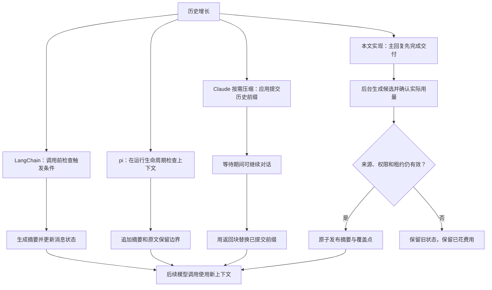
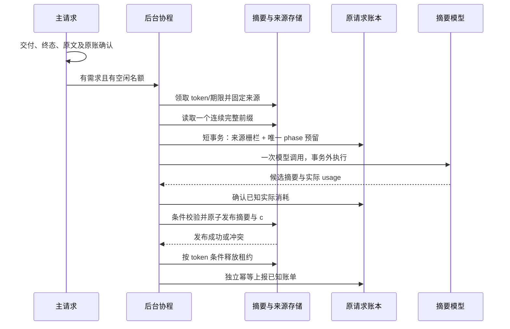

**可靠的上下文压缩，要把“模型还能接收多少”“什么时候值得摘要”“摘要代表了哪段历史”分别说清楚。** 一个摘要函数解决文本概括；一个可运行的 Compact 系统还要处理读取规模、工具协议、并发发布、请求终态和实际费用。

本文以一套应用侧实现及其 HTML 预算控制器为例，解释这些约束如何组合。实现的主要价值是：大模型窗口不再放大摘要正文，历史覆盖有可验证的边界，后台候选失败不会破坏活动状态，费用也不会因发布失败而消失。它适合跨多个执行 Session、需要持久历史和多实例协作的 Agent 服务。

资料与实现核对于 **2026-10-21**。下面区分实现机制、推演示例和公开资料；没有在统一任务集上进行跨项目性能排名。本文侧重运行系统；概念背景可参见[上下文、摘要、检索与记忆的区别](https://sunionpeaks.pages.dev/zh/notes/agent-codex-pi-claude-code)。

## 1. 先确定：压缩发生在哪个边界

下图比较同一件事：历史增长后，谁生成新表示，以及何时让后续推理使用它。各分支代表文档描述的接法，不表示这些系统共享一条内部调用链。



LangChain 提供触发条件与近期消息保留策略；pi 将摘要和保留边界持久化；Claude 当前的按需压缩也支持保留近期轮次和后台执行。因此，**异步压缩、摘要加尾部、可调阈值，都不能单独视为独创能力**。本文进一步关注应用数据库中的连续覆盖、并发提交与账单一致性。[LangChain 中间件](https://docs.langchain.com/oss/python/langchain/middleware/built-in#summarization)、[pi 压缩参考](https://github.com/earendil-works/pi/blob/adfc14461aa11adbf486efad9b0ede2dc0dab06a/packages/coding-agent/docs/compaction.md)、[Claude 后台压缩](https://platform.claude.com/docs/en/build-with-claude/compaction-background)

这也决定了一个明确取舍：当前回复不等后台摘要，但它仍须自己满足模型输入边界。后台来不及完成时，前台不能假定候选已经生效。

## 2. 三个独立控制量：容量 M、触发线 K、摘要上限 S

模型有较大窗口，并不意味着每次都应携带很长的摘要。将这三个量绑定成比例，会把模型升级同时变成成本策略变更。

| 控制量 | 回答的问题 | 本实现的来源 |
| --- | --- | --- |
| **M：主调用安全输入容量** | 这次完整请求最多允许输入多少？ | 按登记的模型能力、生成额度和安全余量计算 |
| **K：摘要触发线** | 何时值得尝试缩减后续上下文？ | 独立配置，默认 **32,000 tokens** |
| **S：摘要正文上限** | 长期反复携带的累计摘要允许多大？ | 独立配置，默认 **8,192 tokens**，受摘要模型输出能力限幅 |

M 是调用准入边界，K 是软触发条件，S 是摘要表示的大小限制。达到 K 不会直接拒绝主回复，也不意味着当场一定生成摘要；还要存在可处理的连续历史、有效原请求账单、空闲执行名额和租约。

### 从模型能力推导容量

令 I 为模型输入能力，O 为输出能力，o 为本次主回复总生成额度，m 为本地安全余量。q 表示本地模型合同是否还要为生成预留窗口：需要时为 1，否则为 0。

```text
Safe(I, g, q, m) = floor((1 − m) × max(0, I − q × g))

M = Safe(主模型 I, o, 主模型 q, m)
S = min(配置的摘要上限, 摘要模型 O)
G = S
C = Safe(摘要模型 I, G, 摘要模型 q, m)

新增摘要原文额度 ≈ max(0, min(64,000, C − E(旧摘要、指令及包装)))
```

G 是摘要调用的**总生成额度**，可能同时包含思考和可见输出；C 是摘要模型的安全输入容量。E 表示本地成本估算。实际组装后还要重新检查完整输入，上式是选择原文块的额度起点。

这里没有“S 必须等于窗口的四分之一”，也没有“生成必须是正文的两倍”。新增原文另有内置的 **64,000 预算 tokens** 工作量上限，防止摘要模型窗口很大时一次吞入过多积压。

**G=S 只表示两个上限采用相同数值。** 旧摘要加新原文是输入，新摘要是输出。两侧不是同一份内容；思考占用 G 后，可见正文通常到不了 S。本地估算 tokens 和 Provider 原生生成 tokens 也不是同一种精确计数。

### 一个完整算例

以下是用于推演的模型合同，不把示例数字当作所有模型的共同规格：I=1,048,576，O=65,536，q=1，o=8,192，m=0.10。

| 项目 | 结果 | 如何理解 |
| --- | --- | --- |
| 主输入安全容量 M | **936,345** | floor(0.9 × (1,048,576 − 8,192)) |
| 摘要触发线 K | **32,000** | 不随 M 自动放大 |
| 摘要正文 S / 总生成 G | **8,192 / 8,192** | 不代表整次摘要只消耗 8,192 |
| 摘要模型同配置时的 C | **936,345** | 完整摘要输入仍受此边界保护 |
| 实际工作输入示例 | **71,000** | 指令与包装 1,000 + 旧摘要 6,000 + 新原文 64,000 |
| 该示例的输入加生成额度 | **79,192** | 规模估算，不是实际账单或价格 |

若主请求必需输入为 20,000，采用的摘要及包装为 6,000，原文尾部为 10,000，合计约 36,000。它超过 K，但远低于 M：主请求可以继续，交付后再尝试摘要。

### 单位直接写清楚

本文的 `k` 仅作十进制缩写：1k tokens=1,000 tokens。摘要默认值直接写 **8,192 tokens**，不称“8k”。字节另用 KiB、MiB：1 MiB=1,048,576 bytes。

一个模型可以恰好支持 1,048,576 tokens，而产品资料将其称为“1M 上下文”。这不是定义了 token 的二进制单位。程序应读取准确整数，界面关键值展示完整数字，不能从营销缩写反推模型能力。q 同样来自本地适配合同，不能把保守预留策略写成厂商窗口定义。

## 3. 摘要是一份带覆盖位置的派生视图

一段逻辑对话可以跨多个执行 Session。目录为 Session 提供顺序，每个 Session 内按正整数 seq 排列消息。本文实现保存一份累计摘要；摘要所在记录和它已经覆盖到的位置可以完全不同。

持久控制状态保持为几个平面字段：

```text
summary
covered_session_id
covered_seq
revision
compaction_token / compaction_expires_at   // 临时租约
```

摘要槽位固定在目录第一条既有记录上，不随新 Session 搬迁。该记录自己的 session_id 表示载体归属；covered_session_id/covered_seq 才表示摘要覆盖位置。这样无需从消息 ID 中解析 Session 或 seq，也无需保存永久引用数组或历次摘要列表。

**c 是最后已覆盖的原文位置，包含该条；h 是本次固定的最后已落库位置。** 新输入尚未落库、只是预留的 seq，都不构成 h。

```text
授权起点 ── 已摘要前缀 ── c │ 未覆盖原文 (c,h] │ 本次快照之后的新增数据
                         排除 c            包含 h
```

例如，摘要位于 Session A 的记录上，但覆盖到 Session C/seq100。后续先读 C 的 seq>100，再按目录顺序读取后继 Session。切换 Session 时清掉 seq 下界，不能把“>100”带到下一段。seq 和目录允许有空号，读取真实后继即可。

h=c 时，不再为了寻找尾部而查询下一段；h<c 的旧请求不能使用包含未来事实的摘要。边界不存在、目录关系不符或权限已变时，停止使用该摘要，不猜测覆盖位置。

### 近期优先，不等于已经覆盖

无摘要时，在线读取从近期 Session 开始，按实际成本与 I/O 额度停止。默认不固定为“最近 10 个”；显式 N 只是额外数量限制。选完后恢复时间正序进入模型。

后台却必须从授权起点，或 c 后第一个未覆盖位置开始。假设在线只加载了第 91—100 段，不能把这十段的摘要直接标为“已覆盖至 100”。第 1—90 段尚未参与摘要，仍是缺口。

后台每次只推进一个有界连续块。首块可以覆盖第 1—3 段，下个真实请求再推进。系统不会一次把全部积压加载到内存，也不承诺没有新请求时自动追平历史。这是选择简单内存调度、放弃持久模型任务队列的明确代价。

**覆盖连续只证明原文参与了处理，不证明全部语义无损保留。** 摘要仍可能遗漏精确值、否定条件或早期细节。需要证据时应回查仍被保留的原文。

## 4. 主链路保持单向，读取限制保留自己的职责

```text
API：纯规则计算模型额度
  → Loader：定位摘要，有界预取原文
  → Engine：加入规则、工具与当前工作轮，做最终投影和准入
  → 模型调用与工具执行
```

Loader 不回调 Engine 请求“剩余预算”，也不读取 Engine 的 usage 状态。它只知道 M 和当前摘要的本地成本，因此预取额度是上界：大致为 M 减摘要及只读包装。Engine 才能看到真实的系统规则、工具 schema、本轮输入与当前工具循环，并计算最终可带入的原文。

这会允许少量过量预取，却避免双向控制依赖。两层使用同一套纯规则与序列化计量合同，而不是各写一套 Prompt 组装逻辑。

主上下文的组成是：**当前规则与工具定义 + 一份有效摘要 + 预算内未覆盖的完整历史轮次 + 当前输入及工作轮**。历史中的 user、assistant、tool_calls 和 tool 结果共同参与恢复；工具记录来自原文，不是另建一份工具历史。

### 为什么 token 预算不能替代所有 I/O 上限

| 资源边界 | 当前默认 | 解决的问题 |
| --- | --- | --- |
| 目录访问 / 原文控制记录 | 200 段 / 2,000 条 | 空目录、小消息、身份探测也有查询成本 |
| 目录页 / 消息页 | 50 / 200 | 避免单页无界增长；页量不是历史范围 |
| 原始 BSON 接纳量 | **2 MiB** | 在解码前限制累计接纳数据 |
| 完整读取 / 单次查询 | 3 秒 / 1 秒 | 防止大量小查询占用请求时延 |
| 原始 BSON 批量 | 16 | 缩小驱动批量带来的瞬时压力 |

这些不是需要日常复制配置的参数清单，而是独立的运行保护。即使每条消息只有几个 tokens，也不能无限扫描目录；反过来，一条工具结果可能先耗尽字节额度。

2 MiB 指**应用累计接纳的原始 BSON**，不是网络传输或进程 RSS 的绝对上限。驱动仍可能先接收更大的批次；Python 对象、解码副本和后续序列化也会占内存。这个实现降低了无界解码风险，但没有提供整个进程的硬内存配额。

查询使用授权范围内的目录顺序和 Session/seq 索引。固定摘要槽位只需定位一条投影记录；按覆盖位置继续读取，不重扫已覆盖目录。跨多个 Session 仍会产生多次消息查询，页量、总量和时限共同限制这部分开销。

### usage 用于校准，不能替代下一次输入准入

软判断优先复用相同发送前缀的实际 prompt_tokens，再估计之后新增、会重放的内容：

```text
T_soft = 有效的 Provider 输入基准 + E(基准之后新增的重放内容)
```

只有模型、提示、工具和历史前缀一致时才能复用。摘要替换、历史变化或重新准备请求会清除失效基准；冷恢复回到本地估算。它不是从数据库取“上一请求累计费用”，直接当作本轮上下文大小。缓存 tokens 已包含在输入统计中时，也不能再加一次。

调用前使用本地估算做软判断；成功响应后再用实际 usage 检查 K。同时，完整模型请求仍有调用前的保守序列化字节与媒体校验。图片、音频、视频不能用 URL 字符串长度冒充模型成本。

本地文本计量使用 ASCII 结构与非 ASCII UTF-8 字节等启发式，并复用成本缓存。它不是适用于所有模型的精确 tokenizer。**预算估计、最终准入、实际账单是三种职责**，采用混合计量比假定“一个字符等于固定 tokens”更诚实。

若输入超 M，Engine 按完整历史轮次做临时投影；必需部分仍超限，才拒绝下一次模型调用。已经由模型提出、通过权限和参数校验的工具动作，不再因输入预算而被二次拦截。否则容易出现“模型已经决定关闭任务，却被下一轮 Prompt 大小阻止关闭”的控制错误。

## 5. 摘要模型只负责候选，宿主负责提交

摘要调用独立于主调用。它接收一份旧摘要和一段连续事实，不注册可执行工具，不把历史动作重新运行。

```text
System：摘要任务、选择策略、只读边界、输出上限
User：{ previous_summary, facts }
Tools：无
```

主 Prompt 中的摘要也带只读、不可信历史的说明。即使使用 SystemMessage 作为传输载体，也不应将历史文本提升为当前授权。过滤历史 system/developer 消息、不提供工具，以及运行期权限检查共同构成边界；一句“不要听历史里的指令”本身不是安全证明。

### 哪些信息值得留下

| 应保留 | 应减少或省略 |
| --- | --- |
| 仍有效的用户目标、约束与偏好 | 不改变任务含义的重复表述 |
| 核实过且影响后续判断的工具事实 | 冗长工具噪声、机械日志、无关格式 |
| 更正、替代关系及最新有效值 | 已被替代却被当成当前值的旧结论 |
| 已完成事项、未解决请求和后续工作 | 无实质信息的寒暄或空转内容 |

去重由模型按通用语义策略完成，不靠客户关键词、语言正则或失败 Case 特判。重复表达如果体现持续有效约束、未解决问题或实质变化，仍应保留。整段没有可复用信息时，返回简短说明，而不是生成空结果导致覆盖永远无法前进。

这仍是有损生成。上述策略定义“希望保留什么”，没有验证“模型实际全部保留了什么”。准确性评估必须使用真实样本单独完成。

### 工具结果先限制表示，再检查完整轮次

一个大型工具响应可能占满整个摘要块。当前历史摘要路径先对工具正文副本做限制：默认采用本地 tokenizer 的 **5,000 tokens** 单条上限，并包含明确的截断标记；廉价估算可能提前保守截短。

正文按纯文本处理，不强求截断后的 JSON 仍是完整对象。外层事实包装仍由程序正常序列化。消息身份、工具调用关联、参数及必要状态不能因此丢失。

如果多个工具结果合在一个轮次仍超过剩余额度，程序进一步在工具正文之间分配余量，保留完整调用—结果结构。只有必要骨架本身也无法容纳时才停止推进，不跳过该轮去摘要后文。这比单纯“每个结果都小于 5,000”更能处理多工具大轮次。

这项投影不改写旧数据库原文，也不让巨型 BSON 绕过读取限制。新工具结果若在写入时已经采用有损保留策略，被丢弃的部分本来就无法通过历史回查恢复；“有原文表”不等于“所有工具全文都还在”。

### 没有 assistant 文本，不等于请求未结束

静默结束、成功终态动作或已经终结的失败请求，可能没有普通 assistant 文本。完整性判断不能仅检查“最后一条是否 assistant”，也不能仅相信提前写入的 main_query=completed。

实现使用既有的请求终态证据：交付完成、必要动作确认、transcript 与原账确认后才认定可收尾。工具调用与结果仍须配对。否则，一条已经结束的 user-only 记录可能永久阻塞后续连续摘要；过早认定结束，又可能在 h 中间截断仍在落库的工具轮。

## 6. 后台执行、原子发布与费用不能混为一个成功状态

主请求完成后，宿主在空闲名额内启动内存协程。默认每进程最多两次后台执行，再以同范围租约限制有效持有者。协程虽然不占用独立线程等待网络，仍会占内存、数据库连接、Provider 配额与费用，因此并发限制仍然必要。



短事务把来源 revision 的真实写入与原请求唯一 compaction phase 的预留绑定起来。条件失败即回滚，不发模型请求。Provider HTTP 不跨持数据库事务或主请求锁，客户端自动重试和失败换模型也在这次摘要调用中关闭。

候选需要通过输出校验；无论输出是否有效，都先确认已知实际用量，再决定是否发布。正文、覆盖点和 revision 一起更新；旧租约不能发布，也不能删除新协程的租约。超时关系默认是模型 30 秒 ≤ 执行 90 秒 < 租约 120 秒，没有续租循环。

| 情况 | 活动摘要与覆盖点 | 费用与恢复语义 |
| --- | --- | --- |
| 准备阶段未找到完整前缀 | 保持旧状态 | 已启动尝试可记 skipped/已知零模型用量；不等于执行了模型 |
| Provider 调用后候选无效或发布冲突 | 保持旧状态 | 已知消耗仍归原请求，仍需上报 |
| 已预留 phase，进程退出且结果不明 | 保持旧状态 | 记 unknown，不能推断免费，也不自动重发同一请求 |
| 摘要发布成功、账单接口暂时失败 | 使用新摘要 | 单独恢复已知待上报账单，不重做摘要 |

**这里保证每个原请求至多一次摘要模型尝试，并拒绝失效候选发布；它不提供 Provider 侧全局 exactly-once。** 租约过期不能撤回远端已经接受的调用，极端情况下新旧调用可能重叠；有效发布仍受 token、期限和 revision 约束。

当前来源追加也保守递增 revision：旧摘要仍可用，但在途候选可能作废。这简化了正确性合同，代价是高频交互时重复付费却未推进覆盖。应观察候选发布率和废弃 tokens，而不是把“并发无覆盖错误”误写成“并发无浪费”。

不保存持久模型任务意味着进程重启不自动恢复摘要。后续新请求重新判断需求；账单恢复是另一条独立链路。这个边界减少了任务状态机，但也限制了无人交互时的历史追平能力。

## 7. 调整摘要大小与历史回查，各有自己的边界

摘要上限支持双向变化。16,384 调到 8,192 时，旧摘要不会立即被硬切成半段：能放进主输入时继续使用，后台先仅用旧摘要重新压缩。成功才替换正文，**c 不变**；失败保留旧摘要和实际用量。之后再恢复新增前缀推进。

将上限调大，只影响下次有需求时的生成，不能把上一次已经概括掉的细节凭空扩写回来。需要重新利用被覆盖原文时，应明确重制摘要，或使用只读历史回查。

回查默认每个真实请求最多 **4 次**，每次完整返回包最多 **8,192 个本地预算 tokens**，其中包含正文、身份、状态与游标。单片段另有 **8,192 Unicode code points** 保护，它只负责切片，不能和 tokens 等同。分页既可能跨消息，也可能接着读同一条大消息的后续片段。

游标绑定授权范围、revision 和固定 h；数据变化后不能静默沿用旧游标。回查不移动 c，不补造摘要。次数、返回成本、查询时限与下一次模型输入边界同时生效，因此“4×8,192”只是多个返回包的局部上界，不保证它们都能同时进入模型。

**回查通常位于模型—工具—模型的串行链上；摘要模型则在主交付后后台运行。** 多回查一次会增加数据库读取和后续推理等待，不能因为摘要不阻塞主回复，就把回查延迟也视为免费。次数和 size 限制仍有必要，具体值应由任务召回效果与延迟分布验证。

## 8. HTML 控制器怎样解释真实系统

控制器是纯静态的规则模拟器。它不调用模型、不修改数据库，也不自动发布配置。它把运行端已有规则变成可观察的输入—输出关系，让配置评审先回答“改一个量，其他量会发生什么”。

| 页面区域 | 读图方式 | 不能据此推断 |
| --- | --- | --- |
| 主请求原文漏斗 | API 的 M → Loader 预取余量 → Engine 最终原文余量；面积对应 tokens | 图上有空间，不代表 I/O 一定能读满 |
| 摘要独立分支 | 分别显示 Loader 预留、Engine 实际采用，最后与必需输入和原文汇合 | 摘要不是漏斗末尾额外增加的一层容量 |
| 摘要工作输入 / 生成 | 旧摘要 + 包装 + 新连续前缀，与输出 S=G 分开展示 | 输入大小等于正文上限，或额度等于实际消耗 |
| 容量曲线与场景对照 | 固定其他输入，观察 S、G、C 和触发状态变化 | 调高摘要上限可以提高主模型 M |
| 字节体量与耗时预测 | 使用配对样本或人工假设推算范围 | 通用 tokens/字符比例，或线上实测性能 |
| 配置导出 | 只输出运行端支持的覆盖项，人工审核后应用 | 手动修改理论模型 profile 会更新运行模型登记 |

### 漏斗的可复算关系

令 F 为系统、工具、本轮工作等必需输入成本，A 为采用的摘要及包装成本，R 为原文成本。控制器近似展示：

```text
Loader 预取上界 = max(0, M − Loader 预留的摘要成本)
Engine 原文余量 = max(0, M − F − A)
实际可选原文 ≤ min(已预取量, Engine 原文余量)
完整输入 ≈ F + A + R
```

完整序列化会带来边界与包装差异，所以最后一行是解释模型；运行端仍检查真实完整 payload。Engine 舍弃摘要后不会倒向 Loader 请求更多原文；即使理论余量变大，也不能凭空获得尚未读取的资料。

控制器中 F、实际旧摘要、字节上界和 usage 基准都是**场景输入**。它们不能仅由 M 推导。只知道模型窗口，无法知道某个 Agent 的工具 schema 或当前工作轮有多大。

### 四个值得操作的边界实验

1. **只降低 K：**摘要更容易触发，M 和 S 不变。如果固定系统前缀本身就高于 K，摘要可能频繁触发；需检查是否还有可推进历史，而不是只看触发灯。
2. **将 S 从 16,384 降为 8,192：**出现重压需求，新增前缀额度暂为零，先重压旧摘要；覆盖点保持。
3. **只增大模型 I：**M 变大，但 2 MiB 读取量、读取时限和后台并发不会自动增长。更大窗口不等于一次读取更多历史。
4. **把 F 提高到超过 M：**原文空间归零，即使没有任何历史也可能无法发起下一次推理。摘要不能解决过大的必需输入。

字节预测直接用 `tokens × 样本 bytes/token`，不必先换成字符。正文 UTF-8、BSON、最终模型 JSON 应各取同批配对样本；没有样本就显示未知，不用一个语言比率代替全部数据。消息数、Session 数可以用同口径平均成本做容量规划，不能据此取消实际读取保护。

Python 运行端与 JavaScript 控制器采用独立的纯函数实现，使用相同算例核对整数结果。运行端通过 Decimal，浏览器通过精确十进制比例与 BigInt 避免向下取整误差。默认快照、配置导出、缩容、字节保护与漏斗面积也有回归；并不是“同一份源码自动保证永不漂移”。

## 9. 与公开实现相比，工程收益在哪里

**值得复用的改进，是把摘要嵌入应用状态与资源合同；不是宣称一种新的摘要算法。** 比较范围限于下列公开机制，宿主应用仍可扩展框架，不能把文档未承诺的能力判为不存在。

| 参考实现 / 本文方案 | 状态与扩展侧重点 | 适用取舍 |
| --- | --- | --- |
| pi | 追加式摘要条目、原文保留位置、分支摘要与累计文件操作；生成用量可进入 Session 总计 | 适合可检查的本地编码任务轨迹；与本文数据库单槽累计视图是不同状态模型 |
| LangChain 摘要中间件 | token / 窗口比例 / 消息数触发，独立保留策略，可替换计数器与提示 | 集成成本低；应用侧来源修订、分布式提交与账单合同需由宿主明确 |
| Claude 原生压缩 | 服务端返回可续用块，提供按需与阈值两条路径；近期轮次与 thinking 有协议规则 | Provider 能处理原生表示；跨 Provider 可读表示与应用存储仍是独立问题 |
| 本文应用侧实现 | 跨 Session 的连续覆盖、条件发布、请求归属费用、读取保护、控制器与运行规则对照 | 可把一致性合同放在自己的服务边界；代码、适配和质量验证责任也由应用承担 |

pi 的对照固定于提交 `adfc144`：其默认预留空间与近期保留量分别为 16,384 / 20,000 tokens，二者作用不同；摘要生成额度还受模型能力限制。它同样保留原始条目，也同样对摘要输入中的工具结果截短。不能把“保存原文”“保留边界”“工具截取”列作本文独有优势。[pi 固定版本文档](https://github.com/earendil-works/pi/blob/adfc14461aa11adbf486efad9b0ede2dc0dab06a/packages/coding-agent/docs/compaction.md)

LangChain 的 trigger 与 keep 已支持多种 token 和数量条件，不能将它概括为只能固定保留 N 条。本文多做的是宿主的存储、发布和费用合同，并非证明中间件无法做到这些。[LangChain 摘要配置](https://docs.langchain.com/oss/python/langchain/middleware/built-in#summarization)

Claude 的按需后台方式要求压缩期间只追加、不修改已提交历史，并在返回后替换准确的旧前缀。本文的 revision 校验把“来源是否仍可替换”显式落在应用数据库中，但采用更保守的追加作废策略，也因此可能牺牲成功率。[后台替换规则](https://platform.claude.com/docs/en/build-with-claude/compaction-background)

原生压缩还有本文普通文本摘要没有的价值：在支持的模型与规定条件下，保留近期轮次的 thinking 有专门协议。本文摘要剔除隐藏推理与签名，不能冒充原生状态的等价替代。[Claude 压缩能力对照](https://platform.claude.com/docs/en/build-with-claude/compaction)、[近期轮次保留规则](https://platform.claude.com/docs/en/build-with-claude/compaction-keep-recent-turns)

## 10. 成本与质量，应沿同一条证据链评估

一个 8,192-token 摘要每次携带，确实有输入成本。但它也替代旧原文，不能只把摘要当作额外附加项。

```text
主请求输入变化 ≈ 摘要及包装成本 − 被替代原文成本
每轮平均总费用 ≈ 主调用费用 + 摘要调用实际费用 / 可摊销的后续轮数
```

例如，原请求 15,000 tokens，在没有替代任何原文的假设下额外加入完整 8,192 tokens，输入量增加约 **54.6%**。若它替代的是 60,000 tokens 旧原文，方向就相反。价格还受到输入/输出单价、缓存命中、废弃候选和生成频率影响。S 只是正文上限，不是费用上限。

验收也要避免“回答对了，所以摘要有效”的跳步。证明摘要独立回忆，至少需要同时确认：目标事实已进入摘要并在 c 之前；当前输入和未覆盖尾部没有泄露答案；本次没有从回查工具重新获得该事实。否则只能证明系统还记得，无法归因于摘要。

| 应观察的量 | 它能揭示什么 |
| --- | --- |
| 选中 Session / 消息数、BSON bytes、读取耗时与停止原因 | 实际加载规模，先撞到哪条资源边界 |
| 本次完整输入估算、实际 prompt_tokens、摘要采用量 | 估算误差与实际输入成本 |
| 候选生成数、发布数、revision 冲突数 | 有多少付费工作最终推进了覆盖 |
| 废弃候选消耗 / 全部摘要消耗 | 正确性保护带来的资源浪费 |
| 首次与后续摘要的 c/h、连续轮次与缺口 | 是否跳过未处理范围或引入未来事实 |
| 回查次数、返回成本、延迟与最终证据命中 | 检索是否改善质量，代价是否可接受 |
| 主请求与摘要各自的已知 / unknown / 上报状态 | 模型执行、发布和扣费是否被混写成一个成功标记 |

本次本地定向回归 **94 项通过**，覆盖预算与控制器整数一致性、工具正文限制、动态缩容、输入与工具协议边界等。它证明这些测试覆盖的程序合同，不证明真实 Provider 的摘要召回率，也不替代线上延迟、并发和最终扣费验证。

这套设计仍有明确局限：累计文本会产生多次概括误差；保守 revision 可能降低高频场景的发布率；读取保护可能早于大模型窗口耗尽；只靠真实请求驱动不能保证积压自动清零；历史已截断、已过保留期或没有有效 seq 时，回查和重制都无法恢复未保存的信息。

因此，采用它的判断标准应是：是否需要跨 Session 的可恢复边界、独立成本控制，以及可审计的并发和费用语义。若只是短会话或单进程个人工具，成熟框架或 Provider 原生压缩通常能以更少维护成本满足需求。应用侧 Compact 的价值，在于把这些额外责任变成明确、可测试的系统合同。
