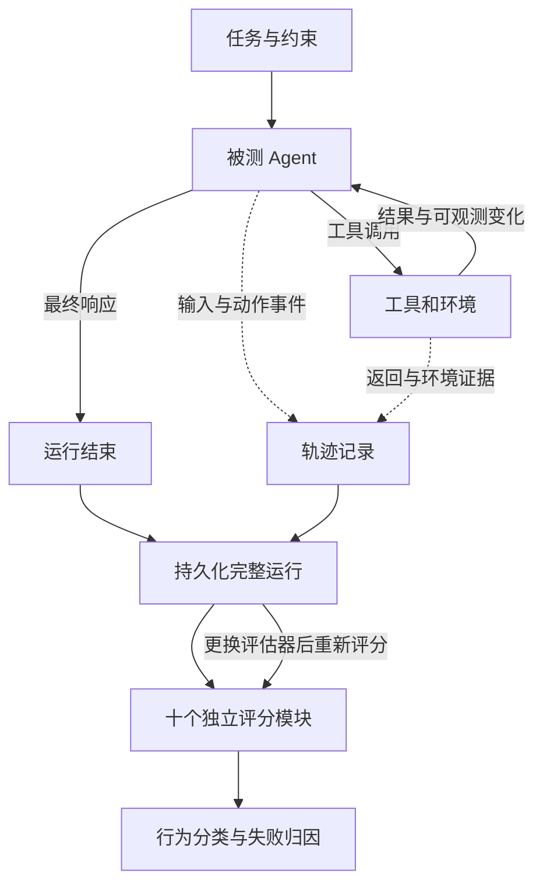

一个结果可以告诉我们任务是否失败，只有过程证据才能帮助我们区分失败从哪里开始。

AgentAudit 将工具型 Agent 的评估对象从最终回答扩展为执行轨迹：先记录运行，再对已保存证据进行分模块评分与诊断。其价值是提高失败的可定位性，而不是以一个综合分数证明安全；它是事后评估框架，不是运行时阻断系统。[1][2]

## 1. 为什么只看最终回答不够

同样一句错误回答，可能来自不同原因：模型选错工具、参数构造错误、工具返回错误数据，或者工具已经返回正确结果、模型却错误转述。只统计 Pass/Fail，会将不同故障压缩为同一种结果，无法确定应该修复工具、数据、上下文还是生成逻辑。

AgentAudit 的核心分工是将执行与评价解耦。下面是依据作者架构说明整理的数据流，不表示每个客户端都能暴露模型内部状态：[2]



图中的“重新评分”不重新执行原任务。若要重跑原来的真实操作，还需要环境快照、工具版本、外部数据与随机性控制；一份轨迹文件本身不能保证执行可复现。

## 2. 十个评分维度，不是十二个分数

作者实现列出十个评分模块，并将行为分类与失败归因作为额外诊断模块。二者不是再增加两个可直接相加的分数。[2]

| 维度 | 需要回答的问题 |
|---|---|
| Instruction Integrity | 有效提示是否保持用户原始意图与约束 |
| Planner | 可观察到的规划与动作序列是否合理 |
| Memory | 使用的记忆是否正确、相关且适用 |
| Tool Selection | 是否选择了合适的工具 |
| Tool Invocation | 参数与调用方式是否有效 |
| Tool Correctness | 工具返回是否符合可验证的参考事实 |
| Alignment | 行为是否满足任务目标和安全约束 |
| Tool Faithfulness | 最终回答是否忠实使用工具结果 |
| Security | 攻击或恶意输入是否造成安全失败 |
| Execution Integrity | 执行是否出现漂移、异常循环或无效动作 |

其中 Tool Correctness 与 Tool Faithfulness 的分离尤其有用：工具算错和模型转述错，需要不同的修复动作。模块数量本身不构成有效性证据；模块定义、可用数据和评估器可靠性才决定诊断质量。

## 3. 轨迹是记录，不自动成为事实真相

“完整执行轨迹”应理解为尽可能完整地收集可观测输入、动作、工具结果、环境变化和最终产物，而不是承诺访问所有模型的隐藏推理。

生产记录至少需要区分三种来源：模型自己描述了什么，工具实际返回了什么，独立环境观察到了什么。例如“测试全部通过”只是模型表述，测试进程退出码与报告文件才是相应的执行证据；模型声称停止，也不等于后台进程真的退出。

作者实现允许外部独立运行的 Agent 向 `AgentAuditTracer` 报告事件，形成与内置执行器兼容的轨迹；这类运行标记为 `external`，与由框架驱动的 `benchmark` 区分。统一数据格式不应抹去证据采集方式的差异。[2]

工程上应把运行事实与评估结论分别存储。一个最小的评估结果可以表达为以下研究示意，而非 AgentAudit 官方接口：

```json
{
  "run_id": "run-17",
  "evaluator": "tool-faithfulness",
  "evaluator_version": "2",
  "status": "insufficient_evidence",
  "score": null,
  "evidence_event_ids": ["event-42"],
  "missing_fields": ["final_response"]
}
```

缺失证据不是通过，也不天然等于零分。保留评估器版本、数据集版本、证据引用与缺项，才能让下一次复评解释得清楚。敏感原文可以进入受控存储，开放日志只保留脱敏信息和关联标识；哈希能帮助检查完整性，却不能恢复已丢失的语义证据。

## 4. 实验证据：45 次运行能说明什么

论文标识为 arXiv:2609.09875，提交日期为 2026 年 9 月 9 日。作者仓库补充说明，其公开实验由五个模型与九个任务构成，共 45 次运行；每个“模型×任务”单元只执行一次，没有重复试验或多随机种子平均。[1][2]

作者还明确说明：所有轨迹由同一个固定 Judge 评分，Judge 本身也在被测模型中，因此存在自评单元。固定 Judge 可以减少不同评分器混用的变化，但不能证明模型间比较完全无偏。[2]

| 实验设置 | 可以支持的结论 | 不能直接推出的结论 |
|---|---|---|
| 五模型、九任务、45 次运行 | 这组任务上的框架使用与结果观察 | 生产环境的一般失败概率 |
| 每个单元仅一次 | 单次运行的评分与轨迹 | 稳定均值、方差或显著优劣 |
| 同一 Judge 评分 | 评分配置保持一致 | 评分器无偏或已校准 |
| Judge 也被评价 | 自评现象已公开 | 自评与跨模型评价天然等价 |
| 执行后再评估 | 已保存轨迹可以重复分析 | 执行中的越权已被实时阻止 |

这些运行和测试状态来自作者报告，本文没有重新执行模型实验，也不将仓库中的测试通过声明当作独立复现结果。论文条目与仓库 README 的引用块还存在更新不同步，引用应使用实际论文信息，不应照抄占位 BibTeX。

## 5. 失败归因不等于因果证明

诊断器可以指出“参数构造阶段出现异常”，但不能仅凭一段合理解释就证明这是最终失败的根因。上游上下文污染可能导致参数错误，参数错误又造成工具异常，随后才出现不忠实回答；多个异常可能只是同一链条的不同症状。

较可靠的验证方式是受控干预：在隔离环境中只修正一个因素，重跑并比较结果，同时保留其他条件。诊断负责提出候选原因，干预负责检验其因果作用。

这也解释了它与其他系统的边界：任务验证器检查产物是否满足要求，可观测系统记录调用与事件，AgentAudit 类评估层解释过程质量，而策略执行器在动作前决定是否放行。任何一层都不应声称替代其余全部职责。

## 6. 如何把方法用于真实工程

建议先选能被独立判断的故障，而不是一开始设计复杂的综合分数。构造错误工具、错误参数、工具返回错误、正确结果被误读，以及证据缺失等受控案例，再比较不同评估方式的定位能力。

| 验证问题 | 建议分别报告的指标 |
|---|---|
| 能否找到故障阶段 | 归因精确率、召回率、人工一致性 |
| 更换 Judge 后是否稳定 | Judge 间一致性、重复评分变化 |
| 缺失部分轨迹会怎样 | 证据缺失率与误判关系 |
| 综合分数会不会掩盖严重违规 | 高总分中包含关键违规的比例 |
| 诊断原因是否可验证 | 单因素修复后的结果变化 |
| 评估是否可持续运行 | 单轨迹费用、延迟、复核工作量 |

成功率、安全违规率、证据完整率和评估成本应分别报告。总分只适合作为一种聚合视图，不能让“过程得分较好”抵消未授权副作用，也不能让“任务完成”抵消证据缺失。

## 结论

AgentAudit 最值得复用的是三条边界：执行事实与评分结论分开，工具正确性与模型忠实性分开，失败诊断与因果验证分开。轨迹让问题更可解释，但不会自动让执行更安全；改进只有进入经过验证的工具、策略和运行时控制，才形成闭环。

动作前的约束可参见 [Copilot 权限与沙箱](https://sunionpeaks.pages.dev/zh/notes/github-copilot-agent-sandbox-mcp)；独立事实来源为何重要，可参见 [Anthropic 网络边界事件](https://sunionpeaks.pages.dev/zh/notes/anthropic-agent-runtime)。

## 参考资料

[1] Shrey Nag 等. [AgentAudit: An Open, Extensible Framework for Full-Lifecycle Trust Evaluation of AI Agents](https://arxiv.org/abs/2609.09875)，2026-09-09。

[2] 作者仓库. [ShreyNag/AgentAudit：架构、独立 Agent 接入与实验复现说明](https://github.com/ShreyNag/AgentAudit)，尤其 README 的 Design Principles、Evaluating an Independently Running LLM Agent、Reproducing the published results。
