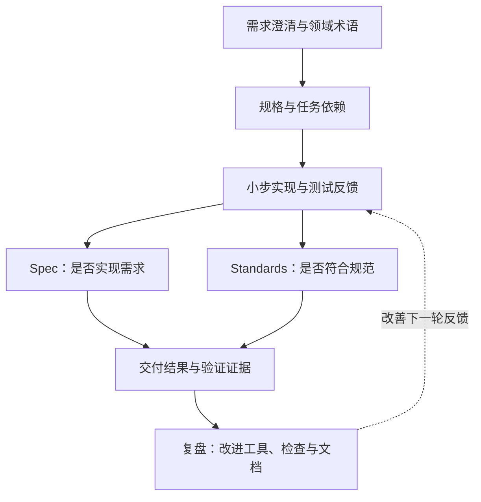
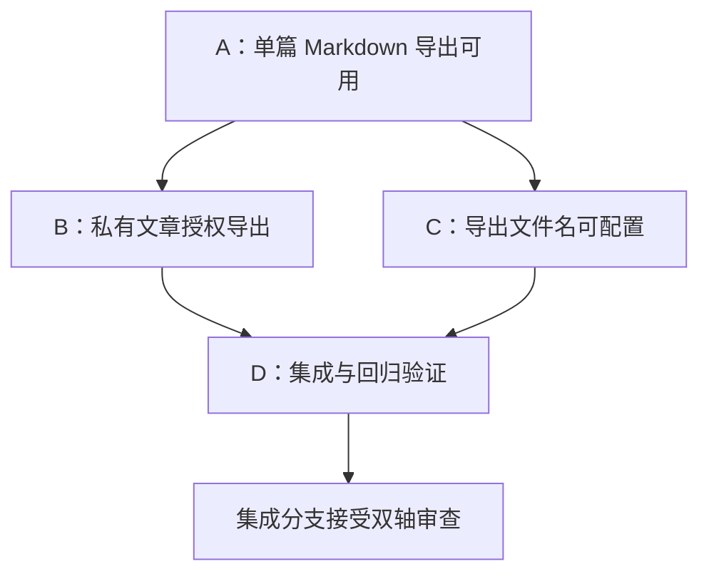

**一个值得复用的 Skill，需要同时说清楚：何时调用、需要什么上下文、执行哪些动作，以及凭什么判断完成。** `mattpocock/skills` 的学习价值，就在于它把需求澄清、设计、测试、审查和复盘连接成一套可组合的工程方法。

AI 编程中常见的落差，发生在“代码已经生成”和“需求真正交付”之间：双方对目标理解不同，测试没有覆盖真实问题，换一个会话又丢失决策背景。这个仓库围绕这些失误组织工作方式，强调小巧、可修改、可组合，让使用者保留流程控制权。[来源：仓库 README][readme]

本文以 **2026 年 10 月 19 日读取到的 `main` 提交 `49dd158d1076`** 为基准，该提交日期为 2026 年 10 月 9 日。插件清单版本为 `1.3.1`，登记了 **27 个 Skill：20 个工程类、7 个生产力类**；这是插件登记数量，不等于仓库所有历史或实验内容的数量。下文分析的是这些文档规定的行为，没有对执行效率或成功率做对照实验。[提交][commit] · [插件清单][plugin]

## 一、从需求到交付，什么被固定下来

这里的 **Skill**，指宿主 Agent 可以发现、读取并据此工作的能力说明包；该仓库通常以 `SKILL.md` 为入口，配合参考文件及宿主元数据。它提供工程方法，实际的文件读写、命令执行和子 Agent 调用仍由宿主完成。[来源：调用约定][invocation]

下图归纳主要能力的关系。它是阅读导图，各环节可以按任务选择，并非每次都要完整执行的强制流水线。

这条链的关键，是把“理解了”“写完了”“看起来没问题”拆成可以分别检查的状态。需求理解、行为正确性和代码质量各有自己的依据；其中一个环节通过，不能替代另一个环节的判断。[来源：需求访谈][grilling] · [TDD][tdd] · [双轴审查][review] · [复盘][retro]

展开查看主要 Skill 分组

| 工作阶段 | 代表 Skill |
| --- | --- |
| 澄清与建模 | `grill-me`、`grilling`、`grill-with-docs`、`domain-modeling` |
| 规划与任务管理 | `to-spec`、`to-tickets`、`wayfinder`、`triage` |
| 实现与诊断 | `implement`、`implement-spec`、`tdd`、`diagnosing-bugs`、`prototype` |
| 架构与审查 | `codebase-design`、`improve-codebase-architecture`、`code-review`、`pr` |
| 研究与交接 | `research`、`handoff` |
| 工作环境与学习 | `retro`、`writing-for-agents`、`setup-matt-pocock-skills`、`ask-matt`、`wizard`、`teach`、`to-questionnaire`、`wait-what` |

这是为阅读整理的功能分组；仓库的正式分类还区分工程/生产力，以及用户调用/模型调用。[来源：README][readme]

## 二、Skill 的关键：触发、组合与上下文

### 入口负责组合，共同方法只维护一份

仓库用调用方式划分职责。**用户调用型** Skill 由人选择启动；**模型调用型** Skill 允许模型根据任务使用，也可以由用户主动调用。在该仓库的设计约定中，用户入口可以调用模型能力，其他 Skill 不应自动启动用户调用型入口。[来源：调用约定][invocation]

`grill-with-docs` 是一个很直观的例子：除元数据外，正文只有一句要求，分别调用 `grilling` 和 `domain-modeling`。访谈规则与领域建模规则各自维护，入口只承担组合责任。[来源：grill-with-docs][grill-with-docs]

**可迁移的设计是“入口编排 + 能力复用”。** 当多个流程需要同一套审查方法时，可以复用同一份能力说明，避免把规则复制进每一个流程。拆分也需要理由：只有必须独立触发或被其他 Skill 复用的能力，才值得增加一个入口。[来源：Skill mechanics][mechanics]

这里还有一个容易忽略的边界：仓库自己的调用约定，比“文件里写了一个名字”更严格。它维护 Claude Code 和 Codex 的不同元数据，并要求依赖调用明确表达。迁移时应检查目标宿主的发现与调用机制；不能把仓库约定当成所有 Agent 平台统一保证的行为。[来源：调用约定][invocation]

### 上下文指针决定资料什么时候进入视野

`writing-for-agents` 提出 **context pointer，上下文指针**：在当前上下文中，说明另一份资料是什么，以及何时需要读取它。Skill 的 `description`、`AGENTS.md` 里指向其他文档的说明，都可以承担这个角色。[来源：writing-for-agents][writing]

下面是一个改写示例：

> 弱指针：参考测试规范。
>
> 更明确的指针：新增或修改导出行为时，读取测试规范中的“导出接口”章节，确认文件完整性、权限和错误响应的检查要求。

第二种写法把触发条件与读取目的连在一起。资料写得再完整，也需要一个能在正确时刻被识别的入口。

该 Skill 还区分两类负担：**上下文负担**，是常驻说明占用的 token 与注意力；**人的认知负担**，是使用者需要记住哪些入口、何时使用它们。按需加载会减少常驻内容，但必须付出指针维护与发现成本。[来源：writing-for-agents][writing]

由此可以推导出一种组织方法：执行步骤留在主文件，各分支都需要的规则就近说明，仅部分场景使用的参考资料按条件读取。目录拆得更细，并不自动意味着更好；必需资料藏得太深，同样会造成遗漏。

**完成条件也属于上下文设计。** 与其写“充分验证后结束”，更可操作的示例是：“原始复现用例在修改前失败、修改后通过；相关回归检查通过；报告运行命令和结果。”清晰的结束条件，比反复要求“认真、全面”更便于检查。仓库将这一点作为提示词设计经验提出，并未提供证明其普遍效果的对照数据。[来源：writing-for-agents][writing]

## 三、让需求、接口和测试使用同一套语言

### 事实由 Agent 调查，取舍由人确认

`grilling` 把需求讨论组织成决策树：每轮只处理前置条件已经明确的问题，同时给出推荐答案。仍依赖其他未决问题的决策，进入后续轮次。代码或工具中可以查到的事实，由 Agent 调查；需要权衡的选择，再交给用户。[来源：grilling][grilling]

以一个贯穿本文的**原创示例——为文档应用增加文章导出功能**——说明这种区分：

| 问题 | 应如何处理 |
| --- | --- |
| 当前是否已有导出接口或渲染服务？ | 查代码、配置和现有调用。 |
| 第一版支持 Markdown，还是包含复杂排版的 PDF？ | 解释成本与限制，再确认产品范围。 |
| “导出成功”指生成任务已创建，还是文件已经可下载？ | 明确定义，因为它决定接口、状态与验收。 |

这个方法的价值是减少“拿未经验证的事实做决策”。它也有成本：仓库倾向于充分访谈并等待确认；对于范围已经明确、风险较低的修改，可以借鉴决策顺序，而不必照搬完整访谈强度。

### 术语表记录含义，ADR 记录重要取舍

`domain-modeling` 要求在概念澄清时及时更新 `GLOSSARY.md`，并用具体边界场景检查术语是否一致。术语表保持为术语表，不混入实现规格或讨论草稿。[来源：domain-modeling][domain]

在导出示例里，可以区分“导出请求”“导出任务”和“导出文件”：请求被接受，并不代表任务执行成功；任务执行成功，也需要约定文件如何获得。这样的词汇区分，可以同时约束接口返回、界面文案和测试名称。这是本文的应用示例，并非仓库内置的数据模型。

**ADR，即架构决策记录**，解释一个重要设计为什么这样选择。仓库要求同时满足“以后修改成本高”“缺少背景会令人疑惑”“确实经历了备选方案权衡”时，才提出创建 ADR。这样可以保留关键理由，也避免每个微小决定都变成文档负担。[来源：domain-modeling][domain]

### 深模块隐藏调用者不必反复处理的复杂性

`codebase-design` 用 **deep module，深模块** 描述一种接口设计：调用者学习较少的接口知识，就可以使用较多的行为。这里的“接口”包含调用顺序、约束、错误模式和配置要求，不仅是函数签名；“深”也不按实现代码行数计算。[来源：codebase-design][design]

在导出示例里，每个调用方都自行处理权限判断、排队、状态轮询和文件获取，会把同一套知识分散出去。将稳定、重复的协调逻辑封装起来，可能降低调用成本；但取消、超时和失败语义仍应对调用者明确可见。这是架构推导，不是把所有步骤塞进一个大函数的建议。

仓库提供了一个实用的**删除测试**：想象移除某个模块。如果复杂性跟着消失，它可能只增加了一层转发；如果复杂性重新散落到多个调用者那里，它就在承担真实职责。[来源：codebase-design][design]

## 四、验收必须抓住真实行为

### 纵向切片让完整反馈尽早出现

`to-tickets` 要求把工作拆成 **vertical slice，纵向切片**：每个任务贯穿所需层次，交付一条窄而完整的行为路径；完成后能单独演示或验证，规模尽量适合一个新的上下文窗口处理，并明确阻塞关系。[来源：to-tickets][tickets]

导出功能的第一片，可以限定为“有权限的用户从文章页下载一份 Markdown 文件”，连同接口、界面入口和关键检查一起完成。复杂 PDF 排版、批量导出和异步队列可以随后增加。这样第一片就能验证用户行为，而不是等各层分别写完后才开始集成。

这条规则有明确例外。仓库针对跨大量调用点的机械重构提出 **expand–contract，扩展—迁移—收缩**：先并存新旧形式，再分批迁移，最后删除旧形式。当批次无法独立保持检查通过时，可以使用共享集成分支，并把完整验证放在最终集成任务上。[来源：to-tickets][tickets]

### 测试边界和预期结果必须能独立成立

当前 `tdd` 强调在预先确认的 **seam，测试接入点** 上观察行为，按“一次失败测试 → 最小实现使其通过”推进。测试应针对约定的公开行为，预期值来自规格、已知正确值或独立算例，避免用实现的同一套逻辑重新计算答案。[来源：tdd][tdd]

例如，验证导出内容时，若“期望文件”也是通过被测导出函数生成的，函数与断言可能共同犯错。更有区分力的例子是：使用固定文章输入，对照独立定义的标题、正文及编码要求检查产物。

**版本细节：该提交的 TDD 正文把重构移到 review 阶段，实施循环聚焦 red → green。** README 仍保留 red-green-refactor 的概述。理解具体规则时应以正文为准，同时把这种分工视为作者的工程取舍，不能当作 TDD 的唯一通用定义。[来源：tdd][tdd] · [README][readme]

### 排错先建立能捕捉具体症状的信号

`diagnosing-bugs` 把反馈循环放在首位：检查需要运行到实际故障路径，并断言用户描述的具体症状，然后才进入复现、最小化、可证伪假设、观测和修复。修复后，还要回到原始场景验证。[来源：diagnosing-bugs][debug]

| 已有证据 | 能证明什么 | 还不能证明什么 |
| --- | --- | --- |
| 构建通过 | 项目满足当前构建条件。 | 导出的内容和排版正确。 |
| 接口返回成功状态 | 这次请求获得成功响应。 | 返回体确实是完整文件。 |
| 原始故障用例修复后通过 | 此次检查未再发现同一症状。 | 所有输入与并发条件都正确。 |

这是本文的证据边界示例。对于间歇性故障，还需要记录触发条件、重复次数与观测结果；一次“没有复现”不应直接解释为故障已消除。原 Skill 同样强调提高并固定可调试的复现率，而非只追求一次漂亮的演示。[来源：diagnosing-bugs][debug]

### 需求审查与规范审查分别报告

`code-review` 先固定 diff 的比较基准，查找需求来源与规范来源，再由两个子 Agent 分别审查 **Spec** 和 **Standards**。缺少需求来源时，应明确报告无法完成需求核对；汇总时保留两个维度，不合并成一个总排名。[来源：code-review][review]

对导出功能而言，“代码结构清晰”和“没有满足私有文章权限要求”完全可能同时成立。保持两条审查线，可以防止一种优点掩盖另一种缺陷。并行审查是该 Skill 规定的组织方式；它本身不构成审查更准确的实证。

## 五、多 Agent 的并发，落在任务与工件上

`implement-spec` 把任务视为带阻塞关系的图。**frontier，就绪任务集合**，指所有前置任务已经完成、现在可以启动的任务。各实现者使用独立 worktree 和分支，结果合入集成分支后，再启动新解锁的任务；所有任务完成后统一审查。[来源：implement-spec][implement-spec]

下面用导出示例说明依赖如何约束并行。A、B、C、D 都是本文假设的任务，并非仓库提供的案例。

A 完成后，B、C 在依赖关系上具备并行条件；它们是否真的适合同时修改，还要检查共享文件与接口。**依赖独立不等于修改互不冲突。** 独立 worktree 可以隔离工作目录，却不会自动消除合并冲突或语义冲突，这是把该方法用于实际项目时必须补上的判断。

另一个值得学习的细节是交接方式。`implement-spec` 要求尽量通过规格、任务、研究笔记和提交的引用传递上下文；`handoff` 同样要求引用已经存在的工件，补充下一轮所需信息，并去除敏感数据。[来源：implement-spec][implement-spec] · [handoff][handoff]

但路径引用有环境前提。原 `handoff` 把交接文档放到操作系统临时目录；`implement-spec` 要求探索笔记位于后续子 Agent 都能访问的位置。若迁移到互相隔离的云端沙箱，必须另行提供共享工件存储和访问权限；仅传一个本机临时路径，无法完成跨环境交接。

**Skill 提供工作约定，运行时承担可靠执行。** 将这种设计产品化时，任务认领、防重复执行、失败重试、并发上限、审批和工作区回收，需要由系统实现并记录状态。本文没有把一份 Markdown 编排说明，视为已经实现这些能力的调度引擎。

## 六、复盘如何变成下一次的可靠性

`retro` 的复盘对象是 Agent 的工作环境：资料是否易找、检查是否接入、日志是否可见、工具结果是否浪费上下文，以及常驻说明是否臃肿。它要求先读现有检查命令和 CI，分清“没有检查”和“检查已经存在但没有正常运行”。[来源：retro][retro]

最有价值的分工是：**可机械判定的问题交给确定性检查；需要上下文判断的问题交给审查规则。** 以下是根据该原则整理的迁移示例：

| 反复出现的问题 | 更合适的改进位置 |
| --- | --- |
| 必填字段、类型或固定导入规则出错 | Schema、类型系统或 lint。 |
| 功能回归只在用户操作时暴露 | 对应行为的自动化测试。 |
| Agent 总找不到配置或决策 | 简短的导航指针。 |
| 抽象过度、跨文件职责不一致 | 带依据的审查标准。 |
| 工具每次返回大量无关内容 | 可筛选的工具参数与精简结果。 |

这也解释了为什么“再加一条提示词”不该成为所有问题的默认解法。若确定性检查已经能拦截错误，把同一规则反复写进常驻上下文，只会增加维护点。真正需要判断的规则，则应记录适用条件和证据，避免泛化成无边界的禁令。

仓库的维护政策进一步要求：改进建议应对应真实会话里观察到的失败，说明运行了什么、实际发生什么、预期是什么。能够组合现有能力解决的需求，不轻易增加新 Skill。这是作者保持仓库范围的政策，也提供了一种控制规则膨胀的思路。[来源：SCOPE.md][scope]

## 七、怎样借鉴，哪些地方需要保留判断

**优先选择一个反复出错的环节，建立可比较的执行记录，再决定是否扩大流程。** 这是基于前述设计提出的应用建议，不是仓库已经验证的实施收益。

改造现有 Skill，可先读 `writing-for-agents` 和 `retro`，清理重复说明、补齐触发条件与完成标准。改善代码交付，可先读 `tdd`、`diagnosing-bugs` 和 `code-review`，让测试信号与用户症状对应。建设多 Agent 工作台，再研究 `to-tickets`、`implement-spec` 和 `handoff`，同时补齐持久状态与共享工件机制。

有三点需要保持边界。**调用兼容性**取决于宿主，照搬元数据不等于得到同样行为。**流程强度**取决于任务风险，完整访谈和双 Agent 审查都有成本。**效果判断**需要执行证据，源码中要求认真验证，并不等于真实运行每次都做到了。

评估时可以记录同类任务的遗漏需求数、复现与回归覆盖、人工返工、工具调用和 token 成本。模型、任务难度与环境尽量保持可比，并保留失败样例。这里列的是验证方向，未提供任何虚构的提效百分比。

**这个仓库最值得带走的，是一套组织工程判断的方法：用清晰的触发入口获得所需上下文，用独立证据界定完成，再把观察到的失误转成更可靠的环境。** Skill 的数量是目录信息，稳定交付才是最终要检验的结果。

源码阅读入口与版本范围

本文链接固定到同一个提交，便于复查。它们描述的是该版本规则，不自动代表后续版本。

- [writing-for-agents][writing] 与 [Skill mechanics][mechanics]：上下文指针、信息分层、调用策略和完成条件。
- [grilling][grilling]、[domain-modeling][domain] 与 [codebase-design][design]：决策顺序、领域语言和模块接口。
- [to-tickets][tickets]、[tdd][tdd] 与 [diagnosing-bugs][debug]：纵向切片、测试边界和可复现反馈。
- [code-review][review]、[implement-spec][implement-spec] 与 [handoff][handoff]：独立审查、任务依赖和跨会话交接。
- [retro][retro] 与 [SCOPE.md][scope]：把真实失败转成环境改进，控制规则膨胀。

[readme]: https://github.com/mattpocock/skills/blob/49dd158d1076134a641b33efb035946536778336/README.md
[commit]: https://github.com/mattpocock/skills/commit/49dd158d1076134a641b33efb035946536778336
[plugin]: https://github.com/mattpocock/skills/blob/49dd158d1076134a641b33efb035946536778336/.claude-plugin/plugin.json
[invocation]: https://github.com/mattpocock/skills/blob/49dd158d1076134a641b33efb035946536778336/.agents/invocation.md
[writing]: https://github.com/mattpocock/skills/blob/49dd158d1076134a641b33efb035946536778336/skills/productivity/writing-for-agents/SKILL.md
[mechanics]: https://github.com/mattpocock/skills/blob/49dd158d1076134a641b33efb035946536778336/skills/productivity/writing-for-agents/SKILL-MECHANICS.md
[grill-with-docs]: https://github.com/mattpocock/skills/blob/49dd158d1076134a641b33efb035946536778336/skills/engineering/grill-with-docs/SKILL.md
[grilling]: https://github.com/mattpocock/skills/blob/49dd158d1076134a641b33efb035946536778336/skills/productivity/grilling/SKILL.md
[domain]: https://github.com/mattpocock/skills/blob/49dd158d1076134a641b33efb035946536778336/skills/engineering/domain-modeling/SKILL.md
[design]: https://github.com/mattpocock/skills/blob/49dd158d1076134a641b33efb035946536778336/skills/engineering/codebase-design/SKILL.md
[tickets]: https://github.com/mattpocock/skills/blob/49dd158d1076134a641b33efb035946536778336/skills/engineering/to-tickets/SKILL.md
[tdd]: https://github.com/mattpocock/skills/blob/49dd158d1076134a641b33efb035946536778336/skills/engineering/tdd/SKILL.md
[debug]: https://github.com/mattpocock/skills/blob/49dd158d1076134a641b33efb035946536778336/skills/engineering/diagnosing-bugs/SKILL.md
[review]: https://github.com/mattpocock/skills/blob/49dd158d1076134a641b33efb035946536778336/skills/engineering/code-review/SKILL.md
[implement-spec]: https://github.com/mattpocock/skills/blob/49dd158d1076134a641b33efb035946536778336/skills/engineering/implement-spec/SKILL.md
[handoff]: https://github.com/mattpocock/skills/blob/49dd158d1076134a641b33efb035946536778336/skills/productivity/handoff/SKILL.md
[retro]: https://github.com/mattpocock/skills/blob/49dd158d1076134a641b33efb035946536778336/skills/engineering/retro/SKILL.md
[scope]: https://github.com/mattpocock/skills/blob/49dd158d1076134a641b33efb035946536778336/SCOPE.md
