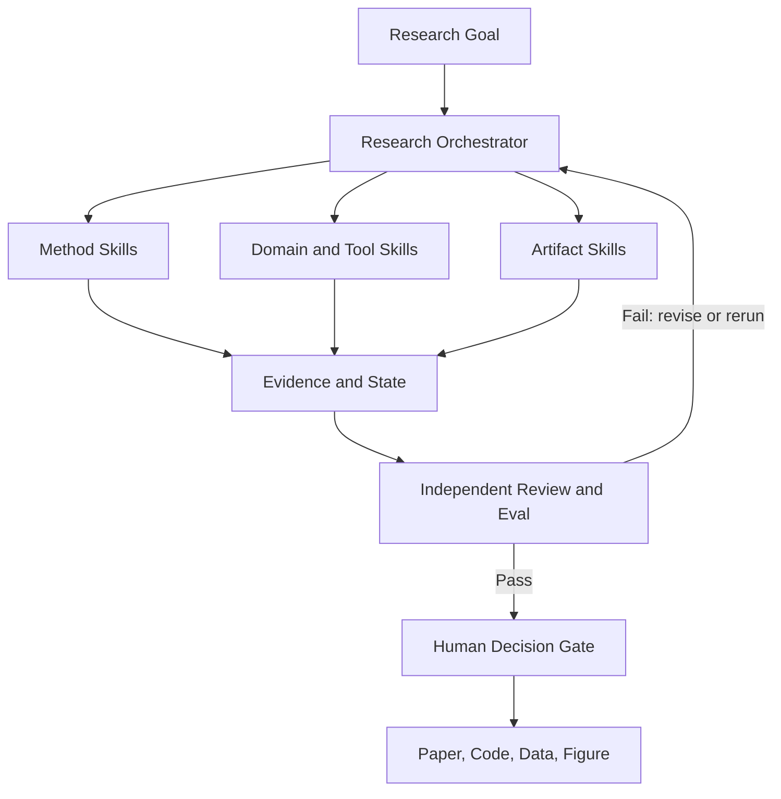

这些开源项目的共同价值，不是提供更多写作提示词，而是把科研活动编码成可执行、可检查、可复用的流程。成熟的科研 Agent 系统会同时管理任务阶段、专业能力、证据状态、评测门禁和最终交付物。Skill 只是其中一个能力包；当 Skill 数量增加，真正决定系统可靠性的会转向 Runtime、Evidence 和 Evaluation。

可以先记住四个判断：

- **Skill 的价值单位不是 Prompt，而是执行契约。** 它应明确输入、步骤、工具、交付物和失败条件。
- **大型 Skill 库解决的是能力覆盖，不自动解决可信度。** 可信度仍需要证据映射、测试和审阅。
- **Research OS 的核心是状态与门禁。** Runtime 决定调用顺序，Evidence 保存事实来源，Eval 决定是否允许继续。
- **科研判断不能完全外包给模型。** 研究问题、方法选择、结果解释和最终主张仍需要人类承担责任。



这张图给出了本文的中心判断：**科研 Agent 不是“模型加一组提示词”，而是一套围绕证据和交付物运行的受控系统。**

## 1. Skill 不是角色提示词，而是执行契约

一个弱 Skill 往往只定义角色：

```text
You are an expert academic researcher.
```

一个强 Skill 会定义任务如何完成：

```text
输入材料 → 检索与工具调用 → 中间 Artifact → 证据核验
→ 审阅门禁 → 修复或继续 → 最终交付物
```

两者的差异不在措辞，而在是否形成可检查的工作边界。

| 维度 | 角色 Prompt | 强 Skill | Research OS |
|---|---|---|---|
| 输入 | 一段自然语言 | 明确材料、约束和前置条件 | 版本化任务、状态和权限 |
| 执行 | 模型自行决定 | 固定步骤与工具协议 | Runtime 路由、暂停、恢复和重试 |
| 输出 | 一段文本 | 文件、图表、代码或检查报告 | 多个关联 Artifact 与状态记录 |
| 证据 | 依赖模型记忆 | 引用、日志或脚本结果 | Claim 与 Source、Run、Artifact 建立关系 |
| 检查 | 自我反思 | Checklist 或验证脚本 | 独立审阅、基准测试和人工门禁 |
| 失败 | 重新生成 | 显示缺失条件 | 阻断、回滚、修复或恢复执行 |

[Supervisor-Skills](https://github.com/HKUSTDial/Supervisor-Skills) 展示了“经验如何变成程序”。它采用 Handbook + Skills 的双轨结构：Handbook 保存导师式判断框架，Skills 将 Idea 评估、论文写作、预投稿审阅和答辩回复转成可执行流程。

[AI Research Writing Skill](https://github.com/jin-s13/ai-research-writing-skill) 则把写论文定义为“Claim-Evidence Engineering”。它要求生成 `paper_story.md`、`claim_evidence_map.md`、经过核验的引用、图表、LaTeX 和构建检查，而不是只输出流畅段落。

[Academic Figure Generator](https://github.com/dongzhuoyao/academic-figure-generator) 的范围更窄，但它体现了同一原则：输出不是一次性图片，而是可继续编辑的 Draw.io Artifact。它因此是一个明确的生产力 Skill，而不是完整科研 Agent。

## 2. 这些项目处在不同架构层，不能只按热度比较

截至 2026-10-06，这些仓库已经分化为四种角色。

| 项目 | 主要角色 | 可核验的工程特征 | 适用边界 |
|---|---|---|---|
| [Academic Research Skills](https://github.com/Imbad0202/academic-research-skills) | 全流程 Research OS | 分阶段流水线、Artifact 矩阵、完整性门禁、逐阶段人工确认 | 体系完整但偏 Claude 生态；项目设计不等于跨系统效果证明 |
| [ARIS](https://github.com/wanshuiyin/Auto-claude-code-research-in-sleep) | 长时间执行与独立审阅 | Executor 与 Reviewer 分离、循环状态、跨模型审阅、恢复执行 | Reviewer 仍是模型；模型不同不等于结论独立正确 |
| [Supervisor-Skills](https://github.com/HKUSTDial/Supervisor-Skills) | 专家方法论与判断 Skill | Handbook + 可执行 Skills，把隐性经验转成流程 | 经验来自特定团队和学科背景，不是通用质量基准 |
| [PaperSpine](https://github.com/WUBING2023/PaperSpine) | 论文生产与交付工作台 | 文献、论点、大纲、正文、图表、引用检查、Word/LaTeX/PDF 交付 | 当前版本为 alpha；运行平台和发布边界仍需核对 |
| [Scientific Agent Skills](https://github.com/K-Dense-AI/scientific-agent-skills) | 科学领域能力库 | 177 个 Skills，覆盖数据库、Python 包和研究流程；包含测试与安全扫描 | 能力覆盖广，但不是单一的端到端 Research Runtime |
| [Auto-Empirical Research Skills](https://github.com/brycewang-stanford/Auto-Empirical-Research-Skills) | 实证研究方法库与信任面 | Eval harness、数值基准、评分板、安全检查、方法学陷阱测试 | 重点在社科和计量方法；公开覆盖仍是必要但不充分的证明 |
| [Orchestra AI Research Skills](https://github.com/Orchestra-Research/AI-Research-SKILLs) | AI 研究编排与工程能力 | `autoresearch` 编排层加训练、评测、推理、MLOps 等 98 个 Skills | “自主科研”是项目定位；具体可靠性需逐 Skill 和任务验证 |
| [Nature Skills](https://github.com/Yuan1z0825/nature-skills) | 阅读、写作、审稿与科研图 Skill Pack | 20 个面向论文生产的 Skills，覆盖阅读、润色、写作、回复与绘图 | 更接近出版工艺包，不是 Research OS；应直接检查 Skill 文件而非营销叙事 |
| [AI Research Writing Skill](https://github.com/jin-s13/ai-research-writing-skill) | Evidence-bound 论文包 | Claim-Evidence Map、引用验证、构建与投稿检查 | 聚焦 ML/AI 会议论文，不覆盖完整科研生命周期 |
| [Academic Figure Generator](https://github.com/dongzhuoyao/academic-figure-generator) | 可编辑科研图生成 | Image/Prompt/DSL 转 Draw.io，可导出 SVG、PNG、PDF | 单点工具，不提供证据管理或研究判断 |
| [Deep Research Skill](https://github.com/ravmike/deep-research-skill) | 通用 Deep Research 流程 | Scope、Retrieve、Triangulate、Critique、Refine 等阶段 | 流程可参考；“无限长度”等性能主张缺少公开可复现基准 |

这张表说明一个常见误区：**Skill 数量不是统一指标。** 一个拥有大量数据库 Skills 的项目，与一个提供论文状态机的项目，解决的是不同问题。

## 3. Evidence 和 Eval 是可靠性的分界线

科研任务的风险不是“文字不够自然”，而是系统生成了一个看似合理、实际上没有证据的结论。

### 3.1 Evidence：让主张可以回到事实来源

成熟项目开始把 Claim 与 Source、实验运行和交付物绑定。

[Academic Research Skills 的架构文档](https://github.com/Imbad0202/academic-research-skills/blob/main/docs/ARCHITECTURE.md) 明确列出 Stage、Skill、Artifact、Data Level 和 Gate。它还设置完整性阶段，用于检查引用、实验结果、方法和实现是否存在已知失败模式。

[PaperSpine](https://github.com/WUBING2023/PaperSpine) 暴露了 `citation_support_bank`、`reference_inventory.py`、`citation_bank_check.py`、`latex_guard.py` 和 `word_guard.py` 等工具。这些工具把“论文写完了”拆成可检查的交付条件。

[AI Research Writing Skill](https://github.com/jin-s13/ai-research-writing-skill) 更直接地要求每个重要主张回到代码、日志、结果、笔记或已验证引用。它把证据缺口保留下来，而不是让模型用更流畅的语言掩盖缺口。

一个可审计 Claim 至少需要：

```text
Claim
├── Source or Experiment Run
├── Exact Locator or Result Artifact
├── Version and Configuration
├── Confidence or Evidence Status
└── Review Status
```

只保存 URL 仍然不够。真实存在的论文也可能并不支持当前主张。可靠系统必须检查“来源是否支持 Claim”，而不是只检查“来源是否存在”。

### 3.2 Eval：让 Skill 有机会被证明做错

[AERS 的 Trust Surface](https://github.com/brycewang-stanford/Auto-Empirical-Research-Skills/blob/main/docs/TRUST.md) 把信任拆成四个轴：Skill 结构卫生、方法学覆盖、数值基准和运行时安全。它的数值基准会重新计算 gold values，并检查弱工具变量、错用 TWFE、RDD 偏误和 bad control 等高成本错误。

这种设计比“再让模型检查一遍”更强，因为判定标准来自数据和方法，而不是模型对自身文本的感觉。

但项目也明确承认边界：正则 Rubric 不能认证文章质量，小型数值基准不能覆盖所有实证设计。**Eval 的作用是暴露已知失败，不是颁发通用正确性证书。**

### 3.3 Independent Review：减少同一上下文的自我确认

[ARIS](https://github.com/wanshuiyin/Auto-claude-code-research-in-sleep) 将执行模型与审阅模型分离。它的 reviewer routing 甚至要求审阅模型与执行模型属于不同模型家族；无法确认模型身份时，接受门禁可以失败关闭。

这比单模型自我反思更可靠，但仍有明确边界：

- 不同模型可能共享相同训练偏差；
- Reviewer 只能看到传给它的证据；
- 评分阈值可能优化错目标；
- 两个模型达成一致不等于事实正确。

因此，独立 Reviewer 应当是 Eval 的一个组件，而不是最终真理来源。

## 4. Skill 一多，问题就从内容转向 Runtime

单个 Skill 可以靠人工调用。几十个或上百个 Skill 同时存在时，系统必须回答新的工程问题：

1. **Routing：** 当前任务应该调用哪个 Skill？多个 Skill 冲突时如何选择？
2. **State：** 当前处于选题、实验、审阅还是修改阶段？哪些事实已经确认？
3. **Artifact：** 哪个版本的代码、数据、图和论文属于同一次研究运行？
4. **Recovery：** 工具失败、模型中断或审阅不通过后，从哪里恢复？
5. **Compatibility：** Skill、模型、依赖库和外部 API 更新后，旧流程是否仍然有效？
6. **Authority：** 哪些动作可以自动执行，哪些结论必须由人确认？

[Orchestra AI Research Skills](https://github.com/Orchestra-Research/AI-Research-SKILLs) 已经将 `autoresearch` 定义为中央编排层，并把训练、评测、推理和写作 Skills 作为可路由能力。

[ARIS](https://github.com/wanshuiyin/Auto-claude-code-research-in-sleep) 通过循环状态和 Reviewer 反馈持续修改研究产物。

[Academic Research Skills](https://github.com/Imbad0202/academic-research-skills) 则明确维护阶段状态、Artifact 和阻断门禁。

这些设计共同说明：**当能力包开始共享状态和交付物时，系统已经不再是 Skill Collection，而是在形成 Research OS。**

## 5. 一个具体例子：如何处理“准确率提升 6.2%”

下面是一个虚构数字，仅用于说明机制。

假设实验日志中出现一句：

> Method A 在 Dataset D 上比 Baseline B 提升 6.2%。

不同系统会产生不同处理方式。

| 步骤 | 普通写作 Agent | 可验证的 Research OS |
|---|---|---|
| 读取结果 | 从对话或摘要中看到 6.2% | 读取指定 Run、配置、数据版本和结果文件 |
| 识别指标 | 可能默认是 Accuracy | 确认指标名称、单位、聚合方式和置信区间 |
| 比较基线 | 直接写“提升 6.2%” | 检查是绝对百分点还是相对提升，并确认 Baseline 条件一致 |
| 形成 Claim | 生成流畅句子 | 在 Claim-Evidence Map 中绑定结果表和运行记录 |
| 审阅 | 模型自问“是否合理” | 脚本检查数值，Reviewer 检查解释，失败则阻断 |
| 发布 | 放入摘要和结论 | 人确认统计与科学含义后，才允许进入最终主张 |

这个例子说明，科研 Agent 的关键能力不是把数字写进论文，而是维护从数字到结论的证据链。

## 6. 人类门禁应该放在哪里

“Human-in-the-loop” 只有放在正确节点才有意义。每一步都让用户点确认，只会制造确认疲劳。

高价值门禁通常位于四类决策：

- **Research Question：** 系统是否在回答真正的问题？
- **Methodology：** 数据、方法和评价指标是否足以支持目标结论？
- **Interpretation：** 结果说明了什么，又没有说明什么？
- **Final Claims：** 哪些主张可以公开，哪些仍然是推测或待验证假设？

Academic Research Skills 的逐阶段确认展示了一种明确做法。Scientific Agent Skills 在临床、动物实验和标准合规相关 Skill 中也反复声明：Skill 可以准备研究证据或草稿，但不能替代诊疗、认证或方法放行决策。

需要注意：**存在人工门禁不等于门禁有效。** 系统仍需向人展示足够的证据、差异和风险，否则用户只能机械点击继续。

## 7. 选择 Skill 时，先检查七个问题

不要先看 Stars，也不要先问“它有多少 Skills”。先检查下面七项。

| 问题 | 良好信号 | 风险信号 |
|---|---|---|
| 输入是否明确？ | 列出需要的文件、数据、版本和约束 | 只要求一句宽泛 Prompt |
| 输出是否可持久化？ | 生成代码、表格、证据表、引用库或可编辑文件 | 只返回聊天文本 |
| Claim 是否绑定证据？ | 有 locator、run ID、artifact 或证据状态 | 只附一个参考链接 |
| 是否有失败语义？ | 缺证据时阻断、标记或要求补充 | 总能生成一个完成答案 |
| 是否有 Eval？ | 有测试、基准、负样例和明确覆盖边界 | 只有 Demo 和成功截图 |
| 是否管理版本？ | 记录 Skill、依赖、模型、数据和 API 版本 | 更新后无兼容性说明 |
| 人类在哪做决定？ | 在方法、解释和最终主张处确认 | 只在最后点一次“接受” |

如果一个项目只能回答“模型会按这些文字做”，它更接近 Prompt Pack。只有当它能回答“产生什么 Artifact、怎样验证、失败后怎么办”，它才接近工程化 Skill。

## 8. 按缺失层选项目，而不是一次安装全部

- **缺完整论文流水线：** 先看 Academic Research Skills 或 PaperSpine；需要持续执行与独立审阅时再看 ARIS。
- **缺导师式判断：** 看 Supervisor-Skills；它更适合补方法论和审稿视角。
- **缺科学工具与数据库能力：** 看 Scientific Agent Skills；做 AI 训练、推理和基础设施研究时看 Orchestra。
- **缺实证方法与可测评约束：** 看 AERS，重点学习其 benchmark 和 trust surface，而不只是复制目录。
- **缺 Evidence-bound 论文交付：** 看 AI Research Writing Skill；期刊式润色、回复和科研图可参考 Nature Skills。
- **只缺可编辑图：** 使用 Academic Figure Generator，不必引入完整 Research Runtime。
- **缺通用研究流程：** Deep Research Skill 的阶段设计可借鉴，但应自行补充基准、证据边界和结果核验。

最稳妥的路径是先定位当前瓶颈，再接入一个层。能力覆盖不足时增加 Skill；状态和协作失控时增加 Runtime；结论不可信时增加 Evidence 与 Eval。

## 结论

科研 Agent 的长期形态不会是“一个更大的 Prompt”，也不会是“安装尽可能多的 Skills”。更合理的结构是：

```text
Research OS
=
Orchestrator
+ Composable Skills
+ Tools
+ Evidence and State
+ Evaluation and Review
+ Human Judgment
+ Durable Artifacts
```

Skill 将专家知识和工具流程变成可调用能力。Runtime 负责顺序、状态和恢复。Evidence 负责让结论可追溯。Eval 负责让错误有机会阻断流程。人类最终决定研究问题、方法和公开主张。

这套结构不只适用于科研。任何从“回答问题”走向“完成高风险任务”的 Agent，最终都会面对同样的工程边界。

## 参考资料

核验日期：2026-10-06。以下均为项目仓库或仓库内的一手文档。

- https://github.com/Imbad0202/academic-research-skills
- https://github.com/Imbad0202/academic-research-skills/blob/main/docs/ARCHITECTURE.md
- https://github.com/wanshuiyin/Auto-claude-code-research-in-sleep
- https://github.com/wanshuiyin/Auto-claude-code-research-in-sleep/blob/main/skills/shared-references/reviewer-routing.md
- https://github.com/HKUSTDial/Supervisor-Skills
- https://github.com/WUBING2023/PaperSpine
- https://github.com/K-Dense-AI/scientific-agent-skills
- https://github.com/brycewang-stanford/Auto-Empirical-Research-Skills
- https://github.com/brycewang-stanford/Auto-Empirical-Research-Skills/blob/main/docs/TRUST.md
- https://github.com/Orchestra-Research/AI-Research-SKILLs
- https://github.com/Yuan1z0825/nature-skills
- https://github.com/jin-s13/ai-research-writing-skill
- https://github.com/dongzhuoyao/academic-figure-generator
- https://github.com/ravmike/deep-research-skill
