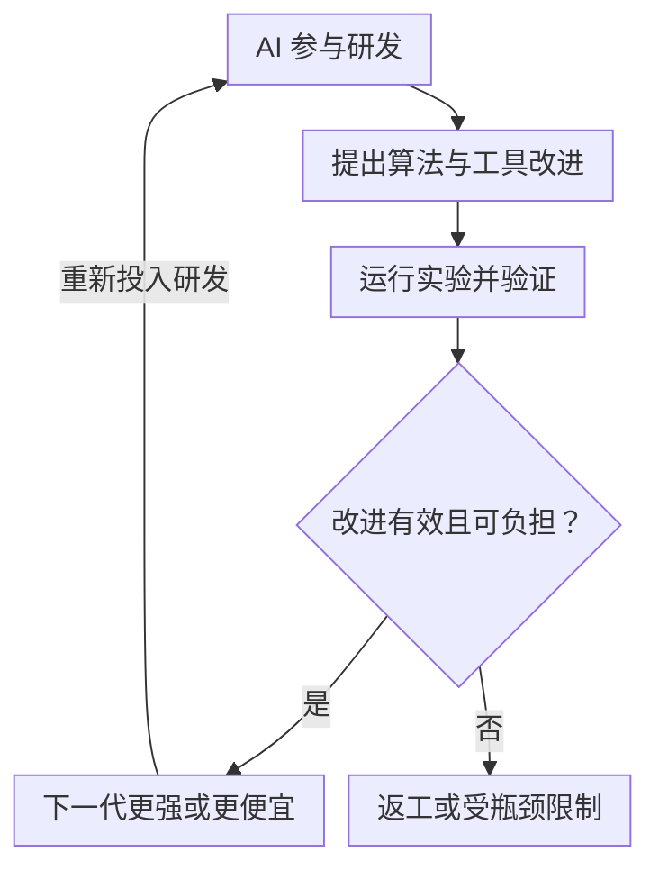

**AI 写出更多代码，不等于智能爆炸已经发生。关键是：研发成果能否持续反哺下一轮研发，让进步本身越变越快。**

Hinton 在[原帖](https://x.com/geoffreyhinton/status/2106122709285368061)中指出，递归自我改进并非新想法，但一些研究者开始认为它可能较快发生。他链接的共同署名工作论文《What if automating AI R&D triggers an intelligence explosion?》，讨论的是一条**值得提前准备、尚未被证实的加速路径**，不是宣布进入倒计时。[论文与原始材料](https://casp.ac/reports/intelligence-explosion)

## 不是“会写代码”，而是研发形成反馈

**AI 研发（R&D）**包括提出方案、写代码、运行实验、评估结果和训练下一代系统。**智能爆炸**指进步的速度被自身改进显著放大，而不只是模型又强了一点。论文重点考察软件改进能否迅速重新投入研发；硬件制造和建设则通常需要更久。[论文，PDF 第 3–5 页](https://casp.ac/__l5e/assets-v1/5efd4b41-deb5-4513-a0a3-b4f82d2b79ea/intelligence-explosion.pdf#page=3)

下面把论文的反馈机制与验证瓶颈合在一张示意图中：



**有反馈，不代表反馈一定越滚越快。** 这也不要求同一个模型在线修改自己的权重：上一代协助设计、训练下一代，再把下一代投入研究，也能构成回路。是否“爆炸”，取决于每轮收益能否持续超过新增的困难与成本。

## 已经观察到什么，尚未证明什么

论文引用的两个醒目数字，测量的是不同东西：

| 信号 | 实际口径 | 不能推出 |
|---|---|---|
| **超过 80%**，2026 年 5 月 | Anthropic 合入生产的代码行中，可归因于 AI 的份额 | 80% 的科学判断已自动化 |
| **26%**，2026 年 8 月 | 内部研发任务篮子中，按人时代理加权、达到“AI 主导”的份额 | 完全自主研发，或生产率提高 26 倍 |
| **完全自主尚未达到** | 上述测量覆盖的任务类别未达到 AL5 | 所有实验室都不可能做到 |

“AI 主导”（AL4）意味着可以根据高层指令完成大部分任务，**人仍负责监督**；AL5 才是无需人在回路中。26% 来自企业内部的任务分类与模型评分，不是直接观测的全部研发产出占比。原始方法还披露了固定任务篮子、模型裁判和跨实验室可比性等限制。[代码归因口径](https://www.anthropic.com/institute/recursive-self-improvement) · [自动化指数及方法](https://www.anthropic.com/institute/measuring-pace-of-ai-development)

**这些证据支持“研发分工正在改变”，不足以单独证明“持续自我加速已经建立”。** 论文自己也写明，现有生产率收益尚未达到其所讨论的触发门槛；“正在接近”是作者判断。[论文，PDF 第 6 页](https://casp.ac/__l5e/assets-v1/5efd4b41-deb5-4513-a0a3-b4f82d2b79ea/intelligence-explosion.pdf#page=6)

## 四个瓶颈：复制研究者，不等于复制研究成果

| 瓶颈 | 反馈为何可能变慢 | 还要验证什么 |
|---|---|---|
| **收益递减** | 好点子越来越难找，重复研究增加 | 多投入一倍研究劳动，实际多产出多少有效改进？ |
| **算力与数据** | 候选方案变多，实验与高质量反馈未必跟得上 | 小规模发现能否迁移到前沿规模？ |
| **剩余难任务** | 关键问题仍需人工判断或处理 | 最慢的那一步是否也在被加速？ |
| **串行耗时** | 训练、验证和依赖顺序无法无限并行 | 缩短的是端到端周期，还是局部环节？ |

这四项来自论文的机制分析，不是已被全部排除的障碍。[论文，PDF 第 5–6 页](https://casp.ac/__l5e/assets-v1/5efd4b41-deb5-4513-a0a3-b4f82d2b79ea/intelligence-explosion.pdf#page=5)

**一个简化算例就能看出差别。** 假设串行研发周期共 100 小时，其中构思与编码占 80 小时，训练和验证占 20 小时。前一部分提速 10 倍后，总耗时仍是 `8 + 20 = 28 小时`，整体约快 **3.6 倍**。即使前一部分瞬间完成，整体也最多快 5 倍。这是说明瓶颈的假设例子，时间占比与上面的代码占比无关，也不是实验室实测。

算力尤其不能简单判定。Whitfill 与 Wu 用同一批历史数据拟合不同模型：基线模型支持研究劳动与算力相互替代；加入前沿实验规模约束后，两者更像互补投入。**模型设定会改变“堆更多 AI 能否绕过算力不足”的答案**，两种结果都不是未来必然发生的证明。[原研究，摘要与模型](https://arxiv.org/html/2507.23181v2)

## “约 17 个月加速十倍”，到底在说什么？

**这是充分自动化之后、特定参数与瓶颈假设成立时的情景计算。增加十倍的是“进步速率”，不是智力水平，更不是从今天起算的期限。**

论文采用历史研究参数，并暂时忽略算力与数据瓶颈，推演研发反馈不断加速的路径。它有解释价值，但不能把条件句读成预测结果。[论文补充材料，PDF 第 13–14 页](https://casp.ac/__l5e/assets-v1/5efd4b41-deb5-4513-a0a3-b4f82d2b79ea/intelligence-explosion.pdf#page=13)

<details>
<summary>展开：反馈条件 r ＞ 1 与 17 个月的计算</summary>

用 A 表示软件质量、E 表示有效研发劳动，论文采用简化的知识生产模型：

```text
dA/dt = A^(1−β) × E^λ

充分自动化，并假设 E = kA：
dA/dt = c × A^(1+λ−β)

相对进步速率 g = (1/A) × dA/dt = c × A^(λ−β)
r = λ/β
```

λ 描述研发劳动的规模收益，β 描述进一步寻找改进的难度。在这些假设下，r 大于 1 时，相对进步速率随 A 上升；等于 1 时保持不变；小于 1 时逐渐放缓，并不意味着已有能力倒退。

论文取三类研究的中心参数平均值，λ 约 1.40、β 约 1.01。因此 A 每翻倍，进步速率乘以 `2^0.39 ≈ 1.31`，下一次翻倍所需时间约为前一次的 76%。再假设第一次软件效率翻倍需要 4.5 个月，连续九次翻倍约需：

```text
4.5 × (1 − 0.76^9) / (1 − 0.76) ≈ 17 个月
```

此时进步速率累计增加超过十倍。算式描述的是一条假设路径，精确写出月份不会降低其前提的不确定性。

历史参数也不是定论：对应研究的 r 中位估计约为 1.2–1.9，但计算机视觉与强化学习的 90% 可信区间都跨过了关键阈值 1。原作者还强调研究投入代理、算力共同增长、并行上限等建模问题。[参数原研究及附录](https://epoch.ai/gradient-updates/the-software-intelligence-explosion-debate-needs-experiments)

尤其需要检验 E 与 A 的关系：推理效率提高可以运行更多副本；“模型更聪明”能否线性换算成“更多有效研究者”，则是额外假设。真实世界也不允许模型在有限时间内产生无限进步。[论文补充材料，PDF 第 13–14 页](https://casp.ac/__l5e/assets-v1/5efd4b41-deb5-4513-a0a3-b4f82d2b79ea/intelligence-explosion.pdf#page=13)

</details>

<details>
<summary>展开：“数百万研究者”是怎样换算出来的？</summary>

论文用每日可生成的 token 数，除以一个研究者工作日对应的 token 数，估算潜在的等效研究劳动：

```text
10^13 token/天 ÷ (5×10^5 token/研究者日)
= 2×10^7 研究者日/天
```

中心值相当于 2,000 万个研究者的每日工作量。把每研究者日 token 消耗上下各放宽一个数量级，区间约为 **200 万至 2 亿**，不是 200 万至 2,000 万。

前提是未来 AI 已达到专家水平，同时保有假定的运行成本和可用于此任务的算力。token 吞吐不直接等于可靠发现，也未证明这些研究工作都能并行开展。因此，这不是“今天已有数百万顶尖科学家在自主工作”的观测。[论文补充材料，PDF 第 13 页](https://casp.ac/__l5e/assets-v1/5efd4b41-deb5-4513-a0a3-b4f82d2b79ea/intelligence-explosion.pdf#page=13)

</details>

## 真正紧迫的是：纠错窗口会不会缩短？

论文认为，加速可能提前带来科学与技术收益，也可能让风险到来得比社会应对更快。它聚焦三条风险链：

| 变化 | 风险 | 对应的政策建议 |
|---|---|---|
| **迭代更快** | 测试、制度与现实防御赶不上 | 提前测量自动化进度、建立应急预案 |
| **人参与更少** | 缺少发现与纠正错误的机会 | 在内部研发部署阶段评估，保留隔离与暂停能力 |
| **领先优势自我放大** | 权力集中，外部制衡变弱 | 独立核验、跨主体协作及防止权力滥用 |

这些是论文的治理主张，不是已生效的统一规则；限速和干预本身也会推迟收益，或被滥用于偏袒特定机构。AI 同样可能加速安全研究，净效果仍取决于验证能力、部署顺序与现实约束。[论文，PDF 第 7–10 页](https://casp.ac/__l5e/assets-v1/5efd4b41-deb5-4513-a0a3-b4f82d2b79ea/intelligence-explosion.pdf#page=7)

**判断这条路径是否正在成立，最值得跟踪的不是代码行数，而是同等资源下的端到端研发产出、瓶颈环节耗时，以及监督能否及时纠偏。** 这是从论文机制得到的判断框架，不是作者给出的统一触发阈值。

不确定性并不等于可以忽略风险；但提前准备，也不需要把条件推演包装成确定预言。

<details>
<summary>原始材料与阅读范围</summary>

主论文发表于 2026 年 9 月，属于 Frontier AI Working Paper Series No. 2/2026。它是证据综合、建模与政策讨论，不是演示智能爆炸的新实验。研究者共同署名，也不代表各自机构作出相同承诺。

- [Hinton 原帖](https://x.com/geoffreyhinton/status/2106122709285368061)
- [CASP 论文入口与完整 PDF](https://casp.ac/reports/intelligence-explosion)
- [Anthropic：AI 参与自身研发](https://www.anthropic.com/institute/recursive-self-improvement)
- [Anthropic：研发自动化指数与测量方法](https://www.anthropic.com/institute/measuring-pace-of-ai-development)
- [Ho、Whitfill：软件智能爆炸需要哪些实验](https://epoch.ai/gradient-updates/the-software-intelligence-explosion-debate-needs-experiments)
- [Whitfill、Wu：算力瓶颈研究](https://arxiv.org/html/2507.23181v2)

</details>
