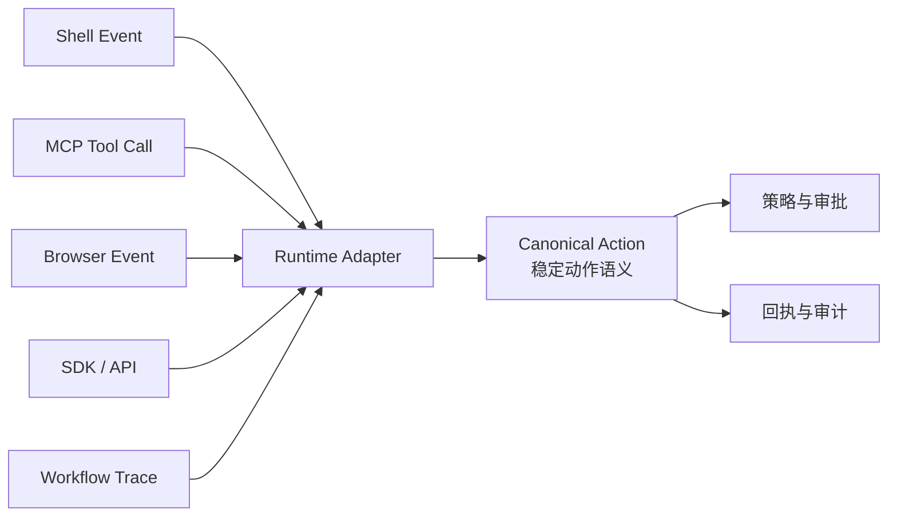
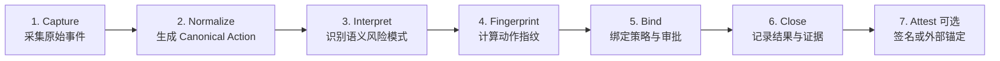
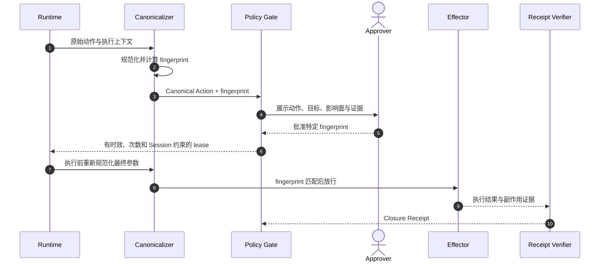
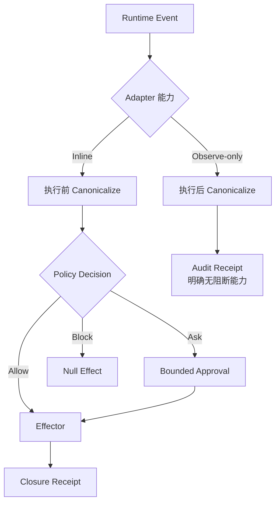

CAVA 将 Shell、MCP、Browser 与 Workflow 中形态各异的执行事件归一为稳定动作对象，使策略、审批、回执和审计绑定同一语义身份。

> 原始论文：Zexun Wang, *CAVA: Canonical Action Verification and Attestation for Runtime Governance of Agentic AI Systems*, arXiv:2607.13716v1, 2026-07-15。  
> 阅读重点：动作身份、审批漂移、回执完整性、运行时覆盖深度，以及论文证据能够支持到什么程度。

## 一、问题不是“调用了什么工具”，而是“执行了什么动作”

Agent 的真实风险发生在 Runtime 产生副作用时：发布代码、修改身份权限、删除资源、触发付款、导出数据或创建公开链接。同一业务动作可以经过完全不同的执行表面：

```text
Shell      git push origin main
MCP        repository.push(branch="main")
SDK        client.push({ branch: "main" })
Browser    点击 Publish
API        POST /deployments
Workflow   release.transition("publish")
```

如果治理规则只匹配命令字符串、工具名或第一个 Token，会产生两类相反错误：

- **语义等价未收敛**：`git push` 被拦截，`env ... git push` 或 SDK 包装调用却绕过规则。
- **语义不同被混淆**：文档搜索中出现 `git push` 被误判为真实发布动作。

CAVA 的出发点是先建立可重现的动作身份，再把策略、审批和证据绑定到该身份。



这不是通用日志格式。日志回答“记录到了什么”，Canonical Action 要回答“授权对象究竟是什么”。

## 二、Canonical Action 的形式化定义

论文把原始运行时事件记为 `a`，通过 Canonicalizer 映射为：

```text
C(a) = (v, r, e, o, k, S, τ, u, m)
```

| 符号 | 字段 | 含义 | 治理作用 |
|---|---|---|---|
| `v` | `schema_version` | Canonical Schema 版本 | 固定互操作边界 |
| `r` | `runtime` | Shell、MCP、Browser 等 Runtime 家族 | 声明事件来源与覆盖条件 |
| `e` | `executable` | `git`、`kubectl`、支付工具等 | 标识执行能力 |
| `o` | `operation` | `push`、`delete`、`payment_trigger` | 表达规范化操作 |
| `k` | `category` | Deployment、Payment、Identity 等 | 进入风险分类 |
| `S` | `systems_touched` | GitHub、数据库、云资源等 | 估计影响面 |
| `τ` | `reversible` | 是否可逆 | 决定审批与恢复要求 |
| `u` | `target / subject` | 分支、账户、租户、资源或钱包 | 绑定实际目标 |
| `m` | `adapter_metadata` | Adapter、置信度、覆盖深度 | 披露解析可信度 |

随后对选定治理字段进行确定性序列化并计算指纹：

```text
F(a) = H(canon(C(a)))
```

这里最关键的是 `canon`，而不是 SHA-256 本身。只有字段选择、默认值、排序、Unicode、空值和版本规则都稳定，两个验证方才会得到相同指纹。

### 2.1 哪些字段应该进入指纹

适合进入指纹的字段需要同时满足“影响动作含义”和“执行前可确定”：

```json
{
  "schemaVersion": "cava.v1",
  "operation": "push",
  "category": "deployment",
  "systemsTouched": ["source-control"],
  "target": {
    "repository": "service-repository",
    "branch": "main"
  },
  "reversible": false,
  "externality": "external-write"
}
```

时间戳、展示文案、日志 ID、风险分数和 Adapter 调试字段通常不应进入动作身份；它们可能变化，但不会改变动作本身。Actor、Session、Policy Version 和批准时效则更适合进入审批租约，而不是混入跨 Runtime 的动作语义指纹。

### 2.2 Canonicalization 的两个目标必须同时成立

| 性质 | 期望 | 失败后果 |
|---|---|---|
| Semantic Equivalence | 相同副作用的不同表达得到同一身份 | 包装器或别名绕过 |
| Semantic Separation | 实质不同的动作保持不同身份 | 批准 A 却执行 B |

过度归一化和归一化不足同样危险。把 `git status` 与 `git push` 合并会造成误拦截；把 `git push` 与 `bash -c "git push"` 分开则留下绕过路径。

## 三、CAVA 协议：从事件到可验证回执

论文正文称其为“六阶段协议”，但枚举和图示实际包含七个步骤；更准确的理解是六个必经阶段，加一个可选的 Attest 阶段。



| 阶段 | 输入 | 产物 | 失败时的安全策略 |
|---|---|---|---|
| Capture | Runtime Event、Actor、Session | 原始证据包 | 标记采集缺口 |
| Normalize | 原始证据、Adapter Version | Canonical Action | 高风险未知动作进入人工确认 |
| Interpret | Action、Boundary、Data Context | Semantic Patterns | 缺少上下文时降低置信度 |
| Fingerprint | 版本化治理字段 | Canonical Fingerprint | 序列化失败则拒绝绑定 |
| Bind | Fingerprint、Policy、Approver | Allow / Ask / Block / Observe | 任何关键字段变化均重新审批 |
| Close | 执行结果、副作用、异常 | Closure Receipt | 未闭环动作保持未完成状态 |
| Attest | Receipt Digest | 签名、VC 或外部锚定 | 本地回执仍然保留 |

协议把“理解动作”“决定权限”“执行动作”“证明结果”拆开。Canonicalizer 只负责稳定语义，不能替代权限系统或业务判断。

## 四、Semantic Pattern：动作身份之外还需要风险语义

`kubectl apply` 可以部署测试配置，也可以削弱生产安全控制。Canonical Action 能说明执行了什么，但风险还取决于边界和数据上下文。

论文用以下映射表示模式识别：

```text
P(C(a), B(a), D(a)) → {p1, ..., pn}
```

- `C(a)`：规范动作。
- `B(a)`：目标可见性、账户来源、信任边界等环境信息。
- `D(a)`：数据敏感度、最小化状态等数据上下文。

论文给出的七类模式具有较强迁移价值：

| 模式 | 识别的问题 | 需要的主要证据 |
|---|---|---|
| Hidden Externality | 表面普通的任务产生外部副作用 | Destination、Effect、Visibility |
| Public Persistent Egress | 数据进入公开或持久链接 | Publicity、Persistence、Sensitivity |
| Security-Control Weakening | 防火墙、审计、EDR 或治理能力被削弱 | Before / After Policy、Target |
| Credential Exposure | 密钥或令牌离开可信边界 | Payload Class、Destination |
| Delegated Authority Mismatch | Agent 使用了超出当前任务的身份权限 | Actor、OAuth Scope、Visible Intent |
| Workflow Sink Risk | 工作流把数据送入外部或弱治理节点 | Graph Edge、Sink Type、Data Label |
| Prompt or Rule Tampering | 修改影响未来行为的 Prompt、规则或 Hook | Policy File、Runtime Config、Scope |

这一层避免把策略写成不断增长的供应商名单。规则不应是“禁止上传到某个站点”，而应是“敏感数据不可进入公开持久出口”，再由证据说明当前目标为何匹配该模式。

### 4.1 四层责任边界

| 层 | 负责什么 | 不负责什么 |
|---|---|---|
| Canonical Action | 稳定描述动作身份 | 最终风险结论 |
| Semantic Pattern | 从动作和上下文提取风险模式 | 企业容忍度 |
| Policy Profile | 根据环境决定 Allow / Ask / Block | 证明实际执行结果 |
| Authority / Proof Loop | 审批、执行闭环和责任归属 | 重新解释动作语义 |

论文使用 PCAA 表示最终权限与证明闭环。可迁移的核心不是采用同一产品名，而是确保最终权限系统消费稳定指纹，并能证明“批准对象”和“执行对象”一致。

## 五、审批绑定：把一次批准限制为一次具体动作

会话级“允许本次操作”过于宽泛。更安全的审批对象是一份短期 Action Gate Lease：

```text
lease = {
  action_fingerprint,
  policy_version,
  actor_id,
  runtime_session,
  destination_scope,
  proof_digest,
  expires_at,
  max_uses
}
```



以下任一变化都应使原批准失效：

- Repository、Branch、Tenant 或 Account 改变；
- 操作从 Read 变为 Write，或从 Dry Run 变为 Apply；
- 数据范围、目标可见性或敏感度改变；
- Actor、Runtime Session、Policy Version 或 Proof Digest 改变；
- 超过有效期、允许次数或批准的批量范围。

这解决的是 TOCTOU 问题：审批时展示的参数与真正执行时的参数必须再次归一并比较。

## 六、回执与 Attestation 能证明什么

最小回执应包含：

```json
{
  "actionFingerprint": "sha256:...",
  "canonicalSchemaVersion": "cava.v1",
  "policyVersion": "policy.42",
  "decision": "allow",
  "approval": {
    "actor": "approver-id",
    "expiresAt": "...",
    "maxUses": 1
  },
  "outcome": "succeeded",
  "effectSummary": {
    "system": "source-control",
    "target": "main"
  },
  "evidenceDigests": ["sha256:..."],
  "receiptHash": "sha256:..."
}
```

本地确定性 Hash 已经可以支持重算和篡改检测；签名、Verifiable Credential、in-toto / Sigstore 风格证明或 Ledger Anchor 都是可选增强。

必须守住三条边界：

1. Hash 能证明内容未变，不能证明输入事实真实。
2. 签名能证明某个身份签过，不能证明业务决策正确。
3. Observe-only Trace 能提供证据，不能被描述为 Inline Blocking。

因此，Attestation 是完整性载体，不是自动生成的正确性或道德判断。

## 七、Runtime 覆盖深度必须显式披露

不同 Runtime 暴露的控制点并不相同：

| 模式 | 能力 | 典型用途 | 主要限制 |
|---|---|---|---|
| Inline Blocking | 执行前规范化并阻断 | 高风险 Shell、MCP、API Gateway | 需要 Effector 独占凭据或强制入口 |
| Approval Gate | 等待人工批准后执行 | 发布、付款、权限变更 | 必须处理参数漂移与重放 |
| Warn | 执行前提示但允许继续 | 中风险开发动作 | 不能保证阻止副作用 |
| Observe-only | 事后生成 Canonical Action 与回执 | Hosted Trace、不可插桩 Runtime | 只能审计，不能执法 |



如果 Agent 仍能绕过 Gateway 直接持有生产凭据，再精确的 Canonical Action 也只是旁路日志。执行权隔离是治理成立的部署前提。

## 八、论文如何评测 CAVA

### 8.1 Benchmark 构造

公开 Benchmark 包含 96 个 Seed Scenario，并扩展为 384 个 Runtime Variant，覆盖四类执行表面：

- Shell Hook；
- MCP 风格工具；
- Browser Automation；
- Managed-Agent Trace。

它测试九个维度：语义等价、语义分离、Wrapper Bypass、良性文本误报、审批绑定、回执重算、Attestation 篡改、Runtime 收敛和 Semantic Pattern Detection。

### 8.2 论文报告的聚合结果

| 指标 | Raw Text | First Token | CAVA |
|---|---:|---:|---:|
| Semantic Equivalence Recall | 0.000 | 0.000 | 1.000 |
| Semantic Separation Precision | 1.000 | 0.750 | 1.000 |
| Wrapper-Bypass Catch Rate | 0.000 | 0.000 | 1.000 |
| False-Positive Control | 0.500 | 0.500 | 1.000 |
| Approval Binding Correctness | 0.000 | 0.000 | 1.000 |
| Receipt Reproducibility | 0.000 | 0.000 | 1.000 |
| Attestation Tamper Detection | 0.000 | 0.000 | 1.000 |
| Runtime Portability Convergence | 0.000 | 0.000 | 1.000 |
| Semantic Pattern Detection | 0.000 | 0.333 | 1.000 |

这些结果证明参考实现满足作者构造的回归语料，不足以证明任意企业 Runtime 都能达到 1.0。两个 Baseline 刻意简单，而 Dataset、Parser 和方法来自同一作者体系，外部有效性仍待验证。

### 8.3 消融实验揭示了真正必要的组件

| 移除组件 | 直接失效 | 论文报告的 Retained Score |
|---|---|---:|
| Wrapper Parsing | 包装器绕过与语义等价 | 0.00 |
| Profile Aliases | 私有工具和领域操作退化为 Unknown | 0.50 |
| Canonical Fingerprint | 审批漂移与跨 Runtime 身份 | 0.00 |
| Receipt Verifier | 篡改只能变成普通日志 | 0.00 |
| Authority Binding | 有指纹但缺少最终授权与闭环 | 0.25 |

消融结果支持一个重要判断：CAVA 不是“更结构化的 Observability”。缺少 Fingerprint 和 Verifier 后，系统分别失去稳定批准对象和可验证证据。

## 九、可信边界与残余风险

### 9.1 论文直接披露的限制

| 缺口 | 为什么困难 | 更稳妥的处理 |
|---|---|---|
| Opaque Private Script | 一个脚本名可能隐藏多个副作用 | 降低覆盖评级，进入 Sandbox 或人工审查 |
| Multi-Action Command | 一条命令同时部署、改策略和移动数据 | 高风险通道强制动作分解 |
| Vendor Schema Drift | MCP 或 Hosted Event 结构会变化 | Adapter 版本化并监控解析退化 |
| Business Context Dependence | 同一动作在不同租户、分支和数据等级风险不同 | 缺少上下文时显式降置信度 |
| External Attestation Failure | Signer 或外部服务可能不可用 | 保留本地回执，独立记录外部状态 |
| Benchmark Saturation | 固定公开语料可被过拟合 | 引入第三方 Trace 和对抗提交 |
| Commercial Disclosure Boundary | 生产 Parser 未全部公开 | 保持 Schema、Hash、Verifier 和代表性案例公开 |
| Operator Misuse | 合法批准仍可能是错误决策 | 双人控制、明确责任与 Outcome Closure |

### 9.2 需要额外警惕的三处证据问题

1. **单作者、单体系验证。** 论文、参考实现、Benchmark 和产品语境高度耦合，尚缺少独立复现。
2. **全 1.0 更像契约回归结果。** 它说明方法与公开测试集对齐，不代表开放世界 Parser Coverage。
3. **部分能力属于结构化案例。** Policy Degradation、Cloud Drill 和 Red-Team Casebook 中有定性材料，不能与可执行评分混成同一种证据。

最值得保留的是问题定义、数据模型和验证维度，而不是把当前结果直接视为成熟产品保证。

## 十、可落地的最小实现

### 10.1 Adapter 契约

```ts
type NormalizeResult =
  | { status: "known"; action: CanonicalAction; confidence: number }
  | { status: "multi_action"; actions: CanonicalAction[] }
  | { status: "unknown"; reason: string };

interface RuntimeAdapter {
  runtime: "shell" | "mcp" | "browser" | "api" | "workflow";
  version: string;
  normalize(event: RuntimeEvent, context: BoundaryContext): NormalizeResult;
}
```

### 10.2 Fail-closed 不是所有场景都一刀切

| 解析状态 | 低风险只读 | 外部写入 | 身份、付款或生产变更 |
|---|---|---|---|
| Known / High Confidence | 按策略执行 | 按策略执行 | 审批或双人控制 |
| Known / Low Confidence | Observe + 记录 | Ask | Block / Ask |
| Multi Action | 分解后重判 | 强制分解 | Block，直至可分解 |
| Unknown | Observe + 采样 | Ask | Block |

### 10.3 首批测试集

1. 同一动作的 Flag、Alias、Wrapper、MCP 和 Browser 变体。
2. 共享关键词但副作用不同的成对样本。
3. 文档、搜索和 Echo 中包含危险命令的良性样本。
4. 批准后修改 Target、Scope、Actor、Policy 或 Session 的漂移样本。
5. Receipt 字段、序列化顺序和 Evidence Digest 的篡改样本。
6. Adapter Schema 升级、未知工具和多动作命令。
7. Inline、Warn、Observe-only 三种覆盖深度的部署验证。

## 十一、学习结论

1. **治理对象必须是动作语义。** Tool Name、命令字符串和 Trace ID 都不足以独立承担审批身份。
2. **Canonicalization 是安全关键解析器。** 语义等价与语义分离需要同时测试，并持续覆盖 Wrapper、Alias 和私有工具。
3. **审批必须绑定最终执行参数。** 短期、单次、特定目标的 Lease 比会话级授权更可靠。
4. **回执证明完整性，不证明决策正确。** Hash、签名和 Ledger 都无法替代业务权限与人工判断。
5. **覆盖深度是产品契约的一部分。** Observe-only、Warn 与 Inline Blocking 必须清晰区分。
6. **论文最强的贡献是评测维度。** 当前 Benchmark 适合作为参考实现回归集，生产可信度仍需要第三方 Trace、独立 Parser Challenge 和真实部署证据。

## 参考资料

1. Wang, Z. **CAVA: Canonical Action Verification and Attestation for Runtime Governance of Agentic AI Systems.** arXiv:2607.13716v1, 2026.  
   [arXiv 摘要](https://arxiv.org/abs/2607.13716) · [HTML 全文](https://arxiv.org/html/2607.13716) · [PDF](https://arxiv.org/pdf/2607.13716)

2. 本文中的协议、Benchmark 数字、消融结果和论文限制均来自原论文；字段分层、最小 Adapter 契约、失败策略和首批测试集属于基于论文的工程推导。
