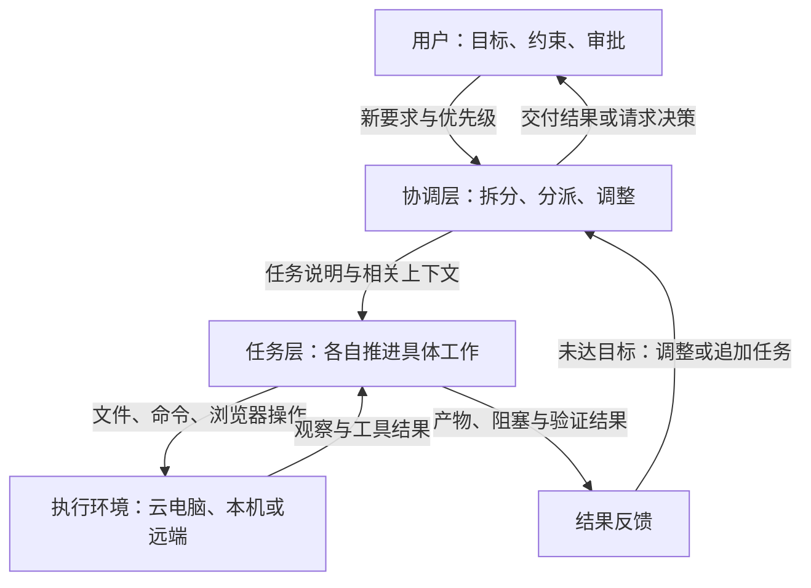
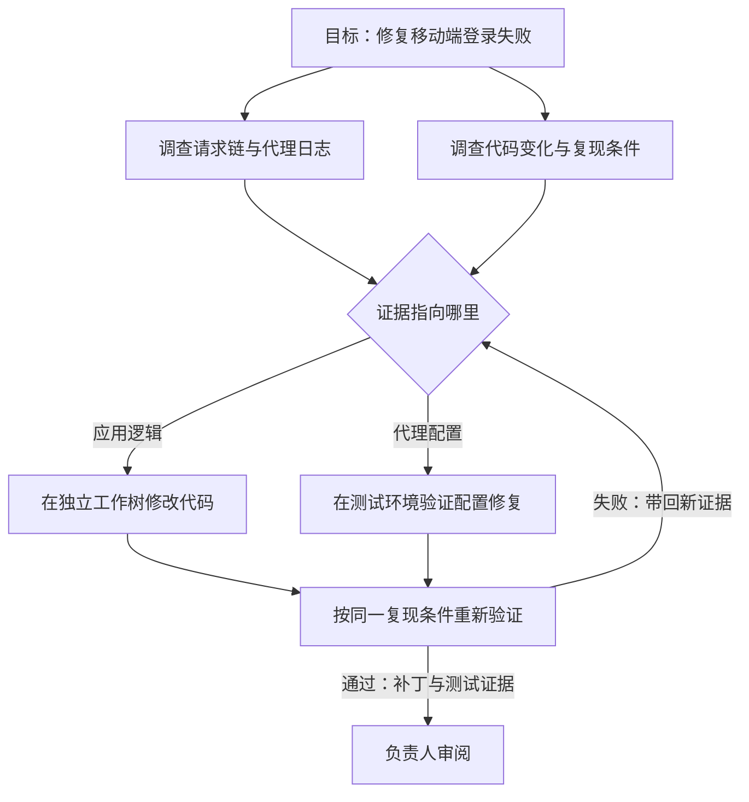
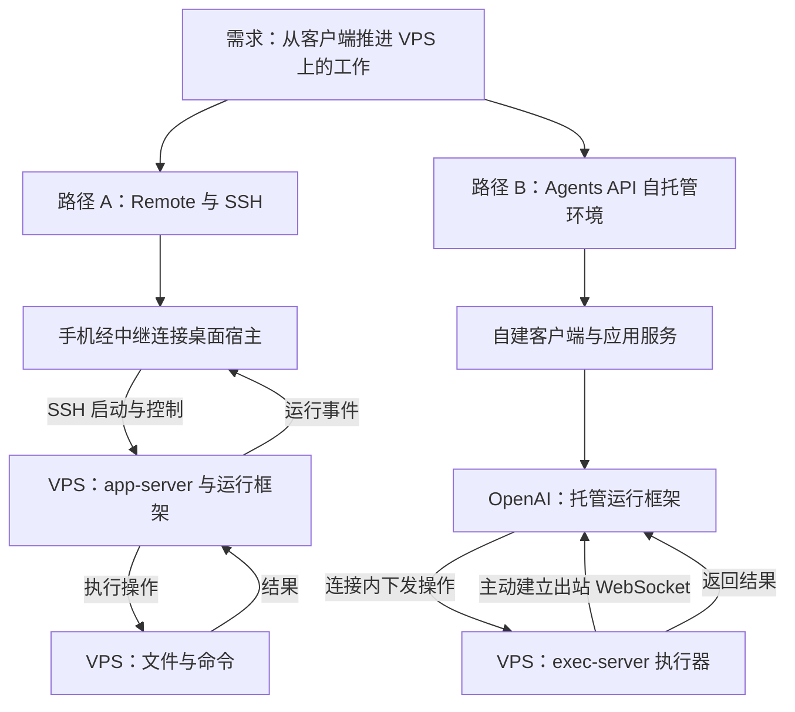

**Dots 把 Agent 产品的重心，从“完成一次任务”推向“协调一组持续变化的工作”。** 它最值得研究的架构变化，是把用户交互、任务编排和执行环境分开：用户保持一个协作入口，具体工作交给不同任务，任务再使用合适的电脑与工具。

这解释了几个看似独立的能力为什么会一起出现：**后台工作不妨碍继续交流，新要求可以改变已有任务，手机可以指挥远端执行，结果还能返回原来的工作关系。** Dot 的公开文档确认了这些产品行为；它们共同指向一个问题：能否把原本由人承担的分派、跟进和协调，也交给系统？[1]

本文从这一问题展开。Dot 的内部服务实现尚未完整公开；下文用其产品文档说明行为，用 Codex 和 Agents API 的公开机制解释可实现的架构，并将进一步的工程设计标明为推论。

## 1. 第一次拆分：让“协调工作”与“执行任务”各自独立

设想一项工作：修复移动端登录失败，完成测试，交给负责人审阅。调查过程中发现问题可能出在反向代理；负责人又从手机补充：“今天只做最小修复，不升级依赖。”

在一个以独立聊天为单位的实现中，即使每个 Agent 都很能干，仍需要有人把新要求传给编码任务，把排查结果交给测试任务，确认它们操作的是同一版本。**瓶颈不是缺少执行者，而是人仍在充当任务路由器。**

Dot 的公开行为提供了另一种组织方式：它可以持续跟进多个责任，创建任务、检查结果、发送后续指令；用户不必进入每一个任务会话才能继续协调。[2]

下面按职责归纳这类系统。它是逻辑架构，不是 Dot 的私有服务部署图。



图中有两个不同的反馈循环。

**任务内循环解决“这一步怎么做”。** 编码任务读文件、修改代码、运行测试，根据错误修正实现。

**工作协调循环解决“接下来该推进哪件事”。** 如果测试发现根因不在代码，协调层应该调整排查方向，而不是让编码任务无限重试。负责人改变范围时，协调层还要判断哪些正在运行的任务受到影响。

这里的“协调层”不是必须由一个模型包办的进程。更合理的工程分工是：模型提出拆分与调整，运行系统记录任务身份、依赖、执行位置和实际状态。**决定做什么，与记录什么已经发生，不能混为一件事。** 这是参考设计，不是对 Dot 存储实现的断言。

这种拆分带来的收益，是让长时间执行不占住唯一的交流入口，也让局部试错不必污染所有工作的上下文。代价同样明确：一旦协调层判断错误，错误可能被分发给多个执行者。因此，它需要可靠的反馈，而不是只需要更会写计划。

## 2. 编排的核心：把新信息变成对已有工作的调整

### 2.1 为什么不能只有一张预先写好的流程图

固定流程适合已知依赖，例如“测试通过后才能生成候选发布”。但在登录故障的例子里，根因未确定，排查路线只能随着证据变化。

因此，值得采用的是一种**混合编排**：让 Agent 决定调查方向和任务分解，把不可越过的业务条件留给确定性控制。前者解决未知问题，后者维持可靠边界。这是架构建议，不代表 Dot 已公开使用某一种工作流引擎。

以下是贯穿本文的参考案例。并行发生在互相独立的调查阶段，而不是无条件增加写入者。



**真正被编排的是依赖、执行权和反馈，不只是 Agent 数量。** 没有统一复现条件，两个调查者可能讨论不同的问题；没有明确写入归属，两个修复者可能覆盖对方；没有回到证据的路径，失败只会变成重复执行。

### 2.2 三种工作，不应使用同一种委派方式

Dot 文档同时提到后台 Agent 和独立可见任务。它们都能帮助推进工作，但不能默认视为同一种生命周期对象。[2]

依据这些能力，可以给出下面的设计选择；这是工程建议，而非官方公布的自动路由策略。

| 工作特征 | 合适的组织方式 | 选择的原因 |
| --- | --- | --- |
| 很短、强依赖当前讨论 | 在当前协调上下文直接处理 | 委派和回收可能比执行本身更费力 |
| 能独立回答的调查问题 | 有边界的后台子任务 | 分开上下文，并行得到不同证据 |
| 需要持续修改、重试、人工介入 | 独立任务，绑定执行环境 | 有自己的历史和现场，后续能定向纠偏 |

公开 Agents API 给出了底层机制：开启多 Agent 后，Harness 提供创建、发消息、等待和打断子 Agent 的动作；每个子 Agent 有自己的上下文。这里的 **Harness** 指管理模型与工具循环的运行框架。[3]

一个重要限制是：该 API 的协调者与子 Agent 可以共享同一环境的文件系统，创建子 Agent 不会自动创建新环境。因此，**并行调查可以靠上下文分离；并行写代码还需要工作树、资源归属或独立环境。** 两者不能互相替代。[3]

### 2.3 新约束必须传到正确的任务，而不只留在主聊天里

负责人说“不要升级依赖”，系统至少需要解决一个因果问题：哪些任务正在采用升级方案？它们做到哪一步了？新的约束会使哪些结果失效？

在参考实现中，应把工作目标及其修订，与具体任务关联。协调层据此向受影响的任务发送补充要求，必要时打断旧路径；不受影响的日志调查可以继续。已经生成的补丁则按新条件重新验收。

这比“记住用户偏好”更进一步：**信息发生变化，执行计划也要发生可追踪的变化。** 单纯把新消息加入一个大上下文，不能证明下游任务已经接收并落实了它。

这种分层还有一个直接可见的代价。Dot 的当前控制文档说明：暂停主任务不会自动停止所有委派任务，也不会取消未来的定时任务。[4] 这意味着主任务、子任务与计划任务确实需要分别管理。对于类似产品，“停止这整个项目”应成为有明确作用范围的操作，而不是一个含义模糊的暂停按钮。

### 2.4 结果回收要支持继续决策，而不只是汇总文案

调查者返回“可能是代理问题”，不足以支撑修复。它至少要说明证据、适用条件与未排除的解释；修复者返回的则应是可定位的补丁及其验证结果。

对本文案例，一个有用的返回包可以很短：

```text
结论：仅移动网络下的大请求失败
证据：复现记录与脱敏日志位置
候选修复：测试环境的代理配置差异
验证对象：具体提交或配置版本
结果：原失败用例通过，另有一项场景未验证
```

这是参考任务契约。它让协调层能够决定继续调查、请求用户判断或进入审阅，而不是把多个“已完成”拼成一份乐观总结。

**协调层应保留证据之间的分歧，而不是为了输出统一答案，把冲突抹平。** 否则，多 Agent 只增加了执行量，没有增加判断质量。

## 3. 第二次拆分：执行环境不再由聊天入口决定

任务能够独立管理之后，接下来必须回答：它在哪里执行？

查公开资料、修改私有代码、复现桌面应用问题，对环境的要求不同。把它们全部塞进同一台机器，会在依赖、网络、登录态和可用性上互相牵制。**环境选择因此属于任务编排，而不只是用户界面的设置。**

### 3.1 云电脑、本机和 VPS，分别解决什么问题

Dot 有独立的云电脑与浏览器，也能在授权后使用连接的个人电脑。云工作可以在用户设备关闭时继续；本机任务依赖个人电脑保持在线。云浏览器的登录态不会自动继承个人浏览器。[5]

这组设计可以理解为一个取舍：**默认给 Agent 独立工作空间；需要特殊资源时，再把工作放到拥有这些资源的环境。** 例如私有网络、特定软件、现有代码与测试装置，都可能使远程开发环境比默认云电脑更合适。

但环境并非随意可替换的空壳。Dot 创建的任务继续使用其原来的电脑或云环境；切换 Dot 当前选中的电脑，不会迁移旧任务。[2] 这是因为任务依赖的不只有聊天，还包括文件版本、运行进程与登录态。

工程上的结论是：**分派前可以选择环境；执行后改变环境，需要一项显式迁移操作。**

### 3.2 手机控制 VPS：两种公开架构，运行框架放置的位置不同

Codex Remote 和 Agents API 提供了两条可核验的路径。它们不是 Dot 的同一个隐藏开关，也不证明 Dot 已向所有用户开放直接注册任意 VPS 的能力。



**路径 A 把完整的 Codex 运行框架放在远端。** 官方 Remote 文档说明：手机连接桌面宿主，宿主通过 SSH 启动远端 `app-server`，文件和命令在远端处理。桌面宿主仍在这条控制路径上，休眠或离线会使 Remote 不可用。这里的“完整运行框架”不表示模型权重也部署在 VPS。[6]

它的好处是复用远端已有项目和工具；问题是控制路径仍依赖中间宿主。服务器没有关机，并不足以保证手机还能连接到它。

**路径 B 将运行框架与执行器进一步拆开。** Agents API 在 OpenAI 侧运行 Harness；VPS 内的 `codex exec-server` 通过环境 ID 和受限密钥注册，主动建立出站 WebSocket，接收操作并返回结果。应用服务管理会话与环境生命周期，不必转发每一条命令。[7][8]

它的好处是个人桌面不再是必经节点，VPS 也无需暴露一个可被直接调用的 Agent 控制监听端口。代价是开发者要负责环境准备、资源回收和运行状态协调；执行放在自己的机器，也不等于模型推理和被送去分析的内容留在本地。

`app-server` 暴露的是完整 Agent 的会话控制能力；`exec-server` 在上述模式下承担环境执行职责。**两者的区别，是 Agent 运行框架放在哪里，不只是程序名称不同。**

此外，一台云电脑也可能通过获准的 SSH 或管理 API 操作另一台服务器。这时 VPS 只是被操作的目标，并不是注册到平台的 Agent 执行环境。仅凭“看到服务器上的文件变了”，无法区分这几种接入方式。

### 3.3 未来的环境调度，应按能力而非设备名称选择

由上述分层可以推导出一种更有用的工程抽象：为执行环境描述它具备的能力，例如仓库版本、可达网络、工具、浏览器、可用资源和授权范围。

协调层要回答的便不再是“用哪台电脑”，而是“哪一个获准环境满足这个任务的依赖”。先过滤权限和资源约束，再比较启动时间、成本与可用性。

这并非宣称 Dot 已实现这样的自动调度器，而是它的公开能力对工程设计提出的自然要求。**要让执行位置可以变化，必须先把环境依赖从隐含状态变成显式条件。**

## 4. 第三次拆分：用任务控制协议连接多端与 Agent

把任务放到远端，只解决了“在哪里干活”。要让手机、网页与协调 Agent 都能参与，还需要一个共同的控制接口。

### 4.1 为什么只有“发命令、收文本”不够

OpenAI 的 App Server 工程文章披露了一段重要演进：为了将 Codex 从终端扩展到 IDE，团队需要表达进度、代码差异和审批。团队曾尝试将 Codex 暴露为 MCP 服务，但在匹配 IDE 交互语义时遇到困难，随后发展出双向 JSON-RPC 风格的 App Server 协议。[9]

这不是说 MCP 天生不能扩展，而是说明：**调用一项能力，与完整控制一个正在工作的 Agent，是不同层级的问题。** 后者需要能够表示运行状态、追加要求、待处理审批和产物，而不只是一个工具返回值。

当前 Codex 协议给出了可见的控制对象：[10]

| 控制对象 | 对应的问题 | 为什么对协作有用 |
| --- | --- | --- |
| `Thread`：持久会话 | 后续要求应发给哪项工作？ | 换客户端后仍能定位原会话 |
| `Turn`：一次运行 | 当前正在执行哪一轮要求？ | 可以定向纠偏或中断 |
| `Item`：消息、操作或产物 | 运行到哪一步、产生了什么？ | 客户端可以展示真实进度与结果 |

例如 `turn/steer` 可以向正在运行的任务追加输入，并用 `expectedTurnId` 检查目标是否仍是用户看到的那次运行。[10] “今天只做最小修复”因而可以表达为对当前工作的调整，而不是被迫再启动一个互不相关的 Agent。

### 4.2 同一控制接口，可以服务人，也可以服务协调程序

双向协议的价值，是执行端不仅报告结果，还能向调用方提出需要处理的请求。客户端将请求展示给人；协调程序则可以在自己权限范围内处理，或将决策递交用户。

由此可以得到一个重要工程推论：**为人设计的 Agent 控制能力，也可以成为上层 Agent 的编排接口。** 创建工作、查看状态、追加要求、处理中断、读取产物，不必为每种调用方重写一套执行逻辑。

这解释了多端和多 Agent 为什么会在同一套架构中相遇：手机是交互入口，协调 Agent 是自动化调用方，二者都需要控制同一项工作。但这只是基于公开接口的推论，不能据此断言 Dot 内部就是逐条调用这些 RPC 方法。

App Server 的公开架构也体现了这种边界：消息处理器把客户端请求转换成核心操作，线程管理器管理各会话，核心事件再转换成稳定的外部通知。客户端不必直接依赖不断变化的内部运行结构。[9]

### 4.3 跨端不是复制聊天，而是访问同一项工作

OpenAI 对 Codex Web 的公开说明是：浏览器通过 HTTP 和 SSE 访问后端，工作进程在容器内运行 App Server；任务状态保存在服务端，浏览器不是长任务的状态来源。[9]

因此，增加一个手机入口，不必在手机里复制执行环境。需要适配的是输入、任务状态、产物审阅与审批界面。**工程上的复用单位是受控的任务与事件，而不是某一个聊天页面。**

不过，三种“连续性”仍要分清：换客户端是接回工作；换渠道还涉及受众；换执行机器则涉及现场迁移。Dot 可以跨渠道使用相关信息，但聊天记录不自动互相复制，获得信息也不代表可以向另一个受众披露。[1]

跨主机的 Codex Handoff 则是一项显式操作：转移聊天与 Git 状态，在目标主机使用工作树，并在转移前打断活跃响应。[6] 这也解释了为什么“随时换屏幕”比“任意迁移运行现场”容易得多。

## 5. 更进一步：让“何时推进”也成为编排的一部分

到这里，系统能够分派工作、选择执行位置，并在多个入口接受调整。下一步才是主动性：**不是等每一条新提示，而是在已有责任范围内判断何时跟进。**

Dot 文档公开了按需暂停与继续、时间或受支持事件触发，以及只读的主动研究。后台研究可以把新信息与已有工作联系起来，但研究工具不能直接修改应用、发送消息或控制电脑；后续动作另受权限与审批约束。[2][4]

对登录故障案例，这意味着系统可以把新错误报告与尚未完成的修复联系起来，形成“需要补测这个场景”的候选工作。它不应因为读到一条新消息，就立刻重新部署。

由此产生一个值得复用的分层：**发现可能需要做的事，与获得资格去做这件事，分开处理。** 发现阶段可以扩大信息覆盖；行动阶段仍要核对目标、影响与授权。

更难的问题是优先级。每一条相关信息都触发一个任务，会造成重复调查、通知泛滥和成本增长。参考实现需要把触发器关联到已有目标，合并重复事件，判断它是否改变当前决策，再决定追加任务、仅更新记录，还是请用户判断。

所以，主动 Agent 的调度器不应只会“到点运行”。它还应能表达等待什么、什么变化值得恢复、什么阻塞需要升级给人。**调度的对象是工作依赖和决策时机，而不只是时钟。**

## 6. 新架构解决协调成本，也引入新的耦合

分层没有让复杂性消失，只是把过去由人处理的协调问题转移到了系统。对这类产品，真正需要评估的是下面几组交换关系；它们是由前述机制推导出的工程问题，不是已测得的 Dot 故障统计。

| 架构选择与收益 | 随之出现的问题 | 设计上必须回答的事 |
| --- | --- | --- |
| 统一协调入口，减少人肉分派 | 协调错误会影响多项工作 | 子任务能否带证据质疑计划，而非只执行？ |
| 独立上下文，减少无关信息干扰 | 委派时可能遗漏关键约束 | 新约束如何传到受影响的任务，并重新验收？ |
| 多任务并行，减少串行等待 | 共享文件与环境可能产生冲突 | 哪个任务拥有写入权，产物基于哪个版本？ |
| 跨渠道获取上下文，减少重复解释 | 私有信息可能流入错误受众 | 使用信息与对外披露是否分别授权？ |
| 远端执行，减少个人设备依赖 | 多了一层连接和环境生命周期 | 断线后如何核对实际结果，而不是盲目重跑？ |
| 主动发现与跟进，减少遗漏 | 可能误判优先级、扩大工作量 | 如何合并事件、限制预算、控制通知？ |
| 托管 Harness，降低运行框架维护成本 | 会话、工具和审批语义依赖平台 | 将来迁移时，除模型外还需迁移哪些状态？ |

这里尤其要区分两类边界。

**运行边界不等于权限边界。** 子 Agent 有独立上下文，不代表它只有最小权限；把执行器放进容器，也不等于容器里没有高权限凭据。自托管环境文档明确要求按用户或工作负载隔离环境，并把应用主 API 密钥留在执行环境外。[8]

**自然语言规则不等于确定性访问控制。** Dot 文档明确说，自定义规则是它尝试遵循的指令，仍可能出错，也不会自动授予应用或电脑访问权。[4] 因此，对“绝不改生产”这样的硬要求，类似系统应在工具、凭据和网络层限制能力，而不是只把它写在协调者的记忆里。

多 Agent 还不必然更快。独立调查可以并行，但如果全部等待同一项慢测试，或都要修改同一处状态，增加 Agent 主要增加协调开销。公开多 Agent 文档也建议将短任务、强依赖步骤留在主 Agent，并协调对同一文件的修改。[3]

**成功标准应是减少人类协调与返工，而不是增加自动启动的任务数。**

## 7. 对未来 Agent 工程，真正重要的四个变化

### 7.1 从“做一个聊天入口”转向“提供可编排的工作对象”

依据这些机制，值得优先设计的是一项工作如何被定位、继续、修订、审阅和结束，而不是先决定聊天气泡长什么样。

执行者要能接收明确目标，返回可验证产物；协调者要能追踪任务关系；不同客户端则读取同一套工作状态。这样，手机、桌面、群聊和上层 Agent 可以复用执行能力，而不是变成四套互相隔离的产品。

这里有一个范围限制：Codex 的 `Thread` 是某个运行框架里的会话，不天然等同于跨产品的项目。自建系统仍需维护项目目标与不同任务会话之间的映射，不能把所有身份都混成一个聊天 ID。

### 7.2 从“选择模型”转向“选择运行框架与控制边界”

OpenAI 目前将 Agents API、Agents SDK 与 Responses API 分别定位为托管 Harness、应用内控制运行逻辑、以及更底层的模型集成路径。[11]

工程选型因此不只关乎模型能力，还关乎谁保存会话、谁推进工具循环、谁提供执行环境，以及谁决定审批和资源回收。托管可以减少集成工作；自建可以保留更明确的控制权。**能替换算力环境，不代表能无成本替换整个运行框架。**

对重视可迁移性的应用，更有价值的做法是保留自己的目标、任务关系、授权记录与产物索引，再通过适配层连接运行框架，而不是只保存一串供应商会话 ID。

### 7.3 从“流程是否跑完”转向“变化发生后是否仍然正确”

单次任务测试不足以评估这种架构。更能暴露问题的，是在工作过程中改变条件。

例如给同一个登录修复任务加入三个测试：编码中途收紧允许修改的范围；用户从另一客户端接续并指出新证据；执行已成功但回传中断。观察系统是否分别修订任务、恢复正确状态、避免重复副作用。

这些是参考评测，不是 Dot 的官方基准。它们检验的是：**系统能否维持一条从目标、决策、执行到证据的连续链条。** 更值得记录的指标，是遗漏了多少约束、需要多少次人工纠偏、发生多少返工，以及每个验收通过的结果消耗多少资源。

### 7.4 从“工具更多”转向“人不再承担跨工具的隐形编排”

多 Agent、远程执行、事件通知并不是全新的基础思想。Dots 值得观察的地方，是把它们组织成一个面向持续工作的协作产品。[1] 它是否足以改变工程实践，还要看长期运行时的可靠性与真实协调成本，不能仅靠功能演示下结论。

但由架构推导出的方向已经清楚：

> 工作跨越多个步骤与环境，促使任务从聊天中独立；独立任务需要协调与反馈；不同任务需要不同执行现场；统一控制接口让人和程序都能参与；持续输入的新信息，又推动系统从执行计划走向修订计划。

**真正的工程跃迁，是让软件不仅能接受“帮我做这件事”，还能够在目标变化、环境受限和人随时介入时，继续对齐“这件事最终为什么而做”。**

<details>
<summary>一手资料与证据范围</summary>

本文核对截至 2026 年 10 月 6 日可见的文档。Dot 文档支持产品行为；Codex 与 Agents API 文档支持各自公开的运行机制，不构成 Dot 私有实现完全相同的证明。

[Meet dots][1]：持续协作、多任务与多入口。

[Tasks and memory][2]：委派、跟进、任务环境绑定、上下文与主动研究。

[Agents API — Multi-agent][3]：子 Agent、协调动作、上下文与共享环境。

[Control your dot][4]：审批、自定义规则，以及主任务、委派任务和计划任务的停止边界。

[Computers and apps][5]：云电脑、本机接入与浏览器状态。

[Remote connections][6]：中继、SSH、宿主依赖和 Handoff。

[Agents API — Architecture][7]：托管 Harness、应用服务与执行环境的职责。

[Self-hosted sandboxes][8]：出站执行器、注册、密钥范围与环境管理。

[Unlocking the Codex harness][9]：2026 年 2 月 4 日工程文章，解释 App Server 的起因、内部职责与 Web 接入；涉及后续计划的段落不作为当前实现事实。

[Codex App Server][10]：当前公开的会话对象、运行事件、纠偏与审批接口。

[Agents][11]：运行框架与集成方式的选型边界。

</details>

[1]: https://learn.chatgpt.com/docs/dots
[2]: https://learn.chatgpt.com/docs/dots/tasks-and-memory
[3]: https://developers.openai.com/api/docs/guides/agents-api/multi-agent
[4]: https://learn.chatgpt.com/docs/dots/controls
[5]: https://learn.chatgpt.com/docs/dots/computers-and-apps
[6]: https://learn.chatgpt.com/docs/remote-connections
[7]: https://developers.openai.com/api/docs/guides/agents-api/architecture
[8]: https://developers.openai.com/api/docs/guides/agents-api/environments/self-hosted
[9]: https://openai.com/index/unlocking-the-codex-harness/
[10]: https://learn.chatgpt.com/docs/app-server
[11]: https://developers.openai.com/api/docs/guides/agents
