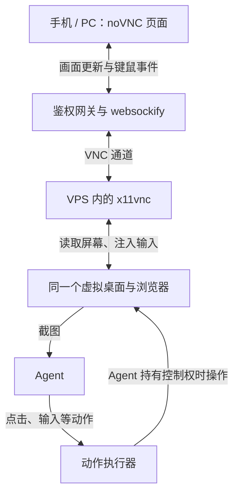

手机如何接管 Agent 的云电脑？从 OpenAI 官方说明和 Computer Use 示例出发，拆解虚拟桌面、画面回传、键鼠输入与控制权切换，并说明如何在自有 VPS 上实现类似体验。

**核心是：Agent 和人轮流操作同一个远程工作现场，而不是把电脑搬进手机。** 手机显示远端画面、发送操作；应用、文件和浏览器仍在远端运行。

## 1. OpenAI 官方明确说了什么？

[Dots 电脑说明][1]写得很直接：打开电脑可以查看；选择 **Take over** 才能使用鼠标和键盘；操作完成后选择 **Return control**，让 Dot 继续。

[入门文档][2]还明确说明移动端行为：

> On mobile, the computer opens in your control.

也就是：**手机打开 Dot 电脑时，电脑直接处于用户控制下。** 手机 App 的具体开放范围取决于版本与账户；这不等于手机浏览器也支持 Dots，当前文档明确说不支持 mobile web。[2]

这里接管的是 **Dot 自带的云电脑**，不是自动接管任意一台自有 VPS。官方已经说明产品行为，但没有在上述文档中公开其屏幕传输协议。下面以官方 Computer Use 示例为基础解释实现链路；补充的 noVNC 方案是可复用的开源实现，**不是对 Dots 内部技术栈的断言**。

## 2. Sandbox 怎样变成一台“人也能操作”的电脑？

Sandbox 解决执行隔离；要让人接管，还需要一个可显示、可输入的工作现场。OpenAI 的 [Computer Use 文档][3]直接给出 Docker 示例：在 Ubuntu 内启动 **Xvfb、桌面环境、x11vnc 和浏览器**，再用 `xdotool` 执行模型返回的键鼠动作。

这些组件各司其职：

| 组件 | 在这条链路里做什么 |
| --- | --- |
| Xvfb | 提供没有实体显示器也能运行的虚拟屏幕 |
| 桌面与浏览器 | 真正运行窗口、网页和用户操作 |
| x11vnc | 把该屏幕接到 VNC 远程桌面通道，提供画面与输入 |
| Agent 的动作执行器 | 把模型的点击、输入等动作施加到同一桌面 |
| noVNC + websockify | 把 VNC 接入普通网页，让浏览器也能显示画面和发送输入 |

前三项及动作执行来自 OpenAI 示例；最后一项是浏览器接入的补充方案。**noVNC 是浏览器里的 VNC 客户端**，使用 Canvas 和 WebSocket，官方支持现代桌面浏览器及 iOS、Android 浏览器；websockify 则在 WebSocket 与服务端普通 socket 之间双向转发数据。[3][4][5]

把它们连起来，就是一条可以部署在 VPS 上的参考链路：



*人工输入与 Agent 动作需互斥放行；这个交接逻辑由应用实现，不是 VNC 自动提供的。*

### 手机上的一次点击，实际上发生了什么？

以这条参考链路为例：远端浏览器把页面画到虚拟屏幕；VNC 提供画面更新；noVNC 在手机上绘制画面。用户点击后，客户端将触点映射成远端坐标，通过同一连接传回，远端把它作为鼠标输入交给应用。[3][4][5]

**人的点击不需要先交给大模型理解。** 它走的是远程桌面输入链路。因此，手机不需要运行远端应用，也不需要安装服务器上的开发依赖。客户端需要处理的是缩放、触控和键盘交互，而不是重新实现那套应用。

Agent 走另一条输入路径：读取截图，决定动作，再由执行器操作桌面。OpenAI 示例中，`DISPLAY=:99` 指向同一个虚拟显示环境；截屏和键鼠操作都针对它。[3]

**关键是同一个现场，而不是仅仅同一台服务器。** 人打开另一个浏览器实例，即使访问相同网址，也不等于接回 Agent 正在填写的表单。

## 3. Take over 切换什么？不切换什么？

设 Agent 在远端浏览器中填写表单，遇到需要用户处理的登录步骤。用户接管、完成登录、交回控制后，Agent 可以继续使用仍然有效的远端网站会话。这正是 Dots 文档描述的登录接管方式。[1]

**应保留的是浏览器进程、标签页、表单与会话；切换的是谁有权继续操作。** 不需要把 Cookie 复制到手机，也不需要重新在手机浏览器里打开业务网站。

在自建实现中，可以把交接收敛成下面三步：

| 阶段 | 系统应完成的动作 |
| --- | --- |
| 接管 | 停止派发 Agent 动作；等待或取消尚未完成、可能干扰界面的操作，再开放人工输入 |
| 人工操作 | 保留远端桌面运行，仅允许当前持有人输入；其他客户端可以只读观看 |
| 交回 | 收回人工写入权，获取最新截图，再让 Agent 根据新现场继续 |

这是参考实现要求，而不是官方公开的 Dots 内部状态机。它解决一个具体问题：**不能让人输入密码时，Agent 仍拿着旧截图继续点击。**

有两个实现细节不能省。第一，控制权应在服务端检查，不能只把页面按钮变灰。第二，需要暂停的包括所有会干扰同一现场的自动化：键鼠、浏览器脚本，以及相关后台操作；不是暂停整台虚拟机，否则人也无法继续使用它。

人工接管可能涉及秘密输入。自建系统还应明确接管期间是否暂停 Agent 截图和录制，不能因为切换了鼠标控制权，就宣称密码不会进入模型或日志。

## 4. 换成自己的 VPS，还需要一台 Mac 中转吗？

**自建上述远程桌面链路，不需要。** VPS 承载桌面和接入服务，手机通过获准的 HTTPS/WSS 入口访问即可。VNC 服务应留在内部网络或回环地址，通过鉴权网关、VPN 或受控隧道访问；不要把演示配置里的固定密码和裸露端口当成生产方案。

但这与 **Codex Remote 的 SSH 工作区**不同。OpenAI 当前文档描述的链路是：

```text
手机 → 安全中继 → 在线桌面宿主 → SSH → VPS 上的 Codex app-server
```

这条路径主要让手机发送提示、审批和后续要求，使用远端文件与命令；手机仍连接桌面宿主。**能通过它控制远端 Agent，不代表已经提供任意 VPS 的图形桌面接管。**[6]

给现有 Sandbox 增加人机协作时，应先确认要开放哪一种入口：

| 想做什么 | 需要补什么 |
| --- | --- |
| 人查看日志、执行命令 | 受控终端；需要接续已有交互时，还要保留对应终端会话 |
| 人验收 Agent 做出的网页 | 应用端口预览；这打开的是用户自己的浏览器会话 |
| 人接手 Agent 正在操作的窗口 | 同一图形会话的远程桌面，加输入控制权交接 |

第三种才是本文讨论的 **Take over**。只做端口转发、截图展示或添加一个“批准”按钮，都不能代替它。

对自有 VPS，最直接的落地顺序是：**先让浏览器客户端连上隔离桌面，再让 Agent 操作同一桌面，最后加上接管与交回控制。** 初期用一个需要人工介入的测试表单验证：接管时 Agent 是否停止输入，交回后是否接着原表单继续，而不是新开页面重做。

值得借鉴的不是某个“神奇远控协议”，而是一个清晰的产品边界：**Sandbox 不再只是工具运行的黑盒，也可以是人随时进入、修正后再交还给 Agent 的共享工作现场。**

<details>
<summary>官方说明与实现参考</summary>

截至 2026 年 10 月 6 日核对。前三项解释 Dots 的接管行为及 OpenAI 公开示例；noVNC 与 websockify 用于说明可复现的网页接入方案，不代表 Dots 使用它们。

[1. OpenAI：Connect computers and apps to your dot][1]

[2. OpenAI：Getting started with your dot][2]

[3. OpenAI：Computer use — 虚拟桌面、动作执行与截图示例][3]

[4. noVNC：浏览器 VNC 客户端与移动端支持][4]

[5. websockify：WebSocket 与 TCP 的双向桥接][5]

[6. OpenAI：Remote connections — 中继与 SSH 工作区][6]

</details>

[1]: https://learn.chatgpt.com/docs/dots/computers-and-apps
[2]: https://help.openai.com/en/articles/20001530-getting-started-with-your-dot
[3]: https://developers.openai.com/api/docs/guides/tools-computer-use
[4]: https://novnc.com/info.html
[5]: https://github.com/novnc/websockify
[6]: https://learn.chatgpt.com/docs/remote-connections
