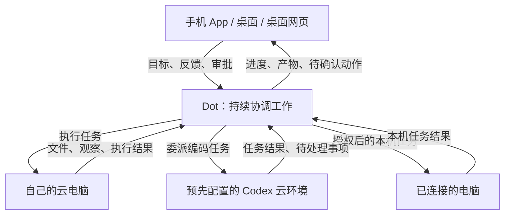
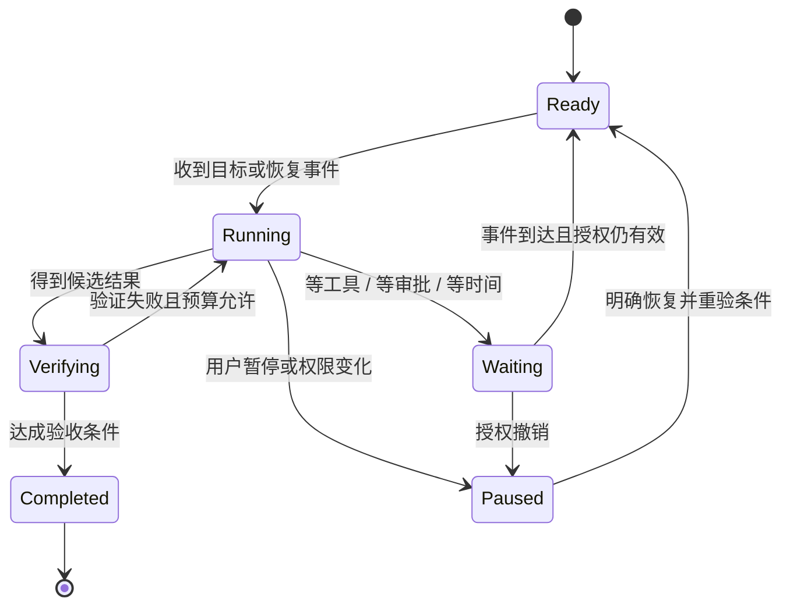
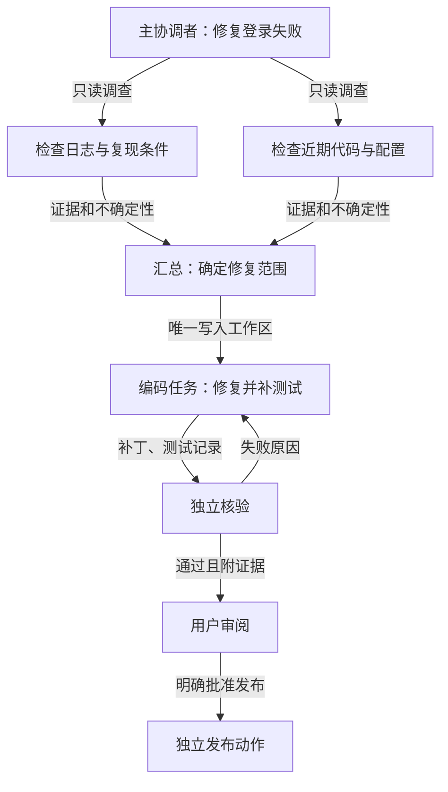
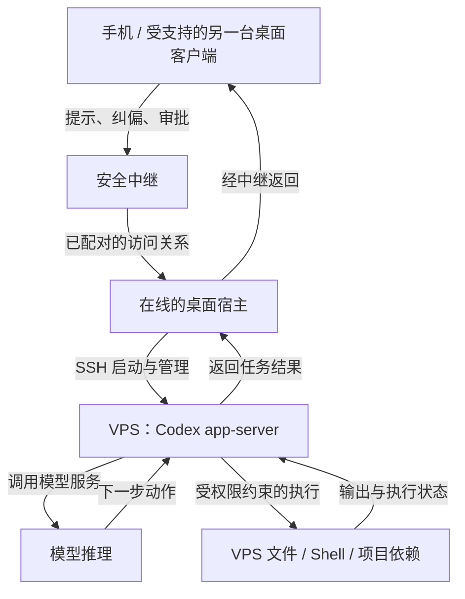
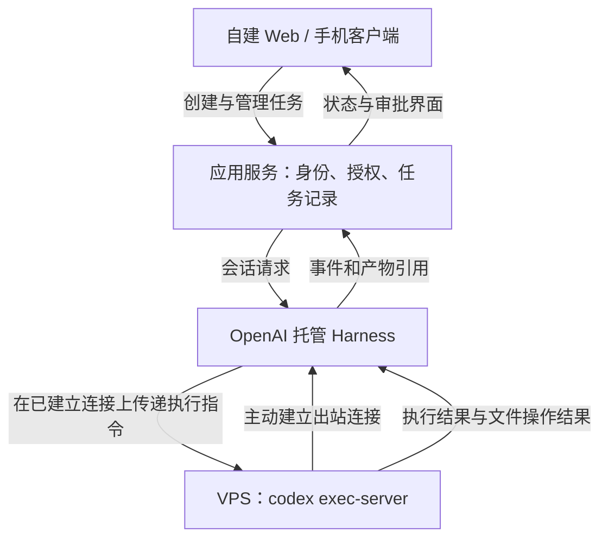

**Dot 的关键，不是把一个大模型装进手机，而是把“与谁对话”“谁持续推进任务”“在哪里执行”拆成了三个可以独立变化的部分。** 手机、桌面客户端和网页提供入口；常驻的 Agent 系统保存工作关系并组织任务；云电脑、Codex 环境或已连接的机器承担具体操作。换一个屏幕，不必换一个任务；但换执行环境，需要另外的迁移机制。

OpenAI 于 **2026 年 9 月 29 日**发布 Dots。本文依据截至 **2026 年 10 月 6 日**可查的一手资料分析。官方确认 Dot 由 GPT-6 Astra 驱动，拥有云电脑，并能连接工具、承担持续工作。下文将**产品事实、公开底层机制、参考实现**分别说明：Codex 和 Agents API 的公开实现能够解释这类体验如何成立，但不能据此认定 Dot 内部逐字使用相同接口。[官方发布][s1]

## 1. 先拆开三个经常被混为一谈的东西

**Dot 自带的云电脑、Codex 云编码环境、自有 VPS，不是同一台机器，也不是同一种接入方式。**

| 对象 | 它解决的问题 | 不应作出的推断 |
| --- | --- | --- |
| Dot | 持续理解目标、组织工作、接收反馈 | 不等于一个无限运行且永不失忆的模型请求 |
| 执行环境 | 提供文件、浏览器、Shell、依赖和凭据使用能力 | 连接一个环境，不等于所有环境共享磁盘与登录态 |
| 手机、PC、Web | 发起任务、看结果、纠偏和审批 | 客户端支持 Dot，不等于每种 Remote 功能都跨端完全一致 |

下面是对已公开职责的**逻辑归纳图**，不是 OpenAI 内部服务拓扑；尤其不能把图中的“协调层”理解成已经公开的某个微服务。



Dot 可以创建云端或本地工作任务；本地访问需要授权，云编码环境需要预先配置。创建 Dot 的入口和使用入口也不同：当前帮助文档要求在桌面客户端或桌面网页创建，**手机浏览器尚不支持 Dot**，手机 App 的访问还受版本与开放范围影响。[入门说明][s2]

“多端控制远程开发环境”也不是 Dots 发布时才出现的能力。ChatGPT 更新记录在 **2026 年 5 月 14 日**已介绍移动端 Codex Remote 预览，**6 月 25 日**记录了 Remote 正式开放，以及创建虚拟机并通过 SSH 接入远程工作区的 DigitalOcean Droplet Workspace 插件。时间关系说明：Dot 更适合被理解为把已有能力组织成持续协作体验，而不是新发明了一套远程网络。[更新记录][s3]

## 2. “常驻”指工作关系持续，不是推理永不停止

### 2.1 一次模型调用，不能独自承载一个持续项目

设想一个任务：“等测试跑完，再检查失败原因；修复后给我看，不要直接部署。”

它包含三个不同的生命周期：模型生成下一步决定的时间、测试进程运行的时间、用户完成审批的时间。让一个 HTTP 请求一直悬着，不能自动获得断线恢复、任务持久化、审批撤销或异常补偿。

因此，分析这类系统时需要引入 **Harness**：模型之外管理工具循环、状态、运行边界与事件的执行框架。OpenAI 的 Agents API 架构明确区分 Harness、执行环境和应用服务器；其中模型推理与工具执行不必发生在同一台机器。**这是公开的架构分层，不是已经证实的 Dot 后端部署方案。**[Agents API 架构][s4]

对一个可恢复的参考实现，可以这样划分状态：

| 状态类别 | 建议保存的内容 | 丢失之后会发生什么 |
| --- | --- | --- |
| 对话与决策 | 当前目标、已确认限制、证据引用 | Agent 重复询问或误解目标 |
| 任务记录 | 子任务、依赖、执行位置、预算、截止条件 | 不知道应等待谁，也可能重复执行 |
| 工作区状态 | 文件版本、进程句柄、浏览器会话 | “记得做过”但文件和进程已不存在 |
| 权限状态 | 当前授权、审批请求、撤销版本 | 把历史许可错误地当成当前许可 |

这里最重要的分离是：**记忆能告诉 Agent“发生过什么”，任务账本才能告诉系统“还欠什么”。** 将任务完成状态只写进自然语言摘要，既难以去重，也难以区分“尝试过”“执行完”“已经交付”。

### 2.2 休眠、唤醒和预算是怎样配合的

官方说明 Dot 可以在工作之间暂停并唤醒，也能按时间或受支持的事件触发工作。其持续性不要求用户始终打开会话。[任务与记忆][s5]

以下状态机是**参考实现**，用于解释上述能力的工程要求，不是官方公布的状态枚举：



一种合理实现是：运行到等待点时保存任务状态，由调度器在定时器、工具结果或用户回复到来后恢复。等待期间可以没有活跃推理调用。但公开资料**不能确定** Dot 使用哪种队列、调度产品、事件存储，或是否释放某一类工作进程。

系统卡提供了一个更具体的线索：Dots 引入了时间预算，并结合推理强度使用；评估比较了同一模型在不同 Harness 与模拟时间条件下的表现。文中的“一年”是带时钟和等待工具的**模拟时间预算**，不是生产系统连续运行一年的可靠性证明。[系统卡：Dots 附录][s6]

工程上，时间预算回答“还值得继续尝试多久”，推理预算回答“当前判断投入多少计算”，权限回答“有没有资格做这件事”。三者不能互相替代：时间宽裕不应扩大权限，模型更聪明也不等于可以省略审批。

### 2.3 跨端连续性不是把所有聊天塞进同一个上下文

Dot 的当前对话、相关 ChatGPT 记忆和自己保存的笔记用途不同。新的委派任务拥有独立对话，不会自动获得用户与 Dot 的全部聊天。不同渠道可联系同一个 Dot，但可见聊天不会因此被完整复制到另一个渠道。[任务与记忆][s5]

由此得到两个设计判断：

**共享身份不等于共享全部上下文。** 一个执行任务需要的是目标、相关证据与限制，而不是无差别复制主会话。

**可用于推理的信息不等于可向所有受众披露的信息。** 私聊中知道的上线风险，可以帮助准备团队汇报；但把私聊原文发进群聊，是另一项需要检查受众和权限的动作。

## 3. Dot 与 Agent 协作：委派工作，而不只是转发一句话

### 3.1 主协调者、后台子 Agent、可见任务并非同一种东西

官方描述了两类能力：Dot 可让后台 Agent 并行工作并汇报，也可创建可见任务并继续给任务下达指令。**并行研究子任务与单独打开的 Codex 编码线程，不能默认当成同一种生命周期对象。**[任务与记忆][s5]

在公开的 Agents API 中，子 Agent 有独立上下文；Harness 提供创建、发送输入、等待、打断等协调动作。事件能报告这些动作，但“创建动作完成”并不等于“子任务完成”。这是可检验的多 Agent 实现机制，而非 Dot 私有协议披露。[多 Agent 文档][s7]

下面以“修复登录失败”为例，说明**参考任务分解**：独立调查可以并行，改动同一份代码不应无约束并行。



这里的协作收益不是“Agent 数量更多”，而是把上下文隔离和依赖关系做对：调查者可以各自消耗上下文；写入者对明确工作区负责；核验者面对补丁与证据，而不是仅复述编码者的结论。

### 3.2 委派协议真正要传什么

“帮我改好”只是自然语言目标，还不是可靠的任务契约。下面是一个**自定义参考数据结构，非 OpenAI API Schema**：

```json
{
  "task_id": "task-login-fix",
  "parent_task_id": "project-maintenance",
  "goal": "修复已复现的登录失败，并补充回归测试",
  "environment_ref": "dev-vps-worktree-17",
  "baseline_commit": "<reviewed-commit-sha>",
  "scope": {
    "read": ["repo", "sanitized-test-logs"],
    "write": ["dedicated-worktree"],
    "deploy": false
  },
  "acceptance": ["提供复现步骤", "回归测试通过", "输出补丁引用"],
  "policy_version": 12,
  "deadline": "<task-deadline>",
  "required_outputs": ["patch_ref", "test_report_ref", "remaining_risks"]
}
```

`environment_ref` 防止任务误跑在生产目录；`baseline_commit` 防止审查对象漂移；`policy_version` 帮助执行前发现许可已经改变。返回结果也应包含可定位的证据，而不是只有“已完成”三个字。

需要特别警惕：**上下文独立不等于权限自动缩小。** Agents API 当前文档说明，子 Agent 可继承配置的 MCP 工具及凭据，也可使用环境中的文件和命令。共享执行环境因此可能共享敏感资源。把权限按子任务裁剪，是系统需要额外落实的责任，不能因为用了多 Agent 就当作已经获得安全隔离。[多 Agent 文档][s7]

### 3.3 为什么这不是“一个 MCP 就能搞定”

MCP 解决的是工具和资源的连接边界；Agent 协调还需要任务归属、等待、取消、结果归并和权限传递。Shell 工具被调用一次，不意味着另一个独立 Agent 已启动；调用一个外部 Agent 服务，也不意味着双方拥有共同的任务状态。

这是一种分层判断：**工具协议描述如何调用能力，任务协议描述谁对工作负责。** 即使一个系统用 MCP 承载部分任务接口，后者的语义仍需单独设计。Dots 当前的子 Agent 能力，也不能被外推为任意厂商 Agent 已实现透明互操作。

## 4. 手机到底怎样“控制 VPS”

### 4.1 先确认看见的是哪一条执行链

| 执行链 | 谁提供工作环境 | 需要特别注意的边界 |
| --- | --- | --- |
| Dot 自己的云电脑 | OpenAI 管理的工作区 | 它不是用户自己的 VPS |
| Dot 委派 Codex 云任务 | 预先创建的 Codex 云环境 | 用户电脑可离线，但任务仍绑定原环境 |
| Codex Remote 接 SSH 工作区 | 桌面宿主连接的远程机器 | 手机仍经桌面宿主访问，不等于直接配对 VPS |
| 自建应用接 Agents API | 用户环境内的执行器 | 属于开发者 API 路径，不是已证实的 Dot 原生 VPS 接入开关 |

这些路径分别来自 Dot 入门、Remote 和 Agents API 文档。**共享一种“用自然语言控制电脑”的体验，并不意味着共享一条网络链路。**[入门说明][s2] [Remote 文档][s8] [自托管环境][s9]

### 4.2 已公开的 Remote + SSH 路径

Remote 文档明确说明：手机先连接已配对的桌面宿主；桌面宿主连接远程开发环境。系统提供安全中继，SSH 路径由桌面应用启动远端 Codex app-server。宿主睡眠、离线或关闭应用，Remote 访问会停止。[Remote 文档][s8]



图中的推理—执行循环是对 Codex Runtime 的逻辑展开；**安全中继的协议细节、消息如何复用连接、是否采用某种端到端加密方案，并未在所引资料中公开。**“安全中继”不能直接等同于“OpenAI 无法读取内容”。

工程含义很直接：手机负责提交意图，宿主负责提供获准的连接入口，VPS 提供文件与进程。手机无需安装项目依赖，也无需本地运行 Shell。这里神奇的是交互体验，不是计算位置违反了常识。

“所有东西放在 VPS 上，就能关闭家里的电脑”也不必然成立。要判断这个结论，必须沿连接图检查：是否仍有桌面宿主节点处于必经路径。**执行服务器在线，不代表控制入口在线。**

### 4.3 不依赖个人桌面的路径：云 Harness + 出站执行器

OpenAI 的自托管环境文档公开了另一种机制：云端运行 Harness；用户机器运行 `codex exec-server`，使用环境 ID 和受限密钥注册，通过**出站 WebSocket**接收指令、返回结果，并在断线后重连。应用的主 API 密钥应留在执行环境之外。[自托管环境][s9]



这条链路不需要把用户桌面放在路径上，也不要求 VPS 开放一个任意人可调用的 Agent 控制端口。但出站连接只解决连接方向，不自动提供进程隔离、细粒度权限或业务幂等。

**不要混淆两个名字相近的程序：**`app-server` 面向富客户端暴露 Codex 的会话与交互控制；`exec-server` 在上述 API 模式中承接云 Harness 发来的环境执行请求。一个涉及完整 Agent 交互接口，另一个承担远程执行器职责。[App Server][s10] [Agents API 架构][s4]

因此，“技术上可构造多端直达云端执行”有公开依据；“Dot 产品已允许所有用户直接注册任意 VPS，而且不需要其他中间节点”则没有从这些资料中得到证明。产品接入范围、开发者 API 可用性与付费身份，也不能自动互相推导。

## 5. 多端接续的关键，是任务协议而不是视频传输

### 5.1 一次换设备，通常不需要搬迁执行现场

可以用四个问题定位一项远程工作：它属于哪个工作目标、哪段对话、哪次运行、哪个执行环境。手机退出只改变观察和控制入口；只要负责运行的服务仍然工作，任务可以在原处继续。

但“换设备”与“换执行机器”不同。Remote 文档中的 Handoff 会转移聊天与 Git 状态、使用目标工作树，并在转移前打断正在运行的响应；这不是把任意进程内存和全部机器状态原样迁过去。[Remote 文档][s8]

由此可以预测一个边界：某任务依赖尚未落盘的进程状态或仅存在于原机的浏览器会话时，迁移聊天记录并不足以恢复它。可靠的迁移需要额外定义哪些状态必须重建，以及如何验证重建结果。

### 5.2 公开协议里，如何在手机上“改主意”

Codex App Server 对外区分 `Thread`、`Turn` 与 `Item`，分别承载会话、一次运行及其中的消息或操作。它提供初始化、恢复线程、开始运行、纠偏和中断接口，并通过事件反馈进展。其消息格式采用 JSON-RPC 风格，但协议不发送常见的 `jsonrpc` 版本字段。[App Server][s10]

例如，下面使用公开方法名、原创参数内容，演示给**正在运行**的任务追加要求；它不是 Dot 的抓包结果：

```json
{
  "method": "turn/steer",
  "id": 32,
  "params": {
    "threadId": "thr_login_fix",
    "expectedTurnId": "turn_active_7",
    "input": [
      {"type": "text", "text": "先补回归测试，不要部署。"}
    ]
  }
}
```

`expectedTurnId` 必须匹配当前运行；没有活跃运行时不能用该方法。它不会隐式新建一轮，也不用于修改这一轮的沙箱等运行级配置。[App Server][s10]

这个字段体现了多端控制的一个重要问题：用户在手机上看到的界面可能已经过期。若运行已切换，系统应拒绝把旧指令无条件施加到新任务上，而不是以“最新消息”为由接受一切。

还要区分两类指令：自然语言“不要部署”用于改变工作方向；真正撤销部署能力应更新可执行的权限规则。**纠偏消息不等于即时完成的权限撤销。**

### 5.3 至少有三条逻辑数据通路

| 通路 | 传输什么 | 为什么需要区分 |
| --- | --- | --- |
| 控制与状态 | 任务指令、审批、取消、执行事件 | 要解决顺序、去重、过期和权限 |
| 屏幕与交互 | 图像、输入、人工接管状态 | 要处理延迟和人机争抢控制 |
| 文件与产物 | 补丁、日志、报告、截图引用 | 要解决大文件、持久化与访问范围 |

这是参考架构的职责划分，并不声称 Dot 为三者分别使用三条物理连接。仅凭能看到远程屏幕，不能判断底层一定使用 VNC、RDP 或 WebRTC；仅凭浏览器能完成任务，也不能断言所有动作都来自鼠标坐标。

Dot 文档确认工作区的文件、软件和浏览器会话可跨使用时段保留，并区分查看电脑与接管操作。[电脑与应用][s11] Agents API 的 Computer Use 则展示了托管浏览器中由 Agent 观察页面、选择下一步动作的公开能力。[Computer Use][s12]

参考实现中，人机接管应是一个独立的控制权状态：`AGENT → HUMAN → AGENT`。进入人工控制后，旧的 Agent 输入应失效；交回后先获取新观察，不能继续点击接管前的旧坐标。可用租约和代际标识实现这一要求，但**公开资料没有披露 Dot 是否采用这种具体做法**。

## 6. 真正难的不是连通，而是完成、恢复与授权

### 6.1 “连接成功”“请求接受”“工作完成”是三件事

以下是一个远程任务系统应明确区分的完成层级：

| 收到的信号 | 可以证明什么 | 还不能证明什么 |
| --- | --- | --- |
| 网络连接建立 | 双方当前可通信 | 任务已开始 |
| 请求确认 | 服务接受或记录了请求 | 外部操作已成功 |
| 命令退出 | 该进程结束，并有退出状态 | 业务目标达成 |
| 验证通过 | 指定验收检查通过 | 用户已经收到结果 |
| 交付回执 | 目标位置出现可访问产物 | 未来不会发生回归 |

这不是术语洁癖。例如服务器已部署成功，但结果传回前连接断开，控制端不能因为“没收到成功”就再次执行同一发布命令。它应先查询实际发布版本、健康状态和操作记录。

同理，取消应区分停止等待、停止派发新命令、终止可终止进程、补偿已经发生的副作用。**取消不是时间倒流。** 已发送的邮件、已推送的提交或已触发的支付，不能由一个 UI 上的停止按钮自动撤销。

### 6.2 跨端并发需要哪些保护

对于一个参考实现，最低限度需要持久化 `task_id`、操作 ID、执行环境和状态版本。客户端的重试应重用操作 ID；服务端保存是否已受理以及最终结果；外部系统支持幂等键时将其贯穿到底。

两个客户端同时批准同一项发布时，可以对审批记录做原子状态转移：只有从“待批”成功转换为“已批”的那次请求获得执行资格。另一个客户端看到的是已处理状态，而不是产生第二次部署。

审批对象还应绑定具体内容，例如：

```text
批准对象 = 仓库 + 提交 SHA + 目标环境 + 操作类型
审批约束 = 当前策略版本 + 有效期 + 一次性操作标识
```

提交变了、目标从测试环境变成生产，或审批已过期，都不能继续使用旧许可。这解决的是**检查时与执行时对象发生变化**的问题，不是模型通过更长的提示词就能稳定规避的问题。

恢复界面也应先重建权威状态，再接续事件；不能仅把断线前的流式文字继续拼接。这里需要快照、事件版本或其他一致性方案，具体选择取决于后端协议，不能假设 Dot 已公开一个通用事件游标。

### 6.3 为什么安全控制不能住在 Agent 可改写的目录里

OpenAI 明确披露：Dot 的工作区基于 Linux 与 Chrome，用户之间的环境隔离；执行代码的环境与协调工作、强制执行关键安全措施的系统分离。Agent 在工作区内能运行程序，不代表它能关闭外层检查。[安全架构][s13]

这条边界比“系统提示词要求谨慎”更实质。参考设计中，Agent 可以编辑业务代码，但不能修改签发能力凭证的服务、操作审批记录或撤销通知机制。高风险命令在执行前重新检查授权，而不是仅在任务创建时检查一次。

Codex 的 Auto-review 文档又揭示了另一层：额外的审核者可以评估需要审批的操作，但它并不扩大沙箱权限，也不是确定性的安全保证。[Auto-review][s14]

因此需要同时回答两个问题：**这个动作是否符合当前目标？这个执行器是否具有做它的能力？** 模型审核更适合处理前者的语义，访问控制、沙箱和凭据范围负责后者的硬边界。

### 6.4 登录凭据与已登录能力也必须分开

Dot 的受支持安全登录流程会暂停模型，将凭据直接送入浏览器环境，之后恢复工作；保存密码的流程使用专门的加密凭据服务。这个保护不覆盖另行放在可读取文档中的秘密。[安全架构][s13]

工程含义是：Agent 可以获得“在授权账户中操作”的能力，而不必把密码当作上下文。但 Cookie、会话和命令输出仍可能携带敏感信息，不能因此宣称整个工作区对模型完全没有秘密。

连接器撤销与记忆删除也不是同一个动作。官方 FAQ 说明，停止连接可以阻止新的访问，但已经进入 Dot 上下文的信息不会自动消失。[隐私与安全 FAQ][s15] 对系统设计而言，授权存储、上下文保留与产物访问应该分别治理。

### 6.5 常驻会放大跨任务边界问题

系统卡对连续任务的测试中，插入任务数从 5 增加到 10 时，中等严重程度的边界问题标记率从 **8.6% 增至 19.7%**。这是特定评估中的行为标记，不是生产事故率，也不能当作严重泄露概率。[系统卡：连续任务评估][s6]

这个结果支持一个谨慎的工程判断：把更多任务长期放进同一个工作关系，会增加旧限制、旧角色和新授权混淆的机会。应把权限归属绑定到当前任务，而不是依赖 Agent 从过去的大量聊天中自行猜出仍然有效的规则。

另外，**主动研究不等于主动写入**。Dots 的后台主动研究受只读限制，与用户明确安排、可以包含授权动作的任务不同。[安全 FAQ][s15] 因此，“会主动发现问题”不能推出“可随时修改所有系统”。

## 7. 用一个完整场景检验架构是否说得通

以下是**参考系统的工作示例**，不是宣称已在 Dot 上逐步实测。设执行器运行在隔离的 VPS 开发工作区，用户在手机上说：

> 调查测试为什么失败，修复并提交到分支。先不要部署。

| 阶段 | 系统动作 | 必须留下的状态或证据 |
| --- | --- | --- |
| 建立任务 | 固定仓库、工作区、基线和禁止部署规则 | 任务 ID、环境引用、策略版本 |
| 调查 | 两个只读任务分别检查日志和改动 | 可复现条件、证据位置、未证实假设 |
| 修复 | 一个写入任务修改专属工作树 | 补丁、实际测试命令、测试结果 |
| 接续 | 用户在 PC 打开同一任务查看差异 | 同一任务的最新状态，而非新建副本 |
| 申请发布 | 对具体提交和测试环境发起审批 | 提交 SHA、目标环境、审批有效期 |
| 执行与验证 | 执行一次发布并检查运行版本 | 发布记录、版本标识、健康检查 |
| 交付 | 将结果送回获准的渠道 | 可访问的产物与剩余风险 |

这个例子有三个容易忽略的地方。

**任务可以共享目标，但不应共享随意写入的现场。** 调查并行不意味着两个写入者都能修改主分支。

**用户换到 PC 是换观察入口，不是把 VPS 的进程搬到 PC。** 只要执行位置没有改变，工作现场仍在原处。

**“先不要部署”不能靠最后再想起来。** 从创建任务起就应没有部署能力，后续批准的是一个精确的新增动作，而不是追认此前已经发生的发布。

再改变几个条件，就能看出架构边界：

| 条件变化 | 应有的判断 |
| --- | --- |
| 手机断网 | 检查云端或宿主任务是否继续；不能把前端断线直接等同于取消 |
| Remote 必经的桌面宿主休眠 | 该控制路径失效；即使 VPS 本身在线也不能假装仍可控制 |
| VPS 执行器重启 | 重建连接后检查进程与副作用，不能盲目重放所有命令 |
| 用户撤销写权限 | 阻止之后的写入，并标明已经完成、无法自动撤回的动作 |
| 审批期间提交发生变化 | 旧审批失效，重新展示真正要执行的对象 |
| 用户人工接管浏览器 | 暂停 Agent 输入，交回后基于最新页面恢复 |

这些预期构成参考实现的验收方向；不应把它们全部表述成已被官方逐项保证的 Dot 行为。

## 8. 已经能确认什么，仍然不能确认什么

| 证据层级 | 可以成立的结论 |
| --- | --- |
| Dot 产品事实 | 有独立云电脑，能持续组织任务、委派工作，并接受多入口反馈；具体入口与本地能力有条件 |
| 已公开的底层机制 | Codex 暴露会话与运行协议；Remote 支持中继和 SSH 远程工作区；Agents API 支持出站自托管执行器 |
| 可以复现的工程设计 | 用任务记录、权限版本、事件恢复、独立执行器与产物证据构造类似体验 |
| 尚未公开的实现 | Dot 的内部调度、存储、完整委派协议、屏幕传输格式、中继密码学细节、记忆检索算法与具体虚拟化技术 |

**最值得复用的思想，是把“持续的工作关系”与“可替换的执行位置”分开，再用明确的任务身份和权限把它们连接起来。**

模型负责理解与选择下一步，Harness 负责推进运行，执行环境负责产生副作用，客户端负责表达意图和展示证据。多端支持因此可以表现得很轻；真正沉重的工作，落在状态、恢复、并发、安全和完成语义上。

所以 Dot 既不只是“聊天框加几个工具”，也不宜神化为能任意跨机器自由迁移的数字生命。它展示的是一种产品整合方向：让用户面对一个持续负责的协作对象，而让系统承担复杂的任务与环境管理。公开资料足以解释这种体验为什么可行，但还不足以复原它的全部内部代码。

<details>
<summary>一手资料与阅读范围</summary>

1. [Introducing dots][s1]：发布日期、产品定位、云电脑与持续工作。
2. [Getting started with your dot][s2]：创建入口、移动端边界、本地访问与云任务。
3. [ChatGPT release notes][s3]：Remote 及远程工作区能力的演进。
4. [Agents API Architecture][s4]：Harness、环境和应用服务的职责分离。
5. [Dots — Tasks and memory][s5]：委派、暂停唤醒、环境归属、上下文与记忆。
6. [GPT-6 Astra System Card — Dots appendix][s6]：时间预算和持续任务安全评估。
7. [Agents API — Multi-agent][s7]：子 Agent 协调动作、上下文和工具继承。
8. [Remote connections][s8]：安全中继、宿主依赖、SSH 和跨主机交接。
9. [Self-hosted sandboxes][s9]：出站 WebSocket、执行器注册和密钥范围。
10. [Codex App Server][s10]：Thread / Turn / Item 及纠偏、中断接口。
11. [Dots — Computers and apps][s11]：云电脑状态与人工接管。
12. [Agents API — Computer use][s12]：托管浏览器中的观察与操作。
13. [How we build safety, security, and privacy into dots][s13]：执行隔离与安全登录。
14. [Codex Auto-review][s14]：审核者与权限边界。
15. [Dots privacy, security, and safety FAQs][s15]：权限、数据保留和主动研究限制。

动态文档会随版本变化。本文没有将相关 API 的能力直接等同于所有 ChatGPT 账户已经拥有的 Dot 产品功能。

</details>

[s1]: https://openai.com/index/introducing-dots/
[s2]: https://help.openai.com/en/articles/20001530-getting-started-with-your-dot
[s3]: https://help.openai.com/en/articles/6825453-chatgpt-release-notes
[s4]: https://developers.openai.com/api/docs/guides/agents-api/architecture
[s5]: https://learn.chatgpt.com/docs/dots/tasks-and-memory
[s6]: https://deploymentsafety.openai.com/gpt-6-astra/change-log
[s7]: https://developers.openai.com/api/docs/guides/agents-api/multi-agent
[s8]: https://learn.chatgpt.com/docs/remote-connections
[s9]: https://developers.openai.com/api/docs/guides/agents-api/environments/self-hosted
[s10]: https://learn.chatgpt.com/docs/app-server
[s11]: https://learn.chatgpt.com/docs/dots/computers-and-apps
[s12]: https://developers.openai.com/api/docs/guides/agents-api/tools/computer-use
[s13]: https://openai.com/index/how-we-build-safety-security-and-privacy-into-dots/
[s14]: https://learn.chatgpt.com/docs/sandboxing/auto-review
[s15]: https://help.openai.com/en/articles/20001529-dots-privacy-security-and-safety-faqs
