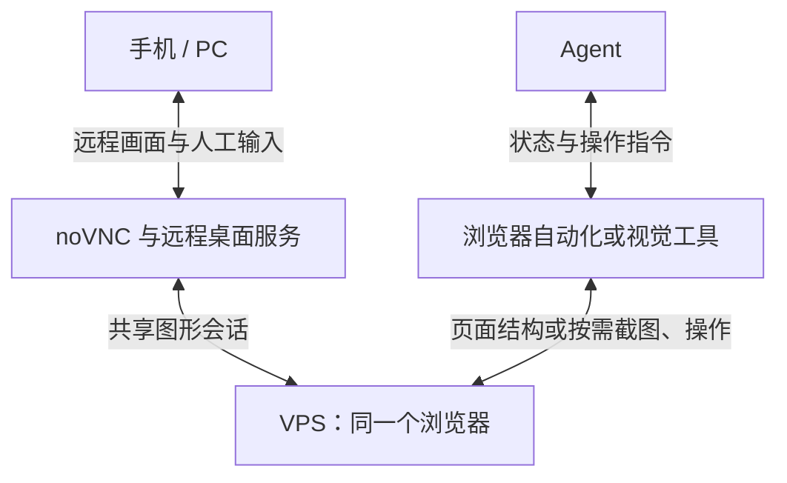

在 VPS 上运行共享桌面，让手机接手 Agent 正在操作的浏览器。结合 OpenAI 与 Playwright 官方资料，说明截图、页面结构和 API 如何配合，并提供开源部署与人工接管方法。

## 在同一个浏览器里接着做

Agent 在云端填写表单，遇到登录步骤。你从手机打开远程桌面，完成登录，再把控制权交回。浏览器仍停在原来的页面，已经填好的内容也保留下来。OpenAI 的 Dots 文档明确提供了这样的 **Take over / Return control** 交互。[1]

实现这一体验，需要让人和自动化程序接入**同一个浏览器会话**。人通过远程桌面查看画面、操作键鼠；Agent 则通过应用接口、页面结构或视觉工具完成工作。两条通道可以独立实现。



*图为开源参考架构；两条输入通道需由服务端协调控制权。Dots 的底层传输协议及完整工具选择策略尚未在所引文档中披露。*

在这条链路中，noVNC 把远端画面显示在手机浏览器里，键鼠事件经 websockify、VNC 服务返回 VPS。手机上的一次点击可以直接到达远端应用，全程无须模型参与。[3][4]

**远程桌面的画面流与模型的观察输入分别管理。** 人可以一直看着桌面；Agent 可以读取几个字段，也可以按任务需要请求截图。给人传输画面的频率，无须等于调用视觉模型的频率。

## Agent 怎样读取和操作界面

### 截图在公开实现中的位置

OpenAI 在 2025 年 1 月发布的 CUA 技术说明明确写到：截图会加入模型上下文，模型结合当前画面与此前操作决定下一步。[11] Computer Use API 的公开示例进一步给出了可核对的调用链：执行动作，采集截图，再通过 `computer_call_output` 中的 `computer_screenshot.image_url` 返回图像。[2]

<details>
<summary>查看官方接口中的截图输入</summary>

下面保留公开示例的核心字段；调用 ID 和图像内容为占位值，完整请求还需按文档设置模型、工具和会话关联。

```json
{
  "type": "computer_call_output",
  "call_id": "<对应的工具调用 ID>",
  "output": {
    "type": "computer_screenshot",
    "image_url": "data:image/png;base64,..."
  }
}
```

这证明公开 Computer Use 路径确实把图像交给模型。它所覆盖的证据范围是该接口与示例；Dots 每一步使用哪种观察方式，仍需产品自身的实现披露。[2]

</details>

截图的价值在于覆盖范围：当应用只提供图形界面、画布缺少可访问的内部结构，或任务需要判断布局与视觉效果时，像素仍能提供信息。CUA 正是围绕跨应用的屏幕、鼠标和键盘接口设计的。[11]

代价也很具体：小字、空间定位和图形理解可能出错；图像输入消耗 tokens；页面在观察后发生变化，还会使旧坐标失效。OpenAI 的视觉文档公开列出了相关识别限制与图像计费规则。[18]

### 有结构可用，就利用结构

网页的 DOM 提供元素结构与属性；无障碍快照进一步表达按钮、输入框等控件的角色、名称和状态。[15] Microsoft 的 **Playwright MCP** 就以结构化无障碍快照作为主要交互依据，可以供文本模型使用。[13]

例如，执行器可以按“保存草稿”这个按钮的角色和名称定位，而无须先估算像素坐标。Playwright 在点击前还会检查元素唯一性、可见性、稳定性和是否能接收事件。[14][16] 这减少了坐标漂移问题；按钮标注错误、同名控件以及业务判断仍需处理。

**按任务选择操作接口，通常比预先规定全部走视觉更合理。** 下表是结合公开能力给出的选型建议：

| 工作目标 | 可优先使用的接口 | 需要关注的条件 |
| --- | --- | --- |
| 查询订单、导出数据、执行已知业务操作 | 已授权的应用 API、CLI | 接口覆盖目标功能，权限与业务语义明确 |
| 填网页表单、读取列表、验证交互流程 | DOM、无障碍快照、Playwright | 元素可定位；保留同一 browser/context/page |
| 操作原生桌面控件 | 系统无障碍与自动化接口 | 应用与平台提供支持，例如 Windows UI Automation [17] |
| 处理缺少结构接口的画布、嵌套远程桌面，检查视觉效果 | 截图与视觉操作，结合可用结构 | 保留足够分辨率，校准坐标，操作后验证状态 |

这个方向已有产品依据：OpenAI 在 ChatGPT agent 的官方介绍中，同时列出了视觉浏览器、文本浏览器、终端和直接 API 访问，并说明会按任务选择路径。[12]

工程上可以据此组合：**结构化接口处理可确定的读写，视觉处理图形判断与结构缺口，人处理需要亲自介入的步骤。** 路由选择同时受任务目标约束——做界面回归测试时，即使存在业务 API，也仍需实际验证页面交互。

### 降低消耗，关键在观察范围与往返次数

一张截图未必比整页 DOM 更贵；把完整页面树反复送入上下文也会造成负担。Playwright MCP 的文档就提示了大型工具 schema 和冗长无障碍树的 token 开销。[13]

对于自建运行框架，更值得优化的是：只提取当前任务涉及的字段与控件；把确定、获准的连续操作交给脚本执行；在页面切换、异常或需要视觉判断时获取新观察。OpenAI 的 Computer Use 指南也提供了动作批处理，以及混合 DOM 与视觉的代码执行方式。[2]

截图裁剪或缩放需要保留定位所需的上下文，并把坐标映射回原图；敏感字段应控制采集与传输。[18] 最终比较同一任务的**总耗时、输入 tokens、完成率和人工修正次数**，才能判断实际收益。本文未进行这些路径的同任务性能对照测试。

## 把共享桌面部署到 VPS

本例使用 **Xvfb** 提供虚拟屏幕，**Openbox** 管理窗口，**x11vnc** 共享现有显示会话，**noVNC + websockify** 提供浏览器入口；需要桌面级键鼠操作时再使用 **xdotool**。这些组件都可从开源项目获得，能与现有 Agent 框架组合使用。[3][4][5][6][7][8]

<details>
<summary>组件许可与维护情况</summary>

| 组件 | 许可概况 |
| --- | --- |
| Xvfb | X.Org 多许可体系，MIT/X11 等，以实际文件和包为准 [5] |
| Openbox | GPL-2.0-or-later [6] |
| x11vnc | GPL-2.0 系列，具体文件可能允许后续版本 [7] |
| xdotool | BSD-3-Clause [8] |
| noVNC | 主要为 MPL-2.0 [3] |
| websockify | LGPL-3.0 [4] |

交付镜像或修改组件时，应核对实际依赖及各自许可。x11vnc 上游当前提示缺少维护者，生产选型需另行检查发行版补丁和维护方案。[7]

</details>

准备 Docker Engine 28+ 和 Compose 插件，在空目录保存下面三个文件，然后启动：

```bash
docker compose up --build -d
docker compose logs --tail=80 desktop
```

在 Docker 宿主打开 `http://127.0.0.1:6080/vnc.html`，点击 Connect，即可尝试连接远端 Firefox。配置用于**单用户隔离测试**，目前只完成静态检查，尚未验证镜像构建与完整运行；它提供桌面服务，模型和接管仲裁由后续集成。

端口仅发布到宿主回环地址，VNC 留在容器内部。Docker 文档提示，28.0.0 之前的版本存在同网段访问回环发布端口的例外。[9]

<details>
<summary>Docker 启动配置与验证边界</summary>

本例采用 Debian 12 软件包与 Openbox，避免依赖第三方预构建桌面镜像。它没有挂载宿主目录、Docker socket，也不使用 privileged。正式复用时应固定经过验证的镜像摘要和包版本，同时跟进安全更新。

**Dockerfile**

```dockerfile
FROM debian:bookworm-slim

RUN apt-get update && apt-get install -y --no-install-recommends \
    xvfb xauth x11-utils x11vnc openbox firefox-esr \
    xdotool imagemagick novnc websockify dbus-x11 \
    ca-certificates fonts-dejavu fonts-noto-cjk python3 \
    && rm -rf /var/lib/apt/lists/*
RUN useradd --create-home --uid 1000 --shell /bin/bash agent

ENV HOME=/home/agent DISPLAY=:99 XAUTHORITY=/tmp/agent.Xauthority \
    MOZ_ENABLE_WAYLAND=0
COPY start.sh /usr/local/bin/start-desktop
USER agent
WORKDIR /home/agent
CMD ["bash", "/usr/local/bin/start-desktop"]
```

**compose.yaml**

```yaml
services:
  desktop:
    build: .
    init: true
    ports:
      - "127.0.0.1:6080:6080"
    shm_size: "512m"
    security_opt:
      - no-new-privileges:true
    cap_drop:
      - ALL
```

**start.sh**

```bash
#!/usr/bin/env bash
set -Eeuo pipefail
umask 077
pids=()
cleanup() {
  if ((${#pids[@]})); then
    kill "${pids[@]}" 2>/dev/null || true
    wait "${pids[@]}" 2>/dev/null || true
  fi
}
trap cleanup EXIT
trap 'exit 0' TERM INT

export XDG_RUNTIME_DIR=/tmp/runtime-agent
mkdir -p "$XDG_RUNTIME_DIR"
chmod 700 "$XDG_RUNTIME_DIR"
touch "$XAUTHORITY"
xauth add "$DISPLAY" MIT-MAGIC-COOKIE-1 \
  "$(python3 -c 'import secrets; print(secrets.token_hex(16))')"
Xvfb "$DISPLAY" -screen 0 1280x800x24 -nolisten tcp \
  -auth "$XAUTHORITY" &
pids+=("$!")
for ((i=0; i<100; i++)); do
  xdpyinfo >/dev/null 2>&1 && break
  kill -0 "${pids[0]}" 2>/dev/null || exit 1
  sleep 0.1
done
xdpyinfo >/dev/null 2>&1 || { echo 'Xvfb startup failed' >&2; exit 1; }

openbox &
pids+=("$!")
## No VNC password in this isolated demo: require host-loopback + SSH/VPN access.
x11vnc -display "$DISPLAY" -auth "$XAUTHORITY" \
  -localhost -rfbport 5900 -forever -shared -nopw -noxdamage &
pids+=("$!")
dbus-run-session -- firefox-esr --no-remote about:blank &
pids+=("$!")
websockify --web=/usr/share/novnc 0.0.0.0:6080 127.0.0.1:5900 &
pids+=("$!")
## Stop the container if an essential child exits; do not leave a fake healthy shell.
wait -n "${pids[@]}"
exit 1
```

Xvfb 与 x11vnc 使用同一份 Xauthority；Agent 动作也必须使用它。本例的 VNC 没有密码，外层只能通过可信宿主或已鉴权的 SSH/VPN 访问。不要把 `6080` 改成公网监听，也不要把不可信容器加入同一网络。这里没有配置浏览器持久卷：重建容器会丢失其中的浏览器资料，不能当作持久云电脑。

配置已做 Bash 语法与 YAML 静态检查，尚未完成该 Docker 镜像的构建和端到端运行验证。

</details>

### 从电脑或手机连接

**电脑通过 SSH 转发访问。** 在自己的电脑运行，保持连接，再打开本机的 noVNC 地址：

```bash
ssh -N -L 127.0.0.1:6080:127.0.0.1:6080 user@your-vps
```

**手机可以通过私有网络直接访问 VPS。** 例如两端加入同一个受限的 Tailscale 网络、配置好访问规则后，在 VPS 上运行：

```bash
sudo tailscale serve --bg http://127.0.0.1:6080
```

核对已有 Serve 路由，按提示完成 HTTPS 授权；手机保持 Tailscale 连接，打开输出的 HTTPS 地址并加 `/vnc.html`。Serve 在私网内共享服务，这条路径无须个人电脑中转。[10]

手机的 `127.0.0.1` 指向手机本身，连接 VPS 要使用对应隧道或私网地址。演示配置没有 VNC 密码，只能放在可信宿主、已鉴权 SSH 或严格授权的私网后面；不要公开 `6080/5900`。

## 沿用现有自动化，接入共享会话

**已有 Playwright 的项目可以继续使用页面结构。** 在上述显示环境中，以 `headless=False` 启动受支持的浏览器，让运行时持续持有原来的 browser/context/page。noVNC 负责把这个窗口展示给人，自动化仍然按元素读写。

演示里的 Firefox 由启动脚本单独运行。接入 Playwright 分支时，需要调整浏览器启动方式并安装 Playwright 支持的浏览器版本；同一个 `DISPLAY` 下新开另一浏览器，仍会得到另一份工作现场。[19]

下面是既有运行时里的示例片段：假定 `page` 已指向共享浏览器中的目标页面，当前任务获准修改测试表单，页面有相应标签。服务端已授予 Agent 控制权。

```python
## 在同一个 page 上按元素填写、校验；这一组操作无需图像输入。
from playwright.async_api import expect

await page.get_by_label("收件人", exact=True).fill("张三")
await page.get_by_label("备注", exact=True).fill("请下午送达")
await expect(page.get_by_label("备注", exact=True)).to_have_value("请下午送达")
```

模型可以通过受控工具选择字段，也可以生成短脚本，由隔离执行器运行。[14][16] **观察信息与执行方式分别选择**：使用 Playwright 或代码执行，并不自动说明模型看了什么；执行器既可以返回文本状态，也可以按需返回图像。

**已有视觉操作工具的项目**则对齐 `DISPLAY`、Xauthority、窗口焦点和坐标空间。下面的命令用于人工验证截图与输入通道，生成的 PNG 可先由开发者查看：

```bash
docker compose exec -T desktop import -window root png:- > screen.png
docker compose exec -T desktop xdotool key --clearmodifiers ctrl+l
docker compose exec -T desktop xdotool type --clearmodifiers --delay 10 'https://example.com'
docker compose exec -T desktop xdotool key --clearmodifiers Return
```

需要视觉决策时，再把截图送入相应模型接口。`click/type/keypress/scroll` 可封装成参数受校验的工具；涉及文本时使用独立进程参数，避免拼接 Shell。xdotool 面向 X11，其他显示系统需要相应驱动。[8]

无论选择哪条路径，浏览器调试端口、Docker socket 和任意命令执行权限都应留在可信服务边界内。用户在手机上接入的仅是获准的远程桌面。

## 人处理完，Agent 接着做

接管时要保留浏览器运行，让自动化暂时让出操作权。下面是自建系统的交接要求：

| 阶段 | 服务端处理 |
| --- | --- |
| 请求接管 | 停止派发自动化，等待或取消在途操作；确认旧动作不会继续生效后，再开放人工输入 |
| 人工操作 | 保留原窗口、标签页和表单，仅允许当前持有人输入；敏感步骤暂停模型侧截图、DOM 采集与相关录制 |
| 交回控制 | 收回人工写入权，确认当前标签页、URL 和表单状态；刷新所需 DOM/无障碍快照，必要时补截图，再恢复自动化 |

这里要管住所有能影响现场的操作。**一个仍在等待元素出现的 Playwright 调用，可能在人接管后突然执行。** 因此，暂停模型生成之外，还要处理执行器的在途调用、队列和迟到动作；相关业务数据写入也应纳入控制范围。这些是参考设计要求，演示容器尚未实现它们。

控制权应由服务端强制执行，并通过会话代次或等效机制拒绝旧请求。前端的只读按钮可以展示状态，实际授权检查仍需覆盖人工输入与自动化入口。

验收可以用一张测试表单：Agent 先填几个字段，人从手机修改其中一项，交回后 Agent 读取修改后的值并继续。这个测试同时检查**工作会话是否连续、操作是否互斥、恢复时是否采用最新状态**。

完成这三件事，远程桌面就能成为现有 Agent 的人工协作入口。自动化继续利用应用提供的高效接口，人则在需要时进入同一个工作现场。

<details>
<summary>官方资料与实现来源</summary>

[1] OpenAI：Dots 电脑与应用说明——人工接管与交回的产品行为。

[2] OpenAI：Computer Use——截图工具结果、图形环境、批处理与混合执行方式。

[3] noVNC——浏览器 VNC 客户端、移动端支持与许可。

[4] websockify——WebSocket 与 TCP 的转发机制。

[5] X.Org 许可说明；[6] Openbox；[7] x11vnc；[8] xdotool。

[9] Docker 回环端口发布；[10] Tailscale Serve。

[11] OpenAI：Computer-Using Agent，2025-01-23——截图进入模型上下文的明确说明。

[12] OpenAI：Introducing ChatGPT agent，2025-07-17——视觉浏览器、文本浏览器、终端和 API 的组合。

[13] Microsoft Playwright MCP——结构化无障碍快照与上下文成本说明。

[14] Playwright Locators；[15] Aria snapshots；[16] Auto-waiting。

[17] Microsoft UI Automation；[18] OpenAI Images and vision；[19] Playwright 浏览器要求。

本文区分公开产品能力、公开示例和自建参考设计。截图路径有官方文档及接口证据；各种路径的成本、速度和可靠性仍需在同一任务上测试。

</details>

[1]: https://learn.chatgpt.com/docs/dots/computers-and-apps
[2]: https://developers.openai.com/api/docs/guides/tools-computer-use
[3]: https://github.com/novnc/noVNC
[4]: https://github.com/novnc/websockify
[5]: https://xorg.freedesktop.org/archive/X11R7.7/doc/xorg-docs/License.html
[6]: https://github.com/danakj/openbox
[7]: https://github.com/LibVNC/x11vnc
[8]: https://github.com/jordansissel/xdotool
[9]: https://docs.docker.com/engine/network/port-publishing/
[10]: https://tailscale.com/docs/reference/tailscale-cli/serve
[11]: https://openai.com/index/computer-using-agent/
[12]: https://openai.com/index/introducing-chatgpt-agent/
[13]: https://github.com/microsoft/playwright-mcp
[14]: https://playwright.dev/docs/locators
[15]: https://playwright.dev/docs/aria-snapshots
[16]: https://playwright.dev/docs/actionability
[17]: https://learn.microsoft.com/en-us/dotnet/framework/ui-automation/ui-automation-overview
[18]: https://developers.openai.com/api/docs/guides/images-vision
[19]: https://playwright.dev/docs/browsers
