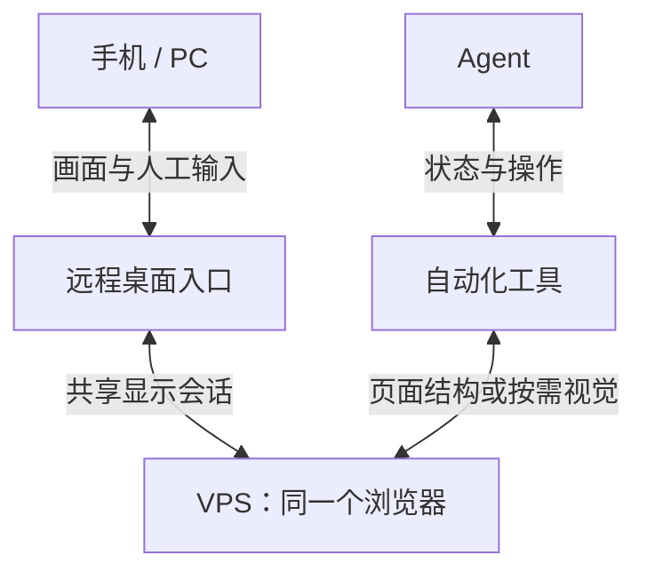

从手机接手 Agent 正在操作的浏览器：理解远程桌面、自动化接口与控制权交接，用开源组件为现有项目补上人工协作入口。

## 同一个浏览器，两条操作通道

Agent 填表遇到登录步骤，你从手机进入桌面，完成登录，再交给它继续。页面、表单和登录会话都留在远端。OpenAI 的 Dots 文档提供了这样的 **Take over / Return control** 交互。[1]

实现这一体验，可以让人和自动化程序接入同一个浏览器。人看画面、操作键鼠；Agent 使用页面结构、应用接口或视觉工具。

*这是自建参考架构。Dots 的底层传输协议及完整工具选择策略尚未在所引文档中披露。*

网页客户端 noVNC 接收远端画面，并通过 websockify 与 VNC 服务传回输入，手机的点击直接作用于远端应用。[3][4] **远程画面供人观看，模型按任务获取观察；两者的更新频率可以独立。**

## Agent 按任务选择操作方式

截图有明确的官方依据：OpenAI 的 CUA 技术说明写明截图进入模型上下文；Computer Use 文档也展示了返回截图的接口。[2][5] 它证明了视觉路径的存在，Dots 每一步采用哪种工具仍未完整披露。

已有项目可以按任务选择：

| 要完成的工作 | 可优先考虑的方式 |
| --- | --- |
| 查询数据、执行接口已覆盖的业务操作 | 已授权的 API、CLI |
| 读取列表、填写网页表单 | DOM、无障碍快照、Playwright |
| 操作缺少结构接口的画布、判断视觉效果 | 截图与视觉工具 |

这是工程选型建议。Playwright MCP 已提供以无障碍快照为主的交互路径；OpenAI 的 ChatGPT agent 也公开组合了视觉浏览器、文本浏览器、终端与 API。[6][7]

**保留现有的结构化自动化，按需补充视觉。** 截图可能出现小字识别和定位误差；完整页面树也可能消耗大量上下文。缩小观察范围、减少模型往返，再比较同一任务的耗时、成本和完成率，才能判断收益。[6][8]

## 用开源组件搭出共享桌面

一套可复用的组合是：**Xvfb 提供虚拟屏幕，Openbox 管理窗口，x11vnc 共享画面与输入，noVNC + websockify 提供网页入口。** 需要桌面级键鼠操作时，可接入 xdotool。它们都是开源组件，分发与修改时需分别核对许可。[2][3][4][9][10][11]

起步可以沿着两个现成入口完成：[OpenAI Computer Use 文档][2]提供图形环境与动作执行示例，[noVNC 项目][3]提供浏览器接入说明。先验证人能进入远端桌面，再连接现有自动化。

**已有 Playwright 的项目**，在该虚拟屏幕上启动有界面浏览器，并持续使用同一组 browser、context 和 page。noVNC 展示的就应是这个窗口；演示脚本另行启动的 Firefox 需要替换为 Playwright 支持的浏览器及启动方式。[12]

**已有视觉工具的项目**，对齐 X11 显示会话、访问凭据和坐标空间，沿用原来的动作执行器。[2][11]

云上访问时，电脑可以通过 SSH 转发，手机可以通过受限私网直接连接 VPS。例如 Tailscale Serve 能为私网设备提供访问入口，这条路径无需个人电脑中转。[13] VNC、浏览器调试端口和 Docker 管理接口应留在内部，网页与 WebSocket 都要检查访问权限。

## 接管时让出输入，交回后刷新状态

共享桌面接通之后，还需要应用服务统一管理人和 Agent 的操作权。下面是自建系统需要实现的交接流程。

**接管：**停止派发自动化，等待或取消在途操作，确认旧动作不会继续执行，再开放人工输入。桌面和浏览器保持运行。

**人工操作：**仅允许当前持有人输入。涉及密码等敏感步骤时，同时暂停模型侧截图、页面内容采集和相关录制。

**交回：**收回人工输入权，确认当前标签页与表单状态，刷新所需页面结构，必要时补截图，再恢复 Agent。

控制权必须在服务端执行。尤其要处理仍在等待元素的自动化调用，防止它在人接管后突然执行；前端按钮只能展示状态。

用一张测试表单就能验证核心链路：**Agent 先填几项 → 人从手机修改一项 → 交回 → Agent 读取修改后的值继续。** 验收重点是会话保留、输入互斥，以及恢复时采用最新状态。

这套设计让自动化继续利用高效接口，也让人能直接进入同一工作现场，处理异常后交还给 Agent。

资料与实现入口

[Dots 接管说明][1] · [Computer Use 环境示例][2] · [CUA 截图机制][5] · [ChatGPT agent 工具组合][7]

[noVNC][3] · [websockify][4] · [Openbox][9] · [x11vnc][10] · [xdotool][11]

[Playwright MCP][6] · [浏览器要求][12] · [视觉限制与计费][8] · [Tailscale Serve][13]

文中组合为参考方案，未进行端到端运行或性能对照验证。复用时应核对组件许可、维护状态与安全补丁。

[1]: https://learn.chatgpt.com/docs/dots/computers-and-apps
[2]: https://developers.openai.com/api/docs/guides/tools-computer-use
[3]: https://github.com/novnc/noVNC
[4]: https://github.com/novnc/websockify
[5]: https://openai.com/index/computer-using-agent/
[6]: https://github.com/microsoft/playwright-mcp
[7]: https://openai.com/index/introducing-chatgpt-agent/
[8]: https://developers.openai.com/api/docs/guides/images-vision
[9]: https://github.com/danakj/openbox
[10]: https://github.com/LibVNC/x11vnc
[11]: https://github.com/jordansissel/xdotool
[12]: https://playwright.dev/docs/browsers
[13]: https://tailscale.com/docs/reference/tailscale-cli/serve
