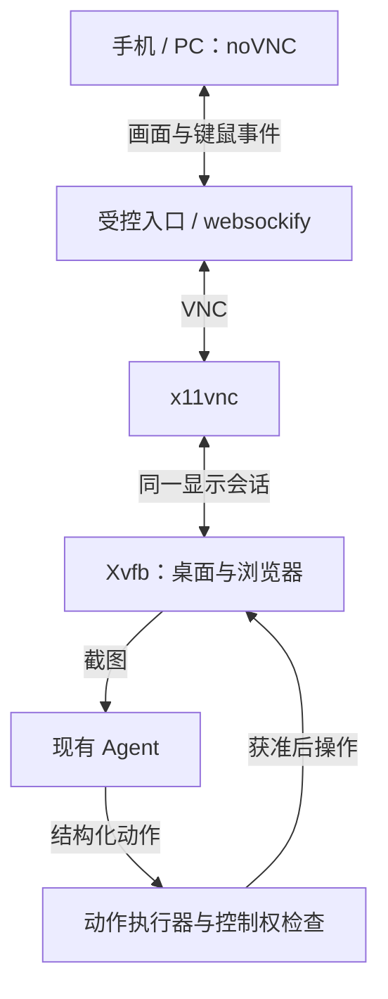

用开源组件，把 Agent 的 Sandbox 变成手机和电脑都能接管的远程桌面。本文拆解共享画面与控制权切换，提供 Docker 启动配置、现有 Agent 接入方法及部署边界。

**不必换掉现有 Agent。先给它一个人也能进入的工作现场，再接上截图、键鼠操作与接管开关。** 人和 Agent 使用同一个浏览器，登录、表单与文件留在远端；手机只接收画面、传回输入。

## 1. 接管的不是聊天，而是 Agent 正在用的那台电脑

OpenAI 的 Dots 文档提供 **Take over / Return control**：人进入云电脑完成操作，再交回给 Dot。这里最值得复用的不是某个模型，而是**双方能接手同一个工作现场**。这不等于 Dots 已开放任意自有 VPS 的接入，也不证明它内部使用下面的开源组件。[1]

OpenAI 的 Computer Use 文档公开了另一部分：用 **Xvfb、桌面环境、x11vnc 和浏览器**建立 Linux 图形环境，再用 `xdotool` 执行键鼠动作。补上 **noVNC + websockify**，这个桌面就能从普通浏览器访问；noVNC 支持桌面浏览器和 iOS、Android 浏览器。[2] [3]



*这是可自建的参考链路，不是 Dots 私有架构图。人工输入通道与 Agent 执行器必须共同遵守控制权规则。*

**画面传回来，键鼠传过去。** 人的点击经过 noVNC、websockify 和 VNC 服务进入远端桌面，不需要先让大模型解释。Agent 则读取截图，再通过自己的动作执行器操作同一个 `DISPLAY`。[2] [3] [4]

因此，只提供截图、网页预览或“批准”按钮都不够。网页预览通常打开的是用户自己的浏览器；真正的接管要保留 **Agent 原来的浏览器进程、标签页和未完成表单**。

## 2. 这套方案是开源的，而且不绑定模型

它不是一个需要申请的专有 SDK，而是几个开源项目的组合。下表同时给出职责与许可，避免把“桌面环境”误当成某个单独产品。

| 组件 | 本文中负责什么 | 开源许可概况 |
| --- | --- | --- |
| Xvfb | 在内存中提供虚拟屏幕 | X.Org 多许可体系，MIT/X11 等；以实际包为准 [5] |
| Openbox | 管理窗口，本例用它代替完整桌面 | GPL-2.0-or-later [6] |
| x11vnc | 共享已有的 X11 显示会话 | GPL-2.0 系列，具体文件可能允许后续版本 [7] |
| xdotool | 模拟 X11 键鼠与窗口操作 | BSD-3-Clause [8] |
| noVNC | 浏览器内显示、控制远端桌面 | 主要为 MPL-2.0 [3] |
| websockify | WebSocket 与 TCP 双向转发 | LGPL-3.0 [4] |

**可以复用，但不能把整个组合笼统标成 MIT。** 封装镜像、修改组件或向客户交付时，要保留对应声明，并核对适用的源码提供等义务；浏览器、字体及其他依赖也有各自许可。部署组件不需要购买 OpenAI 模型服务，之后接入模型的费用另算。[3] [4] [5] [6] [7] [8]

一个实际的选型提醒：**x11vnc 上游 README 目前明确标注缺少维护者。** 它适合说明这条链路，生产选型还要检查发行版安全补丁与替代实现，不能把本文示例当成长期维护承诺。[7]

## 3. 快速启动：先让人连上，再接 Agent

下面是一份**单用户、隔离测试用的参考配置**。准备有 Docker Engine 28+ 和 Compose 插件的 Linux VPS，或本机 Docker 的 Linux 容器环境。在空目录中保存下方三个文件，然后运行：

```bash
docker compose up --build -d
docker compose logs --tail=80 desktop
```

在 Docker 所在电脑打开 `http://127.0.0.1:6080/vnc.html`，点击 Connect，可以进入远端 Firefox。**此时不需要 API Key，也还没有自动运行的 Agent。** 本例没有应用登录和完整的接管仲裁，只用于先验证桌面与输入链路。

端口只发布到宿主 `127.0.0.1`，VNC 不发布到宿主。Docker 官方特别提示，28.0.0 之前的版本存在同网段访问回环发布端口的例外，因此不要把旧版本的回环绑定当成完整保护。[9]

<details>
<summary>展开完整配置：Dockerfile、compose.yaml、start.sh</summary>

本例采用 Debian 12 软件包与 Openbox，避免依赖第三方预构建桌面镜像。它没有挂载宿主目录、Docker socket，也不使用 privileged。正式复用时应固定经过验证的镜像摘要和包版本，同时跟进安全更新。

**Dockerfile**

```dockerfile
FROM debian:bookworm-slim

RUN apt-get update && apt-get install -y --no-install-recommends \
    xvfb xauth x11-utils x11vnc openbox firefox-esr \
    xdotool imagemagick novnc websockify dbus-x11 \
    ca-certificates fonts-dejavu fonts-noto-cjk python3 \
    && rm -rf /var/lib/apt/lists/*
RUN useradd --create-home --uid 1000 --shell /bin/bash agent

ENV HOME=/home/agent DISPLAY=:99 XAUTHORITY=/tmp/agent.Xauthority \
    MOZ_ENABLE_WAYLAND=0
COPY start.sh /usr/local/bin/start-desktop
USER agent
WORKDIR /home/agent
CMD ["bash", "/usr/local/bin/start-desktop"]
```

**compose.yaml**

```yaml
services:
  desktop:
    build: .
    init: true
    ports:
      - "127.0.0.1:6080:6080"
    shm_size: "512m"
    security_opt:
      - no-new-privileges:true
    cap_drop:
      - ALL
```

**start.sh**

```bash
#!/usr/bin/env bash
set -Eeuo pipefail
umask 077
pids=()
cleanup() {
  if ((${#pids[@]})); then
    kill "${pids[@]}" 2>/dev/null || true
    wait "${pids[@]}" 2>/dev/null || true
  fi
}
trap cleanup EXIT
trap 'exit 0' TERM INT

export XDG_RUNTIME_DIR=/tmp/runtime-agent
mkdir -p "$XDG_RUNTIME_DIR"
chmod 700 "$XDG_RUNTIME_DIR"
touch "$XAUTHORITY"
xauth add "$DISPLAY" MIT-MAGIC-COOKIE-1 \
  "$(python3 -c 'import secrets; print(secrets.token_hex(16))')"
Xvfb "$DISPLAY" -screen 0 1280x800x24 -nolisten tcp \
  -auth "$XAUTHORITY" &
pids+=("$!")
for ((i=0; i<100; i++)); do
  xdpyinfo >/dev/null 2>&1 && break
  kill -0 "${pids[0]}" 2>/dev/null || exit 1
  sleep 0.1
done
xdpyinfo >/dev/null 2>&1 || { echo 'Xvfb startup failed' >&2; exit 1; }

openbox &
pids+=("$!")
## No VNC password in this isolated demo: require host-loopback + SSH/VPN access.
x11vnc -display "$DISPLAY" -auth "$XAUTHORITY" \
  -localhost -rfbport 5900 -forever -shared -nopw -noxdamage &
pids+=("$!")
dbus-run-session -- firefox-esr --no-remote about:blank &
pids+=("$!")
websockify --web=/usr/share/novnc 0.0.0.0:6080 127.0.0.1:5900 &
pids+=("$!")
## Stop the container if an essential child exits; do not leave a fake healthy shell.
wait -n "${pids[@]}"
exit 1
```

Xvfb 与 x11vnc 使用同一份 Xauthority；Agent 动作也必须使用它。本例的 VNC 没有密码，外层只能通过可信宿主或已鉴权的 SSH/VPN 访问。不要把 `6080` 改成公网监听，也不要把不可信容器加入同一网络。这里没有配置浏览器持久卷：重建容器会丢失其中的浏览器资料，不能当作持久云电脑。

配置已做 Bash 语法与 YAML 静态检查，尚未完成该 Docker 镜像的构建和端到端运行验证。

</details>

### VPS 在云上，本机和手机怎么打开？

**电脑先用 SSH 转发。** 在自己的电脑执行，保持连接，再打开本机的上述地址；将 `user@your-vps` 换成实际 SSH 目标。

```bash
ssh -N -L 127.0.0.1:6080:127.0.0.1:6080 user@your-vps
```

**手机可以直接走私有网络，不需要电脑中转。** 例如 VPS 与手机已加入同一个 Tailscale 网络，并配置仅允许自己的访问规则时，在 VPS 上运行：

```bash
sudo tailscale serve --bg http://127.0.0.1:6080
```

在已有 Serve 服务的机器上先核对路由；按命令提示完成 HTTPS 授权，在手机保持 Tailscale 连接后，打开输出的 HTTPS 地址并加上 `/vnc.html`。这里使用的是私网 **Serve**，不是向整个互联网开放的 Funnel；Tailscale 只是可选接入方式，不是这套桌面的运行依赖。[10]

**手机里的 `127.0.0.1` 指手机自己，不是 VPS。** 不能把电脑上的本地转发地址直接复制到手机；手机需要自己的隧道，或上面的私网入口。

## 4. 现有 Agent 怎么接？先接五个动作，不必重写框架

先验证自动化确实作用在刚才看到的桌面。在配置目录中，依次执行：

```bash
## 截取同一个 DISPLAY 的画面，保存到宿主当前目录。
docker compose exec -T desktop import -window root png:- > screen.png

## 让远端 Firefox 的地址栏出现文字；在 noVNC 中可以同步看到。
docker compose exec -T desktop xdotool key --clearmodifiers ctrl+l
docker compose exec -T desktop xdotool type --clearmodifiers --delay 10 'https://example.com'
docker compose exec -T desktop xdotool key --clearmodifiers Return
```

这一步的验收不是“命令没报错”，而是 **noVNC 里可见的同一个 Firefox 确实发生了变化**。OpenAI 的公开示例同样通过 `DISPLAY`、截图和键鼠执行连接模型与环境。[2]

接到已有项目时，把这些调用封装为受控工具即可：

| 工具 | 执行器负责的转换 |
| --- | --- |
| `screenshot()` | 返回 PNG 给模型的图像输入，或使用框架支持的图像工具结果 |
| `click(x, y)` | 校验坐标，再执行 `xdotool mousemove --sync x y click 1` |
| `type(text)` | 限制长度，将文本作为独立参数传入，不拼接 Shell |
| `keypress(key)` | 将框架键名映射到 X11 键名，并限制可接受格式 |
| `scroll(direction, steps)` | 限制方向和步数，再转换为滚轮输入 |

**HTTP、MCP、函数调用只是封装入口，底层桌面不变。** 模型仍需要能理解画面，或通过浏览器结构等信息作决策；装好桌面不会自动赋予任意文本模型可靠的视觉操作能力。调用 Docker 的应是可信执行服务，而不是把 Docker socket 或任意 Shell 权限直接交给模型。

已有自动化还要对齐两点：**Playwright 应以 `headless=False` 在这个显示会话中启动，并继续使用原来的 browser/page；已有 PyAutoGUI 或 xdotool 工具则对齐 `DISPLAY`、Xauthority 和截图尺寸。** 只有显示号相同却新开一个浏览器，也没有接回原表单。xdotool 针对 X11，不是原生 Wayland、macOS 或 Windows 的通用输入驱动。[2] [8]

## 5. 再补一个接管开关，才是人机协作

**上面的容器已经提供共享桌面，但没有自动实现 Take over。** noVNC 能连上，不代表 Agent 会自动停手；`viewOnly` 之类前端属性也不能代替服务端授权。

现有 Agent 项目需要在执行器与人工输入入口之间补一项共同控制状态：

| 用户动作 | 服务端必须完成什么 |
| --- | --- |
| 接管 | 停止派发 Agent 动作，处理在途操作；确认不会再干扰现场后，开放人工输入 |
| 人操作 | 保留桌面和浏览器运行，只允许当前持有人输入；敏感操作期间暂停相关截图和录制 |
| 交回 | 先收回人工写入权，再获取新截图，让 Agent 从新现场继续 |

这里暂停的是**自动化输入，不是整台容器**。否则浏览器也会停止，人无法继续操作。需要覆盖的不只是 xdotool，还包括操纵同一浏览器的 Playwright 脚本和其他后台动作。

最小验证场景可以很简单：**Agent 填测试表单的前半段 → 人从手机接管填写后半段 → 交回 → Agent 读取并继续。** 必须看到表单没有重建，人工操作期间没有自动输入，交回后没有基于旧截图误点。

临时演示可以由操作员先停止自动化、再打开远控；产品化时应在服务端强制仲裁。控制权检查与动作派发要避免竞态，用会话代次或类似机制拒绝迟到的旧动作。仅给聊天添加“暂停”提示不够。

## 6. 从演示走向可复用能力，边界很清楚

**安全入口、隔离环境、控制权交接，缺一不可。** 公网产品需要保护 HTTP 页面和 WebSocket，验证用户对具体桌面的访问权；不同用户分配独立环境，不把生产凭据、宿主目录或高权限接口放进演示容器。容器本身也不是抵御任意不可信代码的绝对安全边界。

这份启动配置解决的是“把工作现场开放给人”，不是完整的多租户云桌面。x11vnc 的维护风险、会话恢复、持久化和移动端体验，需要随着产品阶段补齐。[7]

**最值得复用的单位，是一台同时提供 Agent 工具入口与人工接管入口的共享工作机。** 模型和框架可以继续迭代；人不必再靠反复描述错误来纠正 Agent，而可以直接进入现场修正，再交还给它。

<details>
<summary>实现与许可来源</summary>

[1] OpenAI：Dots 的电脑与应用说明，支持产品接管行为，不代表开源实现采用相同技术栈。

[2] OpenAI：Computer Use，包含图形环境、截图、xdotool 与浏览器自动化示例。

[3] noVNC：项目 README、移动浏览器支持与 LICENSE。

[4] websockify：转发机制与 COPYING。

[5] X.Org：许可说明，明确要求按文件或软件包核对具体条款。

[6] Openbox：上游 README 与 GPL 声明。

[7] x11vnc：上游维护状态、许可及源码文件声明。

[8] xdotool：上游用途、X11/Wayland 边界与 COPYRIGHT。

[9] Docker：回环端口发布与旧版本安全例外。

[10] Tailscale：Serve 私网共享与 CLI 用法。

表中许可是定位线索，不替代完整依赖清单与具体交付方式的许可审查。本文启动配置为参考实现，未声称经过生产验证。

</details>

[1]: https://learn.chatgpt.com/docs/dots/computers-and-apps
[2]: https://developers.openai.com/api/docs/guides/tools-computer-use
[3]: https://github.com/novnc/noVNC
[4]: https://github.com/novnc/websockify
[5]: https://xorg.freedesktop.org/archive/X11R7.7/doc/xorg-docs/License.html
[6]: https://github.com/danakj/openbox
[7]: https://github.com/LibVNC/x11vnc
[8]: https://github.com/jordansissel/xdotool
[9]: https://docs.docker.com/engine/network/port-publishing/
[10]: https://tailscale.com/docs/reference/tailscale-cli/serve
