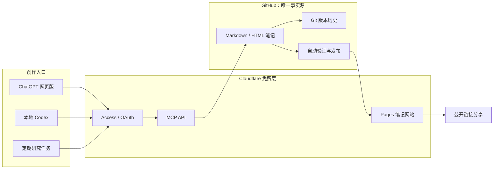
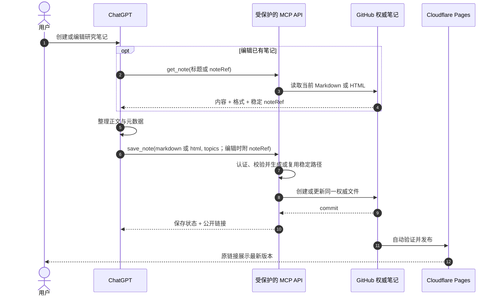

这套工作流把 ChatGPT 中完成的研究内容直接保存为可维护的 Markdown 或 HTML 文件，并自动发布为可分享的网站页面。全程只有一份权威内容，不经过下载链接、中转平台或重复备份。

## 一、方案概览

最短链路如下：



各组件只承担一种核心职责：

| 组件 | 职责 |
|---|---|
| ChatGPT / Codex | 研究、整理、编辑并调用笔记工具 |
| MCP API | 认证、参数校验、笔记定位和 GitHub 读写 |
| GitHub | 保存唯一笔记文件、版本历史和自动化配置 |
| Cloudflare Pages | 托管公开网站和 MCP API |
| Cloudflare Access | 保护写入入口，公开页面保持可分享 |

GitHub 保存“事实”，Cloudflare 提供“运行与访问”。网站可以从任意 Git commit 重新生成，因此无需再维护一份独立的云端文档副本。

ChatGPT 网页版、本地 Codex 和定期研究任务连接同一个 MCP Endpoint。它们读取同一份工具契约并进入同一套保存逻辑，不再分别维护本地 Bearer 通道和云端 OAuth 通道。

## 二、MCP 与笔记身份

MCP 把服务端能力描述为模型可以读取的工具契约：

| 工具 | 用途 | 主要输入 | 返回结果 |
|---|---|---|---|
| `get_note` | 获取待编辑或删除的权威版本 | 标题、文件名或 `noteRef` | Markdown 或 HTML、元数据、`noteRef` |
| `save_note` | 创建或更新笔记 | Markdown 或 HTML、topics；编辑时附带 `noteRef` | 保存状态、commit、公开链接 |
| `delete_note` | 删除笔记 | `get_note` 返回的 `noteRef` 与 `contentHash` | 删除状态、commit、原公开链接 |

模型负责需要语义理解的部分：标题、正文结构、格式、摘要和主题。API 不再要求模型填写 slug，也不调用第二个模型；它根据标题与主题生成稳定路径，并执行认证、HTML 清理、校验、冲突处理、文件写入、删除和链接生成等确定性逻辑。

权威文件路径为：

```text
content/{locale}/notes/{canonical-key}.{mdx|html}
```

`canonical-key` 是文件路径和公开 URL 的组成部分，frontmatter 不再重复保存独立 `slug` 字段：

- 新建时，服务端优先根据 H1 标题生成 `canonical-key`；中文标题结合模型提取的英文技术主题生成自然路径，缺少英文主题时使用标题拼音。
- 路径冲突时，服务端追加基于标题生成的稳定短哈希，不依赖随机值或重复模型调用。
- 编辑时，模型先读取笔记，再使用服务端返回的稳定 `noteRef` 保存。
- HTML 以有效的独立 `.html` 文档保存，但网站只渲染经过清理的语义内容；脚本、表单、事件属性、调用方样式和危险 URL 会被拒绝。
- 删除时必须同时提交准确的 `noteRef` 和当前 `contentHash`；内容在读取后发生变化时，删除会失败并要求重新确认。
- 列表页和详情页头部保留摘要；正文首段或首个“摘要 / 核心问题”区块与摘要重复时，只在页面渲染阶段省略，不改写权威文件。
- 修改标题不会改动文件路径和分享链接。
- 内容未变化时返回 `unchanged`，不产生空提交。

因此，唯一文件路径已经足以标识笔记；slug 不是调用参数或独立元数据，`noteRef` 是编辑阶段的稳定引用。

## 三、创建与编辑：同一条保存链路

新建与更新共用 `save_note`，区别只在于保存前是否已经取得 `noteRef`。



删除复用相同身份链路：先由 `get_note` 取得权威版本，用户确认准确标题和链接后，`delete_note` 将 `noteRef` 与 `contentHash` 一并绑定到 GitHub 删除提交。Cloudflare 不维护第二份笔记，下一次部署会自然移除页面。

这条链路同时覆盖创建、继续学习后的增量更新、标题优化和批量维护。使用者只表达内容意图，模型选择工具并提供语义参数，服务端保证写入范围和文件身份。

## 四、纯免费基础设施

对个人研究笔记和低频定期更新，这套存储与发布链路可以完全运行在免费层内。

| 能力 | 免费资源 | 当前用途 |
|---|---|---|
| 权威存储与版本管理 | GitHub Free 私有仓库 | 保存 Markdown / HTML、代码与 Git 历史 |
| 自动验证与发布 | GitHub Free 每月包含 2,000 分钟私有仓库标准运行时长 | 校验、构建和部署 |
| 网站托管 | Cloudflare Pages Free 每月 500 次构建 | 提供静态网站与分享链接 |
| MCP API | Cloudflare Workers Free 每日 100,000 次请求 | 承载读取与保存工具 |
| 写入认证 | Cloudflare Zero Trust Free，适合 50 人以内 | 限制笔记写入者 |
| 网站地址 | 免费 `pages.dev` 子域名 | 直接公开访问和分享 |

这里的“纯免费”指笔记存储、自动化、API 和网站托管基础设施为 ¥0；已有 ChatGPT 账号或订阅不计入基础设施成本，自有域名属于可选支出。为避免意外计费，GitHub 应保持付费使用预算为 0，Cloudflare 项目固定使用 Free 计划。

免费额度以平台政策为准，可定期核对 [GitHub Actions 计费说明](https://docs.github.com/en/billing/concepts/product-billing/github-actions)、[Cloudflare Pages 限额](https://developers.cloudflare.com/pages/platform/limits/)、[Cloudflare Workers 限额](https://developers.cloudflare.com/workers/platform/limits/)和 [Cloudflare Zero Trust 定价](https://www.cloudflare.com/plans/zero-trust-services/)。

## 五、安全边界

公开网站与写入接口分离：任何人都可以阅读和分享笔记页面，只有通过 Cloudflare Access 身份验证的所有者才能调用 MCP。

- Access / OAuth 在请求进入 Function 前完成身份验证。
- 每个客户端获得独立 OAuth Grant；ChatGPT 与 Codex 不共用访问令牌，但受同一身份策略约束。
- ChatGPT 使用已登记的 HTTPS 回调，本地 Codex 使用受 PKCE 保护的临时 loopback 回调。
- GitHub Token 只授予目标仓库所需的 Contents 读写权限。
- API 固定 profile、语言和笔记目录，不接受任意仓库路径。
- 输入 schema 约束 Markdown / HTML、主题、类型和笔记引用。
- Git 历史保留每次有效修改，可比较和回滚。

唯一的 GitHub 写入密钥只存在于 GitHub Secrets 和隔离的 MCP 运行环境。公开网站不持有写入密钥，ChatGPT 与 Codex 也不会接触该密钥。

## 六、定期研究与批量维护

未来的研究任务继续复用同一事实源和工具契约：

1. 新主题直接调用 `save_note` 创建 Markdown 或 HTML 笔记。
2. 已有主题先用 `get_note` 读取权威版本，再携带 `noteRef` 更新。
3. 单篇删除先读取并确认 `noteRef` 与 `contentHash`，再调用 `delete_note`。
4. 多篇笔记的格式迁移、链接检查和主题调整在本地同步最新仓库后批量处理。
5. 所有修改进入同一 Git 历史，并由同一网站自动发布。

本地仓库适合批量工程维护，ChatGPT 适合内容研究与单篇编辑；两种入口操作的是同一组权威笔记文件，不产生导出件、镜像库或备份分叉。

## 七、使用方式

创建笔记：

```text
将当前研究整理为工作/学习笔记，保存并发布。
```

编辑笔记：

```text
读取并更新笔记 <标题或 noteRef>，保持原链接发布。
```

保存 HTML 笔记：

```text
将当前内容整理为语义化 HTML 工作/学习笔记，通过 save_note 保存并发布。
```

删除笔记：

```text
读取笔记 <标题或 noteRef>，确认准确标题与链接后删除。
```

模型完成整理后调用 MCP，返回稳定公开链接。页面发布完成后即可通过浏览器访问或直接分享。

## 八、结论

最终链路保持为：

```text
ChatGPT → MCP → GitHub → Cloudflare Pages
```

这是一套面向长期工作的免费知识管理基础设施：ChatGPT 负责内容智能，MCP 负责安全写入，GitHub 负责权威事实与版本，Cloudflare 负责网站托管和链接分发。新建与编辑共用一条流程，笔记只有一份权威文件，持续研究和批量维护都在同一体系内完成。
