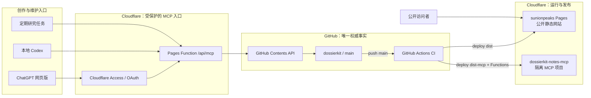
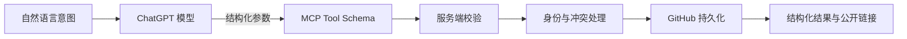
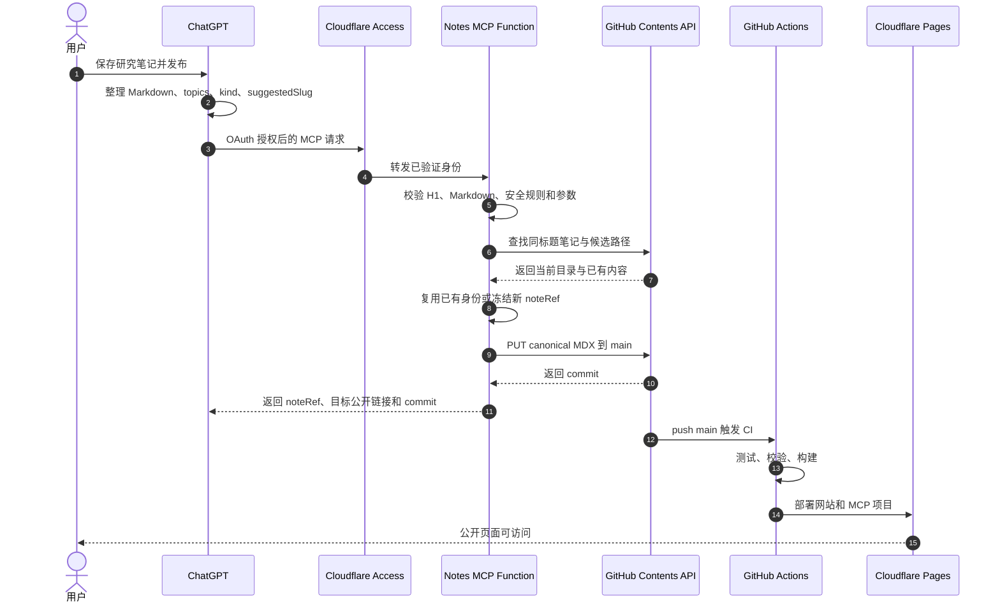
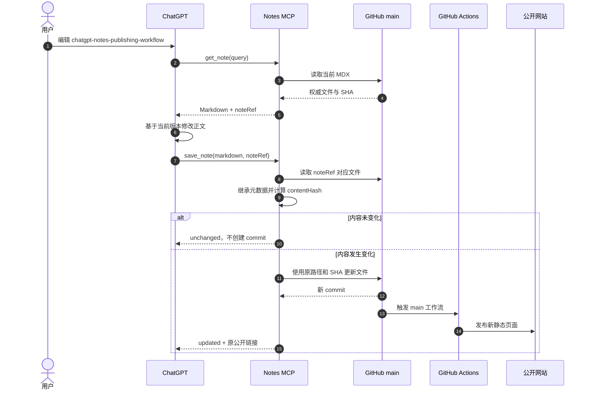
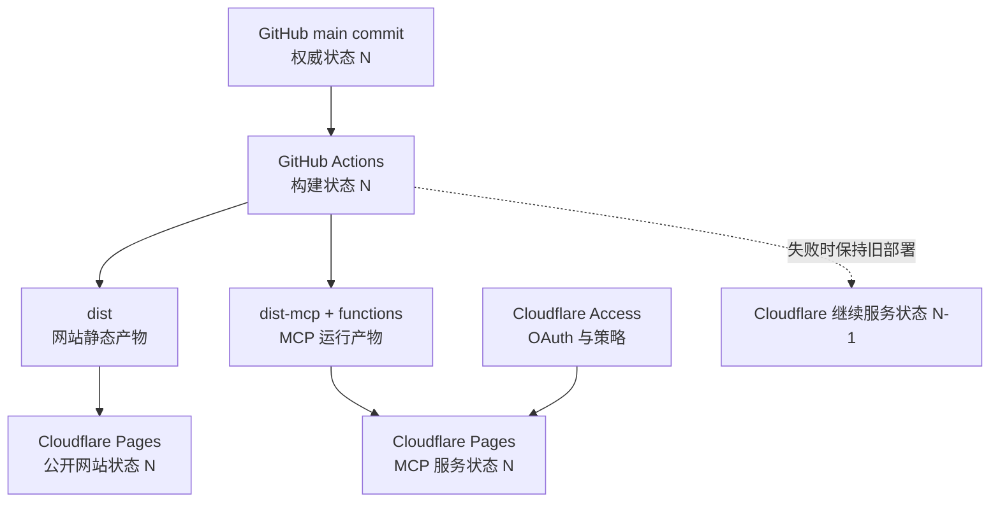
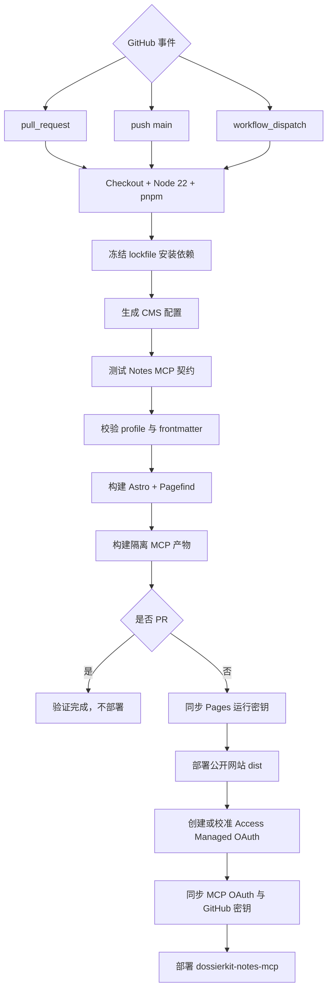
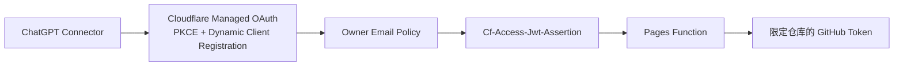
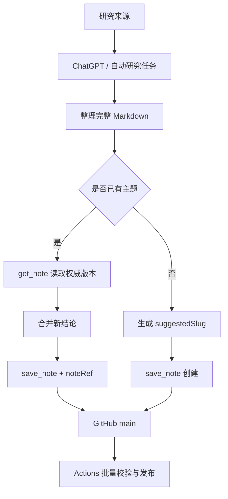

将 ChatGPT 中整理完成的研究内容直接写入 GitHub 权威知识库，再由 GitHub Actions 构建并发布到 Cloudflare Pages；通过稳定身份、幂等更新和自动部署支持长期编辑与批量维护。

## 一、整体架构

系统分为创作、事实存储、自动化和发布访问四层。ChatGPT 与本地 Codex 都是内容入口，GitHub `main` 是唯一权威事实，Cloudflare 只承载 API 与网站运行结果。



这张图中最重要的边界是：

- ChatGPT 负责研究、编辑和生成语义参数。
- MCP Function 负责认证、校验、身份解析和 GitHub 读写。
- GitHub 保存唯一可维护的 MDX 文件与完整版本历史。
- GitHub Actions 负责把仓库状态转成可部署产物。
- Cloudflare Pages 保存当前部署结果，不承担内容主库职责。

## 二、代码仓库保存什么

远程仓库为 `Nunchakus888/dossierkit`。同一仓库同时保存内容、网站、MCP API 和部署流程，减少跨系统配置漂移。

```text
dossierkit/
├── profiles/default/content/zh/notes/
│   └── {canonical-key}.mdx        # 权威笔记
├── functions/api/mcp.ts           # MCP 工具注册与 HTTP 入口
├── src/lib/note-ingest.ts         # 内容解析、校验、哈希与渲染
├── src/server/github-notes.ts     # GitHub 读取、去重与更新
├── src/pages/[locale]/notes/      # 笔记列表与详情页面
├── scripts/test-notes.ts          # Notes 契约测试
├── scripts/build-mcp-static.ts    # MCP 项目静态产物
├── scripts/provision-notes-access.ts
│                                  # Cloudflare Access / OAuth 配置
└── .github/workflows/ci.yml       # 验证、构建和部署编排
```

笔记文件路径为：

```text
profiles/{profileId}/content/{locale}/notes/{canonical-key}.mdx
```

文件名中的 `canonical-key` 同时决定网站路径。笔记 frontmatter 不重复保存 `slug`，从结构上消除“文件名与 slug 字段不一致”这一类分叉。

## 三、MCP 如何连接模型与代码

MCP 是模型可读取的工具契约。它描述工具名称、输入结构、输出结构和读写属性，模型据此选择 `get_note` 或 `save_note`，API 再执行确定性代码。

| 工具 | 用途 | 关键输入 | 关键输出 | 副作用 |
|---|---|---|---|---|
| `get_note` | 读取权威笔记 | 标题、文件名或 `noteRef` | Markdown、元数据、`noteRef` | 无 |
| `save_note` | 创建或更新笔记 | Markdown、`suggestedSlug` 或 `noteRef` | 动作结果、公开链接、commit | 写入 GitHub |

Function 内没有第二次模型调用。语义判断由当前 ChatGPT 会话完成，服务端只处理可验证的工程规则：



这种分工避免在 API 内增加额外模型、提示词、计费和不确定性，同时保留模型对标题、内容和语义路径的理解能力。

## 四、新建笔记的触发流程

创建时，ChatGPT 根据完整内容给出 `suggestedSlug`。服务端将它视为路径建议，而不是未经验证的最终身份。



保存接口会立即返回目标公开链接；页面内容在 GitHub Actions 部署完成后可见。也就是说，GitHub commit 先成为权威事实，Cloudflare 网站随后达到一致状态。

## 五、编辑与更新流程

更新不依赖标题猜测，而是先读取权威文件，再携带稳定 `noteRef` 保存。



更新期间遵循以下身份规则：

1. `suggestedSlug` 只参与首次创建。
2. `noteRef` 是服务端返回的稳定文件引用，例如 `zh/chatgpt-notes-publishing-workflow`。
3. 修改标题不会改变 `noteRef`、文件名或公开链接。
4. 未传入 `date`、`featured`、`kind` 或 `topics` 时沿用已有元数据。
5. 内容哈希相同则返回 `unchanged`，避免无效 commit。
6. 新建请求若命中相同规范化标题，会复用已有文件，阻止语义路径变化造成分叉。

## 六、GitHub 与 Cloudflare 的关系

GitHub 和 Cloudflare 不维护两套等价内容，它们分别承担“源”和“运行结果”。

| 系统 | 保存内容 | 是否权威 | 主要职责 |
|---|---|---:|---|
| GitHub `main` | MDX、代码、测试、工作流 | 是 | 版本、审查、回滚、自动化触发 |
| GitHub Actions | 临时构建环境与日志 | 否 | 测试、构建、密钥同步、部署编排 |
| Cloudflare Pages 网站项目 | `dist` 静态产物 | 否 | 全球访问、缓存、分享链接 |
| Cloudflare MCP 项目 | `dist-mcp`、Pages Function | 否 | ChatGPT MCP API 运行环境 |
| Cloudflare Access | OAuth 应用与访问策略 | 否 | 登录、令牌、所有者访问控制 |



如果构建或部署失败，GitHub commit 仍然保留，Cloudflare 继续提供上一版成功产物。修复 commit 或回滚后，Actions 再次构建即可恢复一致。

## 七、GitHub Actions 工作流机制

`.github/workflows/ci.yml` 支持三类触发：

| 触发事件 | 验证与构建 | 同步密钥 | 部署 Cloudflare | 用途 |
|---|---:|---:|---:|---|
| `pull_request` | 是 | 否 | 否 | 合并前质量门禁 |
| `push` 到 `main` | 是 | 是 | 是 | 正式发布 |
| `workflow_dispatch` | 是 | 是 | 是 | 人工重新发布或切换 profile |



工作流设置了：

```text
concurrency.group = ci-${github.ref}
cancel-in-progress = true
```

短时间内连续写入多篇笔记时，旧的同分支构建会被取消，最新一次工作流从当前 `main` 构建完整站点。所有 commit 仍保留，最终部署包含最新主分支的全部内容。

## 八、认证与权限边界

ChatGPT 使用的入口为：

```text
https://dossierkit-notes-mcp.pages.dev/api/mcp
```

访问路径为：



- OAuth access token 生命周期为 15 分钟，授权会话最长为两周。
- Cloudflare Access 只允许配置的所有者邮箱完成登录。
- Function 校验 Access 签发的身份断言后才执行工具。
- GitHub Token 只授予目标仓库 Contents 读写权限。
- 输入 schema 不接受任意仓库路径，服务端固定 profile、语言目录和 Notes 目录。
- `get_note` 声明为只读工具，`save_note` 声明为有界写入工具。

## 九、一致性与失败处理

| 失败位置 | 是否写入 GitHub | 公开站点状态 | 处理方式 |
|---|---:|---|---|
| OAuth 或身份校验失败 | 否 | 不变 | 重新授权或检查 Access 策略 |
| Markdown/schema 校验失败 | 否 | 不变 | 修正正文结构或参数 |
| GitHub API 写入失败 | 否 | 不变 | 保留原文件，重试写入 |
| GitHub 写入成功、CI 校验失败 | 是 | 保持上一版 | 修复或回滚 commit |
| 网站部署失败 | 是 | 保持上一版 | 重跑 Actions 或修复部署配置 |
| 重复请求且内容相同 | 否 | 不变 | 返回 `unchanged` |

事实状态按以下顺序推进：

```text
ChatGPT 完成稿
→ GitHub commit 成为权威事实
→ GitHub Actions 验证该事实
→ Cloudflare 发布该事实的静态视图
```

因此，GitHub 可独立完成版本恢复，Cloudflare 部署产物可以随时由相同 commit 重新生成。

## 十、定期研究与批量维护

定期研究任务复用同一 MCP 契约，不增加下载中转或第二个内容库。



仓库层面的批量操作适合处理：

- schema 升级与 frontmatter 迁移；
- 链接完整性、内容哈希与命名检查；
- 全站索引和 Pagefind 搜索重建；
- 批量主题调整与内容质量扫描；
- Git 历史审计、差异比较与回滚。

ChatGPT 网页版、本地 Codex 和定期任务共享相同事实源与工具契约。入口可以有多个，可维护的权威内容始终只有 GitHub `main` 中的一份。

## 十一、实际使用

创建：

```text
“将当前研究整理为工作/学习笔记，保存并发布。”
```

模型生成完整 Markdown、主题、类型和 `suggestedSlug`，调用 `save_note`，返回稳定链接。

更新：

```text
“更新笔记 chatgpt-notes-publishing-workflow，补充 GitHub Actions 机制。”
```

模型先调用 `get_note` 获取 Markdown 与 `noteRef`，完成修改后调用 `save_note(noteRef)`。文件路径和分享链接保持不变。

## 十二、设计结论

该工作流把创作、事实、自动化和发布分开，同时保持最短链路：

```text
ChatGPT → MCP → GitHub main → GitHub Actions → Cloudflare Pages
```

GitHub 解决权威内容、版本和触发问题；Cloudflare 解决认证、API 运行和网站分发问题；MCP 解决模型与确定性代码之间的工具契约问题。三者各自承担单一职责，共同形成可编辑、可回滚、可批量维护和可公开分享的研究笔记系统。
