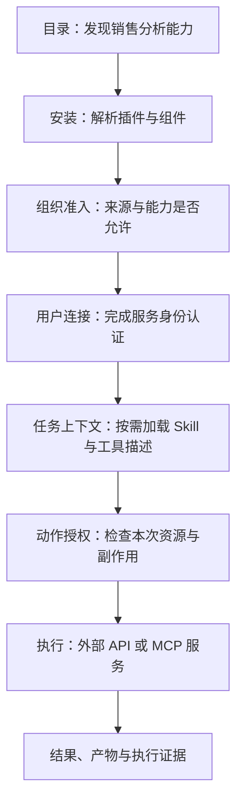

Claude Marketplace 最值得研究的不是“又多了一个插件商店”，而是三个原本分离的问题被放到了同一入口：发现能用的能力、采购 Claude 生态产品、寻找实施服务。**入口统一不意味着底层拥有同一种包格式、执行协议或权限模型。**

本文依据 Anthropic 官方发布、帮助中心和 Claude Code 插件文档，区分已公开产品行为与可复用的架构推演；不将厂商目录规模解释为实际使用量或安全保证。

## 1. 这次到底统一了什么

2026 年 9 月 23 日的官方发布将 Marketplace 分成三类：连接器与插件、Agent 与软件产品、服务合作伙伴；“超过 2,000 个”指发布时可用的 connector/plugin 合计，不是 2,000 个独立 Agent。部分 Claude-powered 软件采购可以使用一定份额的 Anthropic 承诺支出。[1]

这不等于 Marketplace 首次让 Skills、Connectors、Plugins 出现在一起。帮助中心的统一目录说明在此前已经描述了这种浏览与安装体验。因此，新发布更准确的增量是：**将能力目录扩展成生态发现与采购入口**，而不是发明一套新的 Agent Runtime。[2]

| 对象 | 核心作用 | 不能直接推导出的能力 |
|---|---|---|
| Connector | 连接外部服务与数据 | 不代表每个工具调用都获得业务授权 |
| Skill | 提供任务方法、说明与相关资源 | 不等于独立推理进程 |
| Plugin | 将若干能力打包分发 | 不保证不同宿主完整支持全部组件 |
| Agent / Product | 提供完整软件或代理服务 | 不代表能被父 Agent 直接作为 MCP 工具调用 |
| Service partner | 咨询、集成与交付 | 不是可安装的软件包 |

表格是概念分工，不是 Anthropic 公布的统一对象 Schema。采购合同、目录列表、插件文件和工具调用必须分别建模。

## 2. 从“发现”到“执行”，中间至少有四次转换

假设用户安装一个销售分析插件。它带有分析 Skill，并需要连接 CRM。真正的工作流不是“安装完成，所以可以读取全部销售数据”，而是分阶段解析。



这是参考架构，不是 Anthropic 内部服务拓扑。

四次转换对应不同事实：目录条目变成已安装内容；已安装内容变成某个用户可用的连接；连接变成本轮可见工具；模型提出的调用变成经过授权的实际请求。任何一次转换都可能失败，而且不能用同一个 `installed: true` 表示全部状态。

例如，“已安装但尚未登录”“已连接但组织禁止写操作”“工具可见但本次审批未通过”，在 UI 中应是不同状态。否则用户会把权限问题误认为模型不会使用工具。

## 3. 哪些技术对象已经有公开实现

### 插件包与目录索引不是一个文件

Claude Code 文档分别描述 `.claude-plugin/plugin.json` 与 `.claude-plugin/marketplace.json`：前者表示插件元信息及组件配置，后者列出可发现的插件及其来源。Skill 等组件位于插件根目录下，而不是都放入元数据目录。[3][4]

一个便于理解的最小结构是：

```text
marketplace-repository/
├── .claude-plugin/
│   └── marketplace.json
└── plugins/
    └── sales-analysis/
        ├── .claude-plugin/
        │   └── plugin.json
        ├── skills/
        │   └── pipeline-review/
        │       └── SKILL.md
        └── .mcp.json
```

该结构用于说明索引、包和连接配置的关系；它不是包含完整权限、安全策略与业务数据的可直接部署包。

还要区分“目录来源的版本”与“单个插件来源的版本”。Claude Code 文档分别规定两类 source，单个插件的 Git 来源可以锁定具体提交；不能因为目录使用一个分支，就声称所有实际组件已经不可变。[4]

### 企业分发已经不只是手工复制文件

Claude 的组织插件文档提供 ZIP 上传和 GitHub 同步两条路径，也明确说明组织同步支持的 source 类型与 Claude Code CLI 并不完全相同。[5]

由此可得一个重要兼容性原则：**同属 Claude 生态，不代表所有宿主拥有同一组插件能力。** 跨 Chat、Cowork、桌面和 CLI 发布时，应分别验证组件加载、身份认证与工具执行，而不是只检查 manifest 能解析。

## 4. 最值得复用的数据模型：拆开包、安装与授权

下面是研究用模型，不是 Anthropic 官方接口：

```typescript
interface CapabilityPackage {
  packageId: string;
  publisherId: string;
  resolvedRevision: string;
  contentDigest: string;
  components: Array<{
    kind: "skill" | "connector" | "hook" | "agent";
    componentId: string;
    executionLocation: "host" | "sandbox" | "remote";
  }>;
}

interface Installation {
  installationId: string;
  packageId: string;
  tenantId: string;
  approvedRevision: string;
  targetHarness: string;
  state: "pending" | "enabled" | "disabled" | "revoked";
}

interface ConnectionGrant {
  grantId: string;
  installationId: string;
  principalId: string;
  resourceTenantId: string;
  allowedOperations: string[];
  credentialReference: string;
  expiresAt: string;
}
```

这里的核心不是字段数量，而是三个不同生命周期：包可以升级，安装可以被禁用，凭据可以过期或撤销。把它们合并，会让包升级隐式扩大授权，或让卸载操作遗漏仍然有效的连接令牌。

本轮 Context 还应保存实际加载的组件版本，区别于仓库里“曾经安装过”的全部组件。只有这样，故障分析才能追溯某次行为是否受到特定 Skill 版本影响。

对多 API 系统而言，工具路由可分成两步：先从已准入能力中选择与任务相关的候选，再解析为用户当前真正可调用的工具。不要把目录中所有工具 Schema 无条件注入每轮 Prompt；目录规模和模型上下文规模不应线性绑定。

## 5. Marketplace 的安全边界在哪里

### 上架、扫描与授权是三种保证

官方帮助中心已描述企业版 Skill/Plugin 扫描：在安装、更新等相关内容变更时检查恶意内容，并对结果采取阻断或警告。该功能仍有计划与版本范围。[6]

但扫描只能提供某类检测证据。它不能证明远程服务未来不会变化，不能保证纯自然语言指令没有语义风险，也不能替代运行期权限。一个完全正常的销售分析 Skill，也可能被用于读取当前用户无权访问的客户数据。

可以将有效调用权限概念性地表示为：

```text
宿主支持的能力
∩ 组织允许的能力
∩ 用户与服务端授予的范围
∩ 当前任务所需范围
∩ 本次动作审批
```

这是权限收敛模型，不是 Marketplace 的已公布计算公式。

### 升级应比较能力变化，而不只比较版本号

可复用的更新流程是：解析新包 → 比较组件与副作用变化 → 必要时重新审批 → 部署 → 记录实际版本。特别需要关注新增 Hook、从只读变成写入、增加外部目标、引入本地可执行程序等变化。

内容哈希回答“是否还是同一份内容”，不能回答“这份内容是否应被信任”。来源、内容一致性、审批证据和运行授权应分别保存。

### 远程连接与本地程序不是相同威胁模型

Claude 插件帮助文档提醒，本地 MCP 程序可能具有普通本机程序的权限；相关云端 Connector 又经 Anthropic 服务侧连接外部系统。[7]

因此，不应把所有 Connector 都画成“沙箱内的工具”。每个组件都需要明确执行位置、网络来源、凭据持有者及服务端鉴权责任。本地沙箱无法约束远程数据库服务内部的权限。

## 6. 如何判断这个抽象是否真的有价值

以下是验证方案，而不是本次已完成的产品测试：

| 研究问题 | 实验设计 | 需要记录的证据 |
|---|---|---|
| 安装与授权是否分离 | 安装插件但不给 CRM 授权 | 明确的连接缺失状态，而非假成功 |
| 升级是否隐式扩权 | 新版本增加写工具 | 权限差异及重新审批记录 |
| 跨用户是否混淆 | 同一插件连接两个测试租户 | 调用主体、资源租户与返回范围 |
| 跨宿主是否可移植 | 在两个 Harness 中加载同一包 | 支持矩阵、工具集合与行为差异 |
| 撤销是否完整 | 禁用安装并撤销凭据 | 新调用失败、在途调用处理与残留连接 |
| 目录增大是否拖慢任务 | 固定任务、逐步增加可选能力 | 工具选择准确率、Schema token、延迟 |

目录发现率、安装成功率、连接成功率、任务完成率应分别统计。单纯“上架数量增加”无法证明用户更容易完成工作。

## 结论与开放问题

Marketplace 的工程价值是把分发、来源、安装状态和组织管理变成正式对象，让团队不必在每个应用里重新编写一套能力配置流程。其边界是：**发现一个能力，不等于安装它；安装它，不等于授权它；授权服务，不等于批准每次动作。**

仍需进一步核验的内容包括 Marketplace 的具体审核范围、不同产品的升级与撤销语义、能力版本的可追溯性，以及跨宿主组件的一致性。公开材料未披露完整后端实现，不能把本文参考模型当作内部源码分析。

## 参考资料

[1] Anthropic. [Claude Marketplace: one place to discover plugins, agents, and services from our partners](https://claude.com/blog/claude-marketplace). 2026-09-23。

[2] Claude Help Center. [Browse skills, connectors, and plugins in one directory](https://support.claude.com/en/articles/14328846-browse-skills-connectors-and-plugins-in-one-directory).

[3] Claude Code. [Plugins reference](https://code.claude.com/docs/en/plugins-reference).

[4] Claude Code. [Create and distribute a plugin marketplace](https://code.claude.com/docs/en/plugin-marketplaces).

[5] Claude Help Center. [Manage plugins for your organization](https://support.claude.com/en/articles/13837433-manage-plugins-for-your-organization).

[6] Claude Help Center. [Get started with skill and plugin scanning](https://support.claude.com/en/articles/15927065-get-started-with-skill-and-plugin-scanning).

[7] Claude Help Center. [Use plugins in Claude](https://support.claude.com/en/articles/13837440-use-plugins-in-claude).

资料复核于 2026-09-30。帮助文档持续更新，具体能力需与目标宿主及实际版本对应。
