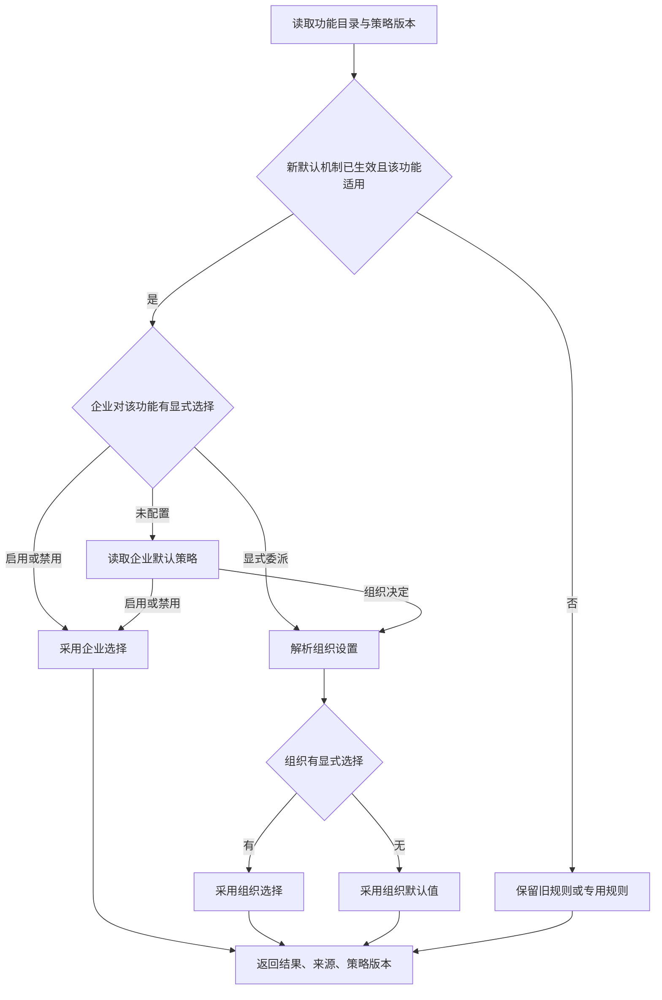
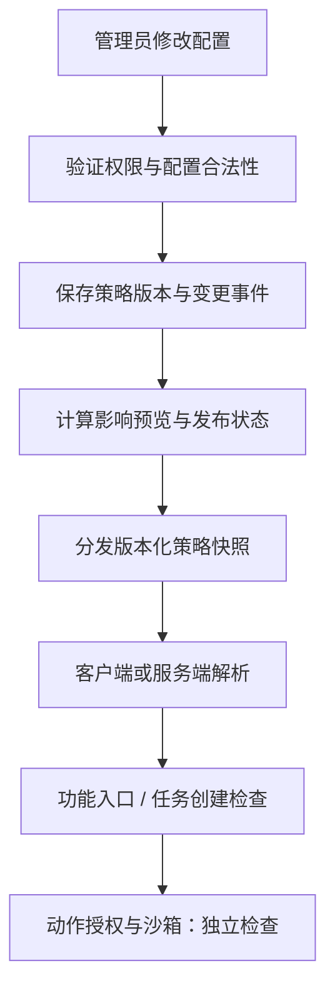

这项功能表面上只是一个全局开关，真正解决的却是一个配置演进问题：**当平台不断增加功能，而管理员没有逐一表态时，“没有配置”究竟意味着什么？**

GitHub 公布了可观察的策略行为，但没有公开这项功能的完整后端实现。本文先还原行为合同，再给出一种可测试的参考实现；不将推演代码写成 GitHub 源码，也不把功能开关等同于动作授权。

## 1. 先纠正两个容易误读的地方

GitHub 在 2026 年 9 月 24 日开放配置新功能默认策略，计划从 **2026 年 10 月 22 日**开始生效。因此，截至本次 9 月 30 日复核，不能写成“新策略已经改变用户访问”。选项包括 Enabled、Disabled 和 Let organizations decide；已有的显式选择不被默认值覆盖，预览功能仍需主动启用。[1]

另一个关键事实是：官方文档写明，该策略**默认 Enabled**，不是默认拒绝。适用对象是符合条件、尚未明确配置的 GA 功能；模型默认策略是另一套策略，不能与本次功能策略混为一谈。[2]

| 状态 | 应怎样理解 |
|---|---|
| 新 GA 功能尚未配置 | 在策略生效且适用时，采用相应默认值 |
| 已有 GA 功能尚未配置 | 同样可能受到默认策略影响 |
| 某功能显式启用或禁用 | 保留管理员决定 |
| 功能仍在 Preview | 不由该 GA 默认策略自动开启 |
| 曾主动加入 Preview，随后转 GA | 不能把升级解释成清除此前选择 |
| 功能属于例外集合 | 按该功能独立规则处理 |

本次范围包括 Features & clients 的适用策略，以及指定的 Code Review 和 MCP 策略；不是对所有 GitHub 功能做统一覆盖。[1][2]

这体现的是可配置的信任默认值，而不是产品宣称采用同一种安全立场。启用优先与审批优先都是管理员可选择的运营模式。

## 2. 为什么 `true / false` 不足以表达这个系统

假设数据库只保存一个布尔字段：

```text
feature_enabled = false
```

系统无法知道它是管理员明确禁用，还是尚未配置而使用旧默认值。未来全局默认变成 true 时，前者应保留，后者可能应跟随变化。如果两者已经合并，就无法正确迁移。

因此，参考设计至少保留四种企业级状态：

```text
ENABLED       显式启用
DISABLED      显式禁用
DELEGATE      把决定权交给下级组织
UNCONFIGURED  这一层尚未作出选择
```

组织级状态可以没有 DELEGATE，但仍需区分 UNCONFIGURED 与显式禁用。**委派是一项明确决定，未配置则是没有作出决定；两者不能共用一个模糊的 null。**

同理，“当前解析结果为 Enabled”不能自动回写成“管理员显式启用”。否则管理员以后调整全局默认时，系统会误以为所有功能都有既有显式选择。

## 3. 技术原理：先判定适用范围，再解析继承

GitHub 官方说明，企业层先控制功能，组织层在获得委派时决定；具体策略还可能有专门的作用范围与例外。[2][3]

下图是一种与这些公开规则相符的简化参考流程，限于单企业、单组织、一般功能策略，不是 GitHub 内部服务图：



最重要的顺序是：**功能目录决定规则是否适用，配置解析器决定采用谁的选择。** 如果先把所有未知值都替换成默认值，再检查 Preview 或例外，容易造成意外开放。

### 不要把所有冲突都写成“deny 永远优先”

GitHub 文档说明，同一用户拥有多个组织或企业授予的许可证时，还存在额外的冲突合并规则。同企业多组织常采用较宽松策略，但敏感功能有例外；跨企业又可能采用更严格规则。企业直接分配的用户也有独立处理方式。[3][4]

这说明现实授权关系不只是简单的一棵树。本文后面的代码故意不处理这些情形，避免把一个教学函数包装成整个 Copilot 权限系统。

## 4. 可测试的解析器

以下 Python 代码是工程参考实现，适用范围与上图相同。调用方需要先确定功能是否属于新策略范围，并提供旧规则的有效结果。`active` 来自可信的发布状态，不能由客户端任意传入来决定真实访问。

```python
from dataclasses import dataclass
from typing import Literal

EnterpriseChoice = Literal["enabled", "disabled", "delegate", "unconfigured"]
OrgChoice = Literal["enabled", "disabled", "unconfigured"]
DefaultChoice = Literal["enabled", "disabled", "delegate"]

@dataclass(frozen=True)
class Decision:
    enabled: bool
    source: str
    policy_version: str


def resolve_feature(
    *, enterprise: EnterpriseChoice, organization: OrgChoice,
    enterprise_default: DefaultChoice, organization_default: bool,
    active: bool, eligible: bool, legacy_enabled: bool,
    policy_version: str,
) -> Decision:
    if enterprise not in {"enabled", "disabled", "delegate", "unconfigured"}:
        raise ValueError("invalid enterprise choice")
    if organization not in {"enabled", "disabled", "unconfigured"}:
        raise ValueError("invalid organization choice")
    if enterprise_default not in {"enabled", "disabled", "delegate"}:
        raise ValueError("invalid enterprise default")
    if not active or not eligible:
        return Decision(legacy_enabled, "legacy_or_exception", policy_version)
    value = enterprise
    source = "enterprise_explicit"
    if value == "unconfigured":
        value = enterprise_default
        source = "enterprise_default"
    if value != "delegate":
        return Decision(value == "enabled", source, policy_version)
    if organization != "unconfigured":
        return Decision(organization == "enabled", "organization_explicit", policy_version)
    return Decision(organization_default, "organization_default", policy_version)
```

这个函数的重点是纯计算与可解释性：相同输入得到相同输出，结果还说明由哪一层决定。无效配置在加载或验证阶段应被明确识别；代码不包含网络失败降级、许可证判定、用户鉴权或完整策略存储。

**本次已用九组受控输入验证该函数**，覆盖企业显式启用与禁用、企业默认启用与禁用、显式委派、默认委派、组织显式决定、机制未生效和功能不适用。全部得到预期结果。这不是对 GitHub 线上行为的独立端到端复现。

| 示例 | 预期结果及来源 |
|---|---|
| 企业显式禁用，组织启用 | 禁用；企业显式规则 |
| 企业未配置，全局默认禁用 | 禁用；企业默认值 |
| 企业委派，组织显式启用 | 启用；组织显式规则 |
| 企业默认委派，组织未配置 | 采用组织默认值 |
| 新机制尚未生效 | 采用既有规则结果 |
| Preview 或排除项 | 采用对应独立规则 |

## 5. 为什么应该返回“解释”，而不只是布尔值

管理后台经常出现这样的问题：“开关明明打开了，为什么用户还是不能用？”如果只返回 false，支持人员要逐层猜测许可证、功能状态、企业规则、组织设置与客户端支持。

一个参考解析结果可以是：

```json
{
  "feature_id": "mcp-connectivity",
  "effective_value": false,
  "source": "enterprise_default",
  "configured_value": "unconfigured",
  "policy_version": "policy-17",
  "catalog_version": "features-9",
  "evaluated_scope": "organization-example",
  "reason": "eligible feature inherits enterprise default"
}
```

这不是 GitHub 官方返回格式。它适合支撑管理页的“为何如此”、审计回溯和变更预演。

OpenFeature 的公开接口区分普通值与 Evaluation Details，并允许返回 reason、error code 和 metadata。它可以作为业务应用与具体 Feature Flag Provider 之间的适配层。[5] 但本文没有证据表明 GitHub 使用了 OpenFeature；它也不会自动实现企业继承规则。

还应分开两种默认值：组织为未知功能制定的**业务默认值**，与 SDK 在网络或 Provider 故障时返回的**技术回退值**。两者即使都是 false，原因和恢复方式也不同。

## 6. 真正难的不是 if-else，而是分布式生效

以下是可复用系统设计，不是已披露的 GitHub 实现。

### 控制面与执行面分开

控制面负责保存配置、权限校验、版本发布和影响预演；执行面消费已验证的策略快照，在合适的位置检查有效值。一个功能是否展示、是否允许启动任务、是否批准高风险动作，可能需要不同执行点。



仅隐藏按钮不能构成可靠的服务端访问控制。反过来，允许使用某个 MCP 功能，也不意味着用户可以调用所有 MCP 服务、获得全部 OAuth scope 或跳过写操作审批。

### 缓存必须带作用域与版本

参考缓存键至少包含功能、租户与组织作用域、策略版本和功能目录版本。只按 `feature_id` 缓存，会把一个组织的结果泄漏给另一个组织；目录从 Preview 更新为 GA 后，旧结果也可能需要重新解析。

配置分发通常还需要版本通知、TTL 或周期同步。不能假定管理员点保存后，所有离线桌面和已经运行的任务立刻采用新值。对活动任务要明确是继续使用启动快照，还是在下一次敏感动作重新校验；撤销权限与普通 UI 功能切换应有不同风险处理。

### 保留未配置状态，做影响预演

在策略启用前，可以对当前用户和功能目录运行新旧解析器，输出：哪些访问会新增、哪些会减少、由哪条默认规则引起、哪些因显式选择而保持不变。GitHub 官方文档也提供了生效前查看符合条件的未配置策略数量的提示。[2]

计算“潜在影响”不等于真实行为收益；缺少的许可证、客户端能力与资源级权限仍可能阻止实际使用。

## 7. 是否有学习价值

有，但价值属于**多租户配置与控制面工程**，不是新的 LLM 算法。

值得复用的部分是：保留配置来源、显式委派、功能资格目录、纯函数解析、可解释结果、灰度生效和配置版本。这些模式适用于 Agent 平台的模型可用性、工具准入、插件安装、审计采集和执行环境选择。

不应直接复用的是某个产品的默认信任取向。开放新功能可以降低运营阻力，默认等待审批可以缩小未知能力进入的范围，选择取决于具体风险与使用场景。无论默认开启还是关闭，都不能替代动作级授权。

## 8. 验证与开放问题

| 检验项 | 应满足的性质 |
|---|---|
| 全局默认发生变化 | 显式配置不被改写 |
| Preview 变为 GA | 重新判断适用范围，但保留有效既有选择 |
| 企业委派或收回委派 | 解析来源和下级设置的作用同时变化 |
| 策略分发中断 | 明确采用何种技术回退及有效期 |
| 客户端长期离线 | 显示实际版本，不能假装已收到新策略 |
| 一个用户有多个授权来源 | 使用该策略指定的冲突规则 |
| 新增高风险能力 | 功能可用性与动作权限分别验证 |

还应测试解析幂等性、跨租户缓存隔离、生效边界以及旧快照撤销。公开材料没有给出内部缓存拓扑、传播 SLA 和全部实现细节，这些仍是未知项。

## 结论

这个“默认开关”的技术核心是：**把未配置保留为一等状态，按作用域、功能资格和生效版本解析，而不是一次性把所有开关写成 true 或 false。** 最值得学习的是配置演进与解释能力；最需要防止的误读，是把功能准入当成 Agent 的完整执行授权。

## 参考资料

[1] GitHub. [Default Enablement of Copilot features for Copilot Business and Enterprise](https://github.blog/changelog/2026-09-24-default-enablement-of-copilot-features-for-copilot-business-and-enterprise/). 2026-09-24。

[2] GitHub Docs. [About default availability of Copilot features and models](https://docs.github.com/en/copilot/concepts/enterprise/default-availability).

[3] GitHub Docs. [GitHub Copilot policies for enterprises and organizations](https://docs.github.com/en/copilot/concepts/enterprise/policies).

[4] GitHub Docs. [Feature availability when GitHub Copilot policies conflict in organizations](https://docs.github.com/en/enterprise-cloud%40latest/copilot/reference/enterprise-administrators/policy-conflicts).

[5] OpenFeature. [Flag Evaluation API](https://openfeature.dev/specification/sections/flag-evaluation/).

资料复核与参考解析器测试于 2026-09-30。2026-10-22 为官方公布的后续生效日期，不是本次已观测的部署结果。
