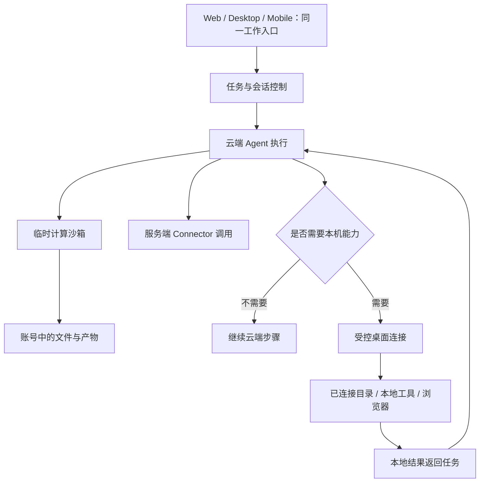
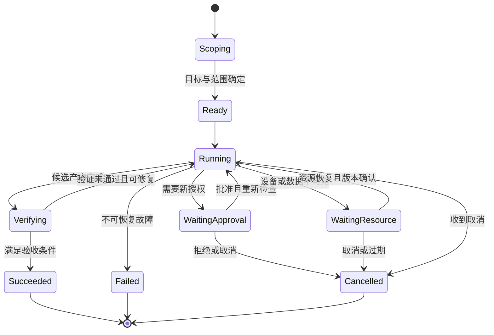

**好的 Agent 产品不是让用户理解更多执行模式，而是在不隐藏权限和风险的前提下，让系统承担任务分解与执行复杂度。** Cowork 与 Chat 合并，值得研究的不是一个按钮消失，而是“对话”开始成为持续工作的入口：回答、操作、产物编辑和任务恢复发生在同一工作上下文中。

本文区分三层：官方公开的产品变化、官方架构文档所描述的执行边界，以及可以复用但并非 Claude 内部实现的系统设计。用户无需选模式，不代表后台只有一个 Agent，也不代表所有任务获得同样权限。

## 1. 产品变化与动机：消除的是任务归属判断

Anthropic 于 2026 年 9 月 16 日宣布合并 Cowork 与 Chat，并让 Docs、Slides 与 Design 进入对话体验。官方给出的动机是：用户需要判断任务属于哪个产品，而在一个入口开始的工作又不能顺畅带入另一个入口。[1]

这是厂商对用户反馈的归纳，不是公开的受控 UX 实验。不能据此宣称合并已经提升了多少完成率或降低了多少成本。

新体验先向 Pro、Max 分阶段推出；相同订阅的账号也可能处于不同阶段。已有任务与主要配置继续保留，但 Code 入口、模型选择及显式 Research 操作并没有因此全部消失。[2]

因此，准确的变化是：**取消普通聊天与 Cowork 之间的前置选择，扩大同一对话可以承担的工作范围**，而不是取消一切专业模式。

### 为什么模式选择会成为负担

假设用户先问“上周销量为什么下降”，随后要求“把结论做成汇报”，最后补充“下周继续更新”。这不是三个互不相干的需求，而是同一工作的自然深化。

如果每次深化都要换入口，用户就需要搬运任务背景、选择文件、解释统计口径，并判断哪些上下文已经传过去。合并入口有望减少这些交接，但只是提供了条件；真正消除重复解释，还要让任务和产物拥有可持续引用的身份。

这段是架构分析：它解释可能的收益，不把“同一个输入框”直接当作已经验证的效率提升。

## 2. 合并的意义：从回答界面转向工作界面

可以把改变拆成三层，而不是笼统称为“全自动 Agent”。

| 层 | 过去容易暴露给用户的负担 | 统一体验需要系统承担的责任 |
|---|---|---|
| 入口 | 先决定 Chat、Cowork 或设计工具 | 判断是直接回答还是需要执行 |
| 工作上下文 | 反复解释目标、口径与已有结果 | 维护任务、资料和产物之间的关系 |
| 时间与设备 | 保持某个页面或电脑一直在线 | 持久化进度，处理资源离线与恢复 |

这里的“系统承担”不是模型独自完成一切。路由可以包含规则、模型判断、资源探测和权限检查；任务恢复还需要存储与执行控制。官方没有公开完整路由算法，不能将其断言为某个分类模型、某套 Multi-Agent 图或一个新的基础模型。

一个有用的设计原则是：**不要求用户预先理解实现方式，但在系统准备扩大执行范围时，让用户看见这种变化。**

例如，从解释销售趋势转向读取 CRM，可以展示数据源；从读取转向修改记录，需要独立的授权；从生成报告转向定期自动发送，则需要新的持续任务约定。取消模式选择，不应该取消这些语义边界。

## 3. 已公开的架构：云端执行与桌面资源之间有桥接

官方架构文档说明，云端会话将 Agent 循环和代码执行放在 Anthropic 基础设施，每个会话使用隔离的临时沙箱；会话与文件保存到账号。出站流量经沙箱外的强制代理，Connector 授权令牌不进入沙箱。既有桌面部署仍存在本地执行路径。[3]

这里有一个重要区分：**临时计算环境与可恢复的工作记录不是同一个对象。** 不能因为界面能恢复会话，就断言原来的进程、内存或容器一直存在。



该图依据公开边界归纳，不是 Anthropic 内部服务拓扑，也不表示每一次执行都经过所有节点。

### “合上电脑继续工作”有明确前提

跨设备文档说明，云端工作可以不依赖设备持续在线，会话与文件可在不同设备继续访问。但需要电脑上的文件、浏览器或应用时，桌面应用仍须可用。[4]

因此，应当区分：任务控制器仍在运行、某一步正在等待设备、以及整项任务已经完成。不能因为云端在线，就假装能够读取已经离线的本地文件。

官方架构页还明确指出，通过桌面读取而用于云端会话的本地内容，会在 Anthropic 服务器处理。[3] 所以“资源在本机”不等于“数据不会离开本机”，这一点需要独立的数据治理判断。

### 桌面桥接不是把整台电脑挂载到云端

参考实现应把设备能力表示成带范围和有效期的资源：某个连接目录、某个本地服务、某种浏览器操作，而不是一个无限权限的 `computer` 工具。

资源离线后，应返回明确的 `WAITING_RESOURCE`；恢复时重新检查授权和文件版本。若用户已经修改了文件，就不能盲目按旧上下文覆盖；若用户撤销了目录授权，也不能把旧 Memory 当作继续访问的理由。

这是从公开资源边界推导出的工程模式，不是对 Claude 所有恢复细节的既有保证。

## 4. 最值得借鉴的抽象：Conversation、Task、Run、Artifact 分离

只在数据库中保存 `messages[]`，很难可靠表达“在手机发起、云端执行、等待电脑上线、人工修订后继续”的工作流。

可复用的参考模型如下：

| 对象 | 保存什么 | 生命周期 |
|---|---|---|
| Conversation | 用户交流、相关工作和资料引用 | 可以承载多个任务 |
| Task | 目标、交付物、范围与预算 | 可跨多次执行尝试 |
| Run | 当前尝试、执行位置、进度与失败原因 | 有开始、暂停和终态 |
| Resource binding | 本次实际使用的账号、设备和目录 | 可失效、撤销或重新绑定 |
| Artifact revision | 内容版本、来源和验证证据 | 独立于临时计算进程 |

下面是说明性任务合同，不是 Claude API：

```typescript
interface TaskContract {
  taskId: string;
  conversationId: string;
  revision: number;
  objective: string;
  inputRefs: string[];
  outputs: Array<{
    kind: "answer" | "document" | "spreadsheet" | "slides";
    acceptanceCriteria: string[];
  }>;
  authority: {
    principalId: string;
    scopeRef: string;
    approvalPolicyRef: string;
  };
  resources: Array<{
    resourceRef: string;
    required: boolean;
    expectedRevision?: string;
  }>;
  budget: {
    maxToolCalls: number;
    deadline: string;
  };
}
```

模型可以提出计划或合同草案，但授权范围应由可信控制面确认。用户追加“顺便发给所有客户”时，目标、受众和副作用已经变化；这不是简单向聊天历史追加一句话就能自动获得批准的操作。

### 任务状态应反映真实阻塞



这是设计示例。停止还需要执行器终止或撤销能力，不能只把数据库状态改为 Cancelled。已经发送到远端的请求可能无法收回，应单独记录在途副作用。

## 5. 统一入口之后，权限交互反而更重要

新版帮助中心列出 Manual 默认模式和 Auto 模式：前者在动作前请求允许，后者减少逐步打断并运行自动安全检查。[2] 这描述交互与检查行为，不能解释成模型获得组织授权的权力。

安全文档还提醒，Computer Use 与普通工具的授权粒度并不完全相同：应用访问许可不能被理解为每次点击都有同样的独立审批保障；Prompt Injection 风险也没有被消除。[5][7]

因此，系统应该让用户知道的是“准备产生什么结果和副作用”，而非要求用户理解 Harness 内部模式。

一个参考交互可以呈现四类信息：当前目标、正在使用的资源、等待原因、下一项需要批准的副作用。它比不断滚动工具名称更有意义，也比始终显示“正在思考”更诚实。

自动化程度还应与动作类别分开。自动读取已授权数据，不代表自动公开发布；允许修改测试文件，不代表允许覆盖生产数据。通过率高的风险分类器也不是权限真相源。

### 自动选深度的成本与反例

统一入口可能错误地把简单问题升级成长任务，也可能把需要执行的工作只当作建议。前者浪费等待与用量，后者产生“看起来回答了，实际没有做”的落差。

参考产品设计应保留可纠正的路径：限制本轮只解释、要求先给计划、允许缩小范围、显示已发生与预期的资源消耗，并支持取消。这里不是要求重新加入一排复杂模式，而是提供与用户意图对应的控制。

## 6. 为什么产物比更多聊天记录更关键

官方将可编辑文档、幻灯片与设计工作纳入同一对话，并支持共享与导出。[1] 产品意义是把讨论与交付物缩短为一个工作闭环。

但“来自同一段对话”不自动保证报告、表格和幻灯片中的数字一致。若各次生成使用了不同时间的数据，或者人已经改过一份文件，共享聊天历史仍可能产生相互冲突的版本。

可复用的工程方案是建立明确的产物关系：

```text
Source snapshot
      ↓
Validated analysis
      ↓
Report revision 3
      ↓
Slide deck revision 2
```

每个产物保存来源快照、所依据的分析版本与验收结果。人编辑后生成新版本；Agent 再修改时检查期望版本，冲突则重新合并或请求确认。这不要求一定采用某种 CRDT，也不能据此推断 Claude 使用了何种协同编辑算法。

真正的持续上下文，不只是模型还记得之前说过什么，而是系统知道**当前哪份结果有效、它依据什么、谁修改过、哪些下游产物需要更新**。

## 7. 定时工作：从一次成功变成可重复运行

官方定时任务文档描述了保存任务指令，并在每次调度时启动新的执行会话。云端任务可在没有设备在线时运行；但依赖本地目录或既有本地模式的配置，不能自动解释成已成为无设备依赖的任务。[4][6]

值得注意的是，定时调用同一个 Prompt，并不保证任务具备可靠工作流的全部性质。业务条件每次都可能变化：凭据过期、数据口径调整、附件迟到、输出位置已存在，以及上一次执行仍未结束。

因此，可复用的周期任务定义应固定目标、数据范围、允许操作和交付规则；每轮另建 Run，重新解析当前资源与授权。对“每周生成报告”还应记录统计时间窗、时区、数据截止时间和输出标识。

对于邮件发送、提交订单或发布文档等副作用，可以使用业务幂等键与明确的重试策略，避免控制器重启后重复提交。若远端服务不提供幂等能力，就需要额外的状态核验与人工处理路径，不能承诺普遍的 exactly-once。

这类可靠性要求来自任务系统本身，与用户是否看见 Cowork 按钮无关。

## 8. 如何评价这次合并，而不是只评价界面

下列是研究问题与可复用的验证设计，不是已发布的产品实验结果。

| 场景 | 核心检验 |
|---|---|
| 快问后升级为报告任务 | 是否无需重复解释，同时准确识别新增资源需求 |
| 手机上发起纯云端任务 | 页面关闭后是否可恢复真实进度与产物 |
| 中途需要离线电脑的文件 | 是否明确阻塞，而非编造结果或扩大访问范围 |
| 人修改了 Agent 正在处理的文件 | 是否识别版本冲突并避免静默覆盖 |
| 从只读分析升级为外发 | 是否触发新的授权与受众确认 |
| 周期任务上轮未结束 | 是否按明确并发策略处理，而非重复提交 |
| 用户取消或撤销连接 | 任务状态、实际执行和在途副作用能否对齐 |

产品指标可关注成功交付率、重复解释次数、完成总耗时与人工介入负担；系统指标应另外记录路由错误、资源等待、恢复成功率、产物一致性和未授权动作。不能只用“需要点击的模式按钮更少”证明整体产品更好。

## 结论与边界

这次合并的动机是降低用户对工具和模式的选择负担；其更深的意义，是把持续任务、资源连接和可编辑交付物放到统一工作入口。**用户界面更简单，要求后台的任务身份、状态、授权和版本关系更清楚，而不是更模糊。**

最值得借鉴的是“统一入口、分层执行、持久任务、独立授权”的组合，而不是构造一个拥有全部工具与权限的超级 Agent。官方材料没有公开完整路由、恢复与协同编辑实现；本文的数据模型和流程图是参考设计，不能作为内部架构实证。

## 参考资料

[1] Anthropic. [Claude Cowork and chat are now one Claude](https://claude.com/blog/cowork-is-now-claude). 2026-09-16。

[2] Claude Help Center. [Claude Cowork and chat are one Claude](https://support.claude.com/en/articles/16761823-claude-cowork-and-chat-are-one-claude).

[3] Claude Help Center. [Claude Cowork architecture overview](https://support.claude.com/en/articles/14479288-claude-cowork-architecture-overview).

[4] Claude Help Center. [Use Claude Cowork on web, desktop, and mobile](https://support.claude.com/en/articles/15520349-use-claude-cowork-on-web-desktop-and-mobile).

[5] Claude Help Center. [Use Claude Cowork safely](https://support.claude.com/en/articles/13364135-use-claude-cowork-safely).

[6] Claude Help Center. [Schedule recurring tasks in Claude Cowork](https://support.claude.com/en/articles/13854387-schedule-recurring-tasks-in-claude-cowork).

[7] Claude Help Center. [Let Claude use your computer in Cowork](https://support.claude.com/en/articles/14128542-let-claude-use-your-computer-in-cowork).

资料复核于 2026-09-30。分阶段发布及新旧执行模式并存，具体可用性应以账号与客户端状态为准；本文未进行真实账号的跨设备故障实验。
