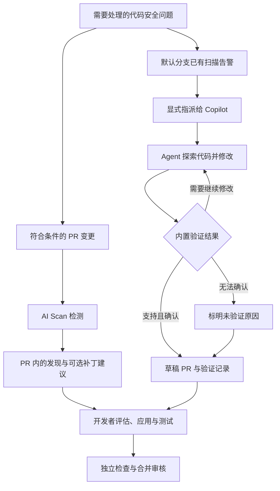

**GitHub 同一天发布的两项能力，并不是一条自动串联的“扫描后全部修好”流水线。** AI Scan 扩展 PR 中的安全发现；Agentic Autofix 接手默认分支的既有代码扫描告警，准备经过一定验证的修复 PR。判断能否落地，首先要分清两种发现的对象，以及验证器实际覆盖了什么。

两项功能在 **2026 年 10 月 15 日**宣布 GA。本文结合公告与 **10 月 19 日**核读的官方文档快照 `dae83f7`，区分产品承诺、已说明的运行机制和本文提出的工程建议；没有在真实仓库中启动扫描、付费修复或修改安全设置。[AI Scan 公告](https://github.blog/changelog/2026-10-15-ai-scan-for-pull-requests-generally-available/) · [Agentic Autofix 公告](https://github.blog/changelog/2026-10-15-agentic-autofix-for-code-scanning-alerts-general-availability/)

## 两条入口，两个不同的完成边界

AI Scan 的结果是 **PR finding**：附着在某次变更上的安全发现，不进入仓库 Security 页面的默认分支告警积压。Agentic Autofix 则只接收 **默认分支 backlog alert**：仓库已有的、可以指派处理的代码扫描告警。名字里都出现 autofix，不意味着前者自动转成后者。[AI Scan 文档](https://github.com/github/docs/blob/dae83f7d28f3b8e10015bd6b6d8b72267cedceca/content/code-security/concepts/code-scanning/ai-powered-security-detections.md) · [告警修复文档](https://github.com/github/docs/blob/dae83f7d28f3b8e10015bd6b6d8b72267cedceca/content/code-security/how-tos/manage-security-alerts/manage-code-scanning-alerts/resolve-alerts.md)

下图按官方披露的行为整理，表示功能边界，不是其内部服务拓扑。

**图中刻意没有从 AI Scan finding 直接连到 Agentic Autofix 指派入口。** 当前材料不支持把两者画成无条件衔接。AI Scan 可以附带经典 Copilot Autofix 的建议；开发者也可以另行要求一个 Coding Agent 修复，但那是另外发起的任务，不是这条原生告警指派路径已经自动打通。

## AI Scan 扩大的是检测面，不是强制合并门禁

AI Scan 采用 AI 扫描引擎，补充 CodeQL 尚未覆盖的部分语言和框架，例如 PHP、Shell/Bash、Terraform HCL、Dockerfile、JSP 和 Blazor。CodeQL 仍负责其支持范围内的分析，AI Scan 并不替代它。

官方描述的 AI Scan 路径无需构建系统，可能通过代码搜索获取额外仓库上下文，使用专门的检测提示词；它**不读取** `/.github/copilot-instructions.md`、`/CLAUDE.md` 等自定义指令文件来指导扫描。相比之下，Agentic Autofix 生成修复时会使用适用的自定义指令。因此，检测与修复的指令输入面并不相同；不能假定修改一个仓库指令文件就能统一配置二者。[AI Scan 机制](https://github.com/github/docs/blob/dae83f7d28f3b8e10015bd6b6d8b72267cedceca/content/code-security/concepts/code-scanning/ai-powered-security-detections.md) · [Autofix 机制](https://github.com/github/docs/blob/dae83f7d28f3b8e10015bd6b6d8b72267cedceca/content/code-security/concepts/code-scanning/autofix-for-code-scanning.md)

**启动条件必须同时满足。** 仓库要符合使用资格、启用 code scanning 和有效的 AI Scan 设置，PR 还须包含受支持的变更。它在 PR 创建及新提交后扫描，但不处理来自 fork 或由 Dependabot 创建的 PR。它不要求 CodeQL default setup；CodeQL 分析失败或等待，也不会单独阻止 AI Scan 运行。

**发现是 advisory，而不是 required check。** 结果出现在 Conversation 和 Files changed 中，并以 AI 标识区分。它们不会让 code scanning check 失败，当前也不能通过 ruleset 的相应要求阻止合并。团队若需要强制安全审核，必须另行建立适当的检查或人工审查条件，不能仅因“扫描已启用”就认为合并受保护。

这也解释了为什么“没有 AI finding”不是无漏洞证据：PR 可能不在支持范围、源自 fork、设置未生效，或预算已经耗尽；也可能扫描执行了但漏报。采用时至少应分开观察**是否符合条件、是否实际运行、是否产生发现**，而不只统计发现条数。

## Agentic Autofix 的进步是迭代修复，不是无条件保证正确

经典 Copilot Autofix 为一个受支持告警生成一份补丁建议，由人评估和应用；Agentic Autofix 则启动一次 Agent 会话，探索相关文件、生成修复、尝试验证和迭代，最后创建草稿 PR。一次指派可以选择最多 **25 个告警**，形成一个会话和一个 PR，而不是25个独立、相互隔离的补丁。[官方操作与结果定义](https://github.com/github/docs/blob/dae83f7d28f3b8e10015bd6b6d8b72267cedceca/content/code-security/how-tos/manage-security-alerts/manage-code-scanning-alerts/resolve-alerts.md)

最容易被省略的限定是：**能尝试修复的告警集合，大于内置验证器能确认的集合。** 官方文档明确指出，Agentic Autofix 以 best-effort 方式重跑 CodeQL 的 code-scanning query suite；它不能确认以下来源的告警已经修复：

- 自定义 CodeQL 查询；
- `security-extended` 查询套件；
- 第三方代码扫描工具。

因此，“重跑 CodeQL”必须同时回答“用了哪一套查询”。若原始告警来自内置验证没有覆盖的规则，没有再次看到该告警，可能只是没有运行原规则，而不是漏洞消失。官方也说明：无法验证修复，或判断可能是误报时，会在 PR 中说明。[验证能力的明确限制](https://github.com/github/docs/blob/dae83f7d28f3b8e10015bd6b6d8b72267cedceca/content/code-security/concepts/code-scanning/autofix-for-code-scanning.md)

**草稿 PR 是候选结果，不是修复完成的证明。** 其说明和会话日志能提供模型做了什么、尝试过哪些验证的证据；合并前仍需代码审查、适用的扫描配置和业务回归。后续可通过 PR 评论或 Agent 会话要求继续迭代，但不应把这些自然语言说明当作可信扫描器结果本身。

## 一份可复核的修复证据应该包含什么

下面是本文提出的验收方式，用于自建 Harness 或消费 Agent 生成的 PR，不是 GitHub 新增的标准数据协议。

| 要证明的事情 | 应保留的证据 | 不足以替代它的东西 |
| --- | --- | --- |
| 原问题确实被测试 | 告警ID、扫描器、规则或查询套件、配置版本 | “已运行安全扫描”一句话 |
| 补丁处理了原问题 | 修复前后的对应扫描结果与代码位置 | 仅关闭或 dismiss 告警 |
| 验证针对当前内容 | PR head SHA、扫描 run ID、产物版本 | 前一次提交的绿色检查 |
| 正常功能没有被破坏 | 编译、业务测试、必要的边界案例 | 只有安全规则不再报错 |
| 验证条件没有被削弱 | 扫描配置、排除路径和测试变更的审查 | 通过删除检查获得的“成功” |

GitHub 的告警文档区分了代码修复与 dismiss：后者表示认为告警不需要修复，并会影响告警显示和后续行为。同一问题也可能在不同分支或扫描配置中有不同状态。因此“Closed 数量上升”不能直接当作实际修复率。[告警状态及多配置说明](https://github.com/github/docs/blob/dae83f7d28f3b8e10015bd6b6d8b72267cedceca/content/code-security/how-tos/manage-security-alerts/manage-code-scanning-alerts/resolve-alerts.md)

对于自定义查询或第三方扫描器，应在受控 CI 中运行**产生原告警的工具与配置**，把结果绑定到具体补丁版本。若工具无法运行，就保留未验证状态，不把它折叠成通过。若补丁修改了扫描配置、测试或排除路径，则需要额外审核，避免让修复者同时自行降低验收标准。

这并非要求一切修复都必须形式化证明。更实际的目标是：让审阅者知道**哪些结论有执行证据，哪些仍是模型判断，哪些还没被检查**。

## 用两个例子看清功能边界

**例子一：Terraform PR 出现风险配置。** AI Scan 可以在受支持且符合条件的 PR 中提出发现与建议，但发现不会自动成为默认分支的 backlog alert，也不会自行阻止合并。团队应在当前 PR 内评估、修复并运行适用的基础设施检查。若这个 PR 来自 fork，AI Scan 不运行；此时没有发现不能解释为通过了同样的扫描。

**例子二：默认分支有一条 `security-extended` 告警。** 可以按资格和权限指派给 Agentic Autofix，让它调查并提出修改；但其内置验证不能确认这个查询套件的修复。验收需要另行运行原套件，并确认补丁没有只删除触发代码的必要功能或降低测试标准。

以上是依据产品边界构造的说明性案例，不是两次已执行的产品测试。它们展示同一个原则：**先匹配发现对象和验证能力，再设计自动化路径。**

## 启用与成本：公开仓库也不等于零成本

当前文档将 AI Scan 与 Agentic Autofix 的使用资格和 Copilot 个人订阅分开：使用者不必先有 Copilot 许可证，但仓库、组织政策和计费仍必须符合要求。AI Scan 适用于符合条件的公开仓库；组织私有或内部仓库需要 Code Security 或 Advanced Security，普通个人私有仓库不适用，托管用户个人命名空间也有排除项。Agentic Autofix 的当前文档同样描述了符合条件的个人公开仓库直接启用路径，不能把7月预览期的“必须有 Copilot 许可证”沿用为所有现行场景的前提。[AI Scan 资格](https://github.com/github/docs/blob/dae83f7d28f3b8e10015bd6b6d8b72267cedceca/content/code-security/concepts/code-scanning/ai-powered-security-detections.md) · [Autofix 资格](https://github.com/github/docs/blob/dae83f7d28f3b8e10015bd6b6d8b72267cedceca/content/code-security/concepts/code-scanning/autofix-for-code-scanning.md)

AI Scan 消耗 **Code Security AI Credits**；Agentic Autofix 还消耗 **GitHub Actions 分钟数**。经典 Autofix 的建议生成不消耗 AI Credits，不代表承载该建议的 AI Scan 扫描本身免费。公开仓库无需某类许可，也不能推出这些 AI 功能没有计量费用。

组织级启用也会扩大影响范围：AI Scan 开启后，符合条件且启用了 code scanning 的仓库会立即继承；企业允许不等于组织已经开启，仓库也不能越过上层禁用。Agentic Autofix 也有层级开关，而且官方提醒：**预览期使用过的组织需要重新启用。** 启用后，具备 write 权限的用户才可以指派修复告警。[Agentic Autofix 策略与迁移](https://github.com/github/docs/blob/dae83f7d28f3b8e10015bd6b6d8b72267cedceca/content/code-security/how-tos/manage-security-alerts/manage-code-scanning-alerts/managing-access-to-agentic-autofix-for-code-scanning.md)

试用应先核对预算、继承范围与仓库退出设置，再选择少量相关告警。25项是批量上限，不是建议每次都用满；将无关问题塞进同一个PR，可能增加审核与回滚成本。评价效果时同时记录真实确认的修复、未验证比例、误报处置、审核耗时和修复后的回归，而不是只比较生成了多少PR。

**AI Scan 扩大“能发现什么”，Agentic Autofix 扩大“能替人执行哪些修复步骤”。真正可靠的交付，还要把原始告警、验证配置、具体补丁和人类审核连成一条可检查的证据链。**
