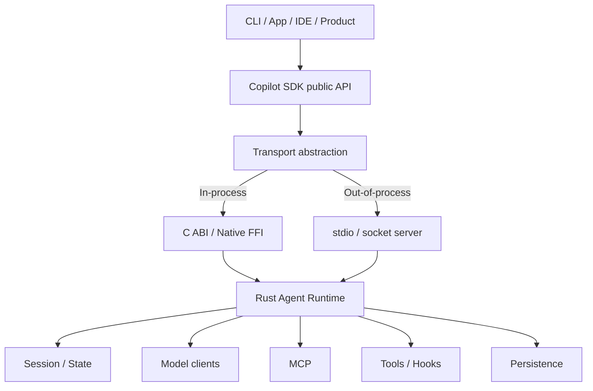
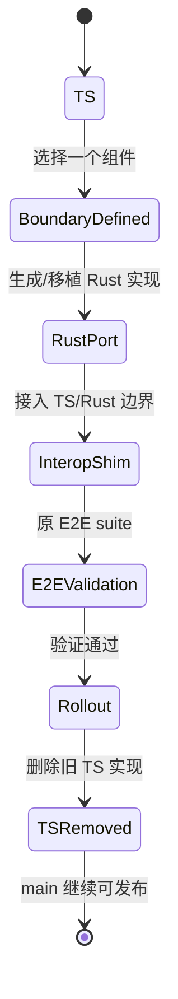

## 时间锚点与证据边界

- 时间锚点：**2026-09-18**。
- 主要检索窗口：**2026-09-12 至 2026-09-18**。
- 核心材料发布时间：**2026-09-16**。
- 来源优先级：**GitHub Engineering 官方技术复盘 > GitHub 官方仓库/发布材料 > 其他资料**。
- 所有迁移数据均来自 GitHub 自身测量，并非独立第三方 Benchmark。下文的产品状态和数据均按上述时间锚点记录。

**主要来源：**[GitHub Engineering — Migrating the GitHub Copilot runtime to Rust, using Copilot](https://github.blog/ai-and-ml/generative-ai/migrating-the-github-copilot-runtime-to-rust-using-copilot/)，2026-09-16。

## 摘要

[事实] GitHub 将 Copilot CLI、Copilot App 和 Copilot SDK 背后的共享 **Agent Runtime / Agentic Harness** 从 TypeScript + Node/V8 完整迁移到 Rust。最终 Runtime 达到 **832,378 行 production Rust、468,689 行 Rust unit tests**，另有 174,675 行 TypeScript E2E 测试；迁移通过 128 个 PR 完成，并在约 14.5 周内伴随 135 次公开发布增量上线。

[事实] 更重要的架构变化不是 Rust 本身，而是 GitHub 正在把原先与 CLI/TUI 纠缠的 Agent Loop 抽离为真正的 **Runtime Library**。新的 Runtime 可以通过 C ABI/FFI 被 C#、Go、Java、Python、Rust、TypeScript SDK 进程内加载，也保留 stdio/socket 的 out-of-process 模式。

[推断] 这项迁移可以看作 Agent Harness 从“某个产品内部的循环代码”演化为 **多产品共享的 Agent Execution Kernel**。语言迁移解决的是实现问题；真正持久的架构成果是 `UI → SDK → Runtime` 的单向依赖关系和稳定的跨语言 Runtime Contract。

## 背景与问题定义

[事实] 原 Copilot Runtime 起源于后来演变成 Cloud Agent 的 TypeScript/Node 系统。随着 Copilot CLI、App、SDK 以及多个 Microsoft/GitHub 产品开始共享同一 Harness，原来合理的 CLI 技术选择逐渐变成 Server Density 和嵌入式 Runtime 的瓶颈。原架构逻辑上近似：

```text
Application
    ↓
Language SDK
    ↓ JSON-RPC
spawn Copilot CLI process
    ↓
TUI + Agent Runtime
    ↓
Node / V8
```

SDK 最初实际上架在 CLI 上：Consumer 进程启动一个 Headless CLI 子进程，再通过 stdin/stdout JSON-RPC 与 Agent Loop 通信。这样可以快速产品化，但每个 SDK Consumer 都需要承担 Node/V8 启动、内存、Process Boundary 和 Supervision 成本。GitHub 估计非 Node Consumer 至少为不需要的第二 Language Runtime 支付约 100MB Working Set 量级的开销。目标架构则变为：



GitHub 的明确目标之一是让 TUI 严格位于 Runtime 之上，并最终让 CLI 也通过公开 SDK Surface 使用 Runtime；截至文章发布时，这项分层仍未完全结束，CLI 尚有部分代码直接调用 Runtime Internals。

## 关键技术细节

### Runtime 与 UI 解耦

[事实] GitHub 将迁移拆成两项工作：

1. 把 TUI-specific code 从 Runtime 分离，使 TUI 位于 SDK Public Surface 之上。
2. 将 Runtime 迁移到 100% Rust，并同时支持 C ABI 进程内加载以及 stdio/socket Out-of-process Hosting。

[推断] 这是典型的“Agent Kernel 化”：

```text
Product Surface
≠
Agent Runtime
```

一个 Runtime 可以被 CLI、IDE、Desktop、Cloud service、Office product 和 Custom application 共同使用，而 Tool Policy、Context、MCP、Session、Persistence、Hooks 等基础能力只实现一次。

### 跨语言 FFI

GitHub 给出的 In-process Bridge 是：

| SDK | Native Bridge |
|---|---|
| C# | P/Invoke |
| Go | purego |
| Java | JNA |
| Python | cffi |
| Rust | libloading |
| TypeScript | koffi |

[事实] Runtime 仍然允许 Out-of-process Hosting，因此“进程内 FFI”不是唯一部署模式。

[推断] 这意味着 Runtime 的逻辑 Contract 应位于 Transport 之上：

```text
SDK API
  ↓
Logical Protocol
  ↓
Transport
├─ FFI
└─ RPC
```

而不是把 Consumer 与 Rust 内部对象模型直接绑定。

### 迁移策略：Atomic Replacement

GitHub 没有选择 Big Bang Rewrite，而是选择 **in-place / component-by-component / atomic replacement**。每个 PR 将一个 TypeScript 组件替换为 Rust，同时放置薄 Shim 维持剩余 TS/Rust 互操作，然后立即删除旧实现。Main Branch 始终保持可发布。



GitHub 指出 Stateful Session Orchestration 并不适合简单的 A/B Shadow Run，因为它拥有 Mutable State 和双向 Callback；同时维护两个副本反而容易制造新的状态分歧。这也是为什么迁移顺序大体从更纯、更外围的逻辑向 Stateful Core 前进，而最复杂的 Session Orchestration 留在后部。

## 规模与交付数据

官方复盘给出的迁移规模如下。

| 指标 | GitHub 报告值 | Caveat |
|---|---:|---|
| 最初估算 Runtime TS | ~130,000 行 | 初期 Scope 严重低估实际工作 |
| 实际约经过迁移的 Production TS | ~430,000 行 | GitHub 作者估计 |
| 最终 Production Rust | 832,378 行 | 2026-08-21 状态 |
| Rust Unit Tests | 468,689 行 | 同上 |
| TS E2E Tests | 174,675 行 | Runtime repo |
| SDK 多语言额外 E2E | ~130,000 行 | 独立 SDK repo |
| Port PR | 128 | 官方文章 |
| Port 窗口 | ~14.5 周 | May–Aug 2026 |
| 期间 Release | 135 | 100 prerelease + 35 stable |
| 平均 Release 频率 | ~1.3/day | 迁移窗口平均 |

这里一个重要事实是：迁移期间 Main Branch 本身仍快速演进，因此“总行数”不是静态重写规模；GitHub 报告期间大约还有 300,000 行 TS 进入、430,000 行 TS 离开，以及大量 Rust 进入/删除。

## 性能结果与测量口径

GitHub 使用 C# SDK 和本地 Deterministic Chat Completion Server 测试，从而刻意排除 Model Inference 和 Network Latency；因此这些指标测的是 Runtime Startup、Process Launch、Session Creation、Persistence、Events 和 Teardown，而不是 Agent 的端到端回答速度。

| Scenario | May 12 TS/Node | Aug 21 Rust OOP | Aug 21 Rust In-process |
|---|---:|---:|---:|
| Client + Session + 1 turn | 5.25 s | 1.33 s | **292 ms（见下述口径冲突）** |
| Resume 32-turn session | 5.64 s | 1.52 s | 264 ms |
| 10 concurrent client lifecycles | 12.34 s | 4.18 s | 742 ms |
| 1,000 one-turn lifecycles | 132.52 s | 22.53 s | 20.93 s |

### 官方页面的数字不一致

同一文章的表格给出第一项 In-process 为 **292 ms**，但紧邻的图片说明以及后文又称该场景约为 **55.3 ms / 55 ms**。因此研究记录中不应简单写：

> “5.25s → 55ms，快约 95 倍。”

更稳妥的记录是：

> 官方文章显示 Runtime Startup/Session Path 显著改善，但同一页面关于单 Turn Lifecycle 的 In-process 数字存在 292ms 与 55.3ms 的内部不一致，需要 GitHub 后续澄清。

相对更明确的指标包括：

- 1,000 Lifecycle Workload：7.55 → 57.45 → **120.0 session lifecycles/s**。
- 相同 workload Aggregate CPU：312 秒 → 约 **110 秒**。
- 10-client Resident Private Memory Delta：1,383MB → 247MB → **126MB**。

这些仍然是 GitHub 自身特定 Benchmark，不能解释为 Rust 对所有 Agent Workload 都有同样倍数提升。

## Agent-assisted 重写成本

作者报告此次 Port 使用约：

| Token 类别 | 数量 |
|---|---:|
| Total | ~136.3B |
| Cached input read | ~130.6B |
| Cached input write | ~4.2B |
| Fresh input | ~0.9B |
| Output | ~0.6B |
| 报告的 Token Bill | ~$120,000 |

[事实] GitHub 同时明确提醒：Token 成本并不是完整工程成本，还存在开发者监督、设计、Review、等待、调试等人力成本。因此不能据此推出：

```text
832k Rust LOC
=
$120k total engineering cost
```

这是错误解释。

## 为什么 Rust 没有消灭 Runtime Bug

[事实] 截至 9 月 14 日，GitHub 已追踪“dozens”已知 Port Regression，并表示都已修复；其中多数是 Correctness Bug，少数是 Performance Regression。文章特别指出 Rust Compiler 无法判断：

- Repository ID 的序列化协议是否保持兼容。
- State Machine 是否表达了正确状态。
- Callback 顺序是否与旧系统一致。
- Host-specific 行为是否保留。
- Port 是否遗漏一段旧逻辑。

这说明迁移的主要风险不只是 Memory Safety，而是：

```text
Behavioral Compatibility
State Semantics
Ordering
Lifecycle
Host Boundary
```

### Unsafe 使用

GitHub 报告 Runtime 中存在 158 个 `unsafe` block，跨 36 个文件，并称全部位于外部互操作边界。

| 原因 | Blocks | 占比 |
|---|---:|---:|
| C ABI | 51 | 32.3% |
| Windows API | 49 | 31.0% |
| POSIX/libc | 46 | 29.1% |
| SQLite C API | 7 | 4.4% |
| Dynamic loading | 4 | 2.5% |
| Process environment | 1 | 0.6% |

GitHub 表示 Model Client、MCP、Agent 和 Prompt 层没有使用 `unsafe`，并且已知 Port Regression 没有一个涉及 `unsafe`。这是 GitHub 自身 Codebase Audit 结论，并非独立安全审计。

## 工程启发

[推断] 这次迁移最可复用的经验不是“Agent Runtime 应该使用 Rust”，而是：

```text
UI
↓
Stable SDK Contract
↓
Transport abstraction
↓
Runtime Kernel
```

其中 Runtime 独立管理 Session、Context、Tool execution、MCP、Hooks、Persistence 和 Model clients。

第二个可复用经验是：对于 Stateful Infrastructure，大规模重写更适合 **bounded atomic replacement**，而不是要求 Agent 在一个长分支上一次完成全部迁移。

第三，AI Coding 的真正价值在这里表现为：

```text
Human:
  architecture
  boundary
  acceptance criteria
  regression analysis

Agents:
  implementation
  repetitive migration
  tests
  local fixes
```

而不是“Agent 完全替代系统工程”。

## 安全与治理风险及缓解

[推断] 迁移后的新风险边界包括：

| 风险 | 原因 | 缓解方向 |
|---|---|---|
| FFI Contract 漂移 | 多语言 SDK 共享 C ABI | ABI conformance suite / version negotiation |
| In-process Crash Blast Radius | Runtime 与 Host 共进程 | 高风险 workload 保留 OOP hosting |
| Semantic Port Regression | Compiler 无法证明旧行为 | Golden traces / differential tests / E2E |
| MCP 行为差异 | SDK / Runtime 实现语义变化 | Protocol compatibility suite |
| Stateful Lifecycle Bug | Session、callbacks、reconnect 非纯函数 | explicit state machine + property tests |
| AI-generated code 引入隐藏行为差异 | 大规模 Agent-generated changes | atomic diffs + review + rollout |

## 局限与未解问题

1. 官方第一项 In-process Benchmark 存在 **292ms vs 55.3ms** 的页面内部冲突。
2. 性能测试排除了实际网络和模型延迟，不能代表完整 Copilot User Latency。
3. 所有数据来自 GitHub 本身，没有独立重现。
4. CLI 尚未完全通过 SDK Public Surface 使用 Runtime，架构解耦仍在继续。
5. 文章没有提供不同平台上 FFI Crash、ABI Stability 与 Deployment Upgrade 的长期数据。
6. `$120k` 只覆盖作者报告的模型 Token 花费，不是 Total Cost of Migration。
7. Agent 写了“most of the code”，但这并不等同于 Agent 独立承担 Architecture、Acceptance 或 Incident Responsibility。

## 参考资料

[GitHub Engineering — Migrating the GitHub Copilot runtime to Rust, using Copilot](https://github.blog/ai-and-ml/generative-ai/migrating-the-github-copilot-runtime-to-rust-using-copilot/)，2026-09-16。
