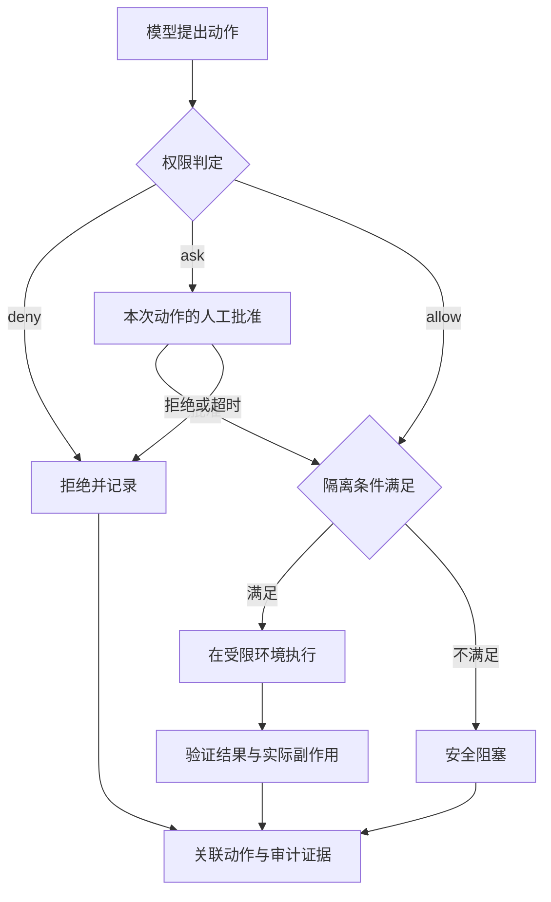

授权回答应不应该做，隔离回答实际上能做什么；可信执行需要这两种约束共同成立。

GitHub 的企业托管权限与沙箱分别约束操作批准和资源可达性。它们可以组合，但不能据此推断所有客户端、进程内工具和远程 MCP 都受到同一种隔离。理解这套设计，关键是沿一次真实动作找出权限检查、执行位置和副作用边界，而不是只确认某处存在“沙箱”选项。[1][2][3][4]

## 1. 一次动作，要经过两种判断

模型选择工具，只意味着提出了动作，不意味着得到业务授权。即使动作被批准，也不意味着执行进程应该获得整个宿主机的能力。

下面是依据公开机制整理的参考控制链，不是 GitHub 内部调用顺序的复刻：



这里将“隔离不可用时阻塞”作为参考安全要求，而非断言所有 Copilot 版本默认如此。一次批准只能解决授权问题，不能代替执行环境检查。

GitHub 2026 年 9 月 9 日的公告描述了企业对 Shell、文件读取与修改、网络域名的集中控制；9 月 8 日的 JetBrains 公告则涉及企业托管沙箱。这是两个相关但不同的产品入口，不能把它们合并成“全部 Copilot 场景同时获得同样保护”。[1][2]

## 2. 企业权限：规则优先级与批准的边界

对应托管设置参考使用 `deny / ask / allow`，优先关系为 `deny > ask > allow`。`ask` 要求新的、一次性的批准，不能直接用自动批准、历史批准或绕过模式满足；VS Code 的细粒度规则还需要核对 Agent Host 等适用范围。[5]

| 决策 | 实际含义 | 容易误解的地方 |
|---|---|---|
| deny | 匹配的动作不能执行 | 其他来源的 allow 不应抵消它 |
| ask | 本次操作需要新批准 | 过去“允许过”不等于永久授权 |
| allow | 匹配的操作可不再弹窗 | 不等于释放沙箱、网络和服务端权限 |

“企业限制不能被用户设置放宽”描述的是受支持客户端执行托管策略的规则，不是对恶意宿主机管理员的形式化防篡改证明。策略的可信来源、客户端版本和宿主机信任假设仍然重要。

工程上，批准至少应关联主体、运行、规范化资源、实际参数和策略版本。参数被改写、批准过期或策略发生变化时，都不应由模型从对话记忆中解释出新的授权。这是通用授权设计，不是新增的 GitHub API 字段。

## 3. 沙箱覆盖的是执行路径，不是产品名称

GitHub 的沙箱说明特别区分了进程外命令与 CLI 进程内文件工具：前者可以受到操作系统隔离；后者在 CLI 自身未进入沙箱时，需要由工具代码检查策略，文档将其描述为尽力遵守，而不是由同一操作系统边界强制限制。[4]

| 路径 | 主要执行边界 | 额外需要验证什么 |
|---|---|---|
| Shell、独立命令进程 | 操作系统进程与文件、网络限制 | 隔离是否真的启用，派生进程是否继承限制 |
| CLI 进程内文件工具 | 应用层策略检查 | 是否覆盖同一资源的所有读写入口 |
| 本地 stdio MCP、LSP | 被客户端启动的本地服务进程 | 是否实际纳入沙箱，子进程与生命周期是否受控 |
| 远程 MCP | 外部服务的身份、权限与运行环境 | 本地网络准入不能替代远端租户和工具授权 |
| 托管云沙箱 | 云端运行环境及对应产品策略 | 不能用本地沙箱后端解释云端全部实现 |

本地沙箱、云沙箱和 IDE 管理功能还可能处于不同的预览或实验状态。启用方式、默认行为和支持平台需要按所用版本核对，不应从某个开关存在推断安全保证已经覆盖整个执行图。[2][4]

## 4. 三个不能省略的例外

### MCP 准入不等于服务可信

Managed Settings 支持按远程 URL 或本地命令及参数匹配 MCP 服务。显示名称由用户配置，不能作为可靠的服务身份。相同 URL 不证明服务器代码没变，相同启动命令也不证明动态下载的依赖版本没变。[3]

还要注意文档列出的内置服务例外：空 allowlist 并不意味着所有内置默认服务都被禁用，第一方 Copilot 服务也存在 deny 规则豁免。因此，“我写了 denylist”不能直接推出“所有服务调用路径都被它覆盖”。[3]

### 代理设置不等于强制出站控制

代理只能约束经过它的连接。如果程序仍能直接出网，或者忽略代理设置，单独配置代理就不是完整边界。GitHub 文档也明确提示了这一点。[3]

合理的防御分工是：网络层阻止不经过批准路径的连接，代理层执行更细的协议、目的地与审计规则；远端服务继续检查自己的身份和业务权限。

### 沙箱失败不能悄悄改变信任假设

必须分别测试“启用”“禁止绕过”和“后端不可用时怎样失败”。不能只看到 `sandbox.enabled` 就假设隔离失败时必然停止。本文不把历史稿中的某个配置字段当作所有版本通用的接口；实际验收应直接制造隔离后端不可用、策略解析失败和启动中断，观察有没有降级为宿主机执行。

## 5. 如何形成可验证的工程约束

下面是框架无关的批准绑定示意，不是 GitHub 官方 Schema：

```typescript
interface ActionApproval {
  actionId: string;
  runId: string;
  principalId: string;
  canonicalResource: string;
  argumentsHash: string;
  policyVersion: string;
  expiresAt: string;
  singleUse: boolean;
}
```

这些字段表达的是“批准什么”，还不等于解决了批准消费与实际执行之间的并发、重放和状态变化问题。例如，同样的 `npm test` 可能执行已经被修改的项目脚本，命令文本白名单不能代替工作区版本与执行能力限制。

测试应覆盖同一资源的多条入口，而不只验证一次 Shell 拒绝：

| 受控实验 | 应检查的结果 |
|---|---|
| 同一动作同时匹配 allow 与 deny | 最终决策与命中规则是否一致 |
| 批准后改变参数或工作区内容 | 原批准是否仍被错误复用 |
| 关闭隔离后端或损坏策略 | 是否出现未记录的宿主机降级 |
| 分别经内置工具、Shell、MCP 访问同一敏感文件 | 不同路径的限制是否等价 |
| 本地服务派生子进程、停止后保留进程 | 隔离继承与终止范围是否完整 |
| 代理不可用或程序忽略代理 | 是否仍有未授权出站路径 |

实验仅使用自有隔离环境与受控资源。报告需要包含客户端版本、操作系统、有效策略、测试集规模和威胁模型；“本组测试没有绕过”不等于证明所有路径不可绕过。

## 结论

企业权限、沙箱、MCP 准入和网络控制应当各自承担可检查的职责：授权不代替隔离，本地隔离不代替远端授权，代理不代替强制出站边界。真正需要审计的是从模型提议到外部副作用的完整路径。

与此互补的两个层次是 [APM 的安装期供应链治理](https://sunionpeaks.pages.dev/zh/notes/microsoft-apm-agent-mcp) 和 [AgentAudit 的事后轨迹诊断](https://sunionpeaks.pages.dev/zh/notes/agentaudit-execution-trace-agent)。本文的批准模型与测试方案是研究设计，未声称完成独立产品安全审计。

## 参考资料

[1] GitHub. [Enterprise managed permissions for GitHub Copilot agent operations](https://github.blog/changelog/2026-09-09-enterprise-managed-permissions-for-github-copilot-agent-operations/)，2026-09-09。

[2] GitHub. [Enterprise-managed sandbox in Copilot for JetBrains](https://github.blog/changelog/2026-09-08-enterprise-managed-sandbox-in-copilot-for-jetbrains/)，2026-09-08。

[3] GitHub Docs. [Enterprise managed settings](https://docs.github.com/en/copilot/reference/enterprise-administrators/enterprise-managed-settings)。

[4] GitHub Docs. [About cloud and local sandboxes](https://docs.github.com/en/copilot/concepts/about-cloud-and-local-sandboxes)。

[5] GitHub Enterprise Cloud Docs. [Enterprise managed settings：permissions](https://docs.github.com/en/enterprise-cloud%40latest/copilot/reference/enterprise-administrators/enterprise-managed-settings#permissions)。
