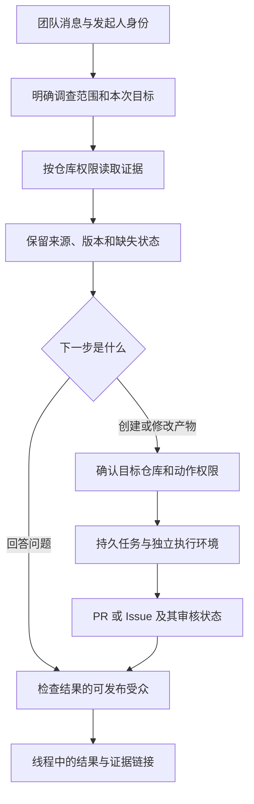

**同一段对话可以横跨多个仓库，但读取范围、写入目标和执行身份必须分别确定。** GitHub 在 2026 年 10 月 15 日发布的 Slack / Teams 更新，让讨论中的调查、Issue 和代码任务保持连贯；它的工程意义，不只是减少几次仓库切换，而是把团队协作接入可追踪的执行流程。[官方公告](https://github.blog/changelog/2026-10-15-copilot-in-slack-and-teams-adds-model-and-repository-updates/)

本文以 **2026 年 10 月 19 日**核读的公告及官方文档快照 `dae83f7` 为准。当前 Slack 和 Teams 的 Copilot 集成文档仍标记为 **Public Preview**；GitHub 消息应用本身的可用状态，不能替代其中 Agent 功能的状态。本文没有实测账户中的这些功能，也不把下文参考设计当作 GitHub 内部实现。

## 这次更新已经超出只读问答

最新公告的例子包括：从讨论创建 Issue、在指定前端仓库修复问题并打开 PR、汇总多个仓库的待处理 PR，以及结合前后端代码调查问题。因此，“本次只是跨仓库信息查询”会低估它；“一个任务已经可以可靠地同时修改并提交所有仓库”则超出公开证据。

更准确的分界是：**对话可以保持不变，读取对象可以跨仓库，具体产物仍有明确目标。** 在前后端共同参与的问题中，Agent 可以先横向调查，再到指定仓库创建 Issue 或启动代码任务；公告没有提供跨仓库事务、联合回滚或统一合并的保证。[官方公告的任务示例](https://github.blog/changelog/2026-10-15-copilot-in-slack-and-teams-adds-model-and-repository-updates/?from=bd_signal)

公告还列出 @GitHub 可出现在消息任意位置、更顺畅的仓库切换、使用共享 Slack 消息与线程作为上下文，以及任务启动和中断恢复的改善。这些是产品行为说明，不是公开了新的 MCP 协议、调度算法或可量化的可靠性实验。

## 三种范围，不能装进同一个 repository 字段

| 范围 | 回答的问题 | 示例 |
| --- | --- | --- |
| 调查范围 | 需要读取哪些证据？ | 前端、后端、接口定义仓库 |
| 产物目标 | 在哪里创建或修改？ | 后端仓库的一条 Issue、一份 PR |
| 发布受众 | 哪些人会看到输入和结果？ | 私聊、项目小组、跨部门频道 |

**默认仓库是路由偏好，不是全局授权。** 官方文档中，频道可以设置默认仓库；未明确指定仓库或分支时，任务使用该默认值。这个设置在频道中共享，不只影响设置它的人。默认值改变不应被理解为用户批准了一切后续写入。[Slack 文档](https://github.com/github/docs/blob/dae83f7d28f3b8e10015bd6b6d8b72267cedceca/content/copilot/how-tos/copilot-integrations/integrate-cloud-agent-with-slack.md)

**有权读取也不意味着适合转发。** 假设发起人能读一个受限事故仓库，但目标频道还有其他团队成员。把那里的调查结果完整总结到频道，会改变信息的受众。公开材料没有披露这一场景所有细粒度检查的内部算法；这应是采用同类方案时的验证项，而不是据此宣称产品存在已证实的漏洞。

## 共享会话改变了谁在承担责任

官方文档明确区分了两种身份：在私聊中，Copilot 使用关联 GitHub 个人账户的权限执行动作；在群组线程或频道中，它以 **App 身份**创建 PR 等产物，而不是把产物全部归到某个参与者名下。[Slack 身份说明](https://github.com/github/docs/blob/dae83f7d28f3b8e10015bd6b6d8b72267cedceca/content/copilot/how-tos/copilot-integrations/integrate-cloud-agent-with-slack.md) · [Teams 身份说明](https://github.com/github/docs/blob/dae83f7d28f3b8e10015bd6b6d8b72267cedceca/content/copilot/how-tos/copilot-integrations/integrate-cloud-agent-with-teams.md)

**触发修改与提供上下文不是同一种权限。** 文档要求用户具备目标仓库的 write 权限才能触发代码修改，但普通会话参与者可以贡献输入。工作区访客、仓库外部协作者不能启动或主动操控这些会话。创建 Issue 也仍受其对应的仓库权限约束；不能把代码修改的 write 条件机械套成所有问答或 Issue 操作的统一门槛。

这带来一个有意思的责任问题：一个有权限的人启动工作，不等于后续所有发言都获得了他的授权。其他人补充的日志、需求或建议可以是证据，却不应自动变成扩大写入目标、部署环境或数据权限的批准。对多用户 Agent 来说，必须保留“谁提供了信息”和“谁授权了动作”的区别。

GitHub 对部分共同创作产物还增加了审核边界：共享上下文中的、没有个人归属的 Copilot PR，在适用的仓库 ruleset 中默认多要求一次批准，前提是原规则已要求至少一次批准；原本要求零批准时不会因此变成一。**App 身份改变了传统的作者—审阅者关系，所以审核条件需要相应调整。**[官方规则说明](https://github.com/github/docs/blob/dae83f7d28f3b8e10015bd6b6d8b72267cedceca/data/reusables/copilot/cloud-agent/unattributed-additional-approval-note.md)

## 讨论是输入，任务才是执行单位

Slack 和 Teams 文档都提醒：@mention 后，**整个线程会进入任务上下文，并存入 Agent 生成的产物中**。群聊内容不是只供模型临时看一眼；内容进入 Issue、任务记录或其他产物后，会带来新的保留与可见性问题。需要缩小上下文时，官方建议使用私聊；对于没有必要携带的内部讨论，也可以从独立线程开始。[Teams 安全说明](https://github.com/github/docs/blob/dae83f7d28f3b8e10015bd6b6d8b72267cedceca/content/copilot/how-tos/copilot-integrations/integrate-cloud-agent-with-teams.md)

Slack 还有更具体的任务组织方式：发起工作后，Agent 创建名为 **Slack Code** 的专用代码频道，展示仓库、分支、产物链接、状态和模型；建立后，任务应在该频道中继续操控，一次频道对应一次任务。完成后的归档保留可搜索历史。Teams 文档描述的是会话状态与线程内继续迭代，并没有把 Slack Code 这一机制复制到 Teams。

这体现了一种值得借鉴的划分：**聊天线程保留协商过程，任务记录保存执行状态，PR 等产物提供可审查的结果。** 频道归档不应被当作代码已合并，更不代表服务已部署；同样，中断了聊天显示，也不能据此判断云端任务停止。

官方说明代码工作运行在云端沙箱，用户能在聊天之外继续处理产物；这解释了它为何可以脱离当前窗口执行。但具体的检查点格式、重试去重和失败恢复算法并未公开，不能仅凭“恢复更顺畅”推断 exactly-once 执行保证。

## 一套可迁移的多 API 协作设计

下面是根据上述边界提出的**参考设计**，不是供应商公开的内部拓扑。它把可读证据、目标写入和消息发布拆开授权，而不是把所有权限合并进一个拥有大量工具的模型会话。

**任务创建时固定执行目标。** 保存发起人、App 或用户执行身份、仓库、基准分支、上下文快照和任务版本。正在进行的任务不应因为频道默认仓库被另一个人改动，就悄悄切换目标。后续有人提出扩大范围，应该形成显式的新决策。

**按来源记录不完整结果。** 跨三个仓库查询时，一个没有相关 PR、一个查询超时、一个不可访问，是三种不同情况。回答“没有阻塞项”之前，需要确认搜索覆盖范围；不能把无权限或网络失败合并成空列表。公开回复的缺失说明，也应避免暴露接收者无权知道的资源身份。

**让重试识别已有产物。** 聊天事件可能重复投递，工具调用成功后的回执也可能丢失。可以用平台事件ID、本次动作ID与目标仓库建立本地去重记录，外部写入后保存产物ID；结果不确定时先对账，而不是重新建一个 Issue。若外部 API 本身不提供幂等保证，本地去重仍不能被宣传成端到端 exactly-once。

**把上下文更新与授权更新分开。** 新增诊断日志可以触发重新分析；“顺便部署生产”则是另一项动作，需要独立权限判断。已经通过的审核，也应与被审查的具体内容版本绑定。

这些设计不需要先引入大量 Subagent。对不少协作场景，优先实现正确的身份、任务状态和证据归属，比增加一个复杂的多模型调度层更容易验证价值。

## 用一个前后端问题检查是否真的有用

假设团队反馈：“前端升级后登录失败，后端最近也改过返回字段。”一个边界清楚的首轮任务可以是：

> @GitHub 请结合指定前端和后端仓库调查登录失败。先只读分析，分别列出支持和反对各假设的代码或 PR 证据；注明无法读取或尚未覆盖的部分，不修改文件，不创建产物。

调查完成后，再以明确目标发起写任务：“基于已确认原因，在后端仓库的指定基准分支创建修复 PR，并补充接口回归测试。”这是本文设计的操作示例，不是已执行的验证结果。

试用时最值得检查的是：仓库范围扩大后是否仍保留证据来源；无关发言是否被当成指令；频道默认仓库变化是否影响正在运行的任务；恢复执行会不会重复创建产物；以及无法访问一个仓库时，是否仍作出过度完整的结论。

启用条件也不能忽略：官方文档要求付费 Copilot 访问权限、相应聊天应用安装与账户关联；云沙箱和 Agent 的组织策略需要允许使用，企业仓库还受到 App 安装范围约束。满足其中一项不代表全部满足。[云沙箱前置条件](https://github.com/github/docs/blob/dae83f7d28f3b8e10015bd6b6d8b72267cedceca/data/reusables/copilot/cloud-agent/cloud-sandboxes-prerequisite-slack.md)

**这次更新展示的是：跨仓库协作可以有连续的对话，但可靠执行仍需要明确的任务边界。上下文可以跨人、跨仓库流动，授权与责任不能随之模糊。**
