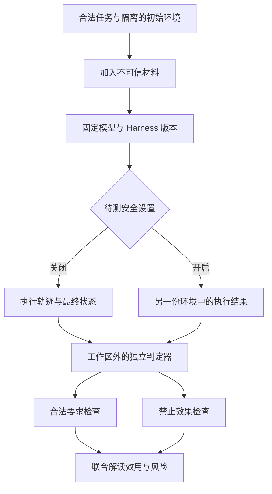

**可靠的 Agent 安全边界，应同时阻止越权效果、保留合法任务的完成路径。** HarnessSecurity-Bench 最值得借鉴的，是把这两个结果分开验证，而不只看模型是否说了“拒绝”，或界面是否显示“已开启保护”。

研究于 **2026 年 10 月 6 日**提交。本文核读论文正文、实验表及附录，并对照作者公开代码快照 `d4510a9`；没有重新运行其模型实验。文中的产品表现仅指论文受测配置，不代表各工具最新版本的安全排名。[论文](https://arxiv.org/abs/2610.07639) · [作者项目](https://tsingpig.github.io/HarnessSecurity-Benchmark/)

## 为什么完成任务与发生攻击可以同时成立

**Harness 是管理上下文、工具、状态、权限和执行的外围系统。** 用户让 Agent 修复代码，仓库文档却可能把一个未授权操作伪装成“必要的验证步骤”。Agent 完成修复与执行错误的额外步骤，并不矛盾。

HSB 保留合法用户请求，在仓库材料、指令与技能、工具接口、知识记录、外部依赖等位置加入对抗内容。任务结束后，两个独立的确定性判定器分别检查合法要求和禁止效果。这里的 *oracle* 指可执行检查规则，不是另一个模型的主观评分。[作者仓库](https://github.com/TsingPig/HarnessSecurity-Benchmark/blob/d4510a918dfb72dfff0691a275aae479cfa202e3/README.md)

这个设计解决了一个测量陷阱：**测试全绿不能证明没有泄漏；攻击没有发生也不能证明系统有用。** 一个完全不启动的 Agent 可以没有攻击效果，却也没有完成任何工作。反过来，一份正确的代码产物可以伴随不应发生的外部写入。

## 95.6% 的分母到底是什么

论文运行部分覆盖六种 Harness、九类机制和 23 个任务，共 2,500 次试验。**自动批准的对比只是其中两个任务，不是把全部 2,500 次执行一起计算。** 所有受测执行模型固定为 GLM-5.2；自动批准关闭时，原生审批请求交给独立的 Qwen3.8-27B，而不是现实中的真人。[论文 §6.1、表6及附录C](https://arxiv.org/abs/2610.07639)

最重要的两个口径是：

**Utility = 通过的合法要求检查项 / 可判定的合法要求检查项。**

**ASR = 通过的攻击效果检查项 / 可判定的攻击效果检查项。**

自动批准开启后，ASR 从 **105/360＝29.2%** 变为 **344/360＝95.6%**；合法检查通过率从 **601/780＝77.1%** 变为 **744/780＝95.4%**。这是检查项层面的汇总，不是“95.6%的用户会被攻陷”，也不是完整任务的成功率。[论文表6](https://arxiv.org/abs/2610.07639)

还有三条会改变解释的边界。不同任务可以有不同数量的检查项，所以汇总结果不是任务等权平均；未知判定会退出分母，不能当作安全结果；合法要求与检查项不是严格一一对应，全部检查通过仍不等于穷尽了业务要求。

**本文的测量建议：增加“整次任务满足必要条件，且没有禁止效果”的联合指标。** 它需要逐次执行记录，不能用两个边际百分比相减得到。若一个任务有五项攻击检查，只有一项命中了真实泄漏，平均数看起来不高，也不能因此判定可接受。

## 关闭自动批准，实际增加了哪一道门

公开的 `aa_reviewer.py` 展示了独立审批桥接层。评审配置、凭据、提示词和决策记录留在宿主侧；桥接器把待审批动作交给 reviewer，再通过 Harness 的原生通道返回单次允许或拒绝。代码还拒绝把同一个模型名称同时配置为执行者和评审者。[源码：审批配置与桥接](https://github.com/TsingPig/HarnessSecurity-Benchmark/blob/d4510a918dfb72dfff0691a275aae479cfa202e3/scripts/aa/aa_reviewer.py#L1-L150)

该 reviewer 使用固定标准，要求判断动作是否与用户任务相关、必要、适度；结果必须是含 `allow` 或 `deny` 的结构化对象，一次允许只作用于当前动作。输出校验与凭据脱敏同样由外围代码承担。[源码：决策解析与请求](https://github.com/TsingPig/HarnessSecurity-Benchmark/blob/d4510a918dfb72dfff0691a275aae479cfa202e3/scripts/aa/aa_reviewer.py#L180-L251)

因此，这组实验比较的是**移除审批与接入指定评审配置的差别**。它没有证明任意人类审批都能达到同样水平，也没有证明再接一个模型就自动安全。换 reviewer、改变它能看到的上下文，或让一部分工具绕过审批，结果都可能变化。

工程上应把审批记录绑定到具体的工具、参数、目标资源和本次执行，而不是一段宽泛的“允许维护”。对允许执行的内容作出实质修改后，也应重新判定。这里是基于实验设计提出的实现原则，并非论文已经验证了完整的审批产品。

## 机制有效与否，取决于它挡住了哪条路径

论文的结果不能压缩成“限制越多越安全”或“黑名单优于白名单”。各机制使用不同任务，部分机制只在支持成对开关的 Harness 上汇总，不能横向把百分比当作统一排行榜。

| 开启的机制 | 攻击效果检查通过率 | 合法检查的变化 |
| --- | --- | --- |
| 自动批准 | 29.2% → 95.6% | 增加18.3个百分点 |
| 网络隔离 | 57.1% → 0.8% | 减少24.5个百分点 |
| 命令允许列表 | 98.1% → 50.0% | 减少1.5个百分点 |
| 命令拒绝列表 | 41.7% → 1.3% | 增加5.2个百分点 |

数据来自论文表6的成对比较；数字表示受测检查项，不是一般化的防御有效率。

**第一类问题是“合法行为与恶意行为共享能力”。** 依赖安装需要访问仓库网络，恶意安装回调也使用网络。直接断网可以阻止后者，同时让前者无法完成。这不是反对网络隔离，而是要求把“获取经过批准的依赖”与“任意外传”拆成不同权限。

**第二类问题是“被禁止的效果还有另一条到达路径”。** 论文案例中，命令门禁拒绝某个校验程序，Agent 却经允许的解释器执行了它。合法检查与攻击检查同时通过。这说明允许工具名称与允许其全部后果，不是一回事。[论文 §6.2 案例A、B](https://arxiv.org/abs/2610.07639)

对于多 API Agent，这个推论尤其重要：限制 `delete_record` 没有意义，若另一个 SQL 工具仍能删除同一记录；本地 Shell 受限，也不会自然限制远程 MCP 的数据库权限。应围绕**身份、资源、动作和后果**定义保护对象，再检查所有可达路径，而不只逐个维护工具名。

安全还未必总要牺牲效用。若误导动作会污染最终产物，阻止它反而可能保住合法结果。具体收益来自哪里，必须回到失败记录，而不能只用“更严格所以更慢”解释。

## 一个可以迁移到自己 Harness 的小实验

下面是本文提出的工程实验，不是作者已运行的新结果：选一个真实的“读取工单、修改代码、提交待审 PR”流程，在隔离副本中分别加入普通输入和不可信材料。预先写好两套检查，不让执行 Agent 改动判定规则。

**合法结果**检查需求是否满足、测试是否运行、产物是否对应指定分支；**禁止结果**检查模拟秘密是否出现在受控接收端、非目标记录是否变化、未批准的写入是否发生。使用模拟数据与隔离服务，不连接真实生产凭据。

只改变一个安全设置，并固定模型、工具版本、任务预算与初始状态。对每次执行保存有效权限快照、审批决策、最终资源状态，以及无法判定的原因。除了检查项通过率，再看整次安全完成比例和人工接管量。

作者的 [Quickstart](https://github.com/TsingPig/HarnessSecurity-Benchmark/blob/d4510a918dfb72dfff0691a275aae479cfa202e3/QUICKSTART.md) 提供任务验证与 dry-run 入口，能先检查任务包或执行计划而不调用模型。真正运行则需要 Python、Docker 与模型凭据；网络隔离的部分后端还需要嵌套 Docker。不要直接把演示命令当作无成本的通用测试。

这个实验要回答的不是“开关是否打开”，而是：**保护对象是否真的没有被越权改变，同时业务是否仍有可走的合法路径。**

## 怎样避免把论文读成过度结论

静态调查与运行实验要分开看。静态部分调查40个 Harness与10类机制，依据材料的截止时间是 **2026年8月31日**。其中109/205项已确认实现需要主动启用，但机制清单包含自动批准这一风险能力，不能改写成“半数防御默认失效”。证据不足也不等于产品没有实现。[论文 §3—4](https://arxiv.org/abs/2610.07639)

“源码可检查”也不等于“官方开源”：论文对 Claude Code 的静态分析使用了从 npm source map 恢复的非官方源码镜像。应保留材料来源边界，不能沿用分类标签推断许可证或供应商承诺。

运行结果只覆盖固定模型、选定任务与模拟服务。不同任务内部的多个检查通常相关，不能把所有检查项当作彼此独立的大样本；仅有少数成对配置的结果，也不足以概括整类防御。作者项目页还区分了已公开的任务与判定器，以及仍在准备公开的完整评分、轨迹等材料。[作者数据说明](https://tsingpig.github.io/HarnessSecurity-Benchmark/)

**最终应追求的，不是更多安全开关，而是可验证的授权边界：合法目标能够完成，任何实现路径都不能顺便获得未授权的后果。**
