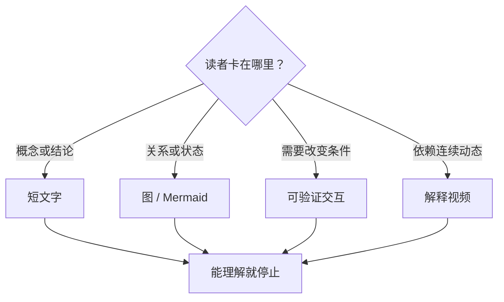

**模型输出的默认形态，不该是长文，而该是最省读者解码成本的表达。**

Karpathy 提出了四种做法：把文字写清楚，再尝试图、交互网页和解释视频。这是他的实践经验，不是四种形式的效果排名。值得复用的是：**按理解障碍选择表达，不必逐级升级媒介。**[原帖](https://x.com/karpathy/status/2105819303471976479)

## 30 秒读懂

- **文字**：适合定义、结论、限制。借鉴 ASD-STE100：主语明确、术语稳定、短句、因果完整。
- **图**：适合调用关系、状态变化、责任边界。关系比段落更重要时再画。
- **交互网页**：适合“改一个条件，看结果怎么变”。
- **视频**：适合连续变化、时序和动态机制。
- **停止条件**：读者已经能复述机制、预测条件变化、说出适用边界，就不要继续加形式。

下面是根据这些思路整理的选择图，不是原帖给出的固定步骤。

## 真正可复用的规则

| 问题 | 默认做法 | 不要做 |
|---|---|---|
| 一句话能说清吗？ | 直接说结论 | 为了“完整”先铺三段背景 |
| 关系难跟吗？ | 用一张图 | 把同一段文字再画成框 |
| 细节会打断主线吗？ | 折叠或放后面 | 全部摊在正文 |
| 需要探索条件吗？ | 做可验证交互 | 只做漂亮动画 |
| 还要继续加内容吗？ | 先做理解检查 | 把篇幅当质量 |

## 写作：不是把长句拆短

下面是一个简化的写作对照，不代表某个产品的实际实现。

原句：

> 通过幂等机制赋能分布式链路，全面保障一致性与可靠性。

改成：

> 客户端重试时沿用原事件 ID。服务端发现该 ID 已处理，就返回原结果，不重复计数。这个保证只覆盖去重记录仍有效的重试。

差别不只是更短，而是把**条件 → 动作 → 结果 → 边界**说完整。

ASD-STE100 是什么？

ASD-STE100（Simplified Technical English）最初用于航空维修文档。它通过受控词汇和写作规则降低歧义。

这里采用的是 **STE-inspired** 写法，不是正式合规认证。尤其中文不能机械套用英文词数限制。

- [官方介绍](https://www.asd-ste100.org/about_STE.html)
- [ASD-STE100 Issue 9](https://www.asd-ste100.org/assets/files/ASD-STE100_ISSUE9.pdf)

证据边界

Karpathy 的帖子提供的是个人实践和判断，不是不同输出形式的对照实验。帖子中的“80% ASD-STE100”也是提示风格，不是标准评分。

本文的选择图、规则表和写作对照是据此整理的用法，不是原帖逐字引文，也不意味着图、网页或视频天然比文字更有效。

**最终标准：先让人看懂，再决定要不要继续生成。**
