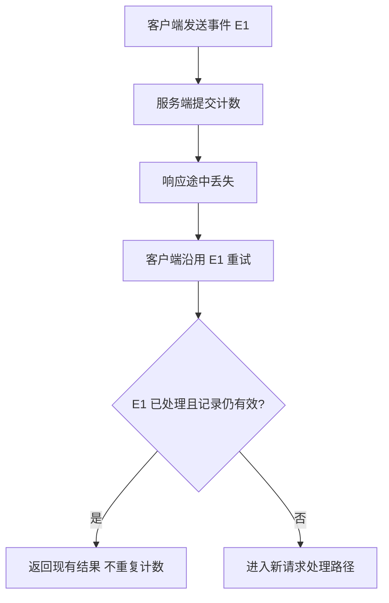

知识的价值，不在于生成了多少内容，而在于读者能否解释它、核验它，并知道它的适用边界。

Karpathy 在一则关于理解语言模型输出的帖子中，依次提出受控写作、图解、交互网页和解释视频。值得沉淀的不是把每篇笔记都做成视频，而是先找出读者卡在哪里，再选择能够消除这个障碍的表达形式。本文据此提出一套理解优先的笔记工作流；它是写作与工程建议，不是经过对照实验验证的学习效果排名。[原帖](https://x.com/karpathy/status/2105819303471976479)

## 原帖提供了方向，而不是通用排名

原帖的四个建议可以概括为：用 ASD-STE100 约束语言；用图表达难读的关系；让网页承载探索；让定制视频解释动态过程。他还提出，模型承担更多具体工作后，人会花更多时间理解和监督输出，模型本身也可以帮助制作解释材料。[原帖](https://x.com/karpathy/status/2105819303471976479)

这是作者的使用经验与判断。帖子没有给出样本量、统一任务或不同形式的理解准确率。文中提到的“80%”是对严格写作风格的软化提示，不是标准的合规分数。

因此，本文采用一个不同于固定排行榜的选择规则：**保留能降低理解成本的形式，删掉只增加观看负担的形式。** 一个定义用两句话能说清，就保留文字。一个比较需要来回翻段落，就改成对照表。只有当读者需要改变条件并观察结果时，才升级为交互演示。

## 写清楚：借鉴 STE，而不是机械复制规则

ASD-STE100 的全称是 Simplified Technical English，通常译为简化技术英语。它最初服务于航空维修文档；其方法包括写作规则和受控词典，并允许符合规则的专业术语。官方目前列出的版本是 Issue 9，发布日期为 2025-01-15。[官方介绍](https://www.asd-ste100.org/about_STE.html)

官方条文强调术语一致、明确动作、短句与渐进说明。程序性句子与描述性句子的词数规则不同。这些是英文文档规则，不能把英文词数直接换成中文字数，也不能仅凭一个提示词声称符合完整标准。[Issue 9，规则 1.11、3.6、4.1–4.4、5.1–5.4、6.1–6.6](https://www.asd-ste100.org/assets/files/ASD-STE100_ISSUE9.pdf)

在中文研究笔记中，采用下面的工程化改写习惯：

**先说谁，再说动作。** “系统支持安全治理”应进一步写清：谁检查什么、何时检查、通过后做什么、失败后由谁处理。主体尚未披露时，写明未知，不能为了主动句而编造执行者。

**同一概念保持同一个名字。** 首次出现的重要术语附上短解释；之后使用固定名称。原文区分的 runtime、harness、gateway 也应保留差别，不能都改写成“平台”。

**每句推进一个意思，每段解决一个问题。** 拆开长句，但保留“因为、因此、如果、否则”以及必要主语。把段落拆成大量残缺短语，并不会让因果关系更清楚。

**保留会改变判断的限定条件。** 模型自报、作者观察、实验结果和本文推导分开写。版本、分母、样本与失败条件放在对应结论附近，不藏到文末。

以下是本文构造的写作对照，不是对某个产品现有实现的描述：

> 泛化表述：通过幂等机制赋能分布式链路，全面保障一致性与可靠性。

改成：

> 如果客户端没有收到响应，重试时沿用原来的事件 ID。服务端识别到已处理的 ID 后，返回现有结果，不再增加计数。这个保证只覆盖采用同一 ID、仍在去重保留期内的重试。

后者更具体，是因为它交代了条件、动作、结果和边界，而不只是删掉了几个形容词。正式介绍真实系统时，还要用代码、接口文档或测试证明这些行为。

## 选对形式：让关系可见，让条件可试

下表是本文提出的表达选择规则，不是 Karpathy 的实验结论，也不是 STE 标准的组成部分。

| 读者要解决的问题 | 优先形式 | 升级或停止的条件 |
|---|---|---|
| 一个概念是什么意思，结论是什么 | 短段落 | 读者可以直接复述，就停止增加形式 |
| 多个方案在同一维度上差在哪 | 表格 | 列与行共享口径，不把整篇文章塞进单元格 |
| 谁调用谁，状态怎样变化，哪里失败 | Mermaid | 用有含义的边、分支与返回路径表达机制 |
| 空间或几何关系难以用流程表示 | 专用图示 / SVG | 图承担独立解释任务，而不是装饰文字 |
| 改一个输入后，结果为什么变化 | 可验证的 HTML 交互 | 有真实输入、计算规则、输出和边界用例 |
| 理解依赖连续变化或时序演示 | 解释视频 | 动态演示有额外价值，且制作与校验成本得到确认 |

沿用结构化技术笔记的 Mermaid 优先原则，但它只在关系图确实适合时生效。精确数字更适合表格，简单结论更适合文字。长流程优先 `flowchart TB`，即从上向下；跨组件调用可以使用时序图。图文各自承担不同工作，旁边的文字解释限制与含义，而不逐个重念框里的标签。

例如，“请求发出后超时”并不能说明服务端是否执行过。这种不可见状态，适合画成一条短流程。下面仍是本文的示意设计，不代表当前网站的内部实现：



这张图要传达的是：超时描述的是客户端看到的结果，不等于服务端没有执行。去重记录失效或重试换了 ID，都可能改变处理结果。关于提交与记录的原子性，则必须继续检查具体实现，不能由一张流程图代替证明。

## 网页和视频：可选解释层，不是默认交付负担

**网页分成两类。** 折叠补充信息、锚点导航和响应式排版属于阅读交互；它们让主论证保持紧凑。改变参数、推进状态或比较结果则属于计算交互；它们必须有可检验的模型。原生 `details` / `summary` 可以提供展开与收起，不依赖自定义脚本。[MDN](https://developer.mozilla.org/en-US/docs/Web/HTML/Reference/Elements/details)

一个有价值的演示可以让读者切换“相同 ID 重试”和“新 ID 请求”，观察计数差异。只有动画、没有输入与规则的网页，不能称为可验证模拟。示例值、模拟值与观测值也应使用不同标注。

DossierKit 当前的笔记入口接受 Markdown 和安全语义 HTML，不接受任意脚本或内联样式。因而，默认笔记使用正文、Mermaid、表格与原生折叠。复杂交互应作为经过代码审查、测试和授权部署的独立附件，再由笔记链接；不能通过放宽内容过滤，把模型生成的脚本直接塞进正文。这是当前发布链路的边界，不是 HTML 本身的限制。

**视频适合动态机制，但也增加校验工作。** 先确认分镜，再制作画面、配音与字幕；画面、旁白和公式必须描述同一件事。提供文字稿、可暂停控制和必要的视觉说明，使读者可以复查。W3C 的媒体无障碍指南也将字幕、文字稿与视觉信息替代方案列入前期规划。[W3C WAI](https://www.w3.org/WAI/media/av/planning/)

本次规范不自动购买配音、开通视频服务或增加播放器。视频只在用户明确需要、媒介确有增益且成本得到确认时制作。API 密钥留在安全配置中，不能出现在文章或可下载演示里。

## 一次成稿的工作流

**定义读者要完成的判断。** 先确定中心问题、所需前置知识，以及读完应能解释或执行什么。标题围绕问题，而不是罗列热门术语。

**建立证据，再设计解释。** 读取原始材料、相关方法和限制；为核心主张准备来源与边界。检索最接近的旧笔记，同一问题优先更新原条目。打不开原文时，如实说明来源缺口，不能从标题扩写出“已读全文”。

**先写最短完整论证。** 用一句朴素命题开篇，接结论与范围。首次使用必要术语时解释它。随后按“问题 → 机制 → 证据 → 适用边界”展开；操作性内容再给出执行方式与失败处理。篇幅取决于证据，不设置统一字数或配图数量。

**只为困难的部分增加形式。** 对照差异用表，状态与责任用图，需要探索条件时再考虑交互。分享封面独立处理：正文可以没有图片，但新笔记仍默认保留一张主题封面。

**做理解检查，而不是检查排版是否热闹。** 从目标读者角度检查：能否复述机制；换一个条件后能否预测结果；能否识别一个不适用的场景；能否追溯关键证据。作者或模型的自检不等于真实读者测试，不能编造“理解率提高”的数据。

**最后验证交付。** 检查引用、锚点、图表渲染和手机阅读；复杂交互还要验证输入、输出与异常状态。保存、CI 通过和线上可访问分别报告，只有实际验证后才称为已上线。

## 可直接复用的生成指令

```text
目标：让读者理解并核验一个核心问题，而不是生成尽量多的内容。

全局约束：
使用 STE-inspired 的清晰表达：短句、明确主语、固定术语、因果完整。
中文借鉴表达原则，不机械套用英文词数，也不声称符合完整 ASD-STE100。
区分事实、来源作者的判断、示意案例和本文推导，保留影响判断的限定条件。
默认使用 Markdown 或安全语义 HTML。复杂网页和视频按需、经授权制作。

生成流程：
1. 读取来源并查找相近旧笔记，确定中心问题与读者前置知识。
2. 用一句朴素命题开篇，随后给出结论、范围与必要术语解释。
3. 用一个具体案例说明最难的机制，同时给出相关边界或失败场景。
4. 只为难以阅读的关系添加合适的图表；长流程优先从上向下。
5. 用折叠区收纳非核心细节，保留主论证与关键限制可见。
6. 检查读者能否复述、迁移、识别边界和核验证据；据此删改。
7. 生成主题分享封面，校验引用和渲染；按授权保存并验证发布状态。

输出：一篇完整、可直接发布的笔记。只有一个 H1。
研究与工程内容保持中立，不附加个人求职或职业建议。
```

本标准的停止条件是：读者已经有足够信息理解和判断，再增加一种表现形式也没有新的解释收益。**清晰不是把知识变浅，而是把不必要的解码工作从读者身上拿走。**
