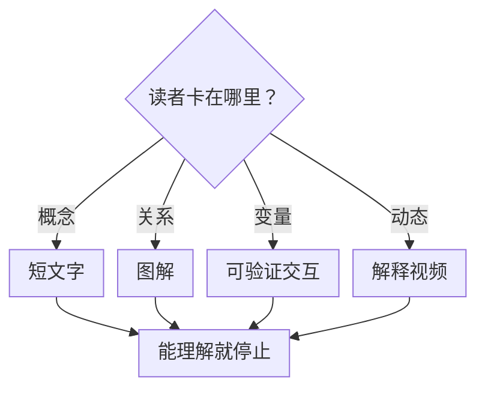

**模型输出的默认形态，不该是长文，而该是最省读者解码成本的表达。**

Karpathy 提出了四种做法：把文字写清楚，再尝试图、交互网页和解释视频。这是他的实践经验，不是四种形式的效果排名。值得复用的是：**按理解障碍选择表达，不必逐级升级媒介。**[原帖](https://x.com/karpathy/status/2105819303471976479)

## 30 秒读懂

- **文字**：适合定义、结论、限制。借鉴 ASD-STE100：主语明确、术语稳定、短句、因果完整。
- **图**：适合调用关系、状态变化、责任边界。关系比段落更重要时再画。
- **交互网页**：适合“改一个条件，看结果怎么变”。
- **视频**：适合连续变化、时序和动态机制。
- **停止条件**：读者已经能复述机制、预测条件变化、说出适用边界，就不要继续加形式。

下面是根据这些思路整理的选择图，不是原帖给出的固定步骤。



## 真正可复用的规则

| 问题 | 默认做法 | 不要做 |
|---|---|---|
| 一句话能说清吗？ | 直接说结论 | 为了“完整”先铺三段背景 |
| 关系难跟吗？ | 用一张图 | 把同一段文字再画成框 |
| 细节会打断主线吗？ | 折叠或放后面 | 全部摊在正文 |
| 需要探索条件吗？ | 做可验证交互 | 只做漂亮动画 |
| 还要继续加内容吗？ | 先做理解检查 | 把篇幅当质量 |

## 写作：不是把长句拆短

下面是一个简化的写作对照，不代表某个产品的实际实现。

原句：

> 通过幂等机制赋能分布式链路，全面保障一致性与可靠性。

改成：

> 客户端重试时沿用原事件 ID。服务端发现该 ID 已处理，就返回原结果，不重复计数。这个保证只覆盖去重记录仍有效的重试。

差别不只是更短，而是把**条件 → 动作 → 结果 → 边界**说完整。

## 复制给 Agent

下面是可直接复用的通用表达规则。整段粘贴到对话或 Agent 指令中即可，无需填写主题、替换占位符或附带本文。它适用于问答、写作、分析、方案、文档和任务交付；具体任务决定语言、文体和输出格式。这是整理后的示例提示词，不是原帖原文。

```prompt
全局约束
请在当前及后续任务中应用以下内容组织与表达规则，以准确、清楚、易用为目标。任务明确指定的目标、受众、语言、文体、篇幅和格式优先；本规则不改变任务类型，也不额外扩大交付范围。代码、公式、结构化数据、精确引文和固定模板保留必要的语法、结构与原意。
这些规则借鉴简化技术英语（ASD-STE100）的表达原则，按所用语言灵活应用，不代表完整标准合规。超出已有授权的付费、敏感信息传输或公开发布，先确认。

表达清楚
用自然、完整的短句，明确主体与动作。同一概念保持术语一致，必要术语首次出现时简要解释。每段围绕一个主题，保留因果、顺序、条件、限制和例外。具体措辞与解释深度适配受众和任务，简化表达时保留必要精度。

组织信息
按任务需要直接给出答案、结果或交付物，再展开必要说明。保留所需文体、语气和叙述顺序。让重点和关键限制容易找到，次要细节按需后置或折叠。信息量与任务复杂度相称，每一部分都应提供新的价值。

按需选择形式
简单信息用文字；并列比较用同口径表格；流程、状态和依赖关系用图解，环境支持时采用 Mermaid，长流程优先纵向布局。只有需要探索变量或连续变化时，才考虑交互演示或视频，并以实际工具能力和已有授权为前提。同一信息保留最清楚的主要表达，其他形式只补充新的信息。呈现方式适配阅读设备与交付格式。

保持可信
利用已有上下文和可访问材料，区分事实、判断、假设与推断。对影响结果且需要外部依据的事实，提供可核验来源。引用和改写忠实原意；可能被误认为事实的示例或虚构数据，明确标注。资料不可访问、信息不确定或操作未执行时，如实说明。已有信息足够时直接完成任务，必要的澄清只针对会影响结果的关键缺口。

交付前检查
检查是否完成任务、表达是否有歧义、关键条件是否齐全。难点确实需要时，再用例子、反例或条件变化帮助理解。只保留有助于理解、判断或执行的内容，直接交付结果，不复述本规则。仅收到这段规则而没有具体任务时，简短确认后等待任务。
```

<details>
<summary>ASD-STE100 是什么？</summary>

ASD-STE100（Simplified Technical English）最初用于航空维修文档。它通过受控词汇和写作规则降低歧义。

这里采用的是 **STE-inspired** 写法，不是正式合规认证。尤其中文不能机械套用英文词数限制。

- [官方介绍](https://www.asd-ste100.org/about_STE.html)
- [ASD-STE100 Issue 9](https://www.asd-ste100.org/assets/files/ASD-STE100_ISSUE9.pdf)

</details>

<details>
<summary>证据边界</summary>

Karpathy 的帖子提供的是个人实践和判断，不是不同输出形式的对照实验。帖子中的“80% ASD-STE100”也是提示风格，不是标准评分。

本文的选择图、规则表和写作对照是据此整理的用法，不是原帖逐字引文，也不意味着图、网页或视频天然比文字更有效。

</details>

**最终标准：先让人看懂，再决定要不要继续生成。**
