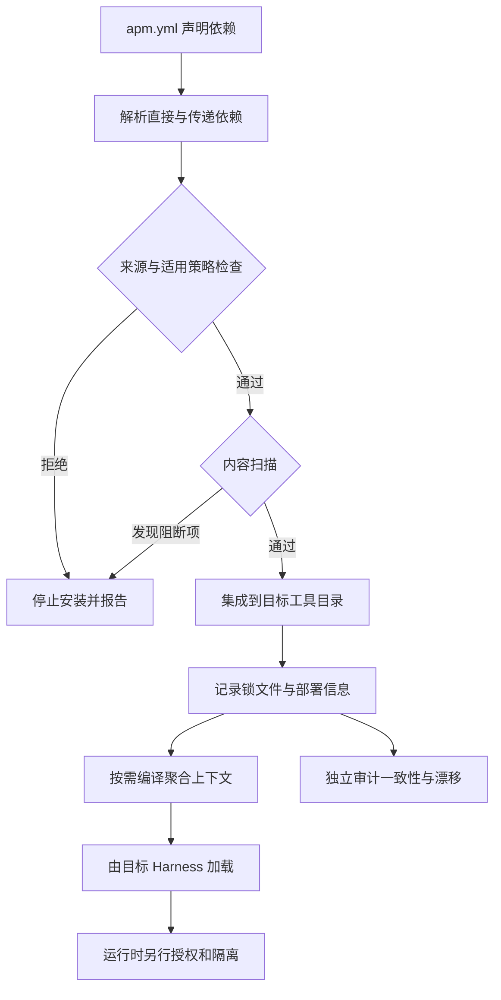
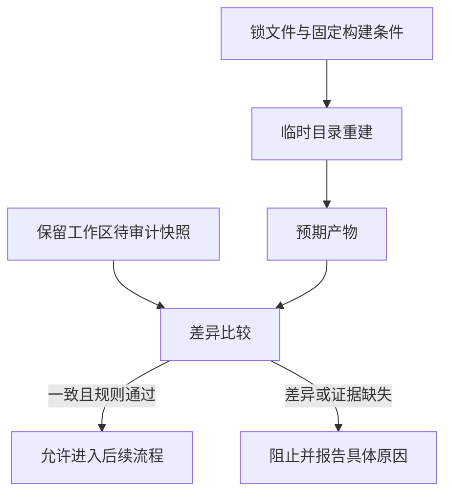

能够复现一份配置，不等于能够信任它；能够信任配置，也不等于已经批准它产生的每一个动作。

Microsoft Agent Package Manager（APM）将 Instructions、Prompts、Skills、Hooks 与 MCP 声明纳入依赖管理和跨工具分发。它解决来源、版本、部署产物与漂移问题，不是 Agent Runtime，也不负责把远程 MCP 服务放进沙箱。理解 APM 的关键，是区分安装期的供应链约束与执行期的业务授权。[1][2][3]

## 1. 为什么一份 Skill 也需要供应链治理

Agent 配置并不都是普通的说明文档。自然语言指令可以影响模型的任务分解和工具选择，Hooks、脚本及 MCP 声明还可能引入可执行程序或外部服务。因此，安装一个依赖包既可能改变上下文，也可能改变可调用能力。[3]

但不能把两者混为一谈：自然语言通常通过模型解释产生影响，不是操作系统直接执行的代码；脚本和服务则有自己的进程与权限边界。相应地，文本扫描、代码审查、依赖批准和运行时隔离需要分工。

另一个重要差异是暴露时点：文件进入某些 Harness 的自动发现目录后，就可能被读入上下文。只在远端合并时审查，不一定能保护已经加载了这些文件的本地开发会话。[3][4]

## 2. 从依赖意图到实际产物

APM 的公开生命周期包含初始化、安装、编译、运行和审计。安装阶段又区分解析、策略检查、内容扫描、集成文件与写入锁文件；安装单独原语和显式生成聚合上下文也不是同一个步骤。[2]

下面概括其职责与主要产物；具体扫描点、策略覆盖和例外参数仍需按 CLI 版本核对：

图中的最后一层是外部责任，不是 APM 自动提供的安全能力。APM 安全模型明确排除了 MCP 运行时沙箱、完整恶意代码分析和对 Agent 加载上下文之后行为的持续检查。[3]

四类数据分别回答不同问题：

| 对象 | 回答的问题 |
|---|---|
| `apm.yml` | 项目打算使用哪些依赖和目标 |
| `apm.lock.yaml` | 实际解析到哪些版本、来源与内容 |
| 组织 Policy | 哪些来源、依赖及能力符合组织规则 |
| 已部署文件 | 工作区实际放入了哪些 Harness 原生配置 |

清单表达意图，锁文件记录解析结果，策略表达允许范围，工作区文件才是部署事实。任何一个对象单独存在，都不足以证明整个链路可信。

## 3. Lockfile 的保证止于哪里

完整性校验能够帮助回答：当前文件是否与被锁定的内容一致。它不能单独回答：最初锁定的内容是否安全、审批是否可信、远程服务是否仍运行同样的代码。

例如，攻击者同时修改清单、锁文件和输出文件时，三者可以保持一致；需要由独立审批与来源约束判断这种变化是否被接受。配置中若包含稍后才动态解析的命令，锁定配置本身也不自动锁定运行时下载的所有代码。

因此，“可复现”至少应说明层级：

| 层级 | 需要固定的对象 | 仍然可能变化的部分 |
|---|---|---|
| 配置字节 | 依赖内容、解析引用 | 内容自身是否合理 |
| 构建产物 | CLI、目标、编译参数 | 运行时加载与优先级 |
| 执行环境 | 工具、依赖、系统和数据 | 远程服务及外部世界 |
| Agent 行为 | 模型、上下文、工具与任务条件 | 模型随机性和多步交互 |

前一层得到保证，不代表后一层自动成立。生产报告应明确是在比较文件哈希、构建输出，还是任务行为。

## 4. 跨 Harness 分发，不等于跨 Harness 行为一致

APM 将共同的配置原语输出到不同工具理解的原生位置，不要求所有工具使用同一个新的 Runtime。具体原语和目标的支持范围由兼容矩阵及实际版本决定。[1][2][6]

同一份 Skill 在不同 Harness 中，可能遇到不同的系统指令、加载顺序、上下文优先级、工具集合、批准机制和任务生命周期。成功生成目标文件，只能首先证明结构可用，不能直接证明权限和行为一致。

一个实用的验收顺序是：先检查文件位置与格式，再核对关键约束是否保留，然后比较工具权限，最后运行同一组受控任务。这里的行为测试应验证“是否满足共同约束”，而不是要求自然语言输出逐字相同。

还需区分已安装与实际加载：仓库存在某个 Skill，并不能证明本次模型调用读取了它。将依赖版本关联到本次上下文清单与执行轨迹，才能进一步研究具体行为与具体版本的关系。这属于建议的工程衔接，不是对 APM 自动记录所有模型上下文的声明。

## 5. 三个常见的治理误区

### 把扫描通过等同于语义安全

APM 的内容检查能够识别隐藏 Unicode、混淆字符等特定模式。但普通可读文本同样可能诱导越权，代码也可能包含扫描器未分析的行为。扫描、来源审查与运行时控制并不相互替代。[3]

### 把依赖批准等同于 MCP 业务授权

某个包被允许安装，只说明它满足相应安装规则；不意味着它声明的服务可以访问所有租户数据、使用全部凭据或执行任意写操作。直接与传递 MCP 的信任准入应显式检查，而服务本身仍需要独立授权。[3][4][5]

### 把本地审计退出成功等同于 CI 门禁通过

生命周期文档区分本地 `apm audit` 与 `apm audit --ci`：前者偏向扫描报告，后者承担一致性和漂移门禁；文档指出本地模式即使有发现也可能返回零退出码。因此不能把一个通用命令的“进程正常结束”直接当作安全检查通过。[2]

检查阶段也不能仅凭命令名推断。不同说明页对 `compile` 的扫描描述并不完全同步，安全文档还单列 Compile and pack scanning。实际门禁应固定 CLI 版本并以受控违规样例验证，不能把某一页文档快照外推为所有版本、所有命令路径的保证。[2][3]

## 6. 漂移审计必须保留被审计的现场

目标是检查已提交文件是否偏离锁定产物时，先覆盖工作区再做比较，会破坏原始证据。APM 的 CI 审计使用临时目录重建预期上下文，并与工作区进行对照；缺少本地依赖目录时，也不应简单跳过关键检查后报绿。[2]

这是有别于主生命周期图的证据关系：审计读取实际状态，不能为了“修复漂移”而先把它擦掉。若允许性能优化跳过部分检查，报告应显式记录降低了哪些覆盖，不能继续使用同样的通过结论。

最小验证矩阵

| 受控实验 | 应验证的边界 |
|---|---|
| 两个干净目录使用同一锁定依赖和 CLI | 目标产物是否一致 |
| 只修改已部署文件，不改锁文件 | 漂移能否定位到具体文件 |
| 同时修改包、锁文件和产物 | 完整性检查与独立审批是否分离 |
| 从传递依赖引入新 MCP | 能力变化是否被识别并要求信任决策 |
| 同一配置分发到不同 Harness | 结构、加载、权限和行为差异 |
| 文件进入自动发现目录后立即开启 Agent | 安装检查是否早于内容使用 |

这些是建议的实验，不是已经完成的 APM 复现实验。测试报告应保留实际版本、依赖引用、参数和检查输出。

## 结论

APM 的价值是把散落的 Agent 配置变成有来源、版本和部署证据的依赖；它的边界则是不能把字节完整性扩展成业务授权，也不能把跨工具编译扩展成行为等价。

安装期治理应与 [运行时权限和沙箱](https://sunionpeaks.pages.dev/zh/notes/github-copilot-agent-sandbox-mcp) 衔接，再把实际加载与执行结果交给 [轨迹评估](https://sunionpeaks.pages.dev/zh/notes/agentaudit-execution-trace-agent)。三者分别回答“装了什么”“允许做什么”和“实际发生了什么”。

## 参考资料

[1] Microsoft APM. [What is APM](https://microsoft.github.io/apm/concepts/what-is-apm/)。

[2] Microsoft APM. [Lifecycle](https://microsoft.github.io/apm/concepts/lifecycle/)。

[3] Microsoft APM. [Security Model](https://microsoft.github.io/apm/enterprise/security/)。

[4] Microsoft APM. [Governance Guide](https://microsoft.github.io/apm/enterprise/governance-guide/)。

[5] Microsoft APM. [Policy Reference](https://microsoft.github.io/apm/enterprise/policy-reference/)。

[6] Microsoft. [APM repository](https://github.com/microsoft/apm)；[Manifest Schema](https://github.com/microsoft/apm/blob/main/docs/src/content/docs/reference/manifest-schema.md)。
