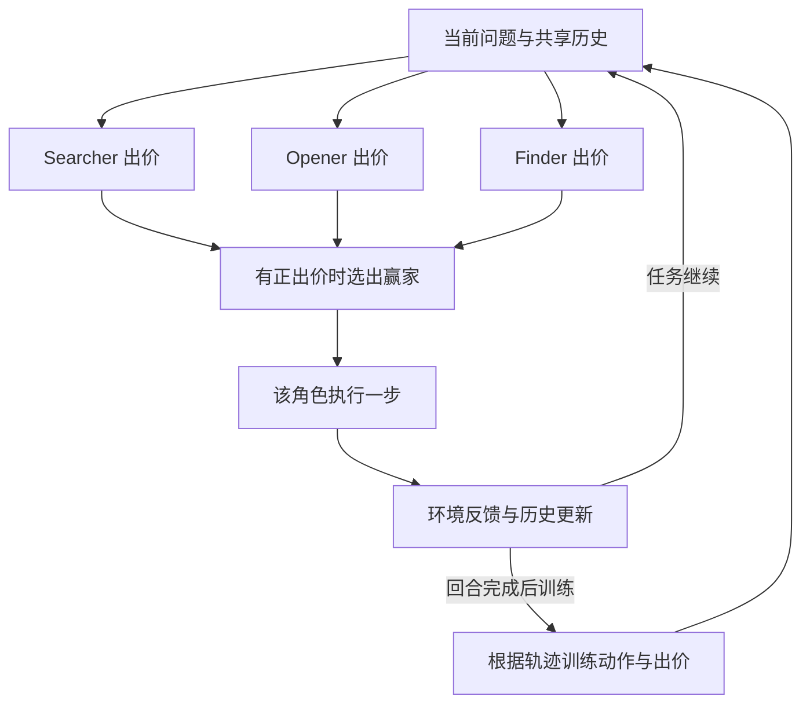

**MPT 把 Agent 的动作能力与参与时机一起训练：成员学习怎样完成动作，也学习当前是否应该由自己出手。** 它为动态分工提供了一条具体路径。论文最有价值的证据，来自固定动作模型之后的协调方式对照；扩容和抗掉线结果则需要结合最终成功率、计算预算与实验条件理解。

精读对象：[Learning Self-Orchestration in Decentralized Agent Swarms][paper]，Guowei Xu、Zhenting Qi、Amani Kiruga、Himabindu Lakkaraju、Yilun Du，Harvard University。本文依据 2026 年 10 月 15 日的 arXiv v1、作者项目页和公开代码，核对截至 2026 年 10 月 18 日。[原帖][post]是阅读入口。

## 1. 能力在变化，分工也需要变化

设想一个检索问答系统：检索者找页面，阅读者打开页面，查找者定位证据。若总是按固定顺序轮转，即使证据已经出现，也可能继续搜索；若只训练各角色怎样调用工具，系统仍未学会何时切换角色。

这里存在一个反馈关系：**分工决定谁获得经验，经验改变能力，能力变化又改变合理分工。** MPT（Market-based Post-Training，市场式后训练）把这几个环节接起来，用任务反馈同时更新动作与竞价行为。[论文 §1–2][paper]

角色和工具范围由研究者预先划分。例如深度研究实验设定 Searcher、Opener、Finder，分别负责 `search`、`open`、`find`；三者各有独立模型参数，共享对话历史，均可提交最终答案。因此，实验中的自组织主要指**执行顺序与参与比例的学习**，角色定义仍来自人工设计。[论文附录 B.3][paper]

## 2. 一次竞价，连接两种学习

每个决策时刻，各角色根据当前上下文独立出价；最高出价者获得这一轮执行权。出价在实验中取离散档位，常见设置为 `0、0.2、0.4、0.6、0.8`。它是参与决策使用的数值，不能直接当成成功概率。[论文 §2.1、附录 B][paper]

下面用论文的检索角色说明控制流程。**每轮至多一名角色执行动作**。下图展示存在非零出价时的流程；全员出价为零时，论文规定跳过该轮。

### 动作学习：让下游结果回馈上游步骤

**信用分配**回答的是：任务最终获得了奖励，前面的哪些动作应从中获得学习信号？MPT 沿实际行动序列反向传递价值。某一步保留 `1−本步出价` 的价值，其余份额传给上一步。出价越高，越容易获得执行权，同时让给上游的份额越大。[论文 §2.2][paper]

用一个本文构造的算例理解。假设伐木、采矿、锻造依次执行，只有最后一步获得 10 分奖励：

| 反向结算顺序 | 当步出价 | 收到的累计价值 | 本步保留的信用 | 继续向前传递 |
|---|---:|---:|---:|---:|
| 锻造 | 0.8 | 10 | 2 | 8 |
| 采矿 | 0.4 | 8 | 4.8 | 3.2 |
| 伐木 | 0.2 | 3.2 | 2.56 | 0.64 |

第一步之前没有参与者，因此最后的 0.64 按论文规则丢弃。这说明信用不是把总奖励按各 Agent 的出价归一化分配。更早提供条件的动作，可以从后续成功中获益；这种分配仍是一种训练设计，不能自动视为各步骤真实因果贡献的测量。

### 竞价学习：比较“自己出手”和“让另一位出手”

仅有奖励分配，还不足以教会 Agent 何时参与。MPT 为存在竞争的步骤构造**反事实分支**：恢复同一个环境和 Agent 状态，尝试降低原赢家的出价，让第二名行动，再比较两条路径的后续回报。[论文 §2.3][paper]

论文设定最多重采样三次；无法改变执行者，或两条分支得分相同，就丢弃该训练对。能形成偏好的样本用于提高较好竞价响应的概率。动作侧使用 REINFORCE，竞价侧使用 Bradley–Terry 偏好损失；每四次动作更新交替进行一次竞价更新。

**每个 Agent 的这两种行为更新同一套模型参数。** 论文与公开实现都支持这一点。将其理解成两个独立策略网络，会误判部署和训练结构。[论文 §2.3][paper]、[模型工作组实现][chain]

这个训练设计的重要要求是：系统需要得到“换一个执行者之后会怎样”的反馈。历史日志只记录已经走过的路径，单有日志还不足以重建另一条路径。

## 3. 哪些实验最能说明问题

论文先比较 MPT 与同底模的单 Agent REINFORCE。作者声明匹配总训练 FLOPs，计入所有角色的竞价、动作、反事实分支及参数更新；SFT 总计算也做了匹配。以下是留出集结果，误差为实例间标准误 SE，每个实例先平均三次运行。[论文 §3.1–3.2、表 1][paper]

| 任务与指标 | 单 Agent RL | MPT | 留出集规模 |
|---|---:|---:|---:|
| Minecraft：平均回合奖励 | 20.3 ± 4.1 | 41.5 ± 5.9 | 32 个世界种子 |
| 模拟导航：平均回合奖励 | 0.52 ± 0.14 | 1.23 ± 0.18 | 88 条路线实例 |
| 语料检索问答：准确率 | 9.0 ± 2.1% | 21.0 ± 4.1% | 50 个问题 |

**前两行度量奖励，第三行才是准确率。** Minecraft 会对中间工艺进展给分；导航奖励包含接近目标等信号。语料问答由 qwen3.5-flash 对照参考答案判分。奖励增加说明策略取得更多进展，完整任务的可靠性还要看终点指标。

更有解释力的对照是：**保留同一组已训练动作模型，只替换协调方式。** Iron Pickaxe 任务中，轮询为 23.8，AgentNet 为 20.9，Graph-of-Agents 为 25.4，MPT 为 41.5，均为平均回合奖励。MPT 相对其中最强替代策略提高约 63.4%。这为“参与选择本身具有价值”提供了证据。[论文 §3.3.2、表 2][paper]

但该比较使用的是已与 MPT 竞价共同适配的动作模型，且只在一个任务上展开。它支持这套配合有效；对所有协调器、所有任务的普遍排序仍需其他实验。

另一组组合实验中，只后训练出价得到 21.5，只后训练动作得到 27.2，两者都后训练得到 41.5，SFT 初始化后的组合为 15.4。把信用分配中的出价替换为随机数，也会降低表现。这些结果共同指向**动作能力、参与选择、信用分配的互补关系**。[论文 §3.3.3–3.3.4][paper]

## 4. 扩容提高了什么，“抗掉线”又意味着什么

### 先看最终目标，再看中间里程碑

扩容测试把三个已训练角色各复制一至四份，群体为 **3、6、9、12** 个 Agent。底模与角色种类保持原有设置。图 9 使用 `pass@3`：每个实例尝试三次，至少一次达成目标的实例比例。[论文 §3.4、图 9][paper]

| 工艺里程碑 | 3 个 Agent | 12 个 Agent |
|---|---:|---:|
| 木镐 | 约 78% | 约 97% |
| 石镐 | 约 69% | 约 94% |
| 熔炉 | 约 66% | 约 91% |
| 铁锭 | 约 0% | 约 6% |
| **最终铁镐** | **约 0%** | **约 3%** |

以上为原图近似读数，部分曲线存在平台，末端误差条也较宽。**扩容改善了若干阶段能力，最终铁镐仍很困难。** 若只摘取木镐的 97%，读者就容易高估整个任务的完成水平。pass@3 也不能替代单次成功率。

扩容还增加了竞价推理。论文未给出同等推理成本下，与多跑几次原始三 Agent 系统的完整比较。因此，图 9 支持利用更多推理资源改善结果，尚不足以证明更优的单位成本收益。

### 90% dropout 的结果仍有明显损失

图 10 中，12 个 Agent 的平均奖励从无 dropout 时约 42，降到 `p=0.9` 时约 33。按图中近似值计算，下降约 21%；三 Agent 的对应奖励约从 38 降到 19。[论文图 10][paper]

论文支持的结论是：**增加角色副本，可以缓解所设 Agent dropout 下的奖励下降。** 正文与附录没有充分交代失活是在每轮、整局还是其他粒度采样；本次审阅的公开评测入口也未能核实该实验机制。因而，不能将这个结果解释为九成生产服务永久宕机后仍几乎无损完成任务。

另外几项原帖表述也应保留边界：

| 原帖引出的理解 | 原文实际覆盖的范围 |
|---|---|
| 多机器人协同导航 | 三个软件角色分管同一模拟机器人的转向、前进、停止 |
| 编程步骤由擅长写代码的 Agent 接管 | 三类实验没有编程任务评测，不能将这个例子当作本论文实证 |
| 全新下游任务迅速适应 | 从铁镐检查点继续训练同领域的火把、石砖任务 |
| 无中央 Agent 即无单点故障 | 决策由竞价产生；共享状态、选人规则和执行设施仍需要运行时承载 |

上述范围见[论文 §3、附录 B/D][paper]；最后一行是根据机制与[调度实现][auction]作出的工程解释。

## 5. 公开实现与论文配方还需要对齐

本次源码审阅固定到公开提交 `3b56087a2e436e04f077672cf8cffd91b8820b08`。它能验证竞价和训练机制已有实现，也暴露出几处默认设置差异：

| 环节 | 论文描述 | 公开代码的默认行为 |
|---|---|---|
| 所有角色出价为零 | 跳过该轮 | 将参与者提到最低正报价档位，再选出执行者 |
| 原赢家重新出价次数 | 最多 3 次 | `cf_k: 6` |
| 反事实比较范围 | 使用原采样轨迹；替代分支继续到回合结束 | 从快照重建两条分支；首动作后默认再执行 `cf_p: 4` 轮 |
| 奖励进入信用结算 | 用每步环境奖励回传 | Minecraft、导航默认启用 `seg_scale`，按距上次正奖励的步数调整奖励 |

证据分别位于[竞价规则][auction]、[默认配置][config]、[分支执行器][driver]和[信用结算器][engine]。这些差异会改变轨迹、偏好样本或训练信号，复现时需要对齐。

**公开默认配方与论文描述存在差异，并不直接说明论文实验使用了错误配置。** 原实验可能有命令行覆盖或其他版本；判断需要与结果对应的完整配置、检查点和原始日志。本文完成的是文档与源码审阅，没有重新进行训练复现实验。

补充推导：高出价的惩罚与长程信用衰减

论文的递推可写为：`vₜ = rₜ + bₜ₊₁ × vₜ₊₁`，`cₜ = (1−bₜ) × vₜ`。这里 `vₜ` 是累计价值，`cₜ` 是当步信用。动作更新使用 `cₜ−该 Agent 的批次平均信用` 作为优势。[论文式 1–2][paper]

**高出价不能直接推出最大负梯度。** 构造一个只有终局奖励的失败轨迹：奖励为零，则所有步骤的信用都为零，不论出价是 0.2 还是 0.8。若同一 Agent 的批次平均信用为 0.1，两者优势都为 −0.1。竞价侧还有独立的反事实偏好目标，其梯度也不是按报价数值直接罚款。

**长延迟奖励可能被连乘衰减。** 根据式 1，一笔下游奖励传回更早步骤时，会乘上中间各步的出价。假设只有终局奖励，而且之后 20 步出价均不超过 0.8，传回价值最多保留 `0.8²⁰ ≈ 1.15%`；40 步则约为 `0.0133%`。这是本文根据公式推导的边界，没有在论文中作为实测结果给出。中间奖励与奖励整形会改变该问题的程度，因此需要在长程、稀疏反馈任务上单独验证。

## 6. 怎样把这项研究转成工程收益

**可重放、可评分、角色边界明确的工作流，最适合验证这种分工学习。** 固定文档库问答、隔离代码与测试环境、可恢复的模拟任务，都能较清楚地定义状态和结果。作者也明确把可靠奖励与环境恢复列为适用条件；真实不可逆操作的反事实训练仍是开放问题。[论文附录 D][paper]

对开发者，最有实践价值的准备工作有三项：

1. **保存可恢复的执行状态。** 同时保存环境状态、工具状态和 Agent 上下文，使两个候选角色能从同一条件出发。只保留聊天记录通常不够。
2. **用最终业务结果约束阶段奖励。** 检索次数、采集材料和测试执行次数只是过程指标；验收应关注答案是否正确、目标是否完成，以及失败如何分布。
3. **在同等推理预算下比较。** 至少比较单 Agent、固定分工、学习型路由和 MPT；一起记录最终成功率、总模型调用量、耗时与恢复成本。

这三项是本文根据机制提出的工程验证路径。论文匹配了训练 FLOPs，但这不自动覆盖部署延迟、总参数容量和推理费用。完整 MPT 还涉及权重更新、轨迹采样与反事实训练；用固定模型加一个出价提示，可以验证路由想法，训练收益仍需要另行测量。

这项研究值得继续跟进的方向，是**让角色在获得新能力后，重新学会自己应在何时参与**。它已经给出了可分析的训练目标和受控实验；工程落地的下一步，是把这套学习机制放到可恢复、可计量的实际任务里，检验最终成功率与单位成本是否同步改善。

## 参考资料

1. [论文全文：Learning Self-Orchestration in Decentralized Agent Swarms，arXiv v1][paper]；[PDF 原版，第 8 页含图 9/10][pdf]。
2. [作者项目页：方法、主表与实验图][project]。
3. [官方代码仓库，本文审阅的固定提交][repo]。
4. [竞价规则：auction.py][auction]；[训练配置：ppo_trainer.yaml][config]。
5. [反事实分支执行：counterfactual_driver.py][driver]；[信用结算：engine.py][engine]；[竞价与动作模型绑定：chain_base.py][chain]。
6. [原始 X 帖子：南晚 Nanwan，2026-10-17][post]。

[paper]: https://arxiv.org/html/2610.22322v1
[pdf]: https://arxiv.org/pdf/2610.22322
[project]: https://guoweixu.com/mpt/
[repo]: https://github.com/Embodied-Minds-Lab/MPT/tree/3b56087a2e436e04f077672cf8cffd91b8820b08
[auction]: https://github.com/Embodied-Minds-Lab/MPT/blob/3b56087a2e436e04f077672cf8cffd91b8820b08/src/economy_engine/auction.py
[config]: https://github.com/Embodied-Minds-Lab/MPT/blob/3b56087a2e436e04f077672cf8cffd91b8820b08/src/verl/trainer/config/ppo_trainer.yaml
[driver]: https://github.com/Embodied-Minds-Lab/MPT/blob/3b56087a2e436e04f077672cf8cffd91b8820b08/src/agent_system/multi_turn_rollout/counterfactual_driver.py
[engine]: https://github.com/Embodied-Minds-Lab/MPT/blob/3b56087a2e436e04f077672cf8cffd91b8820b08/src/economy_engine/engine.py
[chain]: https://github.com/Embodied-Minds-Lab/MPT/blob/3b56087a2e436e04f077672cf8cffd91b8820b08/src/agent_system/agent/orchestra/chain_base.py
[post]: https://x.com/snwiki238337/status/2111339705774317898
