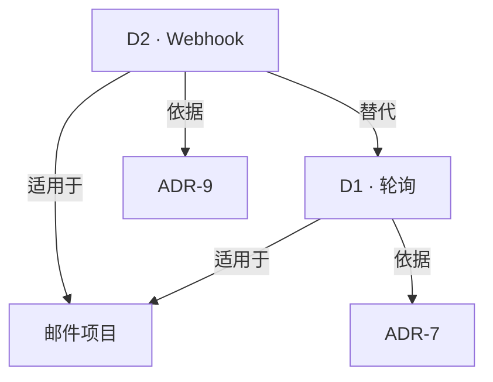

某个项目先决定用轮询收消息，后来改用 Webhook。两份决策记录都是真的。下次 Agent 问“现在用哪种方案，依据是什么”，搜到两段语义相近的文字，只完成了一半工作。它还要知道两段话说的是同一个项目，以及哪份记录替代了另一份。

**Relate 让应用把这种关系直接存成可查询的数据。** 它是用 Rust 写的嵌入式属性图数据库，可以与 Agent 运行在同一进程，支持内存库和持久库。应用负责识别实体、确认来源、写入替代关系，再把查到的少量事实送进模型。数据库不会替应用判断哪句话值得记、哪份证据可信。下文依据 Neo4j 2026 年 11 月 11 日的发布，以及 11 月 20 日的 Apache-2.0 版本 v1.2.0。[发布说明](https://neo4j.com/blog/news/meet-relate-by-neo4j-an-embedded-database-for-ai-agents/) · [固定版本源码](https://github.com/relatedb/relate/tree/v1.2.0)

## 一条决策怎样写进去，又怎样退出现行答案

在这个例子里，节点有三类：项目、决策、来源。边有三种含义：某项决策属于哪个项目、引用哪份记录、替代哪项旧决策。`ADR-7` 和 `ADR-9` 是示例中的架构决策记录编号。轮询和 Webhook 是两次不同的决定，各自有独立身份。



首次导入用稳定 ID 找到或创建实体，再写关系。用 `relate -d ./memory.rl` 打开新的本地库，即可执行下面的 Cypher。`MERGE` 让同一条输入在这个串行示例里可以重复导入。

```cypher
MERGE (p:Project {id:'mail'})
MERGE (d:Decision {id:'D1'}) SET d.value='poll'
MERGE (s:Source {id:'ADR-7'})
MERGE (d)-[:FOR]->(p)
MERGE (d)-[:CITES]->(s)
```

决策变更时，新增 `D2` 并引用 `ADR-9`，同时写入 `(D2)-[:SUPERSEDES]->(D1)`。

<details>
<summary>展开第二次写入的完整 Cypher</summary>

```cypher
MATCH (old:Decision {id:'D1'})-[:FOR]->(p:Project {id:'mail'})
MERGE (d:Decision {id:'D2'}) SET d.value='webhook'
MERGE (s:Source {id:'ADR-9'})
MERGE (d)-[:FOR]->(p)
MERGE (d)-[:CITES]->(s)
MERGE (d)-[:SUPERSEDES]->(old)
```

</details>

读取时，查询从项目出发，只返回有来源、且还没有后继决策指向它的记录。这样，模型收到的每项结论都附有可以回查的依据。

```cypher
MATCH (d:Decision)-[:FOR]->(:Project {id:'mail'}),
      (d)-[:CITES]->(s:Source)
WHERE NOT EXISTS { MATCH (:Decision)-[:SUPERSEDES]->(d) }
RETURN d.value AS choice, s.id AS source
ORDER BY source LIMIT 5
```

**实际运行结果。** 在 Linux x86-64 上使用 Relate v1.2.0 CLI。下面每次读写都在新进程中执行，对 `.rl` 的查询以只读方式打开。

| 操作 | 观察到的结果 |
|---|---|
| 将第一条决策重复导入两次，退出并重开单文件库 | 现行查询只返回一行：`poll / ADR-7` |
| 增加 D2 及替代关系，再次退出并重开 | 同一条查询返回 `webhook / ADR-9`，历史决策总数为 2 |
| 改用 `:memory:` 写入第一条决策，退出后启动新进程 | 新内存库的节点数为 0 |

这验证了**正常关闭后重开、重复导入和按替代关系召回**。它没有模拟断电，也没有测量生产负载。如果第二份材料只是提出 Webhook 设想，应用就不该写下 `SUPERSEDES`。若两项互相矛盾的决策都没有后继，查询会把两条都交出来。此时应把冲突和来源一起展示，或按业务审批规则裁定。真实系统还要给身份加作用域，例如租户、项目和决策主题，避免不同项目的 `D1` 或完全不同的议题被合并。

## 查询在哪里运行，一份文件又存了什么

查询引擎在内存里保存带标签的节点、属性和邻接关系。已经找到项目或文件节点后，执行器可以按关系类型读取相邻记录，例如只沿 `CITES` 找出处。工作量取决于如何定位起点、每次会展开多少邻居，以及路径有多深。一个拥有几十万条边的热门节点，和一个只有三条出处的决策节点，成本完全不同。末尾写 `LIMIT 5` 可以限制返回模型的数据量，前面的扫描或排序仍可能很大。[邻接关系实现](https://github.com/relatedb/relate/blob/v1.2.0/relate/relate-executor/src/adjacency/delta.rs#L123-L154) · [引擎限制](https://github.com/relatedb/relate/blob/v1.2.0/docs/limitations.md)

持久库把恢复所需的数据留在磁盘。默认 `full` 模式先把变更追加到预写日志（WAL），按持久化协议同步后应用到图。检查点把已提交状态写成快照。重开时，引擎加载快照并重放检查点之后的日志。`.rl` 把持久状态封装到单文件，日常查询仍然访问内存里的图。**容量规划要看常驻内存、索引和查询峰值，不能用磁盘文件大小代替。** [存储引擎](https://github.com/relatedb/relate/blob/v1.2.0/docs/guides/storage-engine.md#L1-L24)

| 部署方式 | 适用场景 | 工程边界 |
|---|---|---|
| `:memory:` | 一次 Agent 任务的临时关系或测试夹具 | 进程结束，数据随之消失 |
| 持久 `.rl` 文件 | 单应用、本地项目、可携带的知识库 | 一个写进程持有文件时，另一进程不能同时以只读方式打开该文件 |
| 持久目录 | 一个写入者持续导入，其他进程需要读取 | 支持独立只读快照，也可用 live reader 跟随 WAL；读者要明确所需的新鲜度 |
| 一个 Relate 进程，对外提供 MCP、HTTP 或 Bolt | 多个 Agent 客户端访问同一份图 | 服务统一持有存储。进程内并发写仍可能冲突，应在应用层处理重试 |

同一进程内可以并发读。并发写的冲突检测也不能代替“同一项目、同一主题只允许一个现行决定”这样的业务约束。需要强制唯一性时，要建约束并定义冲突处理流程；持久化不提供自动的事实审核。[存储打开方式](https://github.com/relatedb/relate/blob/v1.2.0/docs/guides/storage-engine.md#read-only-open-and-follow) · [事务边界](https://github.com/relatedb/relate/blob/v1.2.0/docs/limitations.md) · [客户端与服务接口](https://github.com/relatedb/relate/tree/v1.2.0#readme)

## 图遍历与向量检索分别解决什么问题

如果问题是“这个项目最后定了哪种接入方式”，已有项目 ID，就可以直接走有类型的关系。如果问题是“以前讨论过哪些降低重复通知的方案”，用户只给出了自然语言，可以先用全文或向量检索找出候选决策，再沿项目、出处、替代关系核验，最后把结论和来源交给模型。前一步允许模糊匹配，后一步让每个返回值有可解释的身份和路径。

v1.2.0 有一个直接影响选型的实现细节。应用提供 embedding；建好 `VECTOR INDEX` 后，引擎对该索引覆盖的候选向量做**精确扫描**，计算相似度，并维护有界的 top-k 结果。它接受部分 Neo4j HNSW 配置键用于兼容，这些键不会启用近似最近邻检索。固定向量维数时，候选数翻倍会增加打分工作，即便最后始终只取五条。选型时应使用目标维度和真实候选规模测试。[v1.2.0 向量检索指南](https://github.com/relatedb/relate/blob/v1.2.0/docs/guides/vector-similarity.md#L189) · [打分与 top-k 实现](https://github.com/relatedb/relate/blob/v1.2.0/relate/relate-executor/src/exec/vector.rs#L140-L181)

## FastAPI 案例里，图究竟帮 Agent 找到了什么

Neo4j 把 FastAPI 的 8,102 次提交导入图中。`security/api_key.py` 被修改过 28 次，其中 `oauth2.py` 同次变更 18 次、`http.py` 17 次、`open_id_connect_url.py` 16 次。这几份文件彼此没有直接 import。单看当前源码，很容易漏掉这种需要一起审查的历史关联。这些数字代表共同变更的次数，只足以提示检查相关模块，并不要求四份文件一律一起修改。[Neo4j 实验与原始查询](https://neo4j.com/blog/developer/your-coding-agent-can-read-the-code-give-it-the-history-with-relate-by-neo4j/)

实验让三个 Agent 在相同模型和推理配置下，为两种变更各做一次事前分析，设源码组和源码加图组，共 12 场。针对安全模块的任务，图组三个 Agent 都提到了这三份相关文件，纯源码组都漏掉了；两组都能从现有测试找到核心测试用例。**两组检出目录都移除了 `.git`，只有图组获得了提交历史。** 这个设计支持“显式提供历史关系能补足当前源码的盲点”，无法单独证实图查询优于向另一组开放 `git log`，也没有测量最终修改通过率。[实验设置及逐项结果](https://neo4j.com/blog/developer/your-coding-agent-can-read-the-code-give-it-the-history-with-relate-by-neo4j/)

## 已经有 PostgreSQL 或 Redis，什么时候值得加 Relate？

| 常见工作负载 | 合理的起点 | 何时值得试 Relate |
|---|---|---|
| 主键查当前状态、过滤、事务更新，团队已有 PostgreSQL | 用关系表存实体和边，需要时用递归 CTE 沿关系查询 | 多种关系需要经常组合，而且希望随应用分发、离线运行 |
| 按会话取最近状态、按 ID 取对象、简单集合成员判断 | 沿用 Redis 的键与集合；简单查询的成本容易预估 | 需要追溯出处、历史版本和跨实体的多跳关系，手工维护的集合越来越多 |
| 从大量文本找语义近邻 | 先测已有全文或向量索引的召回与延迟 | 相似度只负责找入口，答案还取决于明确的路径、时序或出处 |

这些是工程起点。嵌入式访问省掉了服务端网络往返，却会占用 Agent 进程自己的内存；通过 MCP 或 HTTP 连接它时，传输成本又要计入。使用 PostgreSQL 或 Redis 时，先把已有方案按相同问题优化到能用，再判断增加一种数据库是否划算。[PostgreSQL 递归查询](https://www.postgresql.org/docs/current/queries-with.html) · [Redis 集合](https://redis.io/docs/latest/develop/data-types/sets/)

做小规模验证时，把同一批有标准答案的问题交给现有系统和 Relate：**当前结论正确率、过期结论误召回率、出处覆盖率**衡量记忆质量；**冷热查询 p95、启动恢复耗时、峰值 RSS、并发写冲突与重试次数**衡量运行代价。两边提供同一份历史、相同结果上限和访问范围。对这种记忆系统，最有说服力的结果是：项目改变决定以后，Agent 下一次能答对，也能指出改变它的那份证据。
