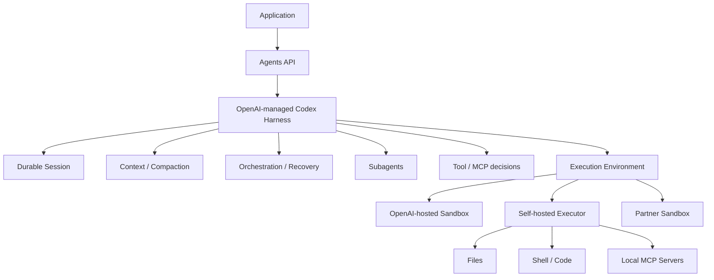
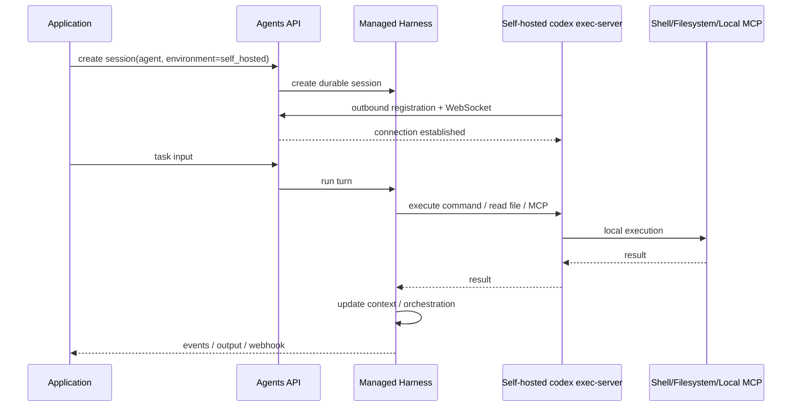
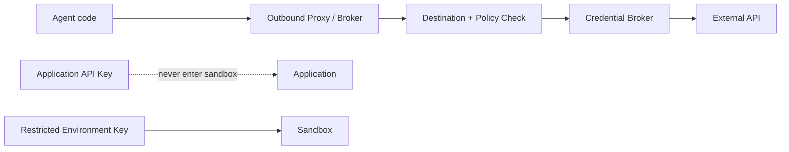

## 时间锚点与证据边界

- 时间锚点：**2026-09-18**。
- 核心发布：**2026-09-10**。
- 检索窗口：**2026-09-05 至 2026-09-18，扩展至近 14 天**。
- 扩展原因：Agents API 正式 Public Beta 发布于 9 月 10 日，超出严格 7 天窗口两天，但属于本主题在研究时点最重要的一手变化。
- 来源优先级：**OpenAI 官方产品发布 > OpenAI 官方 API 文档 > OpenAI 官方安全/Runtime 文档**。
- 本笔记仅采用 OpenAI 官方来源作为事实依据。下文的产品状态、API 示例、数据驻留和 ZDR 支持情况均按上述时间锚点记录。

### 主要来源

1. [OpenAI — Introducing the Agents API](https://openai.com/index/introducing-the-agents-api/) — 官方发布，2026-09-10。
2. [OpenAI API Docs — Agents API overview](https://developers.openai.com/api/docs/guides/agents-api/overview) — 官方文档。
3. [OpenAI API Docs — Architecture](https://developers.openai.com/api/docs/guides/agents-api/architecture) — 官方架构文档。
4. [OpenAI API Docs — Self-hosted sandboxes](https://developers.openai.com/api/docs/guides/agents-api/environments/self-hosted) — 官方文档。
5. [OpenAI API Docs — Sandbox security](https://developers.openai.com/api/docs/guides/agents-api/environments/security) — 官方安全文档。
6. [OpenAI API Docs — Observability](https://developers.openai.com/api/docs/guides/agents-api/observability) — 官方文档。
7. [OpenAI API Docs — Tracing](https://developers.openai.com/api/docs/guides/agents-api/tracing) — 官方文档。

## 摘要

[事实] Agents API 将 Codex 使用的 Agent Harness 作为 OpenAI-managed API 暴露给开发者。OpenAI 管理 **Session、Orchestration、Context Compaction 和 Recovery**，而应用负责定义 Agent 的 Tools 并选择 Execution Environment。Environment 可以是 OpenAI-hosted Sandbox、自有基础设施上的 Self-hosted Sandbox，或合作伙伴提供的环境。

[事实] Self-hosted 模式下，OpenAI 仍运行 Managed Harness，而开发者在自己的环境中运行 `codex exec-server`。Executor 通过 Outbound WebSocket 与 Agents API 建立连接，并在 Harness 请求下执行 Shell、读写文件和调用 Local MCP Server。

[推断] 这一架构将常被混称为“Agent Runtime”的两部分明确拆开：

```text
Agent Intelligence / Control State
        ≠
Execution Authority / Compute
```

即：

```text
Managed Harness
        ↓
Execution Protocol
        ↓
Sandbox / Executor
```

这种分层使 Harness 的 Context、Subagent、Recovery 与 Compute Isolation、Network、Secret、Filesystem 生命周期可以独立演进。

## 背景与问题定义

OpenAI 在发布中将有效 Long-running Agent 所需能力归纳为两类。

第一类是 Harness：

```text
context management
tool use
subagent coordination
session continuity
```

第二类是基础设施：

```text
run for days
files
code execution
intermediate results
```

传统应用常自行实现：

```python
while not_done:
    build_context()
    call_model()
    parse_tool_call()
    execute_tool()
    persist_state()
    recover_if_needed()
```

随着任务变长，这个 Loop 实际逐渐成为完整分布式系统：

```text
Session
Context
Tool scheduling
Recovery
Subagents
Sandbox
Events
Webhooks
Tracing
Storage
```

Agents API 的产品定位，就是把其中的 Harness 层托管化。官方文档明确写道：OpenAI 管理 Sessions、Orchestration、Context Compaction 和 Recovery，应用提供 Tools 并选择 Execution Environment。

## 核心对象模型

OpenAI 官方将 Agents API 的概念拆成四个主要对象：

| 对象 | 职责 |
|---|---|
| Agent | Model、Instructions、Tools、MCP Servers |
| Environment | Agent 可访问文件、加载 Skill、执行命令的 Sandbox/Computer |
| Session | Durable Agent instance |
| Events / Items | Session 中的输入与产生的输出 |

由此可以整理成：



这张图依据 OpenAI 官方对象边界整理，不代表其内部服务拓扑。

## Managed Harness 提供什么

官方列出的 Managed Harness 能力包括：

- 在 Sandbox 中运行 Command / Code。
- 加载相关 Skills 和 Instructions。
- 通过 Tool / MCP 连接外部数据。
- Agent 工作中途 Steering。
- 对历史工作做 Summary 以管理 Context Window。
- 拆分 Subtask 并委派给 Subagents。
- 从停止位置 Resume Session。

OpenAI 同时表示 Harness 会与 Model 一起持续改进，并通过版本化方式暴露新能力。

[推断] 这里产生了一个重要平台特性：

```text
Model Version
+
Harness Version
```

共同定义实际 Agent Behavior，而不能再把性能完全归因于 Model ID。

## Managed Harness 与 Execution Environment 解耦

发布材料给出的关键边界是：

```text
OpenAI owns:
  Harness

Developer chooses:
  Environment
```

Self-hosted 模式更加明确：



[事实] `codex exec-server` 注册时使用 Environment ID 和受限 Key；所有连接由 Executor 主动向外建立。OpenAI 文档要求 Self-hosted 环境至少允许访问 `api.openai.com` 和相应 WebSocket Endpoint。这个设计意味着 Self-hosted 环境通常不需要向互联网暴露 Inbound Agent Control Port。

## API 配置示例

官方 API 的逻辑形态可以简化为以下结构；字段来自研究时点的官方示例，但内容经过压缩。示例包含占位值，用于展示对象关系，不是可直接运行的完整请求：

```json
{
  "agent": {
    "model": "gpt-6-astra",
    "instructions": "...",
    "tools": [
      {
        "type": "mcp",
        "server_label": "docs",
        "transport": {
          "type": "http",
          "server_url": "https://..."
        }
      }
    ],
    "multi_agent": {
      "enabled": true,
      "max_concurrent_subagents": 4
    }
  },
  "environment": {
    "type": "self_hosted",
    "workspace_directory": "/workspace",
    "capability_directories": [
      "/workspace/capabilities/skills"
    ]
  },
  "input": [
    {
      "role": "user",
      "content": "..."
    }
  ]
}
```

这说明 Tool/MCP、Multi-agent 配置属于 Agent/Harness 侧，而 Filesystem Workspace 与 Skill Capability Directory 又与具体 Environment 建立关系。

## MCP 与网络边界

[事实] OpenAI 的 Sandbox Security 文档明确区分两种 MCP 网络来源：

- **Executor MCP**：连接由开发者 Environment 发起。
- **Remote MCP**：连接由 OpenAI Service 发起。

因此，“MCP”并不能单独说明 Network Trust Boundary。更精确的描述应该是：

```text
Tool
├─ remote MCP → OpenAI service network boundary
└─ executor MCP → sandbox network boundary
```

[推断] 在做 Threat Model 时，每一个 Tool 至少应有以下描述。此处是工程建模建议，不是 Agents API 的官方请求 Schema：

```json
{
  "execution_location": "harness|sandbox",
  "network_origin": "openai|customer_env",
  "credential_source": "broker|sandbox|service",
  "side_effect": true,
  "allowed_destinations": []
}
```

## Credential 分离

OpenAI 官方的 Self-hosted 设计采用了 Credential Separation。

应用的 API Key 位于 Environment 外部；Sandbox/Executor 获取单独的 Environment Key。Environment Key 只允许连接 Environment，不能授权其他 API 操作。OpenAI 特别指出，Agent-generated code 可以读取这个 Environment Key，因此不能把 Application Key 放进 Sandbox。

官方还建议第三方 Credential 尽量留在 Environment 外，通过 Credential Broker 为经过批准的 Outbound Request 注入 Secret，而不是把 Secret 本身放进 Agent 可读环境。



这是一种典型的 **Capability Separation**：

```text
Agent can request operation
≠
Agent possesses long-lived credential
```

## Sandbox Security

OpenAI 的官方建议非常直接：Agent-generated code 能访问 Environment 向它暴露的文件、Credential 和 Network，因此应：

- 使用隔离 Compute。
- 对不同用户或不应共享数据的 workload 使用不同 Environment。
- 仅允许访问批准的 Outbound Endpoint。
- 分离 Application Credential 与 Executor Credential。
- 长期 Credential 放入 Secrets Manager。
- 尽可能采用 Credential Broker。

[推断] 因此 Self-hosted 并不等于“安全责任转移给 OpenAI”，反而意味着：

```text
Harness responsibility → OpenAI
Sandbox authority → Environment operator
```

二者拥有不同 Failure Domain。

## Session State 与数据治理

[事实] Agents API 保存 Session State，从而允许跨 Turn 继续任务；用户可以删除 Session 和 Published Artifact。研究时点的官方文档明确写明：

- Agents API Data Residency 仅支持 **United States**。
- **不支持 Zero Data Retention（ZDR）**。
- 选择 Self-hosted Sandbox **不会使 Agents API 获得 ZDR eligibility**。

这揭示一个重要区别：

```text
Execution Environment Location
≠
Harness / Session Data Residency
```

[推断] 企业架构设计不能因为 Compute 位于自有 VPC，就自动认为所有 Agent Data Plane 也处于该 VPC。

## Tracing 与 Observability

[事实] Agents API 默认对新 Session 开启 Tracing。一个 Trace 展示 Turn 内的 Model Responses、Tool Calls 和委派给 Subagent 的工作；每个 Span 包含输入/输出、Duration 和 Status 等信息。Trace 可以通过 API 导出为 **OTLP JSON**。其自然层次是：

```text
Session
└─ Turn
   └─ Agent Span
      ├─ Generation Span
      ├─ Tool Span
      └─ Subagent Span
```

官方 Usage 数据还可以区分 Root Agent 和 Subagent，但 Usage 是 Best-effort，可能暂时为 null，后续也可能更新，因此并不等同于最终 Billing Record。

## 实验与证据摘要

Agents API 发布本身没有公开统一 Benchmark。OpenAI Blog 中包含早期客户案例，例如 Ciridae 报告其内部 Evaluation Score 从 **0.71 提升到 0.85**，同时 Subagent Workflow 声称获得 **4× Latency Reduction**。

| 指标 | 报告值 | 来源 | Caveat |
|---|---:|---|---|
| Ciridae eval score | 0.71 → 0.85 | OpenAI Blog 客户引述 | 客户自行报告；Eval 定义未完整公开 |
| Ciridae subagent latency | 4× reduction | 同上 | 非 OpenAI controlled benchmark |
| Trace usage | Root/Subagent 分开记录 | OpenAI Docs | Best-effort，不是最终账单 |
| Data residency | US only | OpenAI Docs | 研究时点的 Public Beta 状态 |
| ZDR | 不支持 | OpenAI Docs | Self-hosted Sandbox 也不改变这一点 |

因此这些客户指标应被视为 **产品采用证据**，而非可跨系统比较的 Benchmark。

## 工程启发

[推断] Agents API 最值得沉淀的不是某个 API 方法，而是四层分解：

```text
Model
  ↓
Managed Harness
  ↓
Execution Protocol
  ↓
Environment
```

其中：

```text
Harness owns:
  state
  context
  orchestration
  recovery
  subagents

Environment owns:
  process
  filesystem
  network
  local MCP
  execution authority
```

这与 Monolithic Agent Framework 有根本不同。

第二，**Session State 与 Sandbox State 应分别建模。**

例如，以下是工程建模示意，而非官方 API Schema：

```json
{
  "session": {
    "id": "sess_x",
    "harness_version": "...",
    "turn": 12
  },
  "environment": {
    "id": "env_x",
    "workspace_version": "...",
    "sandbox_generation": 4
  }
}
```

这样 Environment 可以销毁、恢复或更换，而不必假设 Session 和 VM 是同一个生命周期对象。

第三，Credential 最好成为“请求时注入的 Capability”，而不是常驻 Environment Secret。OpenAI 官方的 Broker 建议正体现了这一模式。

## 安全与治理风险及缓解

| 风险 | 事实/推断 | 缓解 |
|---|---|---|
| Self-hosted Environment 中 Agent 读取敏感 Credential | [事实] Agent-generated code 可访问 Environment 中 Credential | Application Key 留在 Sandbox 外；Restricted Environment Key |
| 网络外发 | [事实] Agent 能访问 Environment 允许的 Network | Egress Allowlist |
| Third-party Token 泄漏 | [事实] 官方建议 Credential Broker | Broker 在批准请求上动态注入 |
| Session Data 与自有 VPC 数据边界混淆 | [事实] Self-hosted 不带来 ZDR | 单独审计 Harness Data Residency |
| Multi-agent 放大调用量 | [事实] Subagent 独立产生 Model Calls/Usage | Trace + budget + concurrency control |
| Tool/MCP 网络来源理解错误 | [事实] Remote 与 Executor MCP 来源不同 | 显式记录 execution_location/network_origin |

## 局限与未解问题

1. Agents API 在研究时点仍为 **Public Beta**。
2. Harness 由 OpenAI 持续演进；长期来看，Version Pin、Behavioral Stability 和 Migration Contract 会非常重要，但研究时点的公开材料不足以评估长期稳定性。
3. Self-hosted Sandbox 仍使用 OpenAI-managed Harness，因此它不是“完全 Self-hosted Agent Stack”。
4. Harness 与 Environment 网络中断后的精确 Recovery Semantics 仍需要更多 Failure-mode 测试。
5. Remote MCP 与 Local Executor MCP 的统一授权、Approval 与 Credential 传播需要进一步工程验证。
6. 客户性能数据不是统一 Benchmark。
7. 研究时点的 US-only Data Residency 与无 ZDR 支持，对部分严格合规 workload 构成现实限制。

## 参考资料

- [OpenAI — Introducing the Agents API](https://openai.com/index/introducing-the-agents-api/)，2026-09-10。
- [OpenAI — Agents API Overview](https://developers.openai.com/api/docs/guides/agents-api/overview)。
- [OpenAI — Agents API Architecture](https://developers.openai.com/api/docs/guides/agents-api/architecture)。
- [OpenAI — Self-hosted sandboxes](https://developers.openai.com/api/docs/guides/agents-api/environments/self-hosted)。
- [OpenAI — Sandbox security](https://developers.openai.com/api/docs/guides/agents-api/environments/security)。
- [OpenAI — Observability and usage](https://developers.openai.com/api/docs/guides/agents-api/observability)。
- [OpenAI — Tracing](https://developers.openai.com/api/docs/guides/agents-api/tracing)。
