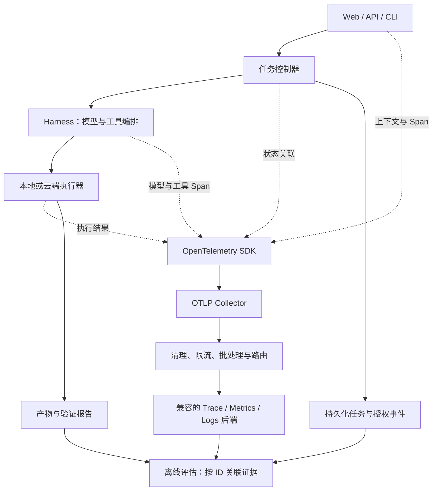

一个 Agent 任务变慢，原因可能是模型生成、工具等待、排队、人工审批，也可能是反复读取同一批文件。只记录最终回答、总 token 和总耗时，无法区分这些问题。**OpenTelemetry 的价值，是把应用、Harness、工具和执行环境的观察连接起来，而不是给 Agent 自动生成一个可信分数。**

本文以 GitHub Copilot App 的 OTel 更新为切入点，说明可复用的数据模型、采集管道、跨进程传播和验证方法。文中的 `app.*` 字段、任务模型与示例程序属于工程设计，不是 GitHub 官方 Trace Schema。

## 1. GitHub 的更新到底提供了什么

2026 年 9 月 22 日，GitHub 宣布 Copilot App 可以通过企业 `managed-settings.json` 的 `telemetry` 设置导出 Agent 活动数据，跟踪会话中的模型请求与工具调用，并送往兼容的监控系统。Prompt 和 Response 内容默认不采集。[1]

这项发布证明了三个能力：企业集中配置、执行调用关联、监控后端集成。它没有承诺自动记录所有环境状态、所有授权依据，更没有承诺提供因果归因或任务正确性判断。**“接入 OTel”与“拥有完整执行审计”之间，仍有数据建模与验证工作。**

Copilot SDK 的公开文档又提供了应用层接入方式：通过 `TelemetryConfig` 配置导出，并在 SDK 与 CLI 的 JSON-RPC 交互中传播 W3C Trace Context。Node.js 应用需要在相应路径注入或恢复上下文；不同语言的集成方式有差异。[2]

这里描述的是该 SDK 文档中的集成路径，不应推导为所有 Copilot Runtime 部署都必须使用独立 CLI 子进程。

## 2. 三类记录不能混成一个“日志系统”

| 层 | 回答的问题 | 适合保存什么 | 不应承担什么 |
|---|---|---|---|
| 可观测性 | 哪一步慢、失败或反复执行 | Span、事件、指标、关联 ID | 不自动证明业务正确 |
| 任务与授权审计 | 谁批准了什么，实际提交了什么 | 持久化状态、授权事件、产物版本 | 不依赖随机采样保留关键事实 |
| 评估 | 结果是否正确，行为是否满足约束 | Verifier、评分器版本、证据引用 | 不覆盖或修改原始执行记录 |

这是参考分层，不是 OTel 强制规定的业务模型。工程意义是：性能 Trace 可以采用采样、批处理与异步导出；付款、部署、批准和撤销等关键事实，则需要明确的持久化与访问控制保证。

例如，一个工具 Span 显示请求成功，只能证明该段代码观察到了成功。若最终产物未校验，不能据此把任务标记为正确。若工具进程崩溃前来不及导出，Trace 中没有记录也不等于动作没有发生。

## 3. 可复用架构：业务协议不绑定某个监控厂商



OTel Collector 的公开组件模型是 Receiver、Processor、Exporter 等，再通过 `service.pipelines` 启用实际管道。只在顶层声明组件，不代表组件正在处理数据。[3]

可复用之处在于：业务代码发出稳定的观测语义，Collector 负责出口和治理，后端可以更换。但身份鉴别、租户隔离、敏感字段规则和审计保留期，仍要由实际系统设计。

### 对全栈项目具体有什么价值

假设前端显示“正在分析订单”，后端调用模型，模型调用 Shopify 适配器，适配器再访问外部 API。统一 Trace 可以把用户请求与后端等待关联，回答：慢在模型还是 API？重试来自 SDK 还是业务层？用户取消后是否仍有工具运行？

前端呈现任务进度仍应以可信任务状态为准，不能直接把监控 Span 当作唯一业务状态库。Trace 更适合解释问题，而不是代替任务控制器。

## 4. 最小数据模型：关联关系比保存更多文本重要

建议将长任务拆成不同对象：`task_id` 表示用户要完成的工作；`run_id` 表示一次执行尝试；`action_id` 表示工具动作；`artifact_id` 表示版本化产物。它们与 Trace ID 相互引用，不必强行一一对应。

```text
Task：整理季度销售报告
 ├─ Run 1：拉取数据，等待重新授权
 │   └─ Trace A：若干有界执行片段
 └─ Run 2：授权完成后继续
     └─ Trace B：分析、生成、验证
         ├─ Tool action
         ├─ Artifact revision
         └─ Verifier result
```

下面是研究用字段清单，**不是统一标准名称**：

| 信息 | 建议记录 | 避免误解 |
|---|---|---|
| 执行身份 | `app.task.id`、`app.run.id`、`app.action.id` | ID 不是权限证明 |
| Harness | 版本、配置摘要、上下文清单引用 | 不必在所有 Span 重复完整 Prompt |
| 工具 | 工具 ID、版本、执行位置、结果类别 | 显示名不等于服务身份 |
| 授权 | 策略版本、批准事件引用、最终决策 | 模型声称获批不算授权证据 |
| 产物 | 产物引用、版本、验证报告引用 | HTTP 200 不代表产物正确 |
| 用量 | 模型、计费类别、请求 ID、输入输出量 | 子 Agent 汇总与叶节点不能重复计数 |

通用模型字段应尽量映射到适用版本的 GenAI 语义约定；业务字段使用自有命名空间。相关标准文档已迁到独立维护位置，升级 SDK 时应固定并检查 Schema，而不是假定不同版本字段永远一致。[7]

## 5. 可以复用的 Collector 与埋点示例

### 5.1 本机、合成数据的最小接收管道

以下配置用于学习 Trace 导出，监听本机回环地址，不接收公网数据，也没有 Metrics 或 Logs 管道。`debug` 会输出所收到的数据，不能直接当作生产脱敏配置。[3]

```yaml
receivers:
  otlp:
    protocols:
      http:
        endpoint: 127.0.0.1:4318
processors:
  memory_limiter:
    check_interval: 1s
    limit_mib: 256
    spike_limit_mib: 64
  batch:
    timeout: 1s
    send_batch_size: 128
exporters:
  debug:
    verbosity: detailed
service:
  pipelines:
    traces:
      receivers: [otlp]
      processors: [memory_limiter, batch]
      exporters: [debug]
```

使用包含上述组件的固定 Collector 发行版，先执行 `otelcol validate --config=otelcol.yaml`。远程部署需要另行设置 TLS、认证、出口及保留策略；容器中的回环地址也不等于宿主机地址。

### 5.2 独立于模型供应商的 Python 工具埋点

安装依赖：

```bash
python -m pip install opentelemetry-api opentelemetry-sdk opentelemetry-exporter-otlp-proto-http
```

下列程序只运行固定测试数据，不调用真实模型或业务 API。正式项目应把通过测试的依赖版本写入锁文件。OTel 的 Provider、Processor 和手工 Span 接口依据 Python 文档组织。[4]

```python
import os
from collections.abc import Callable
from typing import TypeVar
from uuid import uuid4

from opentelemetry import trace
from opentelemetry.exporter.otlp.proto.http.trace_exporter import OTLPSpanExporter
from opentelemetry.sdk.resources import Resource
from opentelemetry.sdk.trace import TracerProvider
from opentelemetry.sdk.trace.export import BatchSpanProcessor
from opentelemetry.trace import Status, StatusCode

T = TypeVar("T")
provider = TracerProvider(resource=Resource.create({"service.name": "agent-study"}))
provider.add_span_processor(BatchSpanProcessor(OTLPSpanExporter(
    endpoint=os.getenv("OTEL_EXPORTER_OTLP_TRACES_ENDPOINT", "http://127.0.0.1:4318/v1/traces"),
    timeout=5,
)))
trace.set_tracer_provider(provider)
tracer = trace.get_tracer("study.agent", "1.0")


def traced_tool(name: str, run_id: str, operation: Callable[[], T]) -> T:
    with tracer.start_as_current_span(
        f"tool.{name}", record_exception=False, set_status_on_exception=False,
        attributes={"app.run.id": run_id, "app.action.id": str(uuid4())},
    ) as span:
        try:
            result = operation()
            span.set_attribute("app.tool.outcome", "completed")
            return result
        except Exception as exc:
            span.set_attribute("error.type", type(exc).__name__)
            span.set_status(Status(StatusCode.ERROR))
            raise


def validate_fixture() -> dict[str, int]:
    values = [2, 3, 5]
    if sum(values) != 10:
        raise ValueError("fixture check failed")
    return {"checks_passed": 1}


def main() -> None:
    run_id = str(uuid4())
    try:
        with tracer.start_as_current_span(
            "task.run", record_exception=False, set_status_on_exception=False,
            attributes={"app.run.id": run_id, "app.task.kind": "fixture-validation"},
        ) as span:
            try:
                result = traced_tool("validate_fixture", run_id, validate_fixture)
                span.set_attribute("app.verifier.checks_passed", result["checks_passed"])
                span.set_attribute("app.task.outcome", "verified")
            except Exception as exc:
                span.set_attribute("error.type", type(exc).__name__)
                span.set_status(Status(StatusCode.ERROR))
                raise
    finally:
        provider.force_flush()
        provider.shutdown()


if __name__ == "__main__":
    main()
```

示例刻意不保存参数、返回正文与异常消息；实际项目中的异常文本可能包含 URL、令牌或业务数据。其他自动埋点库仍需单独检查其内容采集设置。

**本次验证范围：** 程序已在本地运行，并用一个临时 OTLP HTTP 接收器解析实际发送的 Protobuf，确认收到了 `task.run` 与 `tool.validate_fixture` 两个 Span，二者 Trace ID 相同、工具 Span 的 Parent ID 正确指向任务 Span。未在真实 Copilot 租户或生产 Collector 集群中进行端到端测试。

### 5.3 SDK 自带埋点能直接复用，但需要检查接缝

使用 Copilot SDK 时，不必重复实现它已经提供的模型与工具埋点。可以采用文档中的 `telemetry.otlpEndpoint`；若还需要将自己的 HTTP 请求或工具处理器连接进去，再按所用语言配置上下文传播。[2]

需要检查的不是“后台出现了很多 Span”，而是：应用请求、SDK 调用、工具处理器是否属于正确的父子关系。重复手工埋点与自动埋点也可能让同一次模型调用出现两份记录。

## 6. 跨队列与长任务：不能假设上下文自动存在

OTel 的 `inject` 和 `extract` 用于在进程或协议边界传播关联信息。[5] 以消息队列为例，以下是说明性片段，假设 `queue`、`message` 与 `tracer` 由应用提供：

```python
from opentelemetry import propagate

carrier = {}
propagate.inject(carrier)
queue.publish({"task_id": task_id, "trace_context": carrier})

parent = propagate.extract(message["trace_context"])
with tracer.start_as_current_span("task.resume", context=parent):
    resume_task(message["task_id"])
```

仅把 `trace_id` 当字符串塞入 JSON，不足以恢复完整 Span 关系。反过来，收到合法格式的 `traceparent` 也不表示请求已经认证；租户与授权范围必须来自可信连接和服务端检查，不能从 Baggage 直接取来放行。

对等待数小时审批的任务，参考方案是保存业务状态，结束当前有界执行片段，恢复时创建新片段，并通过稳定任务 ID、事件和必要的 Span Link 关联。不要靠一个永不结束的 Span 保存任务生命周期。

## 7. 生产落地的四个易错点

### 采样不是审计保留策略

Head sampling 会在早期舍弃部分 Trace；Tail sampling 可以基于后续结果选择保留，但需要等待、缓存和一致的 Trace 路由。[8] 如果上游已经丢弃相关数据，下游“保留全部错误 Trace”也无法恢复它。

因此，审批、外部写入和撤销记录需要独立的可靠事件通道。与业务事务一致的 Outbox、幂等事件 ID 和受控保留策略，是可采用的工程模式；它们不是 OTel 自动提供的事务保证。

### 隐私应该从采集点处理

OTel 的安全文档强调避免采集不需要的敏感数据，并提供过滤、清理等处理方向。[6] Collector 脱敏属于第二道防线；如果原始秘密已经写进本地控制台或 SDK 队列，后续出口清理并不能抹除前面的暴露。

哈希也不是普遍匿名化：低熵标识可能被枚举，原文被删除后又无法完成语义复查。更合理的方式是把必要原文放入受权限控制的存储，Trace 仅记录引用和分类。

### 指标基数与费用归因需要单独设计

任务 ID 适合放在 Trace 或日志，不适合作为每条时序指标的标签。指标维度应限制在任务类型、工具类别、结果类别等可控集合。

用量数据应先明确记录粒度：若根 Agent 的用量已包含子 Agent，再把子 Span 累加会重复统计。缓存输入、普通输入、输出与不同供应商的价格也不能用“总 token × 一个价格”统一计算。会话用量事件更适合调试和分摊分析，最终账单仍需单独对账。

### 看见调用链，不等于得到因果证明

一个工具失败后任务也失败，可能是根因，也可能只是共同受上游错误影响。要验证修复是否有效，需要固定输入、环境与版本，进行对照或受控重跑。

并行子调用的耗时也不能直接相加当作用户等待时间；应区分关键路径、总资源消耗、排队和人工等待。

## 8. 验证一个 Trace 方案是否真的可用

| 故障注入 | 检查对象 |
|---|---|
| 一个工具超时后重试 | 能否区分逻辑动作与每次尝试 |
| 子 Agent 与主 Agent 并行 | 父子关系、并行区间和用量是否重复 |
| 队列转发后恢复 | 是否保留关联，是否混淆租户 |
| 用户取消时工具仍在执行 | 控制器取消与执行器终止是否分别可见 |
| 工具报告成功但产物验证失败 | 是否保留两个不同结果 |
| Collector 短暂不可用 | 导出丢失、队列压力与关键审计是否可观察 |
| 参数中放入测试秘密 | 是否在 SDK、控制台、Collector 或后端泄露 |

检测指标应同时包括 Trace 完整率、孤立 Span 比例、导出失败量、归因准确率和观测成本。不能只看仪表盘上“有数据”。

## 结论

OTel 最值得复用的是跨语言关联、标准化传输和可替换的采集管道；Agent 项目需要补的是任务、权限、产物与验证语义。**可观测性说明执行过程，持久化审计保存关键事实，评估判断质量——三者互相引用，但不能互相冒充。**

## 参考资料

[1] GitHub. [OpenTelemetry in the GitHub Copilot app](https://github.blog/changelog/2026-09-22-opentelemetry-in-the-github-copilot-app/). 2026-09-22。

[2] GitHub Docs. [OpenTelemetry instrumentation for Copilot SDK](https://docs.github.com/en/copilot/how-tos/copilot-sdk/observability/opentelemetry).

[3] OpenTelemetry. [Collector configuration](https://opentelemetry.io/docs/collector/configuration/).

[4] OpenTelemetry. [Python instrumentation](https://opentelemetry.io/docs/languages/python/instrumentation/).

[5] OpenTelemetry. [Python context propagation](https://opentelemetry.io/docs/languages/python/propagation/).

[6] OpenTelemetry. [Handling sensitive data](https://opentelemetry.io/docs/security/handling-sensitive-data/).

[7] OpenTelemetry. [Generative AI semantic conventions — moved](https://opentelemetry.io/docs/specs/semconv/gen-ai/).

[8] OpenTelemetry. [Sampling](https://opentelemetry.io/docs/concepts/sampling/).

资料复核与示例验证于 2026-09-30；产品与 SDK 的字段支持应以实际固定版本为准。
