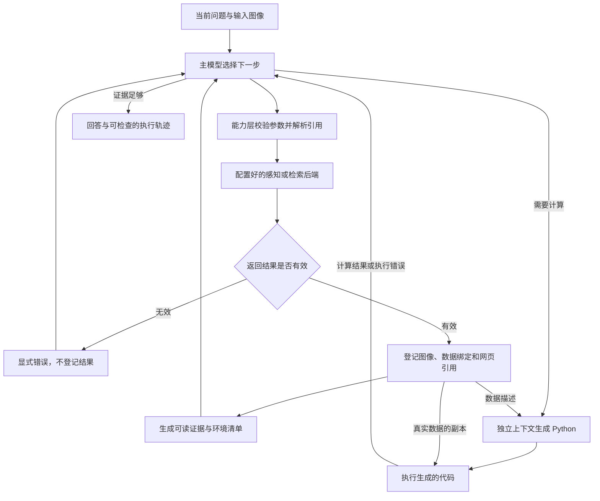

**工具返回了什么，与 Agent 能否继续利用它，是两个问题。** OpenVLHarness 的核心设计，是给模型一份可理解的观察，同时保留底层图像、数组与来源引用，让后续工具和程序继续使用同一份材料。它把视觉任务从“看图后不断补充文字解释”，转为获取、检查和组合证据的过程。

论文于 **2026 年 10 月 19 日**提交。本文核对公开摘要、作者发布的结果数据、运行时文档和源码，代码观察以 **2026 年 10 月 23 日的 `abd465d` 快照**为界。原始 PDF 全文未完整取得，因此下文不声称逐页复核全部实验附录；实验数字属于作者报告，本文没有重新运行基准。[论文摘要](https://arxiv.org/abs/2610.26860) · [代码快照](https://github.com/uclanlp/OpenVLHarness/tree/abd465d1b7271b024d94ff0f0ce8ee7c4242a79a)

## 一、增加工具之前，先解决结果怎样被下一步使用

设想 Agent 要判断一张照片里两件物体哪件更靠近相机。分割工具给出掩码，深度工具给出浮点数组，模型可能只能读懂“检测到两个物体”和一张深度可视化图。如果掩码与数值没有保留下来，下一轮很容易又回到凭文字和图像猜测。

OpenVLHarness 在模型与后端之间加入 **Capability Layer，能力适配层**。它不仅统一参数，还负责验证返回值、登记数据、生成模型可读的图像与说明。**Multimodal Memory，多模态工作记忆**则保留可再次引用的对象；Python 计算工具消费其中的真实数据，而不是从此前回答中重新猜一遍数字。[运行时职责](https://github.com/uclanlp/OpenVLHarness/blob/abd465d1b7271b024d94ff0f0ce8ee7c4242a79a/docs/runtime.md)

这张图展示的是公开运行时的职责关系，不意味着每一个结论都已被外部验证。保存来源使结果可追溯；来源本身是否正确、计算假设是否成立，仍需另外判断。

当前发布包含九种任务级能力：定位与分割、OCR、深度、相机轨迹、裁剪放大、文本搜索、以图搜索、网页访问和 Python 计算。默认后端分别使用 SAM 3、PaddleOCR-VL、Depth Anything 3、Serper 等服务，而非一个模型独自完成所有工作。新增后端需要实现并注册适配器，不是只填一个 URL 就能理解任意接口。[能力与后端清单](https://github.com/uclanlp/OpenVLHarness/blob/abd465d1b7271b024d94ff0f0ce8ee7c4242a79a/README.md)

## 二、能力层真正统一的是结果语义

源码 `BaseCapability.invoke` 的顺序很重要：先拒绝未声明的参数，解析图片或网页引用，再调用具体后端；返回成功后，进行结果校验，随后登记图像、结构化数据与网页引用，最后渲染证据。主模型看到的是任务级能力，底层服务地址和凭据保留在部署配置中。[能力层源码](https://github.com/uclanlp/OpenVLHarness/blob/abd465d1b7271b024d94ff0f0ce8ee7c4242a79a/openvlharness/capabilities/_base.py)

**后端数据与模型观察是两种表示。** 一个深度数组可以以完整数值保存在内存中，同时向模型显示可视化、维度和引用；两种表示对应同一份结果，承担不同职责。把大型数组全部展开进对话既增加负担，也不能保证模型精确计算；只留下摘要又会丢掉后续运算所需的信息。

运行时还明确区分了几种容易混淆的状态：

| 状态 | 当前实现的含义 | 消费方应如何处理 |
| --- | --- | --- |
| 字段为 `null` | 该信息不可用 | 不应改写为零或空结果 |
| 支持的集合返回 `[]` | 已评估，但结果为空 | 可以继续推理，但应保留“没有找到”的范围 |
| 后端结果格式无效 | 返回明确错误 | 不把损坏数组登记成可用证据 |
| 证据渲染器出错 | 可能回退为原始内容，并记录回退状态 | 回退不是同等质量的正常结果 |
| 编码工具返回成功但有 `execution_error` | 调用已返回，Python 计算没有成功完成 | 不能当作计算结论继续使用 |

最后一项可以直接在 `coding.py` 中确认：代码生成返回后，本地执行的超时或异常写入 `execution_error`，并不必然改变外层 `ok`。这不是简单的状态设计错误，而是保留了生成、执行两个阶段的区别；接入方若只统计 `ok=true`，就会把计算失败算进成功率。[编码工具源码](https://github.com/uclanlp/OpenVLHarness/blob/abd465d1b7271b024d94ff0f0ce8ee7c4242a79a/openvlharness/capabilities/coding.py)

还有一个边界：**校验后登记，不等于所有工具都具备事务性的原子提交。** 文档对损坏深度数据给出了明确的登记前检查，但通用实现中的延迟输入加载、登记与归一化仍有各自的失败路径。迁移时应逐类测试错误，不要把某个后端的保证扩展为整个系统的保证。

## 三、“持久记忆”在这里是单个问题的工作区

**每个新问题都会创建新的记忆。** 当前实现保留的是本次推理多轮工具调用间的图像、结构化值和网页引用，不是跨会话的用户画像、知识库或长期学习系统。[记忆与轮次契约](https://github.com/uclanlp/OpenVLHarness/blob/abd465d1b7271b024d94ff0f0ce8ee7c4242a79a/docs/runtime.md)

输入图片得到 `input_image_N`，工具生成的图片得到 `tool_generated_image_N`。掩码、深度数组和相机矩阵成为带描述的数据绑定。环境更新向模型展示当前可以引用的材料；默认网页清单只展示最近20条，较早的引用仍然可解析。**没有显示在最近清单中，不等于对象已被删除。**

这种结构把三件事分开了：对象是否存在，模型当前看到了哪些摘要，以及下一步能否读取底层内容。对多 API Agent，这比一条越来越长的文本历史更便于精确引用，但也产生新的生命周期问题：对象何时过期，引用是否仍有效，不同任务能否访问彼此的材料。

若要将它扩展为多租户服务，本文建议给引用增加任务命名空间、来源调用、内容版本与权限边界。不要把论文中的短句柄直接当作全局数据库主键。**这些是面向服务化的设计建议，不是当前仓库已经提供的租户隔离能力。**

持久性也有细节限制：编码执行读取数据副本，新生成的普通 Python 变量不会自动持久化为下一轮的数据绑定。因此它不是一个任意变量都会累积的长期 Notebook 内核；需要跨步骤保留的结果，必须有明确的注册契约。

## 四、把多个结果组合起来，比给模型更多文本更有价值

以下是依据接口构造的说明性例子，不是本文运行出的实验：图片中的杯子与盒子，哪一个更靠近相机？

定位工具先分别给出对象掩码；深度工具给出与原图关联的深度数组；编码工具收到“比较两个对象区域的稳健深度统计量”这一目标，结合数据描述生成程序。执行端读取真实掩码和数组，过滤无效像素，再比较区域统计量，返回数值、使用范围或错误。

**计算过程可检查，不代表测量天然正确。** 掩码与深度图必须对应同一图像坐标系，裁剪与缩放后的映射需要正确；深度值的方向、单位和尺度也必须先明确。相对深度不能直接报告成米，单目深度与二维位置也不能在没有几何条件时自动得到准确的三维距离。遮挡、反射或分割错误都会影响结果。

这正是证据化运行时的意义：读者可以把“模型判断错误”进一步分解为定位错、坐标映射错、深度估计错、计算错或结论过度外推，而不只看到一句自信的最终答案。

编码能力使用与主模型相同的骨干，但在独立上下文中生成代码。生成端拿到数据描述，执行端拿到真实值；它并不是默认获得主会话的一切信息。因此自然语言计算目标仍需说明必要假设和预期结果。[Python 接口与执行流程](https://github.com/uclanlp/OpenVLHarness/blob/abd465d1b7271b024d94ff0f0ce8ee7c4242a79a/openvlharness/capabilities/coding.py)

## 五、结果支持整体设计，但不能把全部增益归给记忆

作者发布的主结果覆盖22个视觉基准，涉及计数与定位、搜索与研究、通用视觉问答、空间理解。以下是其中三个相同骨干的对比：

| 骨干与配置 | 无工具基线 | OpenVLHarness | 分数差 |
| --- | ---: | ---: | ---: |
| Qwen3-VL-8B | 34.24 | 45.41 | +11.17 |
| Qwen3-VL-32B | 38.30 | 50.92 | +12.62 |
| GPT-6 Luna，medium | 45.76 | 56.52 | +10.76 |

这些是作者对不同基准分数的汇总，**不是生产业务成功率，也不是相对提升百分比**。Qwen 主结果为三次运行均值，GPT-6 结果为单次运行。数值来自作者公开的数据表，不是本文复算的原始预测。[作者结果数据](https://github.com/OpenVLHarness/openvlharness.github.io/blob/main/static/js/data.js) · [结果说明](https://github.com/OpenVLHarness/openvlharness.github.io/blob/main/index.html)

整体比较同时引入了新的证据、工具、适配层和记忆，不能单独归因于某一项。更有解释力的是作者另外报告的**累加式消融**。在 Qwen3-VL-8B 的消融设置中：

| 逐步加入的能力 | 通用视觉问答 | 视觉搜索与研究 |
| --- | ---: | ---: |
| 无工具 | 57.97 | 18.40 |
| 直接接工具 | 52.41 | 21.44 |
| 再加能力层 | 56.05 | 25.97 |
| 再加文本记忆 | 57.54 | 26.92 |
| 再加多模态记忆 | 59.81 | 33.10 |

**工具数量增加，效果可能先下降。** 这组结果提示：给模型新的接口不等于给了可用的证据。与此同时，多模态记忆不是每一列都必然更好；同一8B消融中的定位分数从文本记忆阶段的47.27降到45.46。应根据任务选择表示与工具，而非默认全部开启。[作者消融数据](https://github.com/OpenVLHarness/openvlharness.github.io/blob/main/static/js/data.js)

这些消融按顺序累加组件，并非把所有组合都独立测试的完整析因设计；各阶段差值包含与既有组件的交互。消融中的汇总与主榜不是同一个数字口径，也不能交叉相减。它支持“输出组织和跨步复用值得优化”，不足以证明记忆对所有任务有固定的独立贡献。

比较其他 Harness 时也要保留环境条件：作者将 Codex 配成代码模式，并关闭网页搜索，在这些视觉任务上进行比较。这不是对其完整产品能力或通用软件开发水平的排名。

## 六、37%的成本结论，不能直接拿去做总预算

论文摘要比较的是 **OpenVLHarness 在 medium 推理力度下，与若干基线的 maximum 配置相比的模型 token 成本**。它支持“有针对性地获取证据，可能比一味增加内部推理更划算”，不支持“接入框架以后所有请求都更便宜”。[摘要中的比较范围](https://arxiv.org/abs/2610.26860)

作者公布的同一成本序列还显示：与同为 medium 的裸模型相比，OpenVLHarness 对应数值为0.92对0.58。按这两个公布值计算，模型 token 成本约为 **1.59倍**，同时分数更高。这里比较的是同口径数值的比值；不把它转写成实际业务请求的美元报价。[作者成本数据](https://github.com/OpenVLHarness/openvlharness.github.io/blob/main/static/js/data.js)

部署还涉及感知模型GPU、辅助模型、搜索请求、图片托管、网络传输、评测判定器和运维。即使主模型来自云API，默认搜索能力仍需要辅助Qwen端点。**Training-free 指不微调骨干权重，不代表零部署、单模型或没有额外算力。**[部署要求](https://github.com/uclanlp/OpenVLHarness/blob/abd465d1b7271b024d94ff0f0ce8ee7c4242a79a/README.md)

实践中应同时计量任务质量、端到端延迟、工具故障与总资源费用，并记录缓存和服务并发条件。只比较主模型的输出token，容易把成本转移误认为成本消失。

## 七、复用时先借鉴接口，再决定运行哪些能力

**最值得先迁移的是三份契约：工具结果、对象引用、计算结果。** REST或MCP只是既有工具的接入位置；OpenVLHarness 展示的证据管理方式可以借鉴，但这并不意味着它提出了一个新的MCP协议保证。

小规模试验可以先用一个图像定位任务，验证原图、标注图、结构化坐标与来源调用能否对应；再引入第二种结果，检查程序是否真的读取已保存的数据；最后才扩展搜索、跨模型或更多感知后端。每增加一项能力，都应有一次成功、一种无结果情况和一次故障的测试。

当前调度并不依赖复杂的多Agent并发。模型每轮只允许一个工具调用，同轮多调用会被拒绝；论文预设通常有15轮预算。后端在启动时注册，查询过程中不动态发现。这个设计便于管理顺序和引用，但不能当作任意并行工具编排系统。[调度契约](https://github.com/uclanlp/OpenVLHarness/blob/abd465d1b7271b024d94ff0f0ce8ee7c4242a79a/docs/runtime.md)

实际接入时，以下边界比“能启动Demo”更重要：

| 边界 | 当前发布说明 | 采用时要补的验证 |
| --- | --- | --- |
| 服务健康 | Router健康接口不等于后端模型、搜索凭据都可用 | 实际调用选中的能力，检查降级计数与错误 |
| 代码执行 | Python在宿主子进程中拥有用户的文件和网络权限 | 独立隔离环境、最小凭据与资源权限；超时不等于沙箱 |
| 网络入口 | Router与GPU服务默认无认证，通常绑定回环地址 | 不直接暴露公网；跨机部署加认证和访问控制 |
| 图片流转 | 反向搜图需要外部可获取的图片URL | 使用对象存储时配置生命周期；签名URL过期不等于对象删除 |
| 结果安全 | 模型、搜索、判定服务会收到各自需要的数据 | 明确数据边界，不把客户图片与答案默认发送到所有端点 |

这些限制由项目自己的安全文档披露，不是本文假设发现的新漏洞。[SECURITY.md](https://github.com/uclanlp/OpenVLHarness/blob/abd465d1b7271b024d94ff0f0ce8ee7c4242a79a/SECURITY.md)

对生产多API系统，还有一个需要额外处理的点：运行时会重试部分传输错误。对当前以感知和检索为主的工具，副作用相对有限；迁移到付款、消息发送或数据库写入后，不能原样继承重试策略，必须单独处理幂等与结果不确定状态。这属于跨领域复用的设计要求，不是当前视觉基准验证过的能力。

## 八、可回放、可运行和可复现分数，要分开验收

作者的发布验证使用保存的模型与后端响应，核对重构后的调用、证据、记忆和预测是否一致；同时还跑了小规模真实服务检查。固定响应回放有助于发现运行时回归，但不等于模型再次运行会选择相同工具、得到相同网页或生成相同代码。作者也保留了真实运行中的分数变化和错误，而没有宣称小样本已经证明统计等价。[发布验证记录](https://github.com/uclanlp/OpenVLHarness/blob/abd465d1b7271b024d94ff0f0ce8ee7c4242a79a/docs/validation.md)

复现还存在一个容易踩到的边界：**当前版本要求启用图像记忆，尚未实现直接关闭它的消融路径。** 因此研究中有某个对照配置，不代表公开版本只改一行YAML就能复现该实验。发布验证文档还列出特定协议续接状态的已知限制，提示应用方不能只凭兼容某个API格式就假定行为完全等价。[运行时配置约束](https://github.com/uclanlp/OpenVLHarness/blob/abd465d1b7271b024d94ff0f0ce8ee7c4242a79a/docs/runtime.md)

一个合理的验证顺序是：先使用固定样本检查工具链；再保存完整轨迹与有效配置，建立可回放的运行时回归；最后才在足够的独立样本和重复运行上比较质量、延迟和成本。任何只完成前两步的结果，都不应包装成重新证明了论文的全基准收益。

**OpenVLHarness 最有价值的启发，是把“模型看过某个工具结果”推进到“系统仍能定位、检查并计算那份结果”。** 可读观察、可寻址材料和可执行计算各司其职，工具使用才不必在每一轮重新退回模糊的文字推断。
