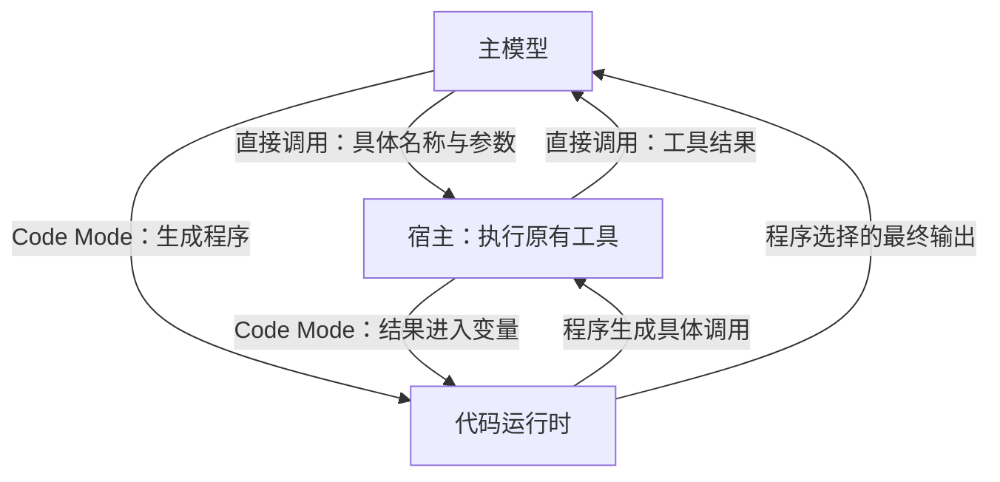

假设有一个任务：**查询所有门店 2026-11-01 的订单，统计已支付金额，返回金额最高的门店。**

现有系统只有两个业务工具：`list_stores` 返回门店列表，`list_orders` 根据门店 ID 和日期返回订单。没有现成的“统计最高门店”接口。现在需要决定：由模型逐步组织这些调用，还是让模型先写一段程序，再由程序组织调用？

**Code Mode 的关键，是允许模型提前表达“拿到数据后如何继续处理”的规则。真实 ID 和订单在程序运行时进入变量，后续调用和计算可以接着完成。**

先用这个任务比较两种过程，再讨论 MCP 和 Pi。示例接口与数据均为教学设定；产品机制依据截至 2026-11-02 的官方文档和源码。

## 1. 传统工具调用：模型生成请求，宿主执行请求

所谓“把工具带入模型”，通常包含两类信息：

- **调用前的工具定义**：名称、用途、参数说明，让模型知道能调用什么、怎样填写参数。
- **调用后的工具结果**：宿主执行请求后，将结果交给模型，让它决定下一步。

工具的函数实现仍在应用程序或远端服务里。模型输出的是一个调用请求，执行请求的是宿主程序，也就是包在模型外面的应用代码。官方工具调用文档明确区分模型返回的 `tool_use` 与应用执行后提供的 `tool_result`。[工具调用机制](https://platform.claude.com/docs/en/agents-and-tools/tool-use/overview)

对上述门店任务，一个支持同轮并行调用的直接调用流程如下。

**第一轮：模型要求获取门店列表。**

模型输出类似下面的调用请求。这里使用概念格式，具体模型 API 的字段可能不同：

```json
{"name":"list_stores","arguments":{}}
```

宿主执行工具，得到 A、B、C 三家店及各自的 ID，然后把列表交回模型。

**第二轮：模型根据刚看到的 ID，生成三条订单查询请求。**

它现在可以填写 `storeId: "A"`、`"B"`、`"C"`。这三条请求可以在同一轮产生，由宿主并行执行。完成后，三家店的订单明细被交回模型。

**第三轮：模型阅读订单结果，完成筛选、合计和回答。**

在这个只提供两个原子工具的基线里，模型需要处理订单状态、金额和门店对应关系。如果宿主另有计算工具，也可以再委托计算；如果宿主已经实现汇总，流程还可以进一步缩短。

这里暴露出的核心问题是：**为了继续查询和计算，门店 ID 与订单明细都经过了主模型上下文；其中一部分工作其实已经有明确规则。**

MCP 或工具调用协议并不强制客户端完整回传原始结果。这里比较的是常见的“原子工具结果直接回传模型”方式，已有裁剪、批处理或汇总的实现应作为更强的基线。

## 2. Code Mode：模型先写出处理规则

现在给宿主增加一个能够执行代码的工具，例如 `execute_code`。模型仍可通过普通工具调用接口使用它，只是这次提交的是程序。

模型在第一次生成时就可以写下：

```javascript
const stores = await tools.list_stores({});
const totals = await Promise.all(stores.map(async (store) => {
  const orders = await tools.list_orders({
    storeId: store.id, date: "2026-11-01"
  });
  const paidCents = orders
    .filter((order) => order.status === "paid")
    .reduce((sum, order) => sum + order.amountCents, 0);
  return { storeId: store.id, name: store.name, paidCents };
}));
totals.sort((a, b) => b.paidCents - a.paidCents);
return { checkedStores: totals.length, topStore: totals[0] ?? null };
```

这里的 `tools.*` 是宿主提供的业务工具代理，示例假设代理已将返回值转换成数组。它们不是 Pi 内置的业务工具。金额使用整数分；本例假设接口已知、三家店的数据全部读取成功且没有分页。

程序运行时，普通 JavaScript 执行器完成这些操作：

1. 调用 `list_stores`，把门店列表放进 `stores`。
2. 从每个 `store.id` 取出真实 ID，继续调用订单工具。
3. 在内存中筛选已支付订单，并用 `reduce` 求和。
4. 排序后，只输出最高门店和覆盖门店数。

**模型写这段程序时，完全可以还不知道 A、B、C 三个 ID。它只需要知道：门店对象有 `id`，订单接口接受 `storeId`，订单里有状态和金额。**

这与开发者先写 `for (const item of items)`，再在运行时接收真实数据是同一个原理。模型描述处理方法，执行器把真实数据代入方法。

在示例数据中，A、B、C 的已支付金额分别是 200 元、270 元、340 元。程序给主模型的结果可以只有：

```json
{"checkedStores":3,"topStore":{"storeId":"C","name":"C店","paidCents":34000}}
```

主模型随后将其表达为“C 店最高，已支付金额 340 元，共检查 3 家门店”。

**订单仍然被查询和处理，只是它们主要在执行环境中流转。主模型阅读的是计算结果。** 程序内部的循环、属性读取和求和不会逐条触发新的语言模型推理；如果程序显式调用其他模型服务，则另当别论。[程序化工具调用机制](https://platform.claude.com/docs/en/agents-and-tools/tool-use/programmatic-tool-calling)

## 3. 同一个任务，实际改变了哪些东西

| 对比项 | 原子工具结果直接回传模型 | Code Mode |
| --- | --- | --- |
| 模型生成的内容 | 一次或一批具体调用及参数 | 带变量、循环、分支与计算的程序 |
| 下一步的门店 ID | 模型读到 ID 后写入新请求 | 程序从 `store.id` 读取 |
| 中间订单明细 | 交回主模型，供其继续处理 | 留在执行环境，按规则处理 |
| 后续调用由谁推进 | 模型的下一轮输出 | 已生成程序的控制流 |
| 示例中的业务工具调用 | 4 次：1 次门店查询、3 次订单查询 | 同样 4 次 |
| 示例中的主模型生成 | 理想流程为 3 轮，含最终回答 | 理想流程为 2 轮，含最终回答 |
| 新增责任 | 宿主分发调用与处理结果 | 还需要执行器、工具代理及程序失败处理 |

这里的轮次只针对接口已知、没有重试和额外确认的教学流程。即使有 100 家店，传统方式也可能把 100 条查询放在同一轮中发出；不能写成必然需要 100 轮推理。Code Mode 的程序则能用同一个循环表达任意长度的门店列表。

下面把两条路径放到同一张图里。箭头表示调用或结果流向，网络传输细节省略：



**新增的能力在经过代码运行时的这条路径：工具结果可以先回到程序，由程序继续推进工作。** 主模型仍决定规则和解释结果；工具系统仍执行原来的业务操作。

## 4. 设计思想：把一次决策扩展成可执行的处理过程

### 用变量连接尚未发生的调用

普通原子调用请求表达的是一个具体动作，例如“用 A 店的 ID 查订单”。

程序还能表达一个规则：“对查询结果里的每家店，使用它的 ID 查订单”。调用数量、实际参数和部分分支可以等到运行时确定。

这让模型在还没有真实数据时，就能交付后续的处理方法。程序变量负责把结果传给下一步，减少模型反复读取和重新生成相同标识符的必要。

### 把明确规则交给确定性计算

比较数字、遍历列表、求和、去重、排序和关联 ID，都有稳定的程序表达。执行器按生成的程序计算，模型不必依靠逐 token 生成来承担这些中间步骤。

但程序的确定性只意味着“按这段代码执行”。模型仍可能写错字段、混淆单位、漏掉分页，或误解“已支付”的业务定义。可靠性取决于规则是否正确、输入契约是否明确，以及失败是否被保留下来。

### 在进入模型上下文之前整理数据

在门店例子中，问题只需要最高门店和金额，完整订单并不都具有同等的推理价值。程序可以先处理原始数据，再输出决定下一步所需的信息。

这与数据库先过滤、聚合，再把查询结果交给应用的思想相近。不过程序筛选规则同样需要核验：返回“全部正常”却丢掉读取失败的门店，会让模型对覆盖范围产生误判。因此输出应包含必要的来源 ID、覆盖数量和失败项。

### 分开工具完成与模型继续推理的时机

工具返回后，有时可以依据已经写好的规则继续，有时需要新的理解。

- 若拿到订单后只需判断金额是否超过阈值，程序可以继续。
- 若拿到客户留言后，要判断真正的不满原因再决定调查方向，就需要模型或其他语义判断服务。

**判断标准是“下一步能否由已知规则决定”。** 有数据依赖的串行流程也可以由代码推进；需要新的语义判断时，即使工具很少，也仍应回到模型。

## 5. MCP 处在哪一层

MCP 规范定义了工具发现、调用和结果交换。例如，客户端用 `tools/list` 获取工具定义，再用 `tools/call` 发送名称和参数。MCP 官方明确说明，它不规定应用如何使用模型或管理这些上下文。[MCP 架构](https://modelcontextprotocol.io/docs/2026-07-28/learn/architecture) · [工具协议](https://modelcontextprotocol.io/specification/2026-07-28/server/tools)

因此，同一个 MCP 工具可以供两种调用方式使用：

- **直接调用**：模型生成名称和参数；宿主通过 MCP 调用服务；结果交回模型。
- **Code Mode**：程序调用宿主注入的代理函数；宿主仍通过 MCP 调用服务；结果先返回程序，程序处理后再输出给模型。

脚本中的 `tools.list_orders(...)` 可以理解为一个代理函数。它把名称和参数交给宿主，宿主完成校验并调用现有 MCP 客户端，取得结果后再兑现脚本等待的 promise。实际业务实现不必复制进脚本。

**MCP 服务可以保持不变。主要变化发生在宿主如何组合工具，以及把哪些信息交给模型。**

模型依然需要接口说明才能正确编程。将全部接口一次性写入代码工具描述，工具定义的上下文开销依然存在；按需搜索和读取接口是另一项可配合使用的设计。[Cloudflare 服务端模式](https://developers.cloudflare.com/agents/model-context-protocol/guides/build-codemode-mcp-server/)

## 6. 已有脚本、业务工具和工作流，能否做到同样的事

可以。这正好有助于理解 Code Mode 的位置。

如果开发者已经提供 `get_top_paid_store(date)`，它在服务器里完成统计，模型调用一次就能获得结果。这样的稳定业务接口通常更容易测试、优化和复用。也应优先利用数据库或源 API 已有的过滤与聚合能力。

Code Mode 更有价值的情况是：**已有许多原子能力，临时需求的组合方式不断变化，还没有对应的复合接口。** 模型可根据当前任务组合它们，无需开发者为每一种组合提前增加一个工具。

Bash、Python 脚本与 SDK 同样能实现循环和筛选。Code Mode 进一步把程序与现有工具目录、认证和执行链连接起来，让模型生成的脚本复用这些接入能力。

JSON 也能描述带变量引用、条件分支的工作流，只要宿主有相应解释器。真正影响能力的是运行时能解释多大的执行过程，以及中间结果如何处理。JavaScript、Python 提供了现成的语言机制；选择代码形式还利用了模型已有的代码生成能力。[CodeAct 论文](https://proceedings.mlr.press/v235/wang24h.html)

## 7. 理解这些原理后，再看 Pi 的设计

Pi 将上述运行层放在 harness 一侧：模型生成 JavaScript，QuickJS/WASM 执行程序，`tools.*` 进入既有工具分发链。它将“工具怎么接入”和“工具之间怎么组合”连接在一起。[Pi Codemode 文档](https://pi.dev/docs/latest/codemode)

Pi 早期偏好极简工具与 CLI；后来引入 MCP 与 Codemode，理由包括工具组合困难、面向阅读的文本结果不利于程序处理，以及工具装载层需要支持按需发现和不同暴露方式。这是它选择修改底层执行机制的背景。[设计说明](https://earendil.com/posts/you-said-no-mcp/)

Pi 的几个具体设计，现在就能对应到明确的问题：

| Pi 设计 | 对应的问题 |
| --- | --- |
| 受限 QuickJS 执行环境 | 让程序处理变量与控制流，同时限制其直接接触宿主的能力 |
| `tools.*` 与嵌套调用链 | 复用原有工具，继续经过参数校验、事件和扩展钩子 |
| 按需查看工具描述 | 避免为当前任务加载完整接口目录 |
| 显式输出 | 决定哪些中间结果进入主模型上下文 |
| 会话中的 `store()` | 在分开的脚本调用之间保留必要的小型状态 |

依据：[工具发现与暴露](https://pi.dev/docs/latest/mcp)、[嵌套调用](https://pi.dev/docs/latest/extensions#calling-other-tools)、[集成执行源码](https://github.com/earendil-works/pi/blob/c9f4c7b9fcd0f3e6b5bbc35c7c9b6cda35580eb8/packages/coding-agent/src/extensions/codemode/execute.ts)。

独立的 `pi-codemode` 包还可供其他应用复用。它的接口 schema 主要用于生成声明，调用方需要自己接好实际参数校验和业务授权；Pi 的集成层通过原有执行链提供相应接入。[独立包](https://github.com/earendil-works/pi/blob/c9f4c7b9fcd0f3e6b5bbc35c7c9b6cda35580eb8/packages/codemode/README.md)

## 8. 适用范围：明确规则多，回传信息少

这个设计最适合批量查询、跨接口关联、分页采集、筛选和统计等任务。其收益来自减少主模型读取的中间数据，以及减少规则明确的步骤之间的推理。

查询单个工单状态时，直接调用通常已足够。每一步都需要重新理解自然语言时，程序只能承担其中的取数和整理。脚本生成、运行和修复也有成本，不能仅按工具数量判断是否划算。

权限与失败处理仍由实际执行链承担。沙箱内没有直接网络或文件接口，不代表被注入的工具没有这些能力；外部操作也不会因为脚本随后失败而自动撤销。[Pi 安全说明](https://pi.dev/docs/latest/security) · [执行与取消语义](https://github.com/earendil-works/pi/blob/c9f4c7b9fcd0f3e6b5bbc35c7c9b6cda35580eb8/packages/codemode/README.md#results)

在工程上，可以先保留原有工具调用方式，把“按明确规则完成一组动作”的部分交给代码，再对同一批任务比较结果正确性、模型输入输出、耗时和重试开销。

<details>
<summary>行业方案分别怎样实现这层能力</summary>

| 方案 | 主要实现位置 | 理解它时应关注 |
| --- | --- | --- |
| Pi Codemode | harness 接入的 QuickJS/WASM 环境 | 工具调用与会话机制如何复用 |
| Cloudflare Code Mode | 默认隔离 Worker，可置于 Agent 侧或 MCP 服务端 | 谁提供执行器、接口目录和按需搜索 |
| Anthropic PTC | 托管 Python 容器 | 程序如何等待客户端工具结果并继续 |
| smolagents CodeAgent | Python 执行器 | 如何以代码表达动作，以及所选执行器的边界 |

Cloudflare 的服务端 `search/execute` 让普通 MCP 客户端也能使用代码编排。其新 durable runtime 还提供调用日志、审批重放与补偿，这些能力不自动属于所有简单包装器。[服务端接口](https://developers.cloudflare.com/agents/model-context-protocol/guides/build-codemode-mcp-server/) · [runtime 机制](https://developers.cloudflare.com/agents/tools/codemode/how-it-works/)

Anthropic 的 PTC 遇到客户端工具调用时，会暂停代码执行并经 API 等待应用回传结果；随后代码继续。当前文档限制平台 MCP connector 工具直接参与 PTC，应用自行封装 custom tools 是另一条路径。[PTC 文档](https://platform.claude.com/docs/en/agents-and-tools/tool-use/programmatic-tool-calling)

smolagents 通过 `CodeAgent` 生成 Python 动作，并提供不同的执行器选择。[框架导览](https://huggingface.co/docs/smolagents/guided_tour) · [执行器边界](https://huggingface.co/docs/smolagents/tutorials/secure_code_execution)

这些方案共享“模型生成处理方法、运行时执行方法”的思想，差异集中在运行位置、工具适配、状态和治理能力。

</details>

<details>
<summary>复核示例与证据范围</summary>

示例金额使用整数分。用于检验代码的合成数据是：

| 门店 | 已支付订单 | 其他订单 | 应计入的金额 |
| --- | --- | --- | --- |
| A 店 | 12000、8000 分 | 已取消 30000 分 | 20000 分 |
| B 店 | 9000、18000 分 | 无 | 27000 分 |
| C 店 | 22000、12000 分 | 无 | 34000 分 |

门店查询 1 次，订单查询 3 次，最终输出 C 店、34000 分、覆盖 3 家店。还应检查空门店列表及请求失败等边界；生产实现需要补齐分页、字段校验和并发限制。

本文以官方协议、产品文档和静态源码为依据。Pi 源码固定在提交 `c9f4c7b9fcd0f3e6b5bbc35c7c9b6cda35580eb8`。教学代码的合成数据检验不等同于真实 Pi、MCP 服务或跨产品性能测试；表中的模型轮次是所示理想流程的计数。

</details>
