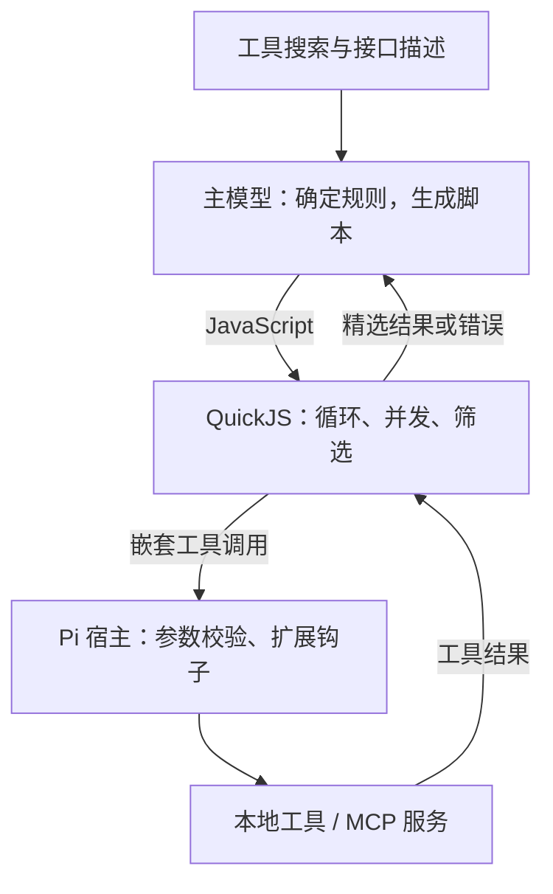

**Pi Codemode 让模型生成一段工具编排程序，把循环、并发、数据拼接与筛选放进运行时，再把必要结果交回模型。** 它改变了工具调用与模型推理的分工：已知规则可以连续执行，需要理解和判断时再进入下一轮推理。

本文研究 Pi 官方内置 Codemode，以 **2026-11-02** 可访问的文档及源码为依据。重点是设计背景、运行机制和行业方案差异；源码细节与最小示例放在文末。

## 为什么 Pi 从极简工具走向 MCP + Codemode

Pi 早期围绕 `read / bash / edit / write` 构建。Mario Zechner 在 2025-11-30 的文章中反对内置 MCP，主要理由是大量工具定义挤占上下文，CLI 与按需读取的 README 更容易组合。[早期设计说明](https://mariozechner.at/posts/2025-11-30-pi-coding-agent/)

2026-09-29，Pi 0.99.0 同时引入内置 MCP、Codemode 和工具搜索。团队随后解释：MCP 的组合能力仍受工具设计限制，许多服务只返回面向模型阅读的文本；他们希望工具更接近“可发现、有结构化结果的 API”，并让 harness——管理模型、工具与会话的宿主程序——支持不同的工具暴露方式。[版本记录](https://pi.dev/changelog/releases/0.99.0) · [设计动机](https://earendil.com/posts/you-said-no-mcp/)

这次变化集中处理三种开销：

| 遇到的问题 | 对应设计 | 实际改变 |
| --- | --- | --- |
| 工具很多，定义全部进入上下文 | 按需搜索与读取接口描述 | 模型只加载当前需要的接口 |
| 批量读取后，只需要少量字段或统计量 | 在脚本中筛选、聚合，再输出 | 中间数据留在执行环境 |
| 已知规则仍反复交给模型推进 | 用循环、分支、并发表达执行过程 | 减少机械步骤之间的推理往返 |

**MCP 负责连接工具，Codemode 负责组合工具，工具搜索负责控制接口信息何时进入上下文。** 三者可以配合，也可以分别使用。Pi 的 Codemode 同样能编排本地工具，不要求先配置 MCP。[CLI 文档](https://pi.dev/docs/latest/cli)

## 一段脚本，跨过多次工具调用

Pi 将脚本放在 harness 侧的受限 QuickJS/WASM 环境中运行。脚本调用宿主注入的 `tools.*`；实际工具可以访问本地工作区，也可以连接远端服务。主模型接收脚本输出，以及执行状态与错误信息。[Codemode 文档](https://pi.dev/docs/latest/codemode)



*图示为 Pi 集成层的职责概括。扩展钩子能承载权限策略，具体策略取决于宿主配置。*

**示例：汇总多个项目中超期且高优先级的工单。** 假设接口返回项目 ID、工单状态、截止时间和优先级，规则已经明确。脚本可以先查询项目列表，再批量获取工单，比较时间与优先级，最后返回候选项、来源 ID 和失败项目。项目列表和所有工单详情无需全部进入主模型上下文。

这里仍会发生真实的 API 调用。普通 tool calling 也能在一轮中并行发起多个调用；Codemode 进一步允许代码处理依赖关系与中间结果。因此收益不能按“调用了多少工具，就省了多少轮模型”计算。

如果任务改成“识别客户是否真的不满”，规则中就出现语义判断。Pi 提供 `models.classify()`，可把批量分类交给专用模型，主模型再解释筛选后的结果；这会产生下游模型调用及费用。当前脚本也支持图像生成，但不能通过 `models` 调用任意聊天模型。[模型桥接源码](https://github.com/earendil-works/pi/blob/c9f4c7b9fcd0f3e6b5bbc35c7c9b6cda35580eb8/packages/coding-agent/src/extensions/codemode/execute.ts)

**因此，结果筛选应同时保留判断所需的证据。** 只输出一句“全部正常”，会把漏查、失败和缺失字段一起隐藏。更有用的输出是结论、覆盖范围、失败项，以及可继续查询的记录 ID。

## 工具发现和代码执行，各控制一条边界

Pi 的默认 MCP 暴露方式是 `codemode`：工具可由脚本调用，但不会把完整目录直接放进模型请求或 Codemode 描述。脚本通过 `searchTools()`、`describeTool()`、`describeNamespace()` 等接口按需查看；`ALL_TOOLS` 也可用于程序化筛选。另一个工具 `tool_search` 能将匹配结果加载成模型随后可直接调用的工具。[MCP 文档](https://pi.dev/docs/latest/mcp)

这意味着“模型此刻看见哪些接口”和“宿主允许执行哪些动作”需要分别设计。只隐藏工具声明，不能承担业务授权。

Pi 还保留两种使用方式：`codemode.mode: "on"` 允许直接工具与脚本共存；`"only"` 让相应工具统一从脚本进入。对少量简单调用，直接使用工具通常更清楚；代码编排适合吸收批量处理块。[工具定义源码](https://github.com/earendil-works/pi/blob/c9f4c7b9fcd0f3e6b5bbc35c7c9b6cda35580eb8/packages/coding-agent/src/extensions/codemode/tool.ts)

## 行业方案：共同方向，不同的运行位置

“用代码表达 Agent 动作”已有研究与工程积累。ICML 2024 的 CodeAct 探索以 Python 统一动作空间；Cloudflare 于 2025-09 发布 Code Mode；Anthropic 在同年 11 月讨论代码与 MCP 的组合，并推出 Programmatic Tool Calling（PTC）。Pi 将这一模式整合到自身工具装载和会话体系中。[CodeAct](https://proceedings.mlr.press/v235/wang24h.html) · [Cloudflare 原始公告](https://blog.cloudflare.com/code-mode/) · [Anthropic 发布说明](https://www.anthropic.com/research/advanced-tool-use)

| 方案 | 程序在哪里运行 | 主要解决什么 | 选择时需要区分 |
| --- | --- | --- | --- |
| **Pi Codemode** | harness 接入的 QuickJS/WASM 沙箱；默认 CLI 使用 worker | 组合本地工具、MCP 和专用模型，控制主模型所见结果 | 复用 Pi 的工具与会话机制；也有独立包 |
| **Cloudflare Code Mode** | 默认隔离 Worker；可放在 Agent 侧或 MCP 服务端 | 将 API 能力组织成代码接口，支持大目录的按需发现 | 简单代码工具包装与 durable runtime 能力不同 |
| **Anthropic PTC** | Anthropic 托管的 Python 容器 | 在代码中调用自定义工具，处理结果后再交回 Claude | 工具执行仍需客户端/API 回传；有平台接口限制 |
| **smolagents CodeAgent** | Python 执行器，可选本地受限执行或隔离环境 | 将代码作为 Agent 的动作表达形式 | 执行器与隔离配置决定能力边界 |
| **Bash / CLI / 脚本** | 工具所在的操作系统或容器 | 管道、批量处理、已有命令与程序复用 | 认证、结果格式、工具审计与状态需要自行整合 |

表中机制依据：[Pi 独立包](https://github.com/earendil-works/pi/blob/c9f4c7b9fcd0f3e6b5bbc35c7c9b6cda35580eb8/packages/codemode/README.md)、[Cloudflare 机制](https://developers.cloudflare.com/agents/tools/codemode/how-it-works/)、[PTC 文档](https://platform.claude.com/docs/en/agents-and-tools/tool-use/programmatic-tool-calling)、[smolagents 导览](https://huggingface.co/docs/smolagents/guided_tour)与[执行器说明](https://huggingface.co/docs/smolagents/tutorials/secure_code_execution)。Bash 行是对传统脚本组合方式的工程归纳。

**Cloudflare 最值得对照的是服务端形态。** 大型 API 可对 MCP 客户端只暴露 `search` 与 `execute`，把接口目录和代码运行环境留在服务器。客户端即使没有 Pi 式沙箱，也能使用这种模式。另一种单一 `code` 工具包装仍会在描述中附带上游类型，所以“工具数量少”本身不保证定义上下文很小。[服务端模式](https://developers.cloudflare.com/agents/model-context-protocol/guides/build-codemode-mcp-server/)

**Anthropic 的架构文章与 PTC 产品要分开理解。** 前者讨论用执行环境连接 MCP、按需读取接口；后者通过 `allowed_callers` 允许自定义工具被 Python 调用。程序遇到客户端工具时暂停，应用回传结果后继续，减少的是模型推理往返。当前 PTC 文档明确，平台 MCP connector 提供的工具不能直接被程序化调用；自行包装成 custom tools 是另一条集成路径。[架构文章](https://www.anthropic.com/research/code-execution-with-mcp) · [产品接口](https://platform.claude.com/docs/en/agents-and-tools/tool-use/programmatic-tool-calling)

## 运行时边界，决定了能否可靠使用

**沙箱限制脚本直接能力，宿主约束工具实际能力。** QuickJS 内没有直接文件、网络或 Node API；但脚本若能调用 `bash` 或某个写入工具，就能通过它产生相应效果。Pi 官方也明确默认不会逐次询问工具审批。其嵌套调用复用参数校验与扩展钩子，具体授权、隔离和审批仍需要相应配置。[安全说明](https://pi.dev/docs/latest/security) · [嵌套工具调用](https://pi.dev/docs/latest/extensions#calling-other-tools)

**脚本失败不会撤销已经完成的外部操作。** Pi 仅在脚本成功时提交这一轮 `store()` 变更；文件修改、消息发送等外部效果没有因此获得事务性。对未等待的调用，结束时会发出取消信号，远端是否已生效仍需核实。[执行源码](https://github.com/earendil-works/pi/blob/c9f4c7b9fcd0f3e6b5bbc35c7c9b6cda35580eb8/packages/coding-agent/src/extensions/codemode/execute.ts)

**持久状态、审批恢复和事务是三种能力。** Cloudflare 当前 durable runtime 已有调用日志、审批后的重放和补偿机制；这些能力不能自动归给简单包装器。其补偿依赖 connector 的 `revert`，不提供跨服务事务。Pi 独立包也提供确定性运行原语，宿主仍需建立持久日志与恢复策略。[Cloudflare runtime](https://developers.cloudflare.com/agents/tools/codemode/how-it-works/) · [Pi 确定性运行](https://github.com/earendil-works/pi/blob/c9f4c7b9fcd0f3e6b5bbc35c7c9b6cda35580eb8/packages/codemode/README.md#deterministic-runs)

**性能收益取决于任务形态。** Cloudflare 的约 99.9% 数字比较的是完整 API 定义与 `search/execute` 初始接口的 token 占用。Anthropic 当前内部评测中，75 工具项目管理任务的输入 token 约减少 38%；每轮一两个顺序调用的 τ²-bench 成本却约增加 8%，准确率均未改变。分母和工作负载不同，不能据此排列产品性能，也不能外推为 Pi 的实测收益。[Cloudflare 测量口径](https://blog.cloudflare.com/code-mode-mcp/) · [PTC 适用性与评测](https://platform.claude.com/docs/en/agents-and-tools/tool-use/programmatic-tool-calling#token-efficiency)

## 可借鉴的设计：把模型留在有判断价值的位置

从这些实现可归纳出三条工程原则：

1. **让工具结果首先能被程序稳定处理。** 明确字段、分页、错误和截断语义。长篇文本可以辅助阅读，稳定的结构化数据更便于组合；能在源 API 查询时过滤的数据，应优先在那里过滤。
2. **将代码编排作为局部执行块。** 批量读取、去重、关联、统计可进入脚本；遇到新的语义判断、重大不确定性或需要用户决定的节点，再回到模型与交互流程。
3. **在每个实际动作上保留治理能力。** 工具调用链应继续校验参数、身份与权限，记录结果和失败。返回给模型的摘要要保留证据入口；重复写入则需要明确幂等键、提交状态或补偿方法。

Codemode 的适用信号是：**中间操作多、规则明确、最终需要模型阅读的信息少。** 它将上下文使用从“工具返回什么就读取什么”，推进到“为下一次判断选择需要的信息”。

<details>
<summary>展开：Pi 的实现层次、状态与错误语义</summary>

### 三层职责

| 层次 | 职责 |
| --- | --- |
| `@earendil-works/pi-codemode` | 独立执行库：QuickJS/WASM、注入函数、输出、取消、store 变更；不依赖 Pi 或 MCP |
| Pi Codemode extension | 提供会话工具与发现接口，接入执行链、模型服务、计费和会话状态 |
| MCP extension | 负责服务连接、认证、工具注册及暴露配置 |

默认 Node/Bun 执行每次创建新的 worker 与 VM。普通 JavaScript 变量不会跨调用保留。Pi 将显式的 `store()` 变更写入会话记录，恢复或切换分支时按该分支路径重建；独立包只返回 `storeWrites`，持久化由宿主完成。[独立包说明](https://github.com/earendil-works/pi/blob/c9f4c7b9fcd0f3e6b5bbc35c7c9b6cda35580eb8/packages/codemode/README.md) · [集成实现](https://github.com/earendil-works/pi/blob/c9f4c7b9fcd0f3e6b5bbc35c7c9b6cda35580eb8/packages/coding-agent/src/extensions/codemode/execute.ts)

**结构声明与运行时校验分别实现。** 独立包的 JSON Schema 用来生成 TypeScript 声明，并不验证实际值。Pi 集成通过 `ctx.executeTool()` 走原有校验与 hooks；自行嵌入时应在工具分发层补齐这些行为。[类型定义](https://github.com/earendil-works/pi/blob/c9f4c7b9fcd0f3e6b5bbc35c7c9b6cda35580eb8/packages/codemode/src/types.ts)

返回值也要按工具契约理解：内置 `read` 可返回文本；`bash` 有 `exit_code`；MCP 返回 `CallToolResult`，需检查 `isError` 与 `structuredContent`；分类模型有 `stopReason`。参数非法、被阻止、执行异常和业务失败并不全部表现为同一种 promise rejection。`Promise.allSettled()` 保留已完成项，但 `fulfilled` 仍可能装着业务错误。[Codemode 文档](https://pi.dev/docs/latest/codemode) · [结果转换源码](https://github.com/earendil-works/pi/blob/c9f4c7b9fcd0f3e6b5bbc35c7c9b6cda35580eb8/packages/coding-agent/src/extensions/codemode/execute.ts)

嵌套调用有 `parentToolCallId` 和执行事件，父结果保留有大小限制的调用摘要。原始结果不默认逐条进入主模型上下文，也不能据此推断所有原始结果都会完整持久化。[嵌套调用记录源码](https://github.com/earendil-works/pi/blob/c9f4c7b9fcd0f3e6b5bbc35c7c9b6cda35580eb8/packages/coding-agent/src/core/nested-tool-calls.ts)

</details>

<details>
<summary>展开：最小使用示例</summary>

单次启用：

```bash
pi --tools +codemode
```

保持默认工具，并为后续会话加入 Codemode：

```json
{
  "defaultTools": ["+codemode"]
}
```

配置位置为用户的 `~/.pi/agent/settings.json`，或受信任项目的 `.pi/settings.json`。配置采用默认 `codemode` 暴露的 MCP 服务时，MCP 扩展会按配置启用 Codemode；服务连接成功后，其工具才能实际调用。[启用说明](https://pi.dev/docs/latest/cli#enable-codemode)

下面是**教学示例**：假设三个小型 JSON 文件都包含 `{service, errorRate}` 数组，读取结果完整，`errorRate` 是 0–1 的比例。脚本只返回错误率超过 1% 的服务，以及读取或解析失败的文件。示例按官方文档编写，未在真实 Pi 环境执行。

```javascript
const paths = ["api.json", "search.json", "worker.json"];
const results = await Promise.allSettled(
  paths.map(async (path) => {
    const rows = JSON.parse(await tools.read({ path }));
    return rows
      .filter((row) => row.errorRate > 0.01)
      .map(({ service, errorRate }) => ({ service, errorRate }));
  })
);
text(results.map((r, i) => r.status === "fulfilled"
  ? { path: paths[i], alerts: r.value }
  : { path: paths[i], error: String(r.reason) }));
```

用于大型输入时，应处理分页、截断与 schema 校验；只读批量任务也需要并发上限和超时。需要写入的流程，应在每次实际工具调用前校验权限，并设计重复执行的行为。

</details>

<details>
<summary>展开：阅读路径与证据范围</summary>

- **设计背景**：[Pi 早期极简设计](https://mariozechner.at/posts/2025-11-30-pi-coding-agent/) → [0.99.0 发布记录](https://pi.dev/changelog/releases/0.99.0) → [为什么引入 MCP](https://earendil.com/posts/you-said-no-mcp/)。
- **运行机制**：[Codemode](https://pi.dev/docs/latest/codemode)、[MCP](https://pi.dev/docs/latest/mcp)、[扩展工具链](https://pi.dev/docs/latest/extensions)、[安全边界](https://pi.dev/docs/latest/security)。
- **源码快照**：`earendil-works/pi` 的提交 `c9f4c7b9fcd0f3e6b5bbc35c7c9b6cda35580eb8`；截至核查日可见正式发布为 [1.4.0（2026-10-21）](https://pi.dev/changelog/releases/1.4.0)。本文当前源码细节不等同于对每个历史版本的保证。
- **行业路线**：[CodeAct 论文](https://proceedings.mlr.press/v235/wang24h.html)、[smolagents](https://huggingface.co/docs/smolagents/guided_tour)、[Cloudflare 原始 Code Mode](https://blog.cloudflare.com/code-mode/)、[服务端 search/execute](https://blog.cloudflare.com/code-mode-mcp/)、[Cloudflare durable runtime](https://developers.cloudflare.com/agents/tools/codemode/how-it-works/)、[Anthropic MCP 代码执行](https://www.anthropic.com/research/code-execution-with-mcp)、[Anthropic PTC](https://platform.claude.com/docs/en/agents-and-tools/tool-use/programmatic-tool-calling)。

本文基于一手文档和静态源码审读。工程建议是对机制的归纳；所引性能数字保留厂商测试范围，未进行跨产品同任务基准测试。

</details>
