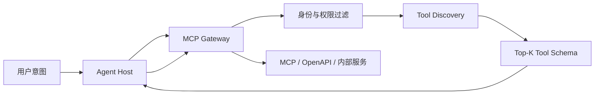

当 Agent 可访问的工具从十几个增长到数千个时，问题不再是如何连接 MCP Server，而是如何让模型只看到当前任务需要且有权使用的工具。MCP Gateway 的价值，是把协议适配、工具发现、访问控制和后端路由从各个 Agent Host 收敛为共享基础设施。

> 原始论文：*Scalable LLM Agent Tool Access in the Cloud*，arXiv:2607.15593，2026-07-17。  
> 论文背景：Alibaba Cloud 等团队基于生产部署总结的云端 MCP Gateway 设计。

## 直接连接模型为什么会失效

MCP 解决了接口标准化，但没有自动解决规模化治理。典型 Host 会连接多个 Server，调用 `tools/list`，再把全部工具描述和 Schema 注入模型上下文。这个模式隐含了一个前提：工具集合足够小，而且 Host 能独立处理每个后端的协议、身份和会话状态。

当工具规模扩大后，四个问题会同时出现：

| 问题 | 表面现象 | 系统后果 |
|---|---|---|
| 上下文竞争 | 大量 Tool Schema 占用 Token | 业务资料和推理空间被挤压 |
| 选择退化 | 相似名称与重叠能力增多 | 误选、错误参数和放弃调用增加 |
| 权限分散 | 每个 Server 各自鉴权 | 无法统一租户、角色和审计规则 |
| 路由复杂 | Host 直连多副本后端 | 健康检查、粘性会话和故障转移进入客户端 |

论文观察到，挂载工具数增加时，Agent 的 no-call rate 从 8% 上升到 19%。这说明全量暴露不只是成本问题：无关工具本身会降低执行能力。

因此，真正需要解决的问题是：

> 如何在完整工具目录不断增长的情况下，为每次任务构造一个小而准确、经过授权的临时工具面？

## 架构转折：从 Tool Exposure 变成 Tool Discovery

旧模式把完整目录交给模型：

```text
Agent Host
  ├─ MCP Client → Server A
  ├─ MCP Client → Server B
  └─ MCP Client → Server C

启动时加载全部 Tool Schema
```

Gateway 模式把完整目录留在平台侧：



关键变化不是多了一层代理，而是工具可见性的决定顺序改变了：

```text
先确定身份和租户
→ 在授权目录中检索候选工具
→ 只向模型暴露 Top-K Schema
→ 对最终调用再次校验
→ 代理执行并记录结果
```

模型不再长期“知道所有工具”，而是在每个任务中发现一个临时工具集合。

## Gateway 应承担的四项职责

### 协议适配：保护存量服务投资

企业能力主要存在于 OpenAPI、SDK 和内部 RPC 中。若要求每个团队重写 MCP Server，接入成本会转移到业务侧，协议升级也会形成重复维护。

论文将数据转换与传输适配分离：

- 数据层把 OpenAPI operation 编译为统一 Tool 定义；
- 传输层处理 HTTP+SSE、Streamable HTTP 等差异；
- 协议变化集中在 Gateway Adapter，不侵入业务服务。

这使 MCP 成为入口协议，而不是要求所有后端采用同一种实现。

### 访问控制：可见性也是权限

“能够连接 Server”不等于“能够看到全部工具”。工具名称、描述和参数 Schema 本身也可能泄露内部能力。

因此权限过滤必须发生在检索之前：

```text
错误：全局召回 → Schema 进入上下文 → 最后检查调用权限
正确：身份过滤 → 授权目录召回 → 调用前参数级复核
```

Gateway 同时负责入口用户身份、租户映射和出口后端凭证。模型只产生调用提议，不持有长期生产凭证。

### 工具发现：检索负责缩小候选，不负责完成任务

论文采用词法与语义结合的 Hybrid Retrieval：

- Tool Name 通常直接编码动作，适合词法匹配；
- Tool Description 与用户表达存在差异，适合向量检索；
- 专业领域查询通过领域知识进行 Query Rewrite；
- 只把 Top-K 候选交给执行模型做最终选择。

在 3,000 多个工具的实验中，论文报告：

- Top-15 Recall 为 98%；
- 工具选择耗时降低 8.9 倍；
- Token 使用量降低 23.8 倍；
- 领域规则改写将一项推荐准确率从 80.8% 提升到 99.7%。

这些数字需要正确解释。Recall@15 只说明目标工具进入候选集，不代表模型最终选对，也不代表参数正确或任务成功。生产评测必须继续覆盖 Tool Selection、Argument Generation 和 End-to-end Success。

### Session-aware Routing：兼容有状态后端

有状态 MCP Server 的同一逻辑会话必须持续命中保存状态的副本。论文将 `session → backend replica` 映射放到 Gateway，并用集中存储和 Pub/Sub 协调多个 Gateway 实例。

无状态 MCP 会减少这类需求，但存量 SSE Server、长连接任务和有状态工作流不会立即消失。合理的 Gateway 应同时支持：

- 无状态请求的普通负载均衡；
- 有状态请求的 Session Affinity；
- 后端故障后的可观察降级或重建。

## 可复用的工程模型

### 控制面：定义“平台拥有什么能力”

```yaml
tool:
  id: cloud.network.create_vpc
  version: 3
  owner: network-platform
  source: openapi://network-service
  schema_digest: sha256:...
  required_scopes: [network.write]
  risk_level: high
  backend_binding: network-prod
  lifecycle: active
```

控制面维护 Tool Registry、版本、所有者、依赖关系、权限、风险和后端绑定。它是工具事实源，不参与每个 Token 的推理。

### 数据面：决定“这次请求可以看到和执行什么”

```text
Authenticate
→ Resolve Tenant
→ Build Authorized Catalog
→ Retrieve Top-K
→ Expose Schemas
→ Validate Proposed Call
→ Route and Execute
→ Normalize Result
→ Trace and Audit
```

控制面与数据面分开后，工具新增、权限调整、后端扩缩容和协议升级均可独立于 Agent 业务逻辑演进。

## 最小可行实现

首版可以聚焦于验证核心架构价值，范围包括：

1. 一个统一 MCP Endpoint，代理两个 MCP Server 和一个 OpenAPI 服务；
2. 一个版本化 Tool Registry，记录 Tool ID、Schema Digest、Owner、Scope 和 Risk；
3. 权限过滤后的 BM25 + Embedding Top-K 检索；
4. 调用前 Schema 与 Scope 校验；
5. 统一错误、超时、重试和 `trace_id`；
6. 一组覆盖相似工具、无权限工具和 no-tool 查询的 Golden Eval。

稳定后再增加多租户、一次性审批、Session Routing、语义缓存和水平扩容。顺序很重要：如果 Registry、权限模型和评测尚未稳定，先做复杂智能路由只会放大不可解释性。

## 应该如何评测

| 层级 | 核心指标 |
|---|---|
| 召回 | Recall@K、MRR、无权限工具泄露率 |
| 选择 | Correct Tool Rate、No-call Rate、误调用率 |
| 参数 | Schema Valid Rate、参数语义正确率 |
| 任务 | End-to-end Success、平均重试次数 |
| 性能 | Tool Schema Tokens、P50/P95 延迟、单任务成本 |
| 安全 | 越权可见、越权调用、敏感参数外发 |
| 路由 | Session 命中率、Failover 成功率、尾延迟 |

Golden Set 至少应包含同名工具、近义工具、跨域表达、无权限工具、组合调用和不应调用工具的请求。

## Gateway 的适用边界

少量稳定工具、单租户、无统一治理需求时，直接连接更简单。工具数量只有十几到二三十个时，优先改进 Schema、权限和 Eval，通常比增加 Gateway 更有效。

Gateway 值得建设的信号是：

- Tool Schema 已明显挤压上下文；
- 多个团队重复维护鉴权、适配和路由；
- 工具数量持续增长并存在大量相似操作；
- 平台需要统一租户隔离、审计和成本治理；
- 同时存在 MCP、OpenAPI 和内部服务。

## 工程结论

这篇论文最值得复用的不是某个检索参数，而是三条架构原则：

1. Agent 应连接受治理的工具入口，而不是直接连接完整工具生态。
2. 工具可见性先由身份和策略决定，再由检索决定。
3. 完整 Catalog 留在平台侧，模型上下文只装载当前任务需要的工具。

MCP Gateway 的本质，是 Agent 时代的 Tool Plane：它把协议、目录、权限、路由、可观测性和评测收敛为一个长期可维护的系统边界。
