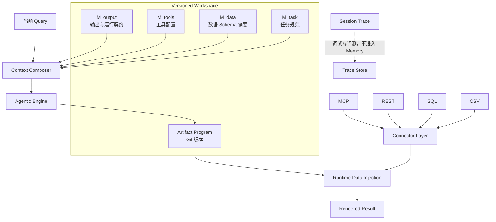
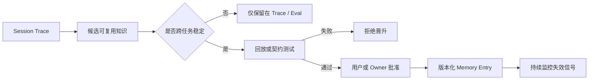
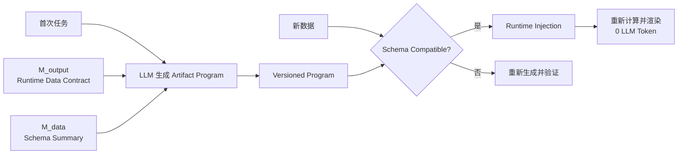
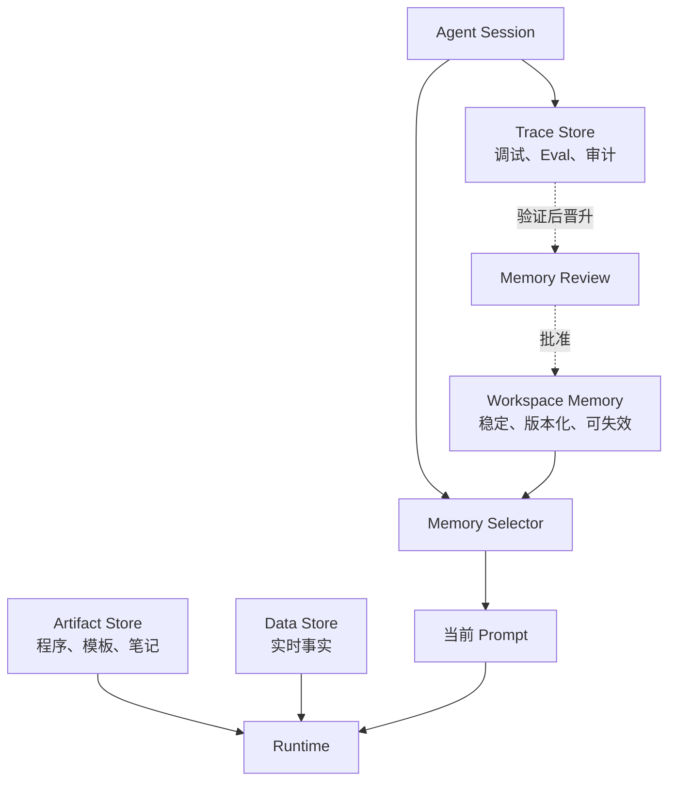

Shared Selective Persistent Memory 只持久化任务规范、数据 Schema、工具配置和输出约束，并把生成程序与运行时数据解耦，以减少跨会话重述和无效模型调用。

> 原始论文：Sanjana Pedada, Aditya Dhavala, Neelraj Patil, *Shared Selective Persistent Memory for Agentic LLM Systems*, arXiv:2607.09493v1, 2026-07-10。  
> 阅读重点：选择什么、遗忘什么、如何组合上下文、Zero-Token 的成立条件，以及实验结果中 Memory 与 Artifact Reuse 的边界。

## 一、核心问题：跨会话系统应该保存什么

一次 Agent Session 可以写成：

```text
S = (s, q, T, a)
```

- `s`：System Prompt 与长期约束；
- `q`：当前用户任务；
- `T`：工具调用、计划、重试和中间状态组成的执行轨迹；
- `a`：最终 Artifact。

会话结束后全部丢弃，会让用户反复说明业务规则、数据字段、工具参数和输出格式；全部保留又会把旧计划、失败恢复、过时工具用法和无关对话重新注入 Prompt。

论文提出第三种路径：保存可复用的声明式上下文，丢弃一次执行形成的过程噪声。

| 策略 | 保存内容 | 主要问题 |
|---|---|---|
| No Memory | 无 | 每次从零重述，消耗用户轮次与 Token |
| Full History | 完整对话与工具轨迹 | Trace Anchoring、Lost in the Middle、过时状态污染 |
| Selective Memory | 稳定规范、Schema、工具和输出契约 | 需要明确写入、失效和冲突规则 |

最重要的认识是：Memory 不是聊天记录的压缩版，而是跨会话仍然成立的工作空间配置。

## 二、整体架构：Memory、Artifact 与 Runtime Data 分离

论文系统以 Workspace 为共享边界，每个 Workspace 保存四类 Selective Memory，并关联版本化 Artifact。原始数据通过 Connector 在运行时注入，不进入持久 Prompt。



这套结构包含三个不同收益来源：

1. Selective Memory 减少重新说明规则和工具的成本。
2. Artifact Versioning 复用已经生成的程序。
3. Runtime Data Injection 允许相同程序处理新数据。

三者协同产生论文中的效率提升，但不能全部归因于 Memory 本身。

## 三、四类 Selective Memory

### 3.1 Task Specifications：保存“要满足什么”

`M_task` 保存跨会话稳定的任务规则：

- 业务口径与质量约束；
- 展示偏好和输出结构；
- 数值处理规则；
- 需要持续满足的验收条件。

它不保存某次任务的临时目标、探索性指令或尚未确认的修改。更稳妥的写入条件是“用户明确接受，并且预期在同一 Workspace 的未来任务继续适用”。

### 3.2 Data Schemas：保存结构摘要，不保存完整数据

`M_data` 包含：

- 字段名与类型；
- 数值列的分布统计；
- 分类列的 Unique Value Catalog；
- 行数与少量 Sample Rows；
- Schema Version 或 Digest。

论文实现使用统计 Profile 代替原始表格注入。目标不是让模型记住当前值，而是让模型知道如何编写可处理该数据的程序。

### 3.3 Tool Configurations：保存能力契约

`M_tools` 描述稳定的工具环境：

- Tool / Connector 名称与版本；
- 参数 Schema 和调用模板；
- REST、SQL、MCP 或 Sub-agent 接入方式；
- Authentication Requirements 与 Scope；
- Read / Write 属性和副作用边界。

密钥本身不应进入 Memory；Memory 只保存引用、所需 Scope 和验证方式。

### 3.4 Output Constraints：保存 Artifact Runtime 契约

`M_output` 描述产物必须遵守的结构和运行约束。论文中最关键的是 Data Injection Contract：

```text
生成的程序只从运行时注入点读取数据
所有聚合、过滤和洞察在运行时计算
源代码禁止硬编码当前数据值
```

这个约束让 Artifact 从“本次结果”升级为“可以复用的程序”。

### 3.5 四类 Memory 的治理字段

论文定义了分类，生产系统还需要为每个条目补齐生命周期信息：

```yaml
id: output.runtime-data-contract
category: output_constraint
scope: workspace
value:
  dataAccess: runtime_injection_only
source:
  type: user_approved
  reference: decision-2026-07-22
version: 3
status: active
validity:
  toolSchema: connector.v4
  artifactRuntime: web.v2
validation:
  type: contract_test
  reference: tests/runtime-data-contract
updatedAt: 2026-07-22
```

这是基于论文的工程扩展。没有 Source、Version、Validity 和 Validation 的“稳定记忆”很容易演变成无法追责的长期 Prompt。

## 四、选择性遗忘：明确禁止进入 Memory 的内容

论文主动丢弃六类内容：

| 丢弃对象 | 原因 | 更合适的位置 |
|---|---|---|
| Intermediate Files | 只属于一次执行路径 | 临时 Workspace |
| Unapproved Changes | 用户尚未接受 | Draft / Undo Stack |
| Reasoning Traces | 高度依赖当次问题分解 | Trace Store，受访问控制 |
| Tool Invocation Logs | 描述一次具体执行 | Observability / Audit |
| Error Recovery Paths | 可能只适用于当次版本和错误 | Eval Case 或经过验证的 Skill |
| Raw Data | 体积大、快速变化、可能敏感 | Runtime Data Source |

“不进入 Prompt”并不等于“彻底删除”。Trace 对调试、评测、事故分析仍然重要，只是默认不参与未来推理。

### 4.1 从 Trace 提炼规则需要晋升流程

一次成功轨迹不能直接成为长期规则。更安全的晋升链路是：



这一步防止把偶然成功、隐含数据假设或旧工具 Workaround 固化为系统行为。

## 五、Session Start 时如何组合 Memory

论文把 System Prompt 组合写成：

```text
s' = s_base ⊕ M_task ⊕ M_tools ⊕ M_output
```

Data Schema 与当前 Query 一起进入 User Message：

```text
q' = q ⊕ M_data
```

这样做隐含两个设计判断：

- Task、Tool 和 Output Constraint 属于稳定执行规则，适合放在 System Context。
- Data Schema 与当前数据源和任务关系更近，适合随 Query 注入。

### 5.1 组合顺序还需要处理信任与冲突

论文没有完整展开冲突算法。生产实现至少需要以下优先级：

```text
平台安全策略
> 当前 Workspace 已批准约束
> 当前用户明确任务
> 从其他 Workspace 导入的 Memory
> 自动提炼但尚未人工确认的候选
```

优先级只处理来源权威性，版本和 Scope 仍需单独判断。一个全局规则不应覆盖更具体且经过授权的 Workspace 规则；一个过期 Tool Schema 也不能因为优先级高而继续启用。

### 5.2 读取阶段的五个过滤器

1. **Scope Filter**：当前 Workspace、用户角色和任务是否匹配。
2. **Freshness Check**：依赖版本、时间或数据源是否仍有效。
3. **Compatibility Check**：Tool Schema、Artifact Runtime 和 Data Schema 是否兼容。
4. **Conflict Resolution**：同类条目按来源、Scope、Priority 和 Version 解析。
5. **Token Budget**：只加载当前任务需要的条目，避免 Selective Memory 再次膨胀为 Full History。

## 六、Zero-Token Refresh 的真正含义

Zero-Token Refresh 不是“首次生成不用模型”，而是已经存在合格 Artifact Program 时，新数据可以绕过模型直接刷新结果。



论文采用的兼容条件是：原始字段集合必须是新数据字段集合的子集。

```text
required_columns ⊆ incoming_columns
```

- 新增字段允许存在；
- 缺少原程序依赖的字段时触发重新生成；
- 相同字段名但类型、单位或语义改变，单纯集合判断无法发现。

### 6.1 一个满足 Contract 的 Artifact

```ts
type RuntimeDataset = Array<Record<string, unknown>>;

export function render(data: RuntimeDataset) {
  const rows = validateRequiredColumns(data, ["region", "target", "actual"]);
  const summary = aggregateAtRuntime(rows);
  const insights = deriveInsights(summary);
  return buildView(summary, insights);
}
```

程序保存的是“如何处理数据”，不是某次数据的结果。所有合计、排名、异常值和说明文本都必须从当前输入动态生成。

### 6.2 Zero-Token 不等于零成本

它仍然需要：

- 首次生成和验证 Artifact 的模型成本；
- 数据读取、Schema Check、计算和渲染成本；
- Connector 认证、超时和错误恢复；
- Artifact Runtime 的安全隔离；
- 数据语义变化时重新生成的成本。

更准确的表述是“Schema 兼容的重复刷新不再调用模型”。

## 七、Shared Workspace 如何复用 Memory

论文把一个 Workspace 表示为：

```text
W = (M_task, M_data, M_tools, M_output, a, V)
```

其中 `a` 是当前 Artifact，`V` 是版本历史。共享过程分为四步：

1. **Load**：加载 Selective Memory 和 Artifact，编辑进入隔离 Draft。
2. **Swap**：连接自己的数据源；Schema 兼容时直接渲染。
3. **Refine**：在已有规范和工具上下文中修改 Artifact。
4. **Query**：只读用户基于 Artifact 与当前数据查询。

论文定义三种角色：

| 角色 | Artifact | Task Spec | Data Source | Base Workspace |
|---|---|---|---|---|
| Owner | 发布、回滚、授权 | 管理 | 管理 | 完整控制 |
| Steward | 编辑并提交 | 可修改 | 可连接 | 受 Owner 策略约束 |
| Viewer | 查看、查询 | 只读 | 可连接自己的兼容数据 | 不修改基础版本 |

共享的是经过治理的 Workspace 配置和 Artifact，不是原作者的对话历史。

## 八、论文实现细节

参考系统包含：

| 层 | 论文实现 |
|---|---|
| Backend | FastAPI |
| Agentic Engine | Claude Opus 4 负责主要生成，Claude Sonnet 4 负责轻量子任务 |
| Data Connector | CSV、SQL、REST、MCP；MCP 使用 JSON-RPC 与 mTLS |
| Metadata Store | MongoDB 保存四类 Memory、ACL 与数据源配置 |
| Artifact Store | Git 保存代码、Diff、Branch 与回滚历史 |
| Draft Isolation | 发布前修改不影响当前公开 Artifact |
| Session Undo | 最多 10 个 Snapshot，可在会话内回退 |

这一实现把两个生命周期分开：Memory Metadata 适合结构化数据库，Artifact 适合 Git；完整对话和 Reasoning Trace 不进入任何一层。

## 九、实验一：三种 Memory 条件的对照

### 9.1 实验设置

- 24 个企业数据文件，覆盖供应链、销售和流程指标；
- 数据规模从 200 行 / 8 列到 45K 行 / 42 列；
- 10 个 Recurring Refresh、8 个 Cross-Team Adaptation、6 个 Iterative Construction 任务；
- 两名盲评人员检查 Render Correctness、Data Fidelity、Format Compliance 和 Completeness；
- 四项都通过才记为成功，评审一致性 `κ = 0.91`。

### 9.2 论文报告的结果

| 指标 | No Memory | Full History | Selective Memory |
|---|---:|---:|---:|
| Input Tokens | 2.1K | 18.7K | 3.4K |
| Output Tokens | 8.2K | 9.6K | 4.1K |
| User Turns | 4.3 | 3.1 | 1.4 |
| Completion | 79% | 71% | 96% |
| Time | 285s | 310s | 68s |

论文报告 Selective Memory 对 No Memory 的 Fisher Exact Test 为 `p = 0.046`，对 Full History 为 `p = 0.008`。

分任务观察：

- Recurring Refresh：100% vs. 70% / 60%，差距最大；
- Cross-Team Adaptation：100% vs. 88% / 75%；
- Iterative Construction：三组 Completion 都为 83%，但 Selective Memory 将平均轮次从 6.2 降到 2.8；
- 24 个任务中有 18 个 Schema 兼容，直接完成 Zero-Token Refresh；
- 唯一一次 Selective Memory 失败来自 Schema Summary 未表达跨文件 Join Semantics。

Full History 的失败主要表现为 Trace Anchoring：模型沿用旧工具路径和旧状态，即使当前任务已改变。

## 十、实验二至四：公开复现、Token 与用户研究

### 10.1 四个公开数据集

论文使用 Superstore Sales、UCI Adult Income、NYC 311 和 World Bank GDP，三种 Memory 条件各运行三次，共 36 次 Trial。

| 指标 | No Memory | Full History | Selective Memory |
|---|---:|---:|---:|
| Input Tokens | 2.6K | 15.4K | 0.0K |
| Output Tokens | 6.8K | 7.9K | 0.0K |
| Completion | 83% | 75% | 100% |
| Time | 84s | 112s | 0s |
| Tool Calls | 4.2 | 5.1 | 0.0 |

Selective Memory 的 12 次 Trial 使用已经生成的 Artifact 和 Schema 兼容的新数据，因此这里测到的是 Zero-Token Refresh，而不是一次全新的 Agent Generation。

### 10.2 数据表示成本

| 数据规模 | Raw Injection | 前 50 行截断 | Statistical Summary |
|---|---:|---:|---:|
| Small `<1K rows` | 3.2K | 1.8K | 0.4K |
| Medium `1–10K` | 28.5K | 1.9K | 0.5K |
| Large `>10K` | 142.3K | 2.0K | 0.6K |
| Enterprise Mean | 48.7K | 1.9K | 0.5K |
| Public Mean | 473.0K | 1.5K | 0.5K |

论文据此报告 Enterprise Data 上 97 倍、Public Data 上 946 倍 Token Reduction。截断方案虽然成本低，但丢失 Tail Distribution 与 Rare Category，在 24 个企业任务中造成 5 次错误。

### 10.3 用户研究

用户研究包含 12 人：6 名工程师、6 名分析师。论文报告：

- Recurring Generation 由 165 秒降至 12 秒，约 14 倍；
- Refinement 加快 2.5 倍；
- Constrained Generation 加快 3 倍；
- “愿意再次使用”评分为 6.5 / 7，对照为 4.2 / 7；
- 每个 Session 平均使用 Revert 1.8 次。

样本量适合发现趋势，不足以对单个 Likert Item 做强统计结论。

## 十一、如何正确解释实验结果

### 11.1 最强证据

1. Full History 在该任务域内比 No Memory 更慢且完成率更低，说明上下文数量不等于上下文质量。
2. 结构化 Schema Summary 比 Raw Injection 或固定行数截断更节省 Token，并保留了分布信息。
3. Artifact 与 Data Injection Contract 解耦后，Schema 兼容刷新确实可以绕过模型。
4. Task Spec 与 Tool Config 复用显著减少用户重新说明和多轮修正。

### 11.2 不能直接推出的结论

| 论文结果 | 不能直接外推为 |
|---|---|
| 24 个结构化 Artifact 任务达到 96% | 任意软件工程或开放研究任务都能达到相同收益 |
| Full History 低于 No Memory | 所有长上下文和 Session Summary 都有害 |
| 12/12 Zero-Token Refresh | 任意实时数据、文档或 API 变化都能绕过模型 |
| Statistical Summary 约 0.5K Token | 复杂 Join、单位语义和业务口径都能被摘要完整表达 |
| Workspace Sharing 有效 | Memory Component 的细粒度跨域组合已经解决 |

### 11.3 关键混杂因素

Selective Memory 条件包含“四类 Memory + 已有 Artifact”，而 Zero-Token 条件进一步依赖 Runtime Data Contract。论文把它们作为一个系统方案评测，因此无法从表格中单独估计每类 Memory 的因果贡献。

更严格的持续实验可以增加以下消融：

- 只有 Artifact，没有 Task / Tool Memory；
- 有 Selective Memory，但强制重新生成；
- 分别移除 `M_task`、`M_data`、`M_tools`、`M_output`；
- Schema 名称相同但类型、单位或含义变化；
- 跨文件 Join、Streaming Source 和 Unstructured Document；
- Summary、RAG Retrieval 与 Full History 的等 Token 对照。

## 十二、生产系统的 Memory 生命周期

### 12.1 四种存储必须分开



| 存储 | 事实类型 | 默认进入 Prompt | 生命周期 |
|---|---|---:|---|
| Workspace Memory | 稳定配置与约束 | 按任务选择 | 版本化、可失效 |
| Trace Store | 完整执行过程 | 否 | 按审计与调试策略保留 |
| Artifact Store | 可执行或可发布结果 | 通过引用 | Git / Object Version |
| Data Store | 当前业务事实 | 否，运行时读取 | 由源系统管理 |

### 12.2 失效条件比写入条件更重要

| Memory 类型 | 典型失效信号 | 处理 |
|---|---|---|
| Task Spec | Scope、Owner 或 Policy Version 变化 | 重新确认或 Supersede |
| Data Schema | 字段缺失、类型/单位变化、Join 关系变化 | 阻止刷新并重新生成 |
| Tool Config | Tool Schema、Auth Scope、Server Version 变化 | 停用旧版本并重新发现 |
| Output Constraint | Template、Runtime 或 Compliance Rule 变化 | 运行 Artifact Regression |

Memory Decay 不应只按时间删除。更可靠的方式是把条目与依赖 Digest 绑定：依赖变化时失效，长期未验证时降低置信度。

## 十三、对知识管理系统的迁移价值

这篇论文的思路可以直接转换为 Agent 知识系统的内容边界：

| 对象 | 应放在哪里 |
|---|---|
| 写作规范、发布规则、工具权限 | Selective Memory / Project Instructions |
| 原始论文与外部资料 | Source Store / RAG Index |
| 完整学习笔记 | Git Versioned Artifact |
| 浏览、编辑和工具调用过程 | Trace Store |
| 当前网页、价格、指标和业务状态 | Runtime Source，使用时重新获取 |

稳定规则只保存一份，研究资料保留来源，最终笔记作为版本化 Artifact 发布；过程轨迹不自动混入下一篇文章。这样既保留可追溯性，也避免知识库被执行噪声占据。

## 十四、学习结论

1. **Memory 的价值来自选择，而不是容量。** 保存跨会话稳定的声明式知识，默认排除一次性执行轨迹。
2. **Memory、Trace、Artifact 和 Data 是四种不同事实。** 混在一个向量库或聊天历史中会模糊来源、时效和责任。
3. **Zero-Token Refresh 本质是程序复用。** 它依赖合格 Artifact、Runtime Data Contract 和 Schema Compatibility，而不是模型记住了数据。
4. **Schema Summary 需要表达语义依赖。** 字段列表和统计分布无法覆盖 Join、单位、业务口径和跨表约束。
5. **写入必须经过批准，读取必须经过选择。** Source、Version、Scope、Validity 与 Validation 是长期 Memory 的必要元数据。
6. **论文证据集中在结构化数据 Artifact。** 对开放式研发、非结构化研究和实时系统，需要重新设计兼容性检查与独立消融实验。

## 参考资料

1. Pedada, S., Dhavala, A., & Patil, N. **Shared Selective Persistent Memory for Agentic LLM Systems.** arXiv:2607.09493v1, 2026.  
   [arXiv 摘要](https://arxiv.org/abs/2607.09493) · [HTML 全文](https://arxiv.org/html/2607.09493) · [PDF](https://arxiv.org/pdf/2607.09493)

2. 本文中的架构、实验设置、数值和作者限制均来自原论文；Memory Entry Schema、晋升流程、冲突优先级、失效矩阵和知识管理映射属于基于论文的工程推导。
