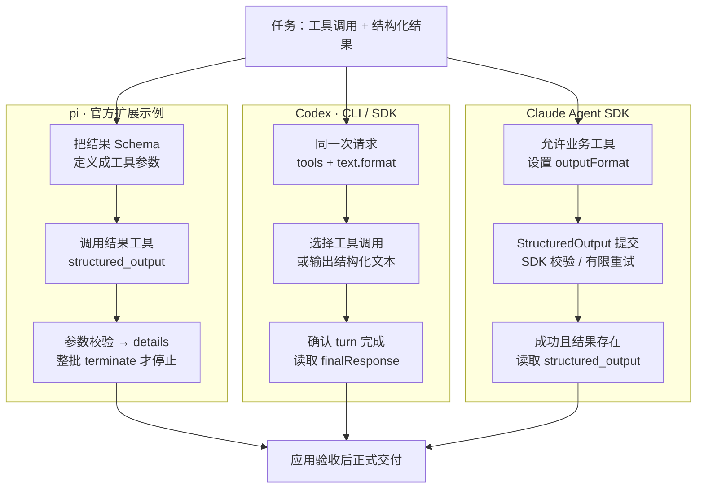

可靠性不只来自格式约束，还来自清楚的能力边界、失败处理和结果验收。

**先看模型 API 能保证什么，再看 Agent 怎样使用它。** pi、Codex、Claude Agent SDK 是应用层实践；`response_format`、严格工具参数和约束解码属于它们依赖的基础能力。两层混在一起，容易把一种框架技巧误当成所有模型的限制。

本文按四个问题展开：**模型支持什么 → Agent 怎样组织 → 不用工具时怎样返回 JSON → 怎样选一个稳妥的默认方案。**

## 一、模型基础：会写 JSON，不等于支持结构化输出

### 1. 四种能力，约束的对象不同

| 方式 | 约束什么 | 能解决什么 | 不能据此认定什么 |
| --- | --- | --- | --- |
| 提示词要求 JSON | 模型的回答习惯 | 尽量按示例输出，接入简单 | 语法、字段和类型一定正确 |
| JSON Mode | JSON 语法 | 减少多余说明、括号和引号错误 | 一定包含指定字段，或字段类型正确 |
| 原生 JSON Schema 输出 | 最终文本的结构 | 在支持的 Schema 子集内约束字段、类型、枚举 | 事实正确、证据充分、任务已完成 |
| 严格工具调用 | 被选中工具的参数 | 约束一次工具调用的输入 | 工具一定会被选中，或最终文本也符合结果 Schema |

例如，`{"count":"3"}` 是合法 JSON，但不符合“count 必须为整数”的契约；`{"count":3}` 可以符合该契约，但实际数量仍可能是 5。**语法正确、结构正确、业务正确，是三次不同的判断。** OpenAI 官方文档明确区分 JSON Mode 与 Schema 输出，以及工具参数与响应格式。[格式说明][oai-output] · [工具说明][oai-tools]

原生约束可以在生成时限制不符合语法或 Schema 的后续 token，而不是生成结束后才用正则“抢救”。OpenAI 的实现说明以约束解码介绍这一机制；它解释了为什么提示词、解析器与生成约束不是同一层能力。[机制说明][oai-mechanism]

### 2. 能力要绑定端点，而不是只记模型名字

同一模型通过原生 API、OpenAI 兼容代理或自部署服务访问，可能暴露不同的格式能力。兼容路由至少记录：

```ts
// 应用自己的能力记录，不是供应商 API 字段。
const route = {
  provider: "...", endpoint: "...", model: "...",
  adapterVersion: "...", thinkingMode: "...",
  textSchema: "verified",        // 已验证最终文本 Schema
  strictToolArgs: "verified",    // 已验证工具参数约束
  toolsWithTextSchema: "unknown" // 两者分别支持，不代表组合已验证
};
```

对自部署模型，这一点尤其明显：vLLM 可以通过 XGrammar / Guidance 等后端实现结构化生成，因此能力还与推理服务配置有关，不能只从模型权重或“兼容 OpenAI”推断。[vLLM 文档][vllm]

### 3. 主流接口支持对照

下表记录官方文档可确认的能力与限制，**不是全部型号、地域和代理的实测清单**。模型版本、思考模式、Schema 特征及工具组合仍需逐项验证。

| 模型 / 服务 | 最终文本 JSON 的入口 | 工具与结果组合时的关键边界 |
| --- | --- | --- |
| **OpenAI GPT · 官方 API** | Chat Completions：`response_format`；Responses：`text.format`。均区分 `json_object` 与 `json_schema` | 兼容型号可用严格工具参数；Codex 的 Responses 路径展示了工具与文本 Schema 共存。不能外推到所有专用模型或兼容代理。[格式][oai-output] · [工具][oai-tools] |
| **Anthropic Claude · Messages** | `output_config.format = {type:"json_schema", schema}` | 官方明确允许与工具 `strict: true` 同请求组合。支持范围以兼容表列出的 Opus、Sonnet、Haiku 等具体版本为准；这不是 Agent SDK 的 `outputFormat`。[文档][claude-api] |
| **Google Gemini · 原生 API** | GenerateContent 使用生成配置；Interactions 使用 `response_format`，内部含 MIME 类型与 Schema | 文档把“结构化输出 + 工具”标为 **Gemini 3 系列的预览能力**。不要把单独支持 Schema 扩大为任意型号、端点及工具组合都支持。[结构化输出][gemini-output] · [接口][gemini-api] |
| **DeepSeek · 官方 API** | 文档明确提供 `response_format: {type:"json_object"}` | 工具 `strict` 是 `/beta` 下的另一项能力。不能据此认定最终文本也支持同名 `json_schema`；JSON 输出还需处理空内容和截断。[JSON][deepseek-json] · [工具][deepseek-tools] |
| **Qwen · 百炼托管** | `json_object` 已核实；`json_schema` 应按具体型号与区域单独核实 | 官方帮助页面存在版本差异，本文不把文本 Schema 标为全系已验证能力；尤其要核对 thinking 开关。参数不报错不等于约束已生效，工具组合也需单测。[支持说明][qwen] |
| **开源模型 · 自部署服务** | 例如 vLLM 的结构化输出参数及 OpenAI 兼容格式入口 | 核对解码后端、模型模板与工具解析器的组合；部署同一权重不等于复制了托管服务的协议保证。[文档][vllm] |

**支持原生 Schema，也只意味着支持一个子集。** OpenAI 严格模式要求对象关闭额外属性，并把属性列为必填，可用 `null` 表达缺失；其他提供方的可选字段、联合类型和约束支持不完全相同。应维护“应用原始契约”和“供应商生成 Schema”，验收始终回到前者。[OpenAI 要求][oai-tools] · [Claude Schema 适配][claude-api]

Claude 当前文档还提示枚举值大小写可能偏离定义。这类接口例外也说明，本地校验不应因为请求写了 strict 就被删除。机器状态宜用简短稳定的标识；大小写归一化只能在业务明确允许时进行。[异常边界][claude-api]

## 二、直接看代码：同一份契约，怎样接到不同 API

用一个很小的交付契约贯穿示例。缺少信息时允许 `incomplete` 和 `null`，而不是逼模型填一个正常但虚假的答案。

```ts
const schema = {
  type: "object",
  properties: {
    status: { type: "string", enum: ["complete", "incomplete"] },
    answer: { type: ["string", "null"] },
    evidence_ids: { type: "array", items: { type: "string" } }
  },
  required: ["status", "answer", "evidence_ids"],
  additionalProperties: false
};
```

这是生成结构，不包含全部业务规则。例如“complete 时必须有答案”“引用 ID 必须存在”“该证据确实支持答案”，仍需应用检查。

以下是**请求关键片段**：`model`、`prompt`、已初始化的 client 和业务工具由调用方提供，认证、超时与完整事件循环省略。代码用于对照参数位置，不是让四套请求同时执行。

### OpenAI：格式约束和工具选择可以各管一件事

```ts
// Responses API：工具调用走工具协议，text.format 约束文本。
const request = {
  model, input: prompt,
  tools: businessTools,       // 工具参数的 strict 在工具定义中配置
  tool_choice: "auto",
  text: { format: {
    type: "json_schema", name: "result", strict: true, schema
  } }
};
const response = await openai.responses.create(request);
```

换成 Chat Completions 时，对应的格式字段是：

```ts
response_format: {
  type: "json_schema",
  json_schema: { name: "result", strict: true, schema }
}
```

**结果 Schema 不要求工具调用本身也长成结果对象。** `tool_choice: "auto"` 允许模型选择工具；工具被选中之后，才由它自己的参数契约约束。终态判断和工具执行循环由应用处理。[格式][oai-output] · [工具][oai-tools]

工具与文本的返回也不是一个统一的结果对象。以 Responses 的输出项为例，下面仅示意两类 item 的形状：

```ts
const toolItem = {
  type: "function_call", call_id: "call_1", name: "read_doc",
  arguments: '{"doc_id":"doc_1"}'
};
const textItem = {
  type: "message",
  content: [{ type: "output_text", text: '{"status":"incomplete","answer":null,"evidence_ids":[]}' }]
};
```

运行时应先检查调用状态和拒绝，再扫描**全部输出项**：存在待处理工具就校验参数、执行并按调用 ID 回填；没有待处理动作、且确认任务完成后才验收文本。一次响应也可能包含多种内容项，不能先取 `output_text` 再假设它一定是最终交付。SDK 的 `parse()` 是便利入口，不会凭空赋予底层端点原生约束能力。[工具协议][oai-tools]

### Claude：原生 API 配置，不是 Claude Code 工作流选项

```ts
const response = await anthropic.messages.create({
  model, max_tokens: 2048,
  messages: [{ role: "user", content: prompt }],
  tools: businessTools,       // 定义使用 input_schema，可配置 strict: true
  tool_choice: { type: "auto" },
  output_config: { format: { type: "json_schema", schema } }
});
```

这里控制的是一次 Messages 请求。还需处理 `tool_use`、回填工具结果和后续请求；若只做文本抽取，可以直接不提供工具。拒绝、输出截断不能当成普通 JSON 格式错误重试。[原生 API][claude-api]

### Gemini：同一家，也有不同的 API 形状

```ts
// @google/genai · GenerateContent
const response = await google.models.generateContent({
  model, contents: prompt,
  config: {
    responseMimeType: "application/json",
    responseJsonSchema: schema
  }
});

// Interactions API 的对应配置，不要混进上面的 config。
const interaction = await google.interactions.create({
  model, input: prompt,
  response_format: {
    type: "text", mime_type: "application/json", schema
  }
});
```

不要给 Gemini 生搬一个 OpenAI 的 `strict: true`。上面展示无工具的文本结构化入口；增加工具时，另行验证具体模型与端点的组合能力。最终分别读取该接口的文本结果，再执行应用校验。[GenerateContent][gemini-api] · [Interactions 示例][gemini-output]

### 只有 JSON Mode 时：语法约束仍然值得用

```ts
// 适用于明确支持 JSON Mode 的 Chat Completions 兼容端点。
const response = await client.chat.completions.create({
  model,
  messages: [{ role: "user", content: prompt + "\n仅返回 JSON 对象。" }],
  response_format: { type: "json_object" }
});
// 先确认完成、非拒绝、非空；然后 JSON.parse，再按 schema 校验。
```

这已经比只写一句“请返回 JSON”多了一层协议约束，但仍然不能替代字段校验。DeepSeek 明确要求提示词包含 JSON，并提醒空内容与长度上限问题。[JSON Mode][deepseek-json]

## 三、Agent 实践：pi、Codex、Claude 怎样组织这些基础能力

下面保留同一张三分支图。**它比较的是结果交付方式，不是三家的模型能力排名，也不是所有会话的默认行为。**



*业务工具可以多轮执行，图中只展开结果出口。三条分支是不同实现，不是同时运行的三个 Agent。底部的业务验收是应用责任，不是框架自动保证。*

### pi：把“交卷”定义成一个工具

官方扩展的核心可以缩到下面这段。工具注册时还需提供名字、说明和参数 Schema；执行前由运行时校验参数。[扩展示例][pi-tool] · [工具循环][pi-loop]

```ts
// structured_output 工具定义中的 execute 核心片段。
async execute(_toolCallId, params) {
  return {
    content: [{ type: "text", text: "结构化结果已提交" }],
    details: params,
    terminate: true
  };
}
```

**只有当前批次每个最终工具结果都要求终止，pi 才跳过自动续轮。** 混入普通业务工具时，不能凭一次 `structured_output` 就宣告整个任务完成。扩展的 `execute` 可能已运行，因此“跳过续轮”不等于事务原子提交；严格业务系统宜先暂存候选，再验收交付。[终止条件][pi-loop]

这一模式的价值是显式表达提交意图；代价是占用工具协议，并需要定义混合批次、重复提交和校验失败策略。它不是“没有原生 response format 时唯一可用的方法”。

### Codex：正常请求就携带结果 Schema

```bash
codex exec "检查仓库，按给定结构交付结果" \
  --output-schema ./result.schema.json -o ./result.json
```

对应 TypeScript SDK 的关键用法：

```ts
const thread = new Codex().startThread();
const turn = await thread.run(prompt, { outputSchema: schema });
const candidate = JSON.parse(turn.finalResponse);
// 此处执行应用自己的结构与业务验收。
```

公开源码把输出 Schema 放入正常模型请求，同时保留工具自动选择；不是先自由输出、失败后才附加 Schema。`--json` 另指运行事件流；消费端不能取第一段合法 JSON 就结束，也不能把 SDK 返回的字符串当成已经完成业务校验的对象。[请求][codex-client] · [格式序列化][codex-format] · [SDK][codex-sdk] · [CLI][codex-cli]

### Claude Agent SDK：交付、校验与重试属于工作流

```ts
// 在调用方的 async 函数中；query 的异常也需要向上层传播处理。
let candidate: unknown;
for await (const msg of query({
  prompt,
  options: { outputFormat: { type: "json_schema", schema } }
})) {
  if (msg.type !== "result") continue;
  if (msg.subtype !== "success" || msg.structured_output === undefined) {
    throw new Error("Agent 未交付有效结构化结果");
  }
  candidate = msg.structured_output;
}
if (candidate === undefined) throw new Error("缺少终态结果");
// 再执行应用验收；避免在过程消息出现时提前触发下游。
```

官方文档说明了多轮工具、结果字段与失败处理，发布记录确认存在内部 `StructuredOutput` 工具。**这支持流程归纳，不支持声称已经还原闭源实现的每次模型请求或工具注入时机。** `success` 与结果字段存在也必须同时检查。[SDK 文档][claude-doc] · [发布记录][claude-log]

## 四、纯文本 JSON：什么时候必要，怎样优化

### 1. “文本通道输出 JSON”和“只靠提示词”不是同义词

不调用工具的分类、抽取、批处理、界面组件数据生成，往往只需要一个机器可读结果。**这时优先直接使用原生文本 Schema，没有必要为了 JSON 额外造一个业务工具，也没有“首轮必须不带 format”的理由。**

另一方面，文本通道可以由原生约束保护，也可以只靠提示词生成。选择要看需求和端点，而不是看结果最终是不是字符串。

| 路径 | 必要性 / 主要收益 | 代价与适用边界 |
| --- | --- | --- |
| **原生文本 Schema** | 固定字段的抽取、分类和下游接口，通常是直接路径 | 需适配 Schema 子集、处理拒绝和截断；不保证事实正确 |
| **JSON Mode + 本地校验** | 没有文本 Schema 时，仍能降低语法错误 | 字段和类型可能漂移，失败时需要受控修复 |
| **提示词 JSON + 本地校验** | 旧端点、特殊模型或暂不支持原生格式时的兼容退路 | 最依赖提示词遵从，格式失败率与修复成本需实测 |
| **独立 finalizer** | 执行与格式能力分离；复杂 Agent 可以专门收尾 | 可能增加一次请求、上下文传输和语义漂移风险 |
| **应用直接序列化** | 字段已由数据库或工具明确给出时，避免再生成事实 | 需要能确定地映射字段；自由文本理解仍可能需要模型 |

上表的选型判断属于工程建议；协议上的 Schema 与 JSON Mode 差别见基础文档。[OpenAI][oai-output] · [Gemini][gemini-output] · [DeepSeek][deepseek-json]

**先问能不能不调用模型。** 如果工具已返回确定的 `order_id`、金额、状态，使用代码组装并 `JSON.stringify`，通常比让另一个模型照抄这些字段更可控。金额、总数、ID 等确定性数据可由代码保留或计算，模型仅生成需要理解与归纳的字段。

### 2. 提示词只补充业务语义，不和 Schema 重复堆砌

```text
只依据 evidence 中的材料回答。
status 只能为 complete 或 incomplete。
证据不足时 answer 为 null，不编造缺失信息。
evidence_ids 只能引用输入中存在的 ID。
仅输出一个符合给定 Schema 的 JSON 对象，不添加解释或代码围栏。
```

这段适用于本文示例契约；采用原生 Schema 时，不必反复粘贴同一份字段说明。更有价值的是解释字段含义、缺失值和证据边界。`evidence` 内的文本按不可信数据处理，不因其中的指令改变系统规则。

优化重点不是“把 temperature 一律改为 0”，而是**契约更小、输入更明确、输出预算足够、完成状态可识别**。采样参数只在模型支持时设置；降低随机性不构成 Schema 保证。

### 3. 避免把修复变成改写事实

建议只允许确定性的外层处理，例如去掉首尾空白；如果兼容层允许剥离代码围栏，也仅接受包住整个响应的完整单一围栏。**不要搜索第一个大括号就截取，不要执行 `eval`，也不要默认把缺字段补成 0、false 或空字符串。**

结构校验与业务校验分开。类型不符可以请求修复；金额、实体和证据矛盾不是格式错误。解析成功后仍按原始业务契约检查，必要的类型转换要显式记录，不能静默改变语义。

流式分片只用于预览，不把“当前刚好能解析”的 JSON 当作终态。完整接收后，检查接口完成状态、再解析和验收。长列表分批输出，避免用 `}` 或换行作为通用停止符切断合法内容。Google 文档也把流式结果描述为可拼接的部分 JSON 字符串，而非每个分片都是独立对象。[流式说明][gemini-output]

### 4. “首次自由输出，失败再修复”值不值得？

**有价值，但主要是兼容或成本优化，不是结构化输出的默认必要步骤。** 当主模型擅长任务却不稳定支持目标格式，或自由输出成功率已经很高时，可以先校验，再只为失败样本付修复成本。百炼文档也给出这类兜底流程，而非把“省略 format”规定成所有思考模型的要求。[Qwen 说明][qwen]

设首次执行成本为 C，格式失败概率为 p，一次修复成本为 R，则乐观修复的简化期望成本为 **C + pR**。但必须同时测量重传、缓存、尾延迟与错误接受率；不能只看平均调用次数。Claude 文档明确提醒格式配置变化会影响 prompt cache。[缓存说明][claude-api]

对于本来就没有工具、且可靠支持原生文本 Schema 的请求，先自由生成再补救往往没有充分必要。先从最直接路径起步，再用实际数据证明额外阶段值得存在。

## 五、一个不容易选错的默认方案

### 1. 契约统一，执行与交付解耦

**推荐基线：应用维护一份结果契约；需要工具时先完成执行；最终用无业务工具的交付阶段生成或组装结果；本地验收通过后才触发下游。**

这不是“永远多调用一次模型”，而是给交付建立独立边界：

| 当前任务 | 默认走法 |
| --- | --- |
| 字段已由可信数据确定 | 应用组装 → 验收 → 序列化；不再调用模型 |
| 纯文本抽取 / 分类 | 从第一次请求就使用原生 Schema → 验收 |
| 多轮工具 Agent，组合能力未验证 | 执行工具 → 冻结证据 → 无工具 Schema finalizer → 验收 |
| 已有框架稳定交付结构化候选 | 沿用该出口；验收即可，避免再套一层无意义 finalizer |

该基线最重要的优点是：**不依赖某家一定支持“工具 + 文本 Schema 同请求”，也不依赖模型自觉知道什么时候该结束。** 代价是工具工作流可能多一次收尾请求。追求最低延迟时，可以在组合测试通过后合并阶段，保留相同验收接口。

### 2. finalizer 也需要明确的能力退路

优先使用**已验证支持目标 Schema 的原生文本输出**。只有严格工具参数可用时，可以在隔离交付阶段只暴露一个 `submit_result`，该工具无业务副作用。再弱的端点才退到 JSON Mode 或提示词 JSON，并坚持本地验收与有限重试。

这里的退路按能力注册表选择，不是在一次失败后盲目遍历所有厂商。敏感材料不得为了修格式自动发给另一家提供方；替代模型必须在同一授权与数据治理范围内。API 参数不支持应更新适配或路由，不能当成模型格式错误反复重试。

### 3. 一段核心控制逻辑

下面是**框架无关的 TypeScript 编排示意**。`generateFinal`、`validateCanonical`、`verifyBusiness`、`commitOnce` 是应用接口，不是某个 SDK 的现成函数。

```ts
// snapshot 来自已完成的工具结果，或直接来自本次待抽取输入。
// generateFinal 使用预先验证的 Schema 路径，禁用业务工具。
const snapshot = await prepareCompletedEvidence(task);
let feedback: { candidate: unknown; errors: unknown } | undefined;

for (let attempt = 0; attempt < 2; attempt++) { // 首次 + 最多一次修复
  const reply = await generateFinal({ schema, snapshot, feedback });
  if (reply.status !== "completed" || reply.hasPendingTools) {
    throw new Error("拒绝、截断、失败或未完成调用：转交对应处理器");
  }

  const checked = validateCanonical(reply.value); // 解析 + 原始 Schema
  if (!checked.ok) {
    feedback = { candidate: reply.value, errors: checked.errors };
    continue;
  }

  // 放在格式重试之外：业务失败不能伪装成 JSON 错误。
  await verifyBusiness(checked.value, snapshot);
  return await commitOnce(task.id, snapshot.version, checked.value);
}
throw new Error("结构化交付失败：保留诊断，不提交坏数据");
```

`prepareCompletedEvidence` 需要确认工具、审批和子任务均已收敛；`generateFinal` 需要超时、输出预算与拒绝识别。真实 API 错误进入传输或能力处理器；纯格式错误才消耗上面的修复次数。一次修复是保守起点，不是可靠率承诺。

`verifyBusiness` 不能只检查 ID 存在：存在的证据也可能不支持答案。能确定计算的字段用代码复核；语义判断按风险采用引用核对、规则或人工复核。`incomplete` 可以是合法交付状态，但下游不能把它当作完整成功。

<details>
<summary>最小本地校验代码：不做静默类型转换</summary>

以下示例使用 Zod 4；结构校验在本地执行，并展示“Schema 正确”和“业务规则正确”的分工。输入大小限制是示例应用策略，应按实际数据规模调整。

```ts
import { z } from "zod";

const Result = z.strictObject({
  status: z.enum(["complete", "incomplete"]),
  answer: z.string().nullable(),
  evidence_ids: z.array(z.string())
});

function validateCanonical(raw: unknown) {
  let value = raw;
  if (typeof raw === "string") {
    if (raw.length > 100_000) {
      return { ok: false as const, errors: ["结果超过应用大小限制"] };
    }
    try { value = JSON.parse(raw); }
    catch { return { ok: false as const, errors: ["无效 JSON"] }; }
  }
  const parsed = Result.safeParse(value);
  return parsed.success
    ? { ok: true as const, value: parsed.data }
    : { ok: false as const, errors: parsed.error.issues };
}

function verifyBasicEvidence(
  result: z.infer<typeof Result>, allowedIds: ReadonlySet<string>
) {
  if (result.status === "complete" && !result.answer?.trim()) {
    throw new Error("完整结果缺少答案");
  }
  if (result.status === "complete" && result.evidence_ids.length === 0) {
    throw new Error("完整结果缺少证据引用");
  }
  if (result.status === "incomplete" && result.answer !== null) {
    throw new Error("本契约要求信息不足时不提供确定答案");
  }
  if (result.evidence_ids.some(id => !allowedIds.has(id))) {
    throw new Error("引用了不存在的证据");
  }
  // 这里只验证基本规则；尚未证明答案真的得到证据支持。
}
```

可从同一份 Zod 定义生成 JSON Schema，减少类型与生成契约漂移；仍需适配提供方支持的子集。格式错误反馈要截断并去除敏感信息，候选文本始终按不可信数据处理。[Zod 文档][zod]

</details>

### 4. 上线前，验证组合而不是只验证参数能传

| 必测场景 | 通过标准 |
| --- | --- |
| 无工具直接交付、多轮工具后交付 | 两条路径都能进入同一个验收器 |
| 文本与工具同响应、结果工具与业务工具混批 | 不提前接受结果，不漏回填调用 |
| 合法 JSON 但类型错、合法结构但证据错 | 前者可有限修复，后者进入业务失败处理 |
| 拒绝、截断、空结果、超时、预算耗尽 | 明确区分状态，不落库为成功 |
| 修复、重试、并发回调 | 不重复执行副作用，最终提交幂等 |

**“大概率不选错”来自不变量，而不是押中某种 API：生成能力可替换，结果契约不漂移；格式可修复，事实不能补造；候选可以失败，验收不能跳过。** 这能降低选型与集成风险，但不保证模型永不出错，也不能用格式通过率代替任务正确率。

<details>
<summary>官方资料与源码范围</summary>

**模型基础**：[OpenAI 结构化输出][oai-output]、[Function calling][oai-tools]、[约束解码说明][oai-mechanism]；[Claude 原生结构化输出][claude-api]；[Gemini 结构化输出][gemini-output]、[GenerateContent][gemini-api]；[DeepSeek JSON][deepseek-json]、[严格工具][deepseek-tools]；[Qwen 托管支持说明][qwen]；[vLLM][vllm]。

**Agent 实践**：pi [结果工具扩展][pi-tool]、[批次终止][pi-loop]固定到 `898ab804`；Codex [请求构造][codex-client]、[格式序列化][codex-format]、[SDK][codex-sdk]固定到 `8a3c4ea3`；Claude [SDK 文档][claude-doc]与 [StructuredOutput 发布记录][claude-log]，发布记录固定到 `58d2e4b8`。

模型接口说明按本次官方文档核对；图为既有源码证据的归纳。示例契约、默认方案、成本表达式与验收流程是工程设计建议，不构成跨端点兼容性实测或闭源内部实现复现。

</details>

[oai-output]: https://developers.openai.com/api/docs/guides/structured-outputs
[oai-tools]: https://developers.openai.com/api/docs/guides/function-calling
[oai-mechanism]: https://openai.com/index/introducing-structured-outputs-in-the-api/
[claude-api]: https://platform.claude.com/docs/en/build-with-claude/structured-outputs
[gemini-output]: https://ai.google.dev/gemini-api/docs/structured-output
[gemini-api]: https://ai.google.dev/api/generate-content
[deepseek-json]: https://api-docs.deepseek.com/guides/json_mode/
[deepseek-tools]: https://api-docs.deepseek.com/guides/tool_calls/
[qwen]: https://www.alibabacloud.com/help/zh/model-studio/qwen-structured-output
[vllm]: https://docs.vllm.ai/en/latest/features/structured_outputs/
[zod]: https://zod.dev/json-schema
[pi-tool]: https://github.com/earendil-works/pi/blob/898ab804050730e9dcefb4443875d5a932aa6a32/packages/coding-agent/examples/extensions/structured-output.ts
[pi-loop]: https://github.com/earendil-works/pi/blob/898ab804050730e9dcefb4443875d5a932aa6a32/packages/agent/src/agent-loop.ts
[codex-client]: https://github.com/openai/codex/blob/8a3c4ea3b5a7c0e92cf24dae46ec87629a26bb7f/codex-rs/core/src/client.rs
[codex-format]: https://github.com/openai/codex/blob/8a3c4ea3b5a7c0e92cf24dae46ec87629a26bb7f/codex-rs/codex-api/src/common.rs
[codex-sdk]: https://github.com/openai/codex/blob/8a3c4ea3b5a7c0e92cf24dae46ec87629a26bb7f/sdk/typescript/src/thread.ts
[codex-cli]: https://developers.openai.com/codex/noninteractive
[claude-doc]: https://code.claude.com/docs/en/agent-sdk/structured-outputs
[claude-log]: https://github.com/anthropics/claude-agent-sdk-typescript/blob/58d2e4b81bdca2c6ce10e6e5db22ad7acdc1d58c/CHANGELOG.md
