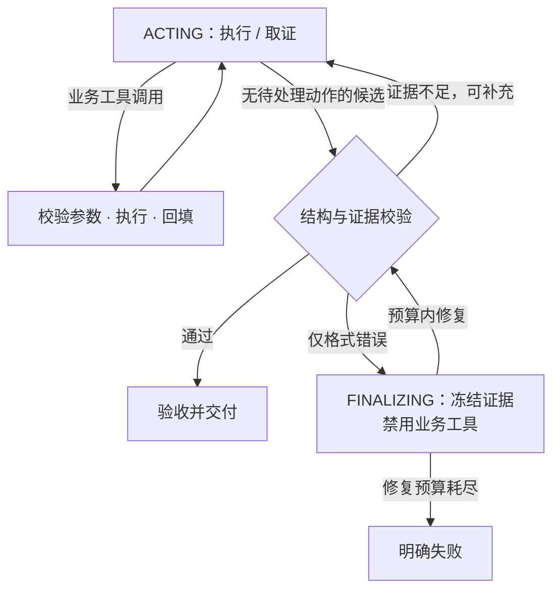

可靠性来自正确的责任边界，而不只是更严格的输出格式。

在 Agent 系统中，工具协议描述“接下来怎样做”，结果 Schema 定义“最终交付什么”，运行时则决定“什么时候算完成”。把三个问题压缩成一个 `response_format` 开关，容易得到格式正确却尚未完成任务的结果，也容易让一次格式修复重新触发业务操作。

Anthropic 原生 API 明确允许结构化文本输出与严格工具调用组合使用；Codex 的公开请求路径也同时携带工具自动选择与文本格式配置。两者并不存在普遍性的互斥关系。真正需要设计的是**输出通道、执行阶段和结果验收之间的边界**。[1][r1][7][r7][8][r8]

> 核心命题：**Schema 有效性不等于终态，模型提交不等于运行时接受。** 本文依据官方文档与公开源码比较实现；状态机、适配接口及验收策略属于工程设计推演，不是三套产品共同承诺的接口，也不构成端点兼容性实测。

## 一、先分清四个不同的问题

| 层次 | 负责的问题 | 不应承担的问题 |
| --- | --- | --- |
| 工具参数 Schema | 某个动作需要哪些输入，类型与约束是什么 | 是否已完成整个任务 |
| 最终结果 Schema | 业务系统接受怎样的数据结构 | 数据是否真实、证据是否充分 |
| `tool_choice` | 本次调用允许、强制或禁止哪些工具选择 | 最终结果的全部格式与验收逻辑 |
| JSON / JSONL 事件流 | 如何传输消息、工具事件、进度与结果 | 将第一段合法 JSON 判为最终交付 |

OpenAI 官方文档将工具调用中的结构约束与面向用户的结构化响应区分开来；Codex 的 `--json` 与 `--output-schema` 也分别面向事件输出与结果约束。[2][r2][6][r6]

### 相似参数名，不等于相同抽象层

| 接口 | 结构化结果入口 |
| --- | --- |
| OpenAI Chat Completions | `response_format` |
| OpenAI Responses | `text.format` |
| Anthropic 原生 Messages API | `output_config.format` |
| Claude Agent SDK · TypeScript | `outputFormat` |
| Claude Agent SDK · Python | `output_format` |

前三行是模型 API 的格式配置；后两行是 Agent SDK 的工作流选项。SDK 可以使用 CLI、内部工具和校验重试来履行该选项，不能因为字段叫 `output_format`，就认定它被原样发送给模型 API。[1][r1][2][r2][10][r10][12][r12]

### 原生双通道的含义

下面展示 OpenAI Responses 风格的请求字段组合，省略模型、输入和完整工具定义：

```ts
const outputControls = {
  tools: businessTools,
  tool_choice: "auto",
  text: {
    format: {
      type: "json_schema",
      name: "final_result",
      strict: true,
      schema: resultSchema,
    },
  },
};
```

这不是要求工具调用也符合 `resultSchema`。工具调用走其原生协议；格式配置约束对应的文本输出。Codex 的请求构造将 `tools`、自动工具选择和 `text` 放在同一个请求对象中。[7][r7][8][r8]

但是，“这个文本通过了 Schema”仍不足以判定任务结束：还需要知道是否存在未处理调用、是否为进度消息，以及对应的 turn 是否真正完成。因此，消费者不应在流中发现第一段可解析 JSON 时立即返回。

## 二、从 initial 请求，转向明确的执行阶段

“首次请求不带 `response_format`，校验失败后再使用强制 Schema 修复”是一种可行的**乐观输出策略**，但它的理由应是兼容性与阶段隔离，而不是“格式约束必然阻止工具选择”。

更准确的控制单位不是第几次模型调用，而是任务处于什么阶段。一个用户回合可能包含多次工具调用和模型续轮，每次续轮都可能仍在取证。



*执行与修复的分支：格式错误使用已有证据，证据不足则重新取证。图示为建议状态机；无法补证时明确返回信息不足，拒绝、截断和传输错误按第九节分类处理。*

### ACTING：执行与取证

从任务开始就向模型说明最终交付契约，但是否启用原生格式约束由输出策略决定。模型调用业务工具，运行时验证参数、执行动作并回填结果；尚未完成时，继续保持 ACTING。

**告知契约与强制解码是两个独立时机。** 例如审计结果要求文件、行号、严重性和证据，那么执行阶段就应该按这些字段采集信息。直到修复阶段才补充字段要求，可能迫使模型填补从未收集过的事实。

### VALIDATING：候选结果验收

出现候选结果后，先确认当前调用没有失败或被截断，再判断是否仍有待处理动作。随后进行结构校验和业务校验。候选结果可以来自受约束文本、结果提交工具，或自由文本中的约定输出。

通过全部条件才接受交付。结构错误可以修复；事实不充分则应继续取证，或交付明确的信息不足状态。两种反馈应分开表达。

### FINALIZING：只修格式，不重新做事

纯格式修复使用冻结的证据快照、候选结果、应用 Schema 和具体校验错误；不提供业务工具，在端点支持时显式禁止工具选择。修复后重新验收，而不是绕过业务校验直接落库。

“强制 JSON Schema”也必须有能力前提：如果当前端点不支持原生结果 Schema，可以切换到支持该能力的 finalizer，或使用只允许结果提交的工具协议。不能对不支持的端点反复发送同一个格式参数。

> 修复器的职责是整理已有事实，不是制造缺失事实。需要新证据时，必须显式回到执行阶段。

## 三、pi：把最终结果变成一个终止型工具

pi 官方仓库包含 `packages/coding-agent/examples/extensions/structured-output.ts`。该扩展注册 `structured_output`，将最终结构作为工具参数；执行后把数据放入 `details`，并返回 `terminate: true`。它展示的是一个可以结束自动续轮的结果提交工具，而非所有 pi 会话默认开启的全局输出模式。[3][r3]

模型仍在同一个工具选择空间里决策：选择业务工具就执行并回填，选择 `structured_output` 就提交候选结果。工具参数成为最终数据通道，运行时仍保留验收权。

### 生成约束与执行校验是两层防线

pi 的工具约束采样支持 `constrainedSampling`。其中 `strict: "prefer"` 表示可用时使用严格约束，不能满足时可退回普通工具调用；`strict: "require"` 则在无法履行严格约束时失败。源码还会将工具 Schema 转换为适用的严格子集。这些限制属于 pi 的适配实现，不能直接当成所有厂商的原生 JSON Schema 限制。[4][r4]

执行前，`validateToolArguments()` 会进行本地参数处理与检查。该实现包含可选空值归一化和类型转换，所以“通过框架参数校验”不总意味着“原始输出未经转换就满足应用契约”。对最终业务数据，应明确是否允许转换，并保留原始值与转换后的值用于排错。[4][r4][5][r5]

### `terminate: true` 不是无条件的全局停止

pi 的 `shouldTerminateToolBatch()` 检查：当前批次非空，且每一个最终工具结果都要求终止，才跳过自动模型续轮。[5][r5]

| 同批工具调用 | 是否满足批次终止条件 |
| --- | --- |
| 仅 `structured_output`，结果为 `terminate: true` | 满足，可跳过自动续轮 |
| `read_file` 与 `structured_output` 混合，前者未要求终止 | 不满足，继续正常处理 |

这避免仅因一个提交动作就把同批工作误判为全部完成。与此同时，它不是事务隔离保证：扩展工具自己的 `execute()` 可能已经运行。生产系统若要求严格的最终结果原子性，应在执行前识别混合批次，或把结果工具实现为“暂存候选”，待整批验收后再正式提交。

**可以借鉴的不是某个字段名，而是把“提交意图”与“运行时结束决策”显式分离。**

## 四、Codex：输出 Schema 与工具自动选择共存

Codex CLI 的非交互模式区分事件流、结果 Schema 和最终消息保存：

```bash
codex exec "审计当前仓库并交付结果" \
  --json \
  --output-schema ./result.schema.json \
  -o ./result.json
```

`--json` 产生 JSONL 运行事件；`--output-schema` 提供结果约束；`-o` 保存最终消息。它们是不同的出口与控制项。[6][r6]

### 从用户选项到模型请求

| 所在阶段 | 字段或转换 |
| --- | --- |
| Turn 输入 | `final_output_json_schema` |
| Prompt 构造 | `Prompt.output_schema` |
| 请求序列化 | `create_text_param_for_request(...)` |
| Responses 请求 | `text.format`，包含类型、Schema、strict 与 name |

正常 turn 将最终输出 Schema 写入 prompt；请求构造时仍包含工具定义与 `tool_choice: "auto"`。这条路径不是等自由文本校验失败之后，才临时注入结果 Schema。具体 strict 设置存在内部会话例外，因此不应扩大为“所有 Codex 内部调用都严格相同”。[7][r7][8][r8]

TypeScript SDK 也有清楚的桥接：`outputSchema` 被写入临时文件，再传给 CLI 的 `--output-schema`。SDK 消费运行事件并返回最终消息；结果文本仍需要应用按自己的契约进行解析和业务校验。[9][r9]

### 对消费者最重要的约束

即使每个候选文本都满足结果 Schema，也不能以“第一个校验成功的对象”作为任务结束条件。消费者应依据 SDK/CLI 的完成与错误事件选择最终结果，再进行验收。

```ts
// 不应把“第一段合法 JSON”当作终态。
// 先依据运行时事件确认完成，再解析选定的最终消息。
const candidate: unknown = JSON.parse(completedTurn.finalResponse);
const result = validateCanonicalResult(candidate);
await validateBusinessEvidence(result);
```

以上为消费顺序示意，`completedTurn` 和两个校验函数由应用提供。原生格式约束可以减少结构错误，却不能替应用判断工作是否完成、结论是否有证据。

## 五、Claude Code：区分原生 API 与 Agent SDK

Anthropic 原生 Messages API 允许 `output_config.format` 与工具的 `strict: true` 组合：前者约束结构化文本，后者约束工具名称与输入。[1][r1]

但 Claude Agent SDK 并不等于一次 Messages API 调用。SDK 运行 Claude Code 的 Agent 能力，提供多轮工具使用、执行循环与最终结果出口。[10][r10][13][r13]

### 公开接口与可确认的内部机制

TypeScript 使用 `outputFormat`，Python 使用 `output_format`；Python SDK 的桥接代码把 Schema 转成 CLI 参数 `--json-schema`，并非将 Agent 选项原样交给原生 API。[10][r10][12][r12]

官方 TypeScript SDK 变更记录明确提到内部 `StructuredOutput` 工具，以及结构化输出重试失败时附带最后一个工具校验错误。这可以支持以下抽象，但不能证明每一次请求的完整隐藏编排细节：[11][r11]

Agent 先通过业务工具完成工作，再通过 `StructuredOutput` 提交候选；校验不匹配时在预算内重新提示，最终从 `structured_output` 或相应错误状态交付结果。

因此，不应仅凭公开参数推断“始终强制某个工具”“固定第 N 轮注入”“成功提交后绝无模型续轮”，也不能断言内部完全不用原生约束解码。

### 成功状态与结果存在性需要分别检查

官方文档提醒，成功结果消息也可能缺少 `structured_output`。消费端应同时检查状态和字段存在性，并在外围处理 SDK 迭代抛出的异常。结构化输出重试上限也是一种独立失败。[10][r10]

```ts
// 放在 SDK 消息循环内；外围仍需 try/catch。
if (message.type === "result") {
  if (
    message.subtype !== "success" ||
    message.structured_output === undefined
  ) {
    throw new Error("Agent did not deliver structured output");
  }

  const candidate: unknown = message.structured_output;
  // 再执行应用级类型、证据与业务完成条件校验。
}
```

使用 `undefined` 判断字段缺失，而非笼统的 truthiness 判断；是否允许 `null` 则由具体业务契约决定。

## 六、实现对照：它们并没有采用同一种折中

| 实现与研究范围 | 输出路径 | 终止或验收边界 |
| --- | --- | --- |
| pi 官方扩展 + Agent loop | `structured_output` 参数 → `details` | 整批结果均要求终止，才跳过自动续轮；不是默认全局模式 |
| Codex 公开 CLI / SDK | 输出 Schema → `text.format`，同时保留 `tool_choice: auto` | 根据完成与错误事件识别最终消息，再做应用验收 |
| Claude Agent SDK | `StructuredOutput` 提交候选，输出 `structured_output` | 校验与有限重试；检查成功状态和结果存在性 |

表中机制分别来自上述源码与官方文档；Claude 一栏仅表达公开材料支持的抽象，不推定完整内部编排。[3][r3][5][r5][7][r7][8][r8][9][r9][10][r10][11][r11][12][r12]

### 抽象为三种可选架构

| 方案 | 数据出口 | 优先解决的问题 | 仍需处理的边界 |
| --- | --- | --- | --- |
| 原生双通道 | 受 Schema 约束的最终文本 | 同一工具循环中的结构化输出 | 端点组合能力、进度与终态识别 |
| 终止型结果工具 | 提交工具的参数 | 显式提交意图、统一工具选择空间 | 提前提交、混合批次、结果工具验收 |
| 独立收尾调用 | 禁用业务工具的结果调用 | 将执行与格式化隔离 | 额外成本、证据传递、语义漂移 |

上一张表比较具体实现；本表是从这些机制抽出的架构分类。一个运行时可以同时支持多种策略，而不是要求所有模型都服从同一种协议。

### 如何理解“首次不带，失败再修复”

它是独立收尾方案的乐观变体：先验收执行阶段的最终候选，只有结构不合格才支付额外收尾成本。策略本身合理，但必须满足四个前提：从开始就提供契约；只在确认为最终候选时校验；只把格式错误交给修复器；修复器不能重放业务操作。

在已验证原生双通道的端点上，关闭执行阶段 Schema 未必有收益。对于有大量自然语言进度、供应商差异或旧系统兼容要求的工作流，阶段隔离则可能更容易控制。这属于需要评估的设计取舍，不是未经实验就能成立的优劣排序。

### 把所有工具动作塞进一个巨型 JSON，有什么代价

也可以定义 `kind: tool_call | final` 的联合 Schema，自行分发工具。但当系统已有可靠原生工具协议时，这会将调用标识、参数增量、并行调用、工具结果配对和错误回填重新变成应用责任。

这种方案适合自定义动作空间或特定仿真环境；不应仅为了“所有东西都长得一样”，就抛弃已有的协议能力。统一应该优先发生在运行时适配层，而非强迫每个模型输出相同的伪工具 JSON。

## 七、运行时抽象：表达契约，而非绑定参数名

业务层应声明结果契约和工具策略，再由适配器选择原生格式、结果工具或独立收尾。下面的 TypeScript 是建议的接口设计，不是某个 SDK 的现成 API。

```ts
type OutputStrategy =
  | "auto"
  | "native"
  | "terminal-tool"
  | "finalize";

type Validation<T> =
  | { ok: true; value: T }
  | { ok: false; errors: string[] };

interface OutputContract<T> {
  canonicalSchema: Record<string, unknown>;
  strategy: OutputStrategy;
  parse(value: unknown): Validation<T>;
  validateEvidence(value: T, snapshotId: string): Promise<void>;
  maxRepairAttempts: number;
}

interface EndpointCapabilities {
  nativeOutputSchema: boolean;
  toolsWithOutputSchema: boolean;
  strictToolArguments: boolean;
  forcedToolSelection: boolean;
}

type ModelBlock =
  | { type: "text"; text: string }
  | {
      type: "tool_call";
      id: string;
      name: string;
      arguments: unknown;
    };

interface ModelStep {
  blocks: ModelBlock[];
  status: "completed" | "incomplete" | "refused" | "failed";
  continuationState?: unknown;
}
```

这里有三个刻意保留的边界。

**未校验参数保持 `unknown`。** 在 JSON 解码成功之前不能当成对象；在业务 Schema 校验成功之前，也不能当成可信类型。

**一次响应保留多个内容块。** 不应一收到供应商响应，就不可逆地压成 `ToolCall | FinalJson`。先保留文本、多项调用及必要的协议续传状态，再由运行时分类。需要保留的隐藏签名或其他不透明状态交由适配器处理，不要求应用解析其内部内容。

**能力表绑定真实路由。** 兼容性键至少应包括供应商、端点、模型和适配器版本，并附带已测试的 Schema 特征。`nativeOutputSchema: true` 不自动推出 `toolsWithOutputSchema: true`；“支持严格工具”也不等于“支持任意 JSON Schema”。

### 结果提交必须是受控入口

建议把最终结果工具理解为 `submit_result`：它提交一个候选，而不是直接获得终止全部任务的权力。运行时验收成功后，才更新最终结果记录。

| 当前响应 | 建议决策 |
| --- | --- |
| 只有业务工具调用 | 校验、执行、回填，继续 ACTING |
| 只有一个结果提交 | 在确认无待处理动作后进入验收 |
| 业务工具与结果提交混在同批 | 延迟或拒绝结果提交；完整回填本批调用结果 |
| 多个结果提交 | 按明确冲突策略处理，不悄悄取最后一个 |
| 只有文本，但任务仍需证据 | 继续执行或返回信息不足，不进入纯格式修复 |
| 拒绝、截断、模型错误 | 进入对应失败路径，不执行不完整调用 |

对于带副作用的业务工具，不能在发现混合批次之前就并发启动所有操作，再试图用“最终输出已接受”掩盖执行中的工作。

## 八、五道验收门：什么时候可以真正交付

验收不是单个 `JSON.parse()`。下面是建议的应用验收顺序，不是模型 API 自动完成的保证。

| 验收环节 | 通过条件 |
| --- | --- |
| 1. 调用状态 | 调用正常完成，未拒绝、截断或失败 |
| 2. 执行闭环 | 没有未处理的工具、审批或子任务，候选对应当前完成状态 |
| 3. 结构校验 | 可解析，且满足应用原始 Schema |
| 4. 业务与证据 | 结论有依据，满足任务完成条件 |
| 5. 一致性提交 | 结果绑定任务与证据版本，幂等提交后才触发下游 |

### 应用 Schema 与供应商 Schema 分开保存

应用原始 Schema 是真正的业务契约；供应商 Schema 是为了适配特定端点而生成的约束版本。生成时可以映射，但验收时必须回到应用契约，不能因为适配器删掉某个约束就把它视为业务上也不重要。

例如 OpenAI 严格输出对对象字段的 `required` 与 `additionalProperties: false` 有明确要求，可空字段可以表达可缺失信息。这是具体接口的约束，不能无差别套用到所有供应商。[2][r2]

### 缺失信息也需要合法结构

强迫模型为每项业务事实提供一个正常值，可能产生结构完美但内容虚构的结果。契约应容纳真实的不完整状态，例如：

```json
{
  "status": "incomplete",
  "findings": [],
  "missing_fields": ["dependency_version"],
  "reason": "无法读取锁文件，不能确认安装版本"
}
```

`findings: []` 也不能默认解释为“确认无问题”；这里必须结合 `status` 和证据范围读取。业务层的信息不足状态，与传输失败、模型拒绝、执行取消仍应分别记录。

### 纯格式修复应锁定证据版本

建议每次修复绑定同一个 `snapshotId`，其中只包含已完成的工具结果、已确认事实和允许引用的材料。修复完成后，重新验证字段值是否仍受这些材料支持。

即使修复器没有业务工具，它仍可能改写数值、扩大结论或补入不存在的事实。因此，“禁用工具”只隔离执行副作用，不能替代证据校验。候选文本和工具输出中的指令性内容，也应作为不可信数据处理。

### 流式输出保持暂态，提交保持幂等

增量 JSON 可用于界面预览，但完整结果经接受前不应触发正式落库或下游业务动作。结果记录可绑定 `runId + contractVersion + evidenceVersion` 等稳定标识；具体幂等键应符合业务语义。

对于已经执行过的写入，模型或网络重试不能直接推导为业务重试。先查询动作状态、复用幂等键或采用补偿策略，避免格式失败造成重复提交。

## 九、失败分类与测试：验证兼容，而不只验证参数能传

| 失败类型 | 应对方式 |
| --- | --- |
| JSON 语法、类型或枚举不匹配 | 基于具体错误做有限修复，再次校验 |
| 结论缺乏证据、必需事实未取得 | 显式重新取证，或交付信息不足 |
| 截断、输出预算不足 | 调整输出规模或预算；不执行残缺工具参数 |
| 模型拒绝 | 作为拒绝处理，不反复改造成普通 JSON |
| API 不支持格式参数或 Schema | 调整适配或路由，避免盲目重试同一请求 |
| 429、连接失败、超时 | 使用传输层重试；有副作用时先确认执行状态 |
| 超过修复或整体预算 | 返回明确失败与诊断，不无限自我修复 |

拒绝和截断是原生结构化输出也需要处理的状态；运行时应在进入普通结果解析前区分它们。[1][r1][2][r2]

兼容性测试应覆盖：不调用工具直接交付、多轮工具后交付、文本与工具同时出现、结果提交与业务工具混批、多个最终提交、合法结构但证据不足、流式截断、成功事件缺少结果，以及修复时是否重复触发业务操作。

**“API 接受参数”只是最浅的一项测试。** 还要验证工具是否仍可正常选择、参数与结果是否正确配对，以及消费者是否在正确的终态提交结果。

### 成本必须按实际工作流测量

乐观修复的简化成本可写为：

```text
执行成本 + 格式失败概率 × 收尾成本
```

它不是完整计费模型。上下文重传、证据压缩、Schema 变化、模型路由和缓存行为都会影响结果。Anthropic 文档区分 prompt cache 与语法缓存，并说明修改格式配置可能影响缓存，因此不能仅按调用次数判断哪种方案更便宜。[1][r1]

建议分别观察有效交付率、错误接受率、格式修复率、提前提交率、重复副作用次数、完成延迟与每次有效交付成本。降低格式错误有价值，但不能以提前接受不完整任务为代价。

## 结语：格式是契约，完成是一次决策

兼容工具选择与结构化结果，不需要预先认定二者只能择一。可用端点可以采用原生双通道；复杂工具工作流可以用结果提交工具显式表达交付意图；兼容旧系统或隔离格式化时，可以增加独立收尾阶段。

无论采用哪条路径，都应保持同一组不变量：执行前知晓契约，执行中保留协议状态，提交时检查工作闭环，修复时不扩大权限，接受时同时验证结构与事实。

**工具决定怎样做，Schema 定义交付什么，运行时决定何时完成。**

## 参考资料与源码入口

引用用于定位可核查实现；方案选择、状态机与验收模型属于本文的工程归纳。源码链接固定到核对版本，避免主分支变化掩盖实现差异。

[1][r1] [Anthropic：Structured outputs](https://platform.claude.com/docs/en/build-with-claude/structured-outputs)。原生格式、严格工具、组合能力及缓存与异常边界。

[2][r2] [OpenAI：Structured model outputs](https://developers.openai.com/api/docs/guides/structured-outputs)。工具调用与结构化文本、Schema 子集、拒绝与不完整响应。

[3][r3] [pi：structured-output 扩展示例](https://github.com/earendil-works/pi/blob/898ab804050730e9dcefb4443875d5a932aa6a32/packages/coding-agent/examples/extensions/structured-output.ts)。结果工具、`details` 与 `terminate`。

[4][r4] [pi：constrained-sampling.ts](https://github.com/earendil-works/pi/blob/898ab804050730e9dcefb4443875d5a932aa6a32/packages/ai/src/api/constrained-sampling.ts)；[validation.ts](https://github.com/earendil-works/pi/blob/898ab804050730e9dcefb4443875d5a932aa6a32/packages/ai/src/utils/validation.ts)。约束采样策略与参数本地校验。

[5][r5] [pi：agent-loop.ts](https://github.com/earendil-works/pi/blob/898ab804050730e9dcefb4443875d5a932aa6a32/packages/agent/src/agent-loop.ts)。批次终止、执行前校验及截断调用处理。

[6][r6] [Codex：Non-interactive mode](https://developers.openai.com/codex/noninteractive)。JSONL 事件、输出 Schema 和最终消息文件。

[7][r7] [Codex：session/turn.rs](https://github.com/openai/codex/blob/8a3c4ea3b5a7c0e92cf24dae46ec87629a26bb7f/codex-rs/core/src/session/turn.rs)；[client.rs](https://github.com/openai/codex/blob/8a3c4ea3b5a7c0e92cf24dae46ec87629a26bb7f/codex-rs/core/src/client.rs)。Schema 注入正常请求，同时保留工具自动选择。

[8][r8] [Codex：codex-api/common.rs](https://github.com/openai/codex/blob/8a3c4ea3b5a7c0e92cf24dae46ec87629a26bb7f/codex-rs/codex-api/src/common.rs)。`create_text_param_for_request()` 与 `text.format`。

[9][r9] [Codex TypeScript SDK：thread.ts](https://github.com/openai/codex/blob/8a3c4ea3b5a7c0e92cf24dae46ec87629a26bb7f/sdk/typescript/src/thread.ts)；[exec.ts](https://github.com/openai/codex/blob/8a3c4ea3b5a7c0e92cf24dae46ec87629a26bb7f/sdk/typescript/src/exec.ts)。Schema 文件桥接与事件消费。

[10][r10] [Claude Agent SDK：Get structured output from agents](https://code.claude.com/docs/en/agent-sdk/structured-outputs)。多轮工具工作流、结果字段与失败处理。

[11][r11] [Claude Agent SDK TypeScript：CHANGELOG](https://github.com/anthropics/claude-agent-sdk-typescript/blob/58d2e4b81bdca2c6ce10e6e5db22ad7acdc1d58c/CHANGELOG.md)。`StructuredOutput` 工具与重试错误的发布记录。

[12][r12] [Claude Agent SDK Python：subprocess_cli.py](https://github.com/anthropics/claude-agent-sdk-python/blob/2c24c8248d0b52d44ff352854d7b679ac37b0db7/src/claude_agent_sdk/_internal/transport/subprocess_cli.py)。Agent 输出选项到 `--json-schema` 的桥接。

[13][r13] [Claude Agent SDK overview](https://code.claude.com/docs/en/agent-sdk/overview)。Agent SDK 与原生 Client SDK 的职责区别。

[r1]: https://platform.claude.com/docs/en/build-with-claude/structured-outputs
[r2]: https://developers.openai.com/api/docs/guides/structured-outputs
[r3]: https://github.com/earendil-works/pi/blob/898ab804050730e9dcefb4443875d5a932aa6a32/packages/coding-agent/examples/extensions/structured-output.ts
[r4]: https://github.com/earendil-works/pi/blob/898ab804050730e9dcefb4443875d5a932aa6a32/packages/ai/src/api/constrained-sampling.ts
[r5]: https://github.com/earendil-works/pi/blob/898ab804050730e9dcefb4443875d5a932aa6a32/packages/agent/src/agent-loop.ts
[r6]: https://developers.openai.com/codex/noninteractive
[r7]: https://github.com/openai/codex/blob/8a3c4ea3b5a7c0e92cf24dae46ec87629a26bb7f/codex-rs/core/src/session/turn.rs
[r8]: https://github.com/openai/codex/blob/8a3c4ea3b5a7c0e92cf24dae46ec87629a26bb7f/codex-rs/codex-api/src/common.rs
[r9]: https://github.com/openai/codex/blob/8a3c4ea3b5a7c0e92cf24dae46ec87629a26bb7f/sdk/typescript/src/thread.ts
[r10]: https://code.claude.com/docs/en/agent-sdk/structured-outputs
[r11]: https://github.com/anthropics/claude-agent-sdk-typescript/blob/58d2e4b81bdca2c6ce10e6e5db22ad7acdc1d58c/CHANGELOG.md
[r12]: https://github.com/anthropics/claude-agent-sdk-python/blob/2c24c8248d0b52d44ff352854d7b679ac37b0db7/src/claude_agent_sdk/_internal/transport/subprocess_cli.py
[r13]: https://code.claude.com/docs/en/agent-sdk/overview
