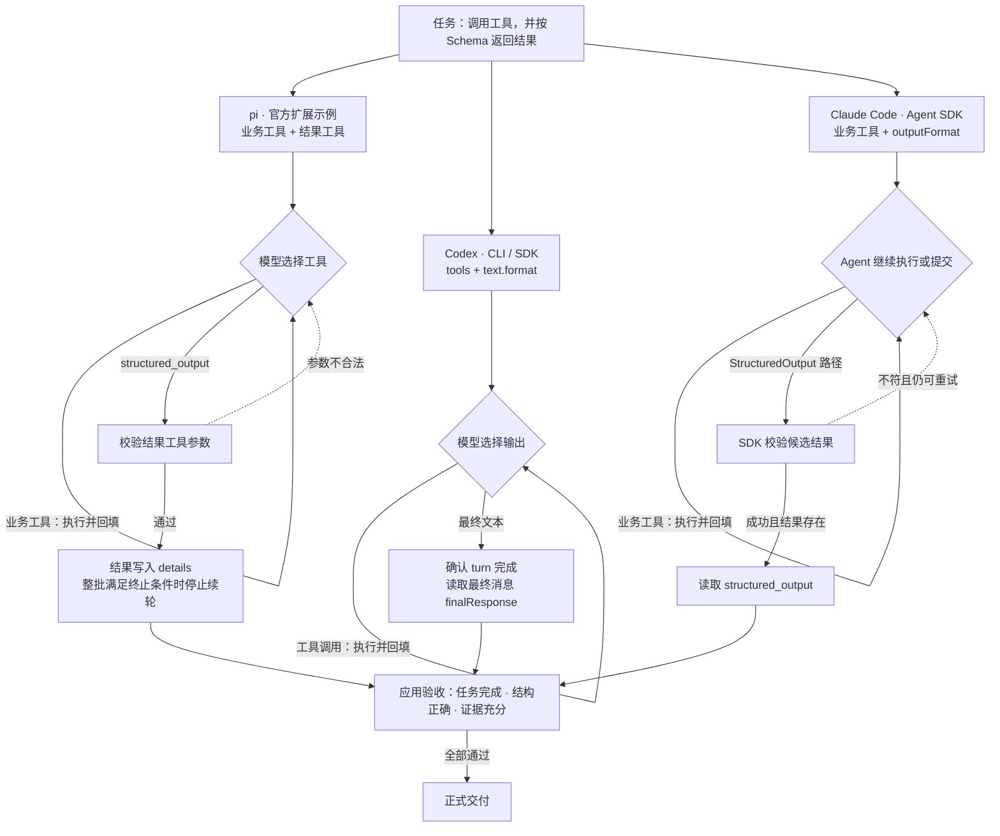

格式规定结果长什么样，运行时决定什么时候可以交付。

**工具调用与结构化结果不必二选一。** pi 可以把结果作为工具参数提交；Codex 在正常请求里同时携带工具和结果 Schema；Claude Agent SDK 组织结构化提交、校验与重试。[pi][pi-tool] · [Codex][codex-client] · [Claude][claude-doc]

## 一图对照：从调用工具到交付结果

*回环表示工具执行后继续调用模型，虚线表示校验反馈。三条分支是不同实现，不是同时运行的三个 Agent；底部的业务验收是应用责任，不是框架自动保证。拒绝、截断和预算耗尽应单独退出失败路径。*

## 三个不能省略的边界

| 分支 | 读图时需要注意 |
| --- | --- |
| **pi** | 这是官方结果工具**扩展示例**，并非所有会话的默认行为。只有当前批次的每个最终工具结果都要求 `terminate: true`，才跳过自动续轮；混合批次不能仅凭一次结果提交就结束。[源码][pi-loop] |
| **Codex** | 结果 Schema 从正常请求阶段就可以存在，不是失败后才加入。`--json` 是事件流，不是业务结果；应按完成与错误事件选择最终消息，而非接受第一段合法 JSON。[请求][codex-client] · [SDK][codex-sdk] |
| **Claude Code / SDK** | `StructuredOutput` 路径有官方发布记录支持；图示不声称还原闭源内部的全部调用顺序。消费端同时检查成功状态和 `structured_output` 是否存在。[文档][claude-doc] · [发布记录][claude-log] |

## “首次不带 format，失败后再修复”是否必要？

**不是通用前提，而是一种兼容策略。** 真实端点支持工具与 Schema 共存时，可以直接组合；需要隔离格式阶段时，再采用独立收尾调用。

采用修复策略时，从任务开始就告知结果契约；只有**格式错误**进入修复，冻结已有证据并禁用业务工具。缺少证据应重新取证或返回信息不足，不能靠修 JSON 补造事实。这是建议的运行时策略，不是三套 Agent 的共同内部实现。

**格式正确只是验收的一项，不能代替任务完成。**

源码与证据范围

**pi**：[结果工具扩展][pi-tool]、[工具循环与批次终止][pi-loop]。固定到 `898ab804`。

**Codex**：[请求构造][codex-client]、[text.format 序列化][codex-format]、[TypeScript SDK 事件消费][codex-sdk]。固定到 `8a3c4ea3`。

**Claude**：[Agent SDK 结构化输出文档][claude-doc]、[StructuredOutput 发布记录][claude-log]。发布记录固定到 `58d2e4b8`；据此区分可确认能力与未公开内部细节。

本图为上述证据的流程归纳，不构成对全部供应商、模型或第三方兼容端点的实测保证。

[pi-tool]: https://github.com/earendil-works/pi/blob/898ab804050730e9dcefb4443875d5a932aa6a32/packages/coding-agent/examples/extensions/structured-output.ts
[pi-loop]: https://github.com/earendil-works/pi/blob/898ab804050730e9dcefb4443875d5a932aa6a32/packages/agent/src/agent-loop.ts
[codex-client]: https://github.com/openai/codex/blob/8a3c4ea3b5a7c0e92cf24dae46ec87629a26bb7f/codex-rs/core/src/client.rs
[codex-format]: https://github.com/openai/codex/blob/8a3c4ea3b5a7c0e92cf24dae46ec87629a26bb7f/codex-rs/codex-api/src/common.rs
[codex-sdk]: https://github.com/openai/codex/blob/8a3c4ea3b5a7c0e92cf24dae46ec87629a26bb7f/sdk/typescript/src/thread.ts
[claude-doc]: https://code.claude.com/docs/en/agent-sdk/structured-outputs
[claude-log]: https://github.com/anthropics/claude-agent-sdk-typescript/blob/58d2e4b81bdca2c6ce10e6e5db22ad7acdc1d58c/CHANGELOG.md
