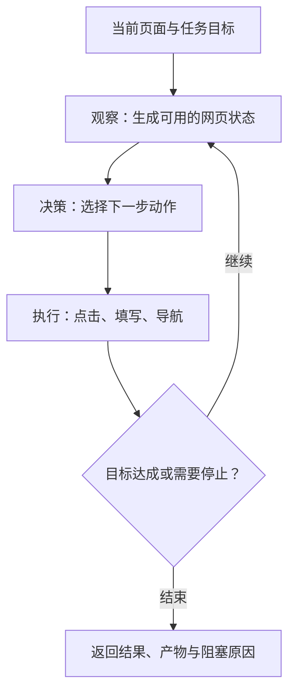
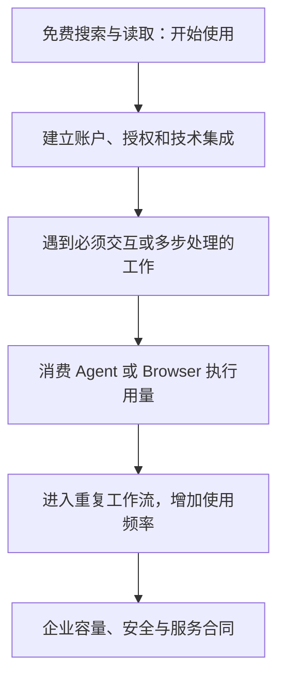
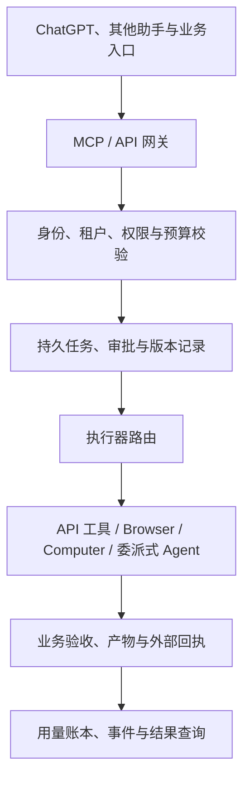

当 ChatGPT 调用 TinyFish 完成网页任务时，究竟是谁在决定下一步：ChatGPT，还是 TinyFish 自己？这个问题决定了上下文在哪里流动、模型成本由谁承担，也决定了服务商究竟在出售浏览器环境，还是完整的任务执行能力。

**核心区别是：MCP 规定能力如何被调用，并不规定推理必须发生在哪里。TinyFish 同时提供由外部脚本或模型驱动的 Browser，以及由内部 Agent 自主执行的 Web Agent。** 将两者混为一谈，就容易把“一个收费的执行服务”误解成“借用 ChatGPT 大脑的浏览器工具壳”。[1] [2]


## 1. 从问题入手：浏览器服务与网页 Agent 不是同一层

业务工作往往停留在网页上：信息要经过交互才能出现，后台需要登录，表单有条件字段，流程会跨页面变化。解决这些问题至少需要两种能力：**可以操作网站的环境**，以及**根据页面变化选择下一步的决策系统**。它们可以由同一家公司提供，也可以分开组合。

先约定几个术语。**Host（宿主）**是 ChatGPT 等承载对话和工具调用的产品；**MCP（Model Context Protocol，模型上下文协议）**连接宿主与外部工具、数据；**CDP（Chrome DevTools Protocol）**用于低层浏览器控制；**Runtime（运行时）**负责执行、状态与资源管理。Agent 则在运行环境之上组织观察、决策和动作循环，不等于单独一个模型。

| 维度 | Browser：宿主驱动 | Web Agent：目标委派 |
|---|---|---|
| 输入 | 脚本、浏览器控制动作 | URL、目标、必要资料、约束 |
| 下一步由谁决定 | 调用方的模型或脚本 | TinyFish 内部执行 Agent |
| 服务的主要交付 | 托管浏览器与会话 | 多步骤网页执行及结果 |
| 上层交互粒度 | 可以逐步观察、决策与操作 | 委派目标，再查询过程和结果 |
| 计量维度 | 独立浏览器会话时间 | Agent 内部执行步骤 |

TinyFish 官方明确将两种 API 分开：需要控制每一步时使用 Browser，需要让服务根据目标决定动作时使用 Agent。[1] [2]

因此，“封装浏览器操作 MCP，让 ChatGPT 按需使用”是一种成立的架构，但只描述了第一类能力。目标委派模式更接近**上层任务编排者与下层执行 Agent 的协作**：上层理解业务意图，下层消化网页细节。

这里还存在一个容易遗漏的中间层：**仅返回 CDP 连接地址，不等于 ChatGPT 已经可以直接操作浏览器。** 宿主仍需可调用的动作工具，或能运行 Playwright、Puppeteer 等代码的受控执行环境。Browser 提供的是可连接的基础设施，而不是自动完成全部接入。

同样，浏览器不等于完整 Computer。公开的 Chromium 与 CDP 能力，不能自动推导为任意终端、系统依赖、代码仓库、后台进程或 GPU 环境。需要 Coding、测试和文件加工的系统，应把计算机沙箱视为另一类执行器。[2]

## 2. 一次调用如何穿过 ChatGPT、MCP 与 TinyFish

### 2.1 接入协议、任务服务与计费是三件事

| 层次 | 负责什么 | 不能据此推导什么 |
|---|---|---|
| 插件／连接入口 | 发现、安装、授权，提供使用说明和可选界面 | 不自动产生服务端执行能力 |
| MCP 工具契约 | 工具名称、描述、输入输出 Schema、调用结果 | 不自动共享完整对话或模型额度 |
| TinyFish API 与 Runtime | 创建运行、控制浏览器、执行任务、返回结果 | 不天然知道全部业务背景 |
| 身份、权限与用量账户 | 确定谁能使用哪些能力，记录资源消费 | 不代替目标网站自身的授权 |

OpenAI 的官方文档把工具交互描述为能力发现、模型选择工具并生成参数、服务端验证执行、返回结果。TinyFish 的 MCP 文档提供对应工具，并说明其连接使用 OAuth 2.1。[3] [4] [5]


*图为依据公开接口抽象的职责边界，不是对 TinyFish 私有部署的还原。*

首次连接时，用户授权宿主访问 TinyFish。运行时，服务端根据经验证的授权识别调用者；模型传入的文字或任意 `user_id` 不应成为权限与扣费依据。这既是身份安全问题，也是收费服务的账务基础。[5]

公开 MCP 文档包含 `run_web_automation`、异步运行、`get_run`、`cancel_run`、`search`、`fetch_content` 和创建浏览器会话等工具。但裸 MCP、经过封装的插件，以及某次会话实际暴露的工具集合，未必完全一致。[3]

目标委派的输入可抽象成：

```json
{
  "url": "https://example.com/application",
  "goal": "读取申请表并填写已确认资料；缺少必填信息时停止，列出缺项；返回操作结果与核验证据。"
}
```

这个例子只展示契约思想，不是完整 SDK 请求，也没有发起实际操作。关键在于，服务拿到的是**传入目标和必要上下文**，并非天然获得宿主全部历史。漏传约束可能导致偏离目标，过量传入资料则增加不必要的数据暴露。

### 2.2 三条通信通道不能混淆

| 通道 | 连接关系 | 作用 |
|---|---|---|
| MCP 传输 | 宿主 ↔ 工具服务 | 工具发现、调用、返回 |
| Agent API／SSE | 调用方 ↔ 执行服务 | 创建运行、接收进度和结果 |
| CDP／WebSocket | 控制器 ↔ 浏览器 | 低层浏览器控制 |

**SSE（Server-Sent Events）**是服务端向客户端持续发送事件的机制。TinyFish Agent API 提供同步 `/run`、异步 `/run-async` 和流式 `/run-sse`；选择方式取决于调用方需要阻塞等待、稍后查询，还是实时展示进度。[1]

这不意味着每个 MCP 调用都会直接暴露一条 Agent SSE，也不意味着宿主在直连 CDP。协议名称相似，不能代替对各层责任的区分。

## 3. 执行机制：观察页面、选择动作，再验证业务结果

### 3.1 WorldModel 与 Mako 分别解决什么

TinyFish 的工程文章将 **WorldModel** 描述为浏览器原生层维护的网页语义表示：识别按钮、输入框、导航、内容与可执行动作，并随页面变化更新。它解决的是“当前页面有哪些可以操作的东西”。[6]

这里的 WorldModel 不是物理世界仿真模型。“不在页面上下文执行 JavaScript 来观察网页”，也不等于网站本身不能执行 JavaScript。工程文章还曾披露独立 microVM 会话隔离；这些属于厂商公开说明，不是本文独立验证过的生产部署。[6]

**Mako** 是 TinyFish 公布的网页执行模型，产品定位包括理解页面语义、选择相关元素、决定动作和维持多步执行。它足以说明 Web Agent 并非完全没有自己的 AI，但不足以确认任意一次运行使用的具体模型版本、权重或调度策略。[7]



这种循环与固定脚本的区别，是下一步可以依据页面变化重新决定。但自主探索同时带来不确定性：执行可能走弯路、需要重试，或者在业务目标未达成时结束。架构不能只讨论“能不能操作”，还要讨论如何判断完成。

### 3.2 运行状态、登录状态与工作状态必须分离

| 状态 | 典型内容 | 保存它仍不能解决什么 |
|---|---|---|
| 运行状态 | 排队、运行、完成、失败、取消 | 不自动证明业务成功 |
| 浏览器登录状态 | Cookie、Local Storage、Session Storage | 不等于完整业务上下文和团队权限 |
| 业务工作状态 | 缺哪些资料、等谁审批、交付了什么 | 不应只存在于一次临时浏览器运行中 |

TinyFish Browser Context Profiles 用于保存网站会话状态；它与 `browser_profile: lite/stealth` 等运行模式不是同一概念。[10]

最重要的语义边界是：**`COMPLETED` 表示运行结束，不保证目标成功。** 官方 Runs 文档分别展示了成功取得数据，以及浏览器运行正常但目标失败的情况。[8]

例如，执行器发现表单缺少必填信息，可以合理地结束运行；业务任务仍然处于需要补充资料的状态。上层可采用如下独立结构：

```json
{
  "runtime_status": "completed",
  "business_status": "needs_input",
  "missing_fields": ["contact_phone"],
  "external_receipt": null
}
```

这是一种参考设计，不是 TinyFish 固定返回格式。验收应检查实际产物、外部回执或可验证效果，而不是只检查状态码。

### 3.3 异步执行不等于宿主会自动长期调度

TinyFish 支持终态 Webhook，即运行结束后的服务端回调；调用方需要处理重复通知，并在敏感流程中进一步读取运行结果核验。[9]

但是，供应商能异步执行，不代表 ChatGPT 会在任意时间自动恢复整项业务。跨入口接续、用户离线后的通知、审批与恢复，需要上层产品自己的持久任务和事件系统。

自然语言目标也不是安全边界。对外提交、发送信息、修改数据等副作用，最终仍需要后端校验授权、必要审批和可追溯记录。网页文字、工具结果和模型解释都不能自行授予权限。

## 4. 计费与单位经济：一次调用不等于一个收费步骤

### 4.1 先锁定计价版本，再进行测算

原研究稿采用 TinyFish 的 Wallet 公开口径：免费读取能力与收费执行能力分开。下表保留这一口径用于理解计量方式，而不是承诺所有账户当前均适用同一价格。[11] [18]

| 产品 | Wallet 公开口径 | 计量对象 |
|---|---:|---|
| Search | 免费，受限额约束 | 搜索请求 |
| Fetch | 免费，受限额约束 | 页面读取 |
| Agent | **$0.016／step** | 内部执行步骤 |
| Browser | **$0.002／分钟** | 独立浏览器会话 |
| Enterprise | 定制合同 | 容量、安全、部署与服务要求 |

**复核边界：公开检索与页面抓取仍同时出现 Wallet 与 Credits／Starter／Pro 文本，部分页面对失败免费、代理费用也有不同说明。不能按抓取顺序认定账户已迁移，更不能把两种版本拼成一张真实账单。生产采购应以实际账户、完整计费规则及合同为准。**

在上述 Wallet 口径中，预付余额与固定月订阅不同；公开说明曾列出新账户初始资金和单次充值最低金额。本文不依赖这些促销条件论证商业模式。[11]

### 4.2 决策位置决定成本归属

Agent 定价说明包含内部模型推理，用户不必为这一内部模型另行提供 API Key。Browser 模式则可以由调用方自备模型或脚本。[2] [11]

因此有两种不同的成本结构：

```text
宿主驱动：调用方决策成本 + 浏览器环境成本
目标委派：上层编排成本 + Web Agent 执行价格
```

MCP 不是模型额度共享协议。接入服务，不会让服务端自动获得用户 ChatGPT 订阅作为后台模型预算；OpenAI 也明确区分 ChatGPT 与 API 的账单体系。[16]

一次宿主工具调用可以触发几十个内部步骤。Step 既不是一条聊天消息，也不能机械等于一次点击或一次进度查询。官方 Runs 文档以执行 Agent 的工具调用步骤解释步骤限制，具体计费事件仍须核对供应商记录。[8]

以表中口径计算，25 个计费步骤是 **$0.40**，50 步是 **$0.80**；另行创建的 Browser 会话运行 10 分钟是 **$0.02**。这些只是数学示例，不代表某类任务固定消耗这么多资源。

费用可写为：

```text
供应商费用
= Agent 计费步骤 × 对应版本单价
+ 另行创建的 Browser 计费分钟 × 对应版本单价
```

不能因为 Agent 内部也使用浏览器，就自动再计一次独立 Browser 费用。也不能将 Browser 售价与 Agent 售价之差视为利润：后者包含不同的决策与执行服务。

### 4.3 “失败免费”不等于“业务不满意就不收费”

部分公开页面出现过 `Failed runs $0`，但 `FAILED` 与业务验收失败不是同一概念。一个未完成业务目标的运行仍可能是 `COMPLETED`。因此，基础设施故障、网站阻塞、资料不足、用户取消和客户不验收，分别怎样收费，需要独立规则，不能只靠一句宣传口径判断。[8] [11]

同样，预算要在服务端真正生效。Runs 文档把自定义 `max_steps` 标为需开通的 Beta 能力；传入参数并不能替代对账户是否支持、达到上限如何停止的验证。[8]

### 4.4 加价一倍，为什么仍可能亏损

下面保留原报告的假设算例，**不是 TinyFish 的真实财务或成功率**。假设某垂直应用执行 1,000 次，每次均产生 25 个计费步骤，供应商费用 $0.40，自有可变成本 $0.10；客户只为验收成功的结果支付 $0.80。

这里假定 1,000 次都是计费执行，例如运行技术上结束但业务未被验收；若供应商对某类失败不收费，应改用实际计费次数。

```text
总可变成本 = 1,000 × ($0.40 + $0.10) = $500
收入 = 1,000 × 业务验收成功率 × $0.80
贡献 = 收入 − $500
```

| 假设业务成功率 | 收入 | 可变成本 | 贡献 | 贡献率 |
|---:|---:|---:|---:|---:|
| 95% | $760 | $500 | $260 | 34.2% |
| 85% | $680 | $500 | $180 | 26.5% |
| 70% | $560 | $500 | $60 | 10.7% |
| 60% | $480 | $500 | −$20 | −4.2% |

该算例的贡献盈亏平衡点是 **62.5%**，还没有覆盖固定研发、销售、税费和额外重试。贡献率不是净利率。

按资源收费，客户更多承担效率波动；按成功结果收费，服务商更多承担失败、重试和验收风险。**计价单位不仅是包装方式，也是风险如何在供需双方之间分配。**

## 5. 商业模式：执行服务是商品，MCP 是分发方式

### 5.1 从免费读取到重复执行：一个待验证的转化模型

TinyFish 于 2026 年 5 月 4 日宣布 Search 与 Fetch 跨多个接入方式免费，其产品同时通过 API、MCP、SDK、CLI 与插件分发。[3] [12]

由此可以建立以下商业分析模型：



**这是一条可能的转化路径，不是已经被公开数据验证的增长飞轮。** 免费用户可能不转付费；一次性填表用户可能不再回来；企业集成也可能带来较高支持成本。存在免费层、付费能力和企业合同，只能证明商业设计存在，不能证明它已高利润运行。

| 客户类型 | 可能付费的原因 | 必须验证的摩擦 |
|---|---|---|
| 助手用户 | 临时任务无需自行搭建自动化 | 低频、第二账户、额外成本 |
| Agent 产品开发者 | 缩短网页执行能力的集成时间 | 成本、稳定性、供应商依赖 |
| 业务自动化与 QA 团队 | 重复流程、高吞吐和证据记录 | 确定性、长尾异常、人工接管 |
| 企业客户 | 身份管理、审计、部署与合同保障 | 采购周期和持续支持成本 |

上表是购买动机分析，不是 TinyFish 披露的客户调研结果。其企业页面列有 SSO、审计、部署和服务保障能力；平台可用性 SLA 也不等于每个网页任务的成功率保证。[13]

### 5.2 MCP 降低接入摩擦，但不构成独占壁垒

MCP 的商业价值，在于用户可以在已有助手中发现和调用外部能力。它不保证模型优先选择某个服务，也不保证平台分发流量。

Microsoft 的 Playwright MCP 已经开源，提供由外部模型调用的浏览器自动化能力。这说明“浏览器动作＋MCP 接口”本身可以被广泛实现。[17]

执行服务更可能形成差异的地方，是会话隔离、复杂流程恢复、稳定访问、资源效率、结果证据、权限控制及企业集成。这些能力需要持续维护，不能从一次成功演示推导出规模化可靠性。

商业贡献应考虑：

```text
执行收入与企业合同收入
− 模型、浏览器、网络、存储等资源成本
− 免费能力与故障支持成本
− 支付、退款及其他可变运营成本
= 用于覆盖固定研发、销售和利润的贡献
```

公开资料没有给出足够证据确认 TinyFish 的 ARR、毛利、留存、获客成本、ChatGPT 渠道占比或平台分成。将“已经收费”解释成“已经验证高利润”，超出了证据。

预付 Wallet 可以减少微小交易的支付摩擦，并限制赊账风险，但充值额不等于已经交付的收入；自动充值也可能放大无效重试。预算、用量账本、异常熔断和可解释账单，都是执行产品的一部分。

## 6. 平台规则：使用既有付费能力，不等于在 ChatGPT 内销售数字额度

接入 ChatGPT、发布公开插件、通过插件发起交易，是三个不同的问题。MCP 能完成技术连接，并不意味着任何商业路径都获准。

OpenAI 的公开插件指南允许用户登录已有付费账户使用既有权益，但限制通过插件销售数字产品或服务，包括订阅、Token 和 Credits；也限制展示套餐、促销升级及直接触发结账。权益不足时可以解释原因，并提供非交易性说明。[14]

| 交互 | 公开规则所表达的边界 |
|---|---|
| 连接已有账户，使用既有权益 | 有相应允许空间，仍须符合具体审核要求 |
| 说明当前功能为何不可用 | 可以解释权益限制 |
| 在插件中引导购买新订阅或充值额度 | 受到数字商品与交易限制 |
| 将“外部结账”理解为所有 SaaS 均可销售 | 不成立；Checkout 文档有适用范围 |

Checkout 文档中的外部结账说明，不能脱离其当时适用的实物商品语境，扩大成所有数字服务的通行规则。[15]

因此，某个已连接服务存在 Wallet 元数据，不足以证明所有插件都可以展示相同的充值流程。没有公开的私人审核或商务协议，就不能认定特许、推测抽成，也不能仅凭元数据断言违规。

**可以抽象出的商业模式是：供应商独立经营服务，通过多个 AI 入口交付能力。不能直接抽象成：ChatGPT 是可以自由销售数字额度的应用商店。** 具体账户权益与计量展示仍需要按照适用平台规则审核。

## 7. 从个案提炼：执行服务需要怎样的产品结构

### 7.1 两条产品路线，对应两套责任

宿主驱动模式出售受控执行环境，把大部分动作决策留给调用方。目标委派模式出售任务执行，把模型、Runtime、异常恢复和结果责任更多集中在服务端。两者可以共用基础设施，但不能用一个模糊的“按任务付费”掩盖自主程度和成本差异。

以下是从研究中提炼的参考结构，**不是 TinyFish 的私有架构图**：



协议解决“能否调用”，任务系统解决“如何继续”，权限解决“谁可以做”，账本解决“资源怎样归属”，验收解决“做完没有”。这些问题不能全交给一个 `goal` 字符串。

### 7.2 用任务生命周期组织能力，而不是只暴露点击

| 参考接口 | 业务含义 | 需要守住的边界 |
|---|---|---|
| `create_task` | 创建持续任务 | 身份、预算、幂等与授权 |
| `get_task` | 查询进度、缺项及产物 | 参与者访问权限 |
| `provide_input` | 补齐资料 | 来源、版本与冲突处理 |
| `approve_action` | 审批具体外部动作 | 审批人与动作参数绑定 |
| `cancel_task` | 停止后续执行 | 已发生副作用不能假定回滚 |
| `get_artifacts` | 获取交付物与回执 | 产物权限和来源可验证 |

这些名称是通用设计示例，不是 TinyFish API 声明。浏览器登录身份、任务发起者、资源所有者、审批人和账单承担方可能各不相同。统一工作记录不能变成合并所有参与者权限。

### 7.3 判断这类服务是否成立，看成功结果而非调用热度

| 观察指标 | 对应研究问题 |
|---|---|
| 首次成功交付转化率 | 接入是否真的降低使用门槛 |
| 业务验收成功率 | 运行完成是否转化为客户价值 |
| 每成功任务总成本 | 失败、重试、人工是否吞噬利润 |
| P50／P95 时长与成本 | 长尾任务怎样影响体验和贡献 |
| 人工接管率与分钟数 | 是否把自动化问题转成后台人工 |
| 重复使用与收入集中度 | 需求是否持续，是否依赖单一渠道 |

上线前还需要确认取消和失败计费、单任务硬预算、重复回调与重复提交、会话撤销、数据留存、转售权利和事故责任。公开营销页不足以替代这些生产约定。

## 结论：协议把能力接进来，交付决定能力值多少钱

TinyFish 的案例展示了三条边界：**接入边界与推理边界不同，运行完成与业务完成不同，多入口分发与自由交易不同。**

其商业逻辑不是单纯给 Playwright 包一层 MCP，而是把浏览器基础设施和网页任务执行包装成可计量、可接入的服务。MCP 可以减少用户和开发者的接入摩擦；可持续收费则依赖重复工作、可靠交付、成本控制与明确的责任边界。

对这类产品最有解释力的因果链是：**存在难以通过接口完成的工作 → 提供可调用的执行能力 → 降低集成和维护成本 → 形成重复使用 → 用成功结果覆盖资源与支持成本。** 任意一环未成立，单靠接入大型助手生态都不足以证明商业闭环。

## 资料来源与证据边界

本文整理自 2026-09-18 的同题研究稿，发布整理时于 2026-09-30 复核主要官方资料。保留原稿的架构区分和单位经济算例，将个人项目建议改为通用设计讨论。价格版本冲突在正文单独说明；厂商技术与企业能力说明不等于独立压测，商业转化与参考架构属于分析。

[1]: https://docs.tinyfish.ai/agent-api "TinyFish Agent API：目标委派、接口与执行方式"
[2]: https://www.tinyfish.ai/browser "TinyFish Browser：Chromium、CDP 与服务边界"
[3]: https://docs.tinyfish.ai/mcp-integration "TinyFish MCP Integration：工具、OAuth 与宿主接入"
[4]: https://developers.openai.com/plugins/concepts/mcp-server "OpenAI MCP server：工具发现、参数与结果"
[5]: https://developers.openai.com/plugins/build/auth "OpenAI Authentication：身份与授权机制"
[6]: https://www.tinyfish.ai/blog/building-a-browser-for-the-agent-era "TinyFish 工程文章：网页语义状态与浏览器实现"
[7]: https://www.tinyfish.ai/mako "TinyFish Mako：网页执行模型的厂商说明"
[8]: https://docs.tinyfish.ai/key-concepts/runs "TinyFish Runs：生命周期、步骤限制与 COMPLETED 语义"
[9]: https://docs.tinyfish.ai/webhooks "TinyFish Webhooks：异步回调与结果核验"
[10]: https://docs.tinyfish.ai/key-concepts/browser-context-profiles "TinyFish Browser Context Profiles：网站会话状态"
[11]: https://www.tinyfish.ai/pricing "TinyFish Pricing：公开计费页面，需注意版本差异"
[12]: https://www.tinyfish.ai/blog/search-and-fetch-are-now-free-for-every-agent-everywhere "TinyFish：2026-05-04 免费 Search 与 Fetch 公告"
[13]: https://www.tinyfish.ai/enterprise "TinyFish Enterprise：企业能力与合同服务"
[14]: https://developers.openai.com/plugins/app-guidelines "OpenAI Plugin guidelines：商业化及已有权益边界"
[15]: https://developers.openai.com/plugins/build/monetization "OpenAI Checkout：外部结账及适用范围"
[16]: https://help.openai.com/en/articles/9039756-managing-billing-for-chatgpt-and-the-api-platform "OpenAI：ChatGPT 与 API 的独立账单体系"
[17]: https://github.com/microsoft/playwright-mcp "Microsoft Playwright MCP：开源浏览器操作服务"
[18]: https://www.tinyfish.ai/blog/exa-alternatives "TinyFish 官方博客：Wallet 公开口径交叉核对"

| 证据主题 | 主要资料 |
|---|---|
| 产品与接入 | [Agent API][1]、[Browser][2]、[MCP Integration][3] |
| 宿主工具与身份机制 | [OpenAI MCP server][4]、[Authentication][5] |
| 网页执行与状态 | [工程文章][6]、[Mako][7]、[Runs][8]、[Webhooks][9]、[Profiles][10] |
| 计费与商业产品 | [Pricing][11]、[免费能力公告][12]、[Enterprise][13]、[Wallet 交叉来源][18] |
| 平台交易与账单边界 | [Plugin guidelines][14]、[Checkout][15]、[独立计费说明][16] |
| 开源对照 | [Microsoft Playwright MCP][17] |
