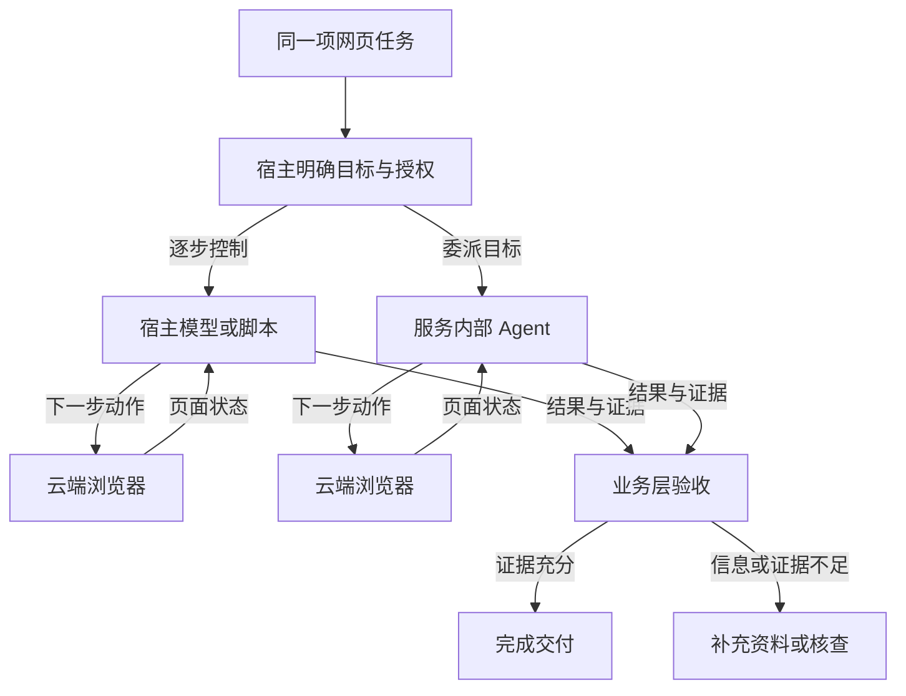

> 知道下一步该做什么，与能够把它做完，是两种不同的能力。

设想这样一项工作：“把这份公司资料填进合作方的申请网站，交给负责人确认，提交后把回执存好。”

如果助手返回一段写得很好的申请文案，它完成了准备工作。但人仍要打开网站、登录账号、辨认字段、上传文件、处理报错，再确认申请到底有没有送达。最费时间的部分，并不总是写那几段话，而是把准备好的内容放进正确的系统，让事情真正往前走。

这就是从“回答问题”到“完成工作”的一道分界：**前者主要生成信息，后者还要在授权范围内改变外部系统的状态，并证明改变已经发生。**

对一位用户来说，这可能只是少点几十次鼠标；对一个每天处理大量申请、订单或后台记录的产品来说，它变成了必须持续供应的执行能力。由此才有了值得研究的问题：这层能力应该由助手自己建设，还是交给专门的服务？服务商卖的是浏览器、智能决策，还是最终结果？

TinyFish 是观察这类分工的一个案例。它同时提供可由外部程序控制的云端浏览器，以及接收目标、自行操作网站的网页 Agent。理解它的起点不是 MCP 接口，而是：**为什么一项工作已经说清楚了，仍需要另一套系统才能完成。**[1][s1] [2][s2]

## 一、既然要操作系统，为什么不直接调用 API？

先问 API 是对的。API 是软件对软件提供的操作接口；如果目标系统已经提供稳定、授权清晰、能返回确定结果的接口，直接调用通常比模拟点击更容易控制。这是工程选择，不是浏览器产品的缺陷。

但开头那个合作方可能只提供网页。它有登录界面、表单和下载按钮，却没有适合当前调用方使用的接口。另一些工作虽然有 API，也可能因权限、覆盖范围或集成成本，暂时无法完全通过接口完成。TinyFish 自己列出的应用范围，就包括没有清晰 API 的工具、登录后的门户，以及必须跨页面推进的任务。[2][s2]

**在这些地方，浏览器不是最理想的接口，却是现成的工作入口。**让软件学会使用它，可以减少“每接入一个系统，就先等待对方改造接口”的依赖。

接着会遇到第二个问题：为什么不写一段自动化脚本？

对于稳定、重复、规则明确的流程，脚本依然合适。需要输入什么、等待什么、成功后应出现什么，都能写清楚；页面改变后，也能定位哪一步失效。Microsoft 的 Playwright MCP 则展示了另一种组合：把结构化网页观察和操作工具交给外层语言模型，让模型决定动作。[3][s3]

当页面路径事先不完全确定时，工作会更复杂：不同账号显示不同入口，上一项选择会改变下一组字段，系统还可能临时要求补充材料。此时，需要的已不只是执行一串动作，而是不断观察页面、判断当前处境、选择下一步。

这解释了三类方案为什么会并存：**有接口时调用接口，路径稳定时使用脚本，需要动态判断时再引入 Agent。**把所有任务都交给自主 Agent，未必更可靠，也未必更经济。

因此，网页 Agent 要证明的价值，不是“能点击按钮”，而是能否在确实需要判断的流程里，减少脚本维护和人工介入，同时保持成本与行为可控。

## 二、ChatGPT 已经能操作网页，第三方还有什么位置？

到这里很容易得出一个过时的解释：“因为 ChatGPT 只能聊天，所以需要 TinyFish 帮它行动。”

事实并非如此。OpenAI 在 2025 年 7 月发布 ChatGPT agent 时，已经公开介绍了视觉浏览器、文本浏览器、终端和直接 API 访问等能力。因此，第三方执行服务不能把“主流助手永远不会操作网页”当作成立前提。[4][s4]

真正需要区分的是两种需求。

一种是**在现成助手里完成一次工作**。用户偶尔填写申请、查询后台，原生能力如果已经满足要求，就未必需要再连接一个付费服务。额外的授权、账户和账单本身也是使用成本。

另一种是**把网页执行纳入自己的产品或业务流程**。例如，一家软件公司需要从业务事件发起任务，分别使用多个客户的授权账号，取得结构化结果，再把结果写回自己的系统。此时它关注的，不只是某个聊天界面里能否完成一次演示，还包括执行如何被调用、管理、观测，以及是否能脱离单一助手入口复用。

TinyFish 的公开接口支持同步、异步和流式调用，产品也面向多个开发框架与模型宿主。它提供的是可以嵌入其他系统的服务，而不只是另一种聊天体验。[5][s5] [6][s6]

**这不是“原生助手一定做不到”，而是两类产品的购买与集成方式不同。**第三方服务是否值得使用，要比较目标任务上的总成本、可靠性、控制能力和集成工作量，不能只比较功能名称。

从这里可以得到一个更准确的判断：ChatGPT 并非天然需要 TinyFish；在用户选择接入、具体任务适合外部执行时，它可以把其中一段工作交给 TinyFish。对服务商而言，主流助手既可能是使用入口，也可能在能力重叠的地方成为替代方案。

## 三、把工作交出去：租一个浏览器，还是委派一个执行者？

回到申请表。同样是“帮我把资料填进去”，服务商可以承担两种不同程度的工作。

**第一种是提供环境。**外层模型或脚本决定每一步，云端浏览器照着执行，返回新的页面状态。TinyFish Browser 属于这一类：它提供托管 Chromium 会话，可以通过 CDP——浏览器调试与控制协议——连接 Playwright 等自动化程序。这里不必由 TinyFish 再安排一个模型负责全部决策。[1][s1]

**第二种是接下目标。**上层说明需要完成什么、哪些资料可以使用、哪些操作不能擅自进行；执行服务自己判断如何导航、填写和处理页面变化。TinyFish Web Agent 属于这一类，官方明确将其与低层浏览器脚本区分。[5][s5]

两者的区别，要看观察结果回到哪里，以及谁据此决定下一步：

*图示比较控制循环与验收责任，不代表 TinyFish 的私有部署结构。*

现在再看 MCP，位置就清楚了。MCP（Model Context Protocol）是一套连接模型宿主与外部工具、数据的协议。它让助手知道服务提供哪些工具、需要哪些参数，以及结果如何返回；**它不规定工具背后只能是一段代码，也不排斥工具背后运行着另一个 Agent。**[7][s7]

连接 TinyFish 后，ChatGPT 可以将网址、目标和必要资料组织成工具调用。TinyFish 的 MCP 文档列出了目标式网页自动化、运行查询与取消等工具，并使用 OAuth 关联账户。此时，上层主要负责理解需求和组织任务，下层负责具体网页决策；并不是 ChatGPT 在逐次遥控所有点击。[6][s6]

这种委派可以让页面细节留在执行服务内部，减少上层反复处理网页状态的需要；代价是多了一道任务交接边界。上层遗漏了限制，下层未必知道；条件写得含糊，下层也可能沿着错误方向工作。减少上层上下文负担，不等于减少了整个系统的全部推理成本。

授权也不能靠自然语言替代。服务端应从验证过的身份确定用户和权限，而不是相信工具参数里任意填写的身份。连接执行服务，与获准操作目标网站，是两个独立的授权问题。[8][s8]

技术补充：TinyFish 自己有没有 AI？浏览器是不是完整计算机？

TinyFish 公开介绍了网页执行模型 Mako，以及在浏览器原生层构建页面语义表示的 WorldModel。这里的 WorldModel 用于理解页面元素、状态与可执行动作，不是物理世界仿真。相关材料可以支持“服务拥有自己的执行决策能力”，不能支持每次运行均使用相同模型版本、具有相同表现等推断。[9][s9] [10][s10]

同样，Browser 也不等于完整 Computer。托管 Chromium 与 CDP 控制，不自动包含终端、任意系统依赖、代码构建或完整虚拟机。需要这些能力时，应另行配置相应执行环境。[1][s1]

## 四、浏览器停下来了，工作就完成了吗？

假设执行器已经识别全部字段，也填完了项目说明，却发现联系人信息缺失，于是返回结果。这次运行可以正常结束，但申请仍未提交。

TinyFish 的 Runs 文档恰好给出了这个边界：`COMPLETED` 表示运行结束、基础设施完成了执行，并不保证目标达成；必须继续检查 `result`。[11][s11]

这不是一个无关紧要的状态名问题。若把“运行完成”直接显示成“申请完成”，用户可能错过截止时间；若超时后直接重试，又可能重复提交已经送达的申请。

因此，一个面向业务的产品需要知道三件不同的事：**执行器是否结束、网站账号是否仍可使用、这项工作是否已经达到验收条件。**登录状态可以保存在浏览器中，业务进度却不能只依附一次临时会话。批准提交、得到回执、归档文件，都是独立于“浏览器运行过”的事实。

TinyFish 的异步接口与 Webhook 能把结果交回调用方；官方也提醒回调可能重送，需要幂等处理。至于谁接收通知、谁补充资料、下一次如何继续，应由业务系统接续，而不是因为接上一个工具就自动具备。[5][s5] [12][s12]

由此也能理解：云端执行让用户不必守着本地电脑，但“随时随地继续同一项工作”还需要任务、权限、审批和交付记录。两者有关，却不是同一种能力。

**执行服务替人做动作，业务产品仍要定义什么算完成。**这个责任边界也会直接影响它如何收费。

## 五、执行成为服务以后，钱为什么流向这里？

用户已经付费使用助手，为什么还可能为一次网页执行付费？

因为付费对象不同。助手提供交互、推理和工具编排；独立执行服务还要承担其模型、浏览器、网络、存储与运行成本。TinyFish 的公开计费说明把 Agent 的内部推理包含在执行价格中，并没有要求使用者为同一次内部推理再单独配置模型账单。[13][s13]

这也不是把用户的 ChatGPT 订阅额度搬到服务商后台。MCP 提供调用关系，不提供任意共享模型额度的权利；OpenAI 同样将 ChatGPT 与 API 计费分开。[7][s7] [14][s14]

### 购买的是不同程度的执行责任

| 服务层次 | 客户购买什么 | 服务商如何组织收费 |
|---|---|---|
| 浏览器基础设施 | 可被程序控制的运行环境 | 按会话时间等资源用量 |
| 网页 Agent | 目标式网页操作与执行决策 | 按内部执行步骤等用量 |
| 企业服务 | 约定容量、部署、安全与支持 | 按合同约定 |

这是对 TinyFish 公开产品与计量方式的归纳，不是其收入结构披露。一次用户请求可能产生许多内部步骤，所以“一次 MCP 调用”不能直接等同于“一个收费单位”。Agent 内部使用浏览器，也不能自动重复加算一笔独立 Browser 费用。[11][s11] [13][s13]

### 免费读取，怎样连接到收费执行？

TinyFish 在 2026 年 5 月的官方文章中宣布 Search 与 Fetch 免费，并覆盖 API、MCP、SDK 和 CLI 等入口。它把读取与执行区分开来：知道要去哪里、读到页面内容是一层；登录、点击、填表并跨页面推进是另一层。[15][s15]

从商业机制推断，免费读取可能帮助开发者先完成接入。此后，如果同一工作流出现需要交互的环节，就有机会使用收费执行能力。这里降低的是切换和集成摩擦，并不意味着免费用户会自然变成付费用户。

偶尔让助手填一次表，与把后台查询接入每天运行的业务系统，带来的用量形态不同。按量模式能否持续，取决于任务是否重复、结果是否有价值，以及客户是否愿意继续把这段工作交给服务商。安装数并不能回答这些问题。

当用量扩大，客户又可能提出容量、安全、部署与支持要求。TinyFish 的企业产品覆盖相关需求，但公开信息不足以说明企业客户实际贡献了多少收入。[16][s16]

**因此，这门生意不是简单“在 ChatGPT 上架一个收费插件”，而是把执行能力独立经营，再让多个入口调用。**MCP 是交付与分发路径之一，不是收入本身。

计价资料说明：为什么本文不把一组单价当成商业结论？

2026-09-30 复核时，同一官方价格页的搜索摘要与打开结果返回了不同口径：摘要显示 Wallet、Agent 每步 $0.016、Browser 每分钟 $0.002；页面打开结果显示 Credits，PAYG 每 Credit $0.015，1 Credit 对应 1 个 Agent 步骤或 4 分钟 Browser，并列出订阅套餐。原研究记录也存在这一差异。[13][s13]

本次不能确定差异来自页面版本、缓存还是适用账户，因此不据此推断调价时间或套餐迁移。两种口径共同支持的结论，是读取与执行产品分开、Agent 和独立 Browser 按用量计量。采购时仍应核对账户、价格版本、计量定义和附加费用。

页面打开结果还列出失败运行免费，但 Runs 文档说明业务目标失败也可能返回 `COMPLETED`。这不足以推导“客户没有验收通过就一律不收费”；故障、取消、部分执行和退款应按适用规则确认。[11][s11] [13][s13]

## 六、最容易看错的地方：能收费，不等于有好生意

TinyFish 的案例值得研究，但不能从“已经有收费模式”直接推导出高利润。浏览器、推理、故障恢复、运行记录和客服都可能产生成本；其具体单位成本、获客成本和实际毛利率并未在上述资料中完整披露。

尤其当一家应用**向上游按尝试付费，向客户按成功结果收费**时，风险会落到自己身上。

做一个纯假设：每次尝试的上游费用为 $0.40，自有可变成本为 $0.10；客户只为验收通过的结果支付 $0.80。执行 1,000 次，总可变成本就是 $500。

| 假设验收成功率 | 收入 | 可变成本 | 剩余贡献 |
|---:|---:|---:|---:|
| 95% | $760 | $500 | $260 |
| 70% | $560 | $500 | $60 |
| 60% | $480 | $500 | −$20 |

这些不是 TinyFish 的价格、成功率或利润数据。算例还未包含固定研发、销售、额外重试和人工接管。在这些假设下，成功率须达到 62.5% 才能覆盖上述可变成本。

看起来“成本 0.40、售价 0.80”，并不意味着实际利润率有 50%。更应该观察的是：**每得到一个客户认可的结果，总共花了多少执行、等待和人工。**

另一类风险来自能力替代。基础浏览器操作已有开源实现，原生助手也在扩展执行能力。独立服务需要在特定工作负载的表现、集成、成本或服务保障上持续证明价值，不能只依赖模型暂时缺少某个工具。[3][s3] [4][s4]

最后，接入规则也不等于交易许可。本次复核的 OpenAI 插件指南允许用户使用已有付费账户中的权益，同时限制在插件中销售数字服务、展示订阅套餐、发起升级或直接连接交易页面。这些规则具有时间边界，但足以说明：**技术上可以调用，与渠道中允许怎样收费，需要分别判断。**[17][s17]

某个产品可以连接，不能证明所有开发者都获得相同的数字充值权限；上述资料也没有提供可用于推算平台抽成、渠道收入占比或特殊商业协议的证据。

## 七、可以借鉴的，不只是“把能力包成 MCP”

从这个案例抽象产品方法，可以得到四个具体启发。它们是基于前文的分析，而不是 TinyFish 已公开验证的经营公式。

**先找反复发生的工作，再选执行技术。**客户要的是申请送达、记录更新、文件归档，不是体验某个协议。先确认任务频率、可用授权、验收方式和预算，再决定使用 API、脚本、浏览器还是自主 Agent。这样能避免用最复杂的执行方式解决最简单的问题。

**把模型当作调用方，但把人和组织当作购买者。**工具描述要让模型知道何时调用、参数怎么填、失败如何处理；账户、合同、隐私、预算和退款则要让人能理解。工具被模型选中只完成了分发，后续成功交付与复用才可能带来收入。准确的工具定义是公开 MCP 机制的一部分，商业转化仍需另行验证。[7][s7]

**把服务价值与聊天入口分开。**如果核心能力可以通过 API、MCP 和其他工作流使用，就不必要求所有客户迁入一个新的聊天界面。但多入口不能只靠多做几个按钮：任务、身份、授权、用量和结果需要在服务端一致管理。渠道规则变化时，已有业务也不应全部依附某个入口。

**把验收、预算和恢复设计进产品，而不是事后补救。**“缺资料”“等待审批”“网站异常”“已经提交但未收到回执”，应该触发不同处理；不能全部重试。限制必须由实际执行系统落实，费用也需要能对应到具体任务。否则，省下的人工操作可能又以排错、返工和费用争议的形式回来。

回到开头那份申请：用户真正购买的，不是几段文案，也不是几十次点击，而是**在合适的授权下，把资料正确送达，并留下可信的完成证据**。

TinyFish 所代表的机会，出现在推理与业务结果之间：一部分团队愿意建设模型和交互，另一部分团队愿意提供可调用的执行能力。两者可以合作，也会在能力重叠处竞争。

**值得学习的不是多卖一个工具，而是把一段原本需要人持续操心的工作，变成边界清楚、成本可控、结果可验的服务。**

来源与证据范围

本文基于原研究报告重写，并于 2026-09-30 复核以下公开一手资料。新增核查补充了 ChatGPT 原生执行能力与第三方服务的关系。开篇工作场景、商业因果分析和成本算例均为解释性构造，不是客户案例或实测结果。产品页说明不等于独立测评；未披露的模型部署、商业合同、营收和利润不作推定。动态文档未注明发布日期时，不以抓取时间代替发布时间。

1. **TinyFish Browser**：托管浏览器、CDP 与调用方控制边界。
2. **TinyFish Web Agent**：登录后、多步骤、非清晰 API 工作流，以及目标委派。
3. **Microsoft Playwright MCP**：结构化网页观察与外层模型驱动的开源实现。
4. **OpenAI，Introducing ChatGPT agent**：2025-07-17，原生浏览器、终端与 API 能力。
5. **TinyFish Agent API**：目标式自动化与同步、异步、流式接口。
6. **TinyFish MCP Integration**：宿主接入、工具、OAuth 和运行管理。
7. **OpenAI，MCP server**：工具发现、参数、服务端执行与返回结果。
8. **OpenAI，Authentication**：用户认证、访问令牌和权限边界。
9. **TinyFish，Building a Browser for the Agent Era**：厂商披露的页面语义表示。
10. **TinyFish Mako**：厂商网页执行模型定位，不作为独立性能结论。
11. **TinyFish Runs**：运行生命周期、步骤与 `COMPLETED` 的限定含义。
12. **TinyFish Webhooks**：异步通知、重送和核验要求。
13. **TinyFish Pricing**：计量、包含项与账户条件；本次读取存在版本差异，已在文内保留。
14. **OpenAI，Managing billing for ChatGPT and the API platform**：两种计费体系独立。
15. **TinyFish，Search and Fetch are now FREE**：2026-05-04，读取免费与多入口接入。
16. **TinyFish Enterprise**：企业容量、部署、安全与服务范围。
17. **OpenAI，Plugin guidelines**：已有权益的使用、商业展示与数字交易限制。

[s1]: https://www.tinyfish.ai/browser
[s2]: https://www.tinyfish.ai/agent
[s3]: https://github.com/microsoft/playwright-mcp
[s4]: https://openai.com/index/introducing-chatgpt-agent/
[s5]: https://docs.tinyfish.ai/agent-api
[s6]: https://docs.tinyfish.ai/mcp-integration
[s7]: https://developers.openai.com/plugins/concepts/mcp-server
[s8]: https://developers.openai.com/plugins/build/auth
[s9]: https://www.tinyfish.ai/blog/building-a-browser-for-the-agent-era
[s10]: https://www.tinyfish.ai/mako
[s11]: https://docs.tinyfish.ai/key-concepts/runs
[s12]: https://docs.tinyfish.ai/webhooks
[s13]: https://www.tinyfish.ai/pricing
[s14]: https://help.openai.com/en/articles/9039756-managing-billing-for-chatgpt-and-the-api-platform
[s15]: https://www.tinyfish.ai/blog/search-and-fetch-are-now-free-for-every-agent-everywhere
[s16]: https://www.tinyfish.ai/enterprise
[s17]: https://developers.openai.com/plugins/app-guidelines
